# FRAMEWORK XÂY SAAS INDIE HACKING
### Đúc kết từ: "How I'd Build a SaaS That PRINTS Money in 2026" — Bgo (codetoceo), 54 phút

---

## 0. LUẬN ĐIỂM GỐC: VẤN ĐỀ KHÔNG PHẢI KỸ NĂNG, MÀ LÀ **THỨ TỰ**

Video mở đầu bằng 3 case study:

| Người | Background | Sản phẩm | Kết quả |
|---|---|---|---|
| **Nurse practitioner** (giấu tên) | **Chưa từng viết 1 dòng code** | HH Notes AI — ghi âm buổi thăm khám → tự điền form OASIS cho home-health | **$35–40K tháng đầu**, 0 đồng quảng cáo, chưa hard-launch |
| **Sandra** | Software engineer, MIT | AI compliance cho home care | Đã có nhiều khách ký dùng |
| **Paul** | Dev kỳ cựu, hàng chục năm | Quản lý nhà cung cấp cho nhà hàng Mỹ | **$100K + equity** để build; **$50K/tháng recurring** từ service |

→ 2 người technical, 1 người hoàn toàn không. Cả 3 đều thành công.
**Vậy mẫu số chung không phải kỹ năng lập trình. Đó là THỨ TỰ làm việc.**

> **"You're not stuck because you can't build. You're stuck because you build FIRST."**
> 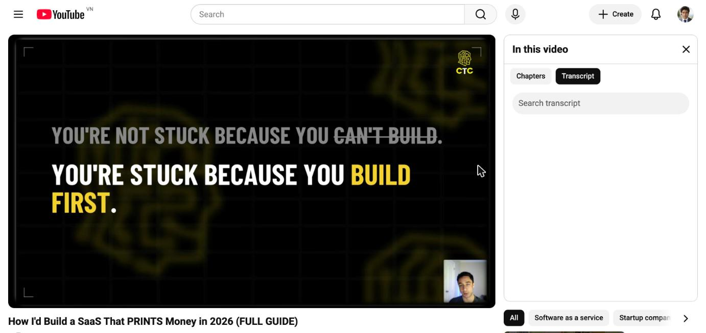

**Vòng lặp chết của dev:** có idea → code 6 tháng → launch → im lặng → nản → có idea mới → lặp lại.
SaaS có tỉ lệ thất bại **>99%**. Không phải vì dev dở, mà vì dev **build trước khi bán**.

**Thứ tự đúng — xương sống của toàn bộ framework:**

```
UNIQUE ADVANTAGE → CONVERSATION → PITCH → DEPOSIT → SOLVE BẰNG TAY
      → LẶP LẠI VỚI KHÁCH #2, #3 → REPEAT LOG → SIGNAL → MỚI BUILD SAAS
```

> **"Software is the RECEIPT for a problem you already sold multiple times."**
> **"You do not build a SaaS. You EARN the right to build one."**

---

## 1. IDEA — TÌM Ý TƯỞNG Ở ĐÂU?

### 1.1. Ngừng "săn ý tưởng". Bắt đầu "gọi tên vấn đề bạn đã sống cùng"

> **Vấn đề bạn cần tìm gần như CHẮC CHẮN không được post online.**
> **Nó được NÓI RA THÀNH LỜI, trong một cuộc trò chuyện với một người thật đang điều hành một doanh nghiệp thật.**

Bgo tự thú: hồi mới bắt đầu chính anh ta cũng lên Reddit, X, google "best SaaS ideas 2026". Vô ích.

### 1.2. UNIQUE ADVANTAGE — 3 vòng tròn

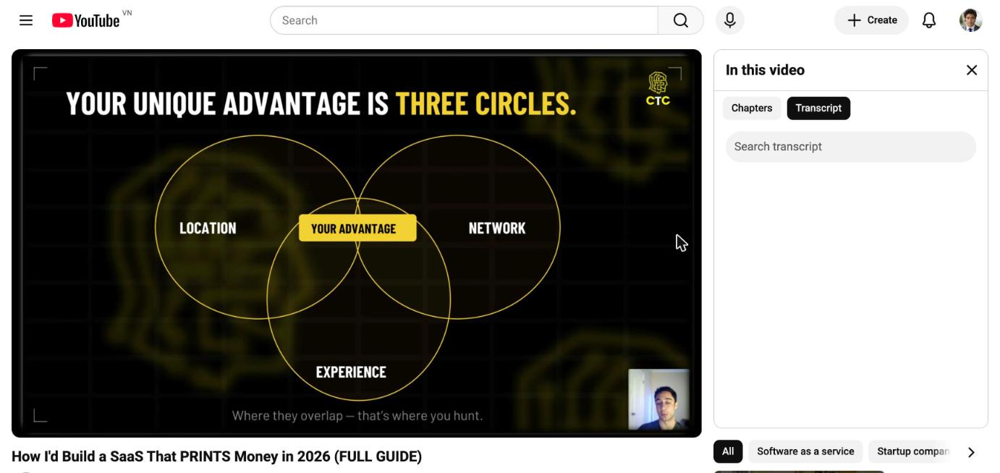

| Vòng | Nội dung cụ thể |
|---|---|
| **LOCATION** (vật lý + số) | Thành phố bạn ở, Chamber of Commerce, chi hội BNI, hội thảo/sự kiện địa phương, các chủ doanh nghiệp trong bán kính bạn tới được |
| **NETWORK** | Bạn bè, đồng nghiệp cũ, người nhà, chủ doanh nghiệp đã có trong danh bạ, chủ doanh nghiệp mà bạn bè giới thiệu được, LinkedIn |
| **EXPERIENCE** | Ngành bạn đã làm, công việc bạn thực sự đã làm, domain knowledge hiếm, cả sở thích / hobby sâu |

**Phần giao nhau = nơi bạn săn vấn đề.**

Lý do: **xác suất 2 người trên đời có cùng location + cùng network + cùng experience là gần như bằng 0.** Trong buổi live, Bgo cho chat gõ ngành mạnh nhất của mình — hàng chục câu trả lời, **không một cái nào trùng nhau**: fitness & dating, edge computing, short-term insurance, automotive, blockchain, applied cryptography, facilities management, logistics, airline ticketing, options trading, serverless, cyber security...

### 1.3. Ba mỏ quặng cụ thể để đào

**a) "Free tech support list"**
Liệt kê tất cả những lần ai đó nhờ vả bạn *chỉ vì bạn là dev*: ông anh họ có nhà hàng muốn website, chú ở nhà thờ, sếp cũ nhờ fix Excel...
→ Đó là **cầu thực tế**, và nó đến với bạn miễn phí.

**b) "Badge industry"**
Ngành bạn đã cắm 10–15 năm. Bạn hiểu jargon, hiểu quy trình, hiểu ai ký duyệt ngân sách. Đây là lợi thế mà 1 dev giỏi hơn bạn *không mua được bằng tiền*.

**c) Con số nền:** riêng Mỹ có **33 triệu SMB**. Năm 2026 phần lớn buộc phải ứng dụng AI, nhưng **gần như không có ai build cho họ**. Với đa số dev, khách hàng ĐẦU TIÊN sẽ là một doanh nghiệp kiểu này — trước khi có bất kỳ SaaS nào.

### 1.4. Câu hỏi ma thuật + "the sigh"

Trong mọi cuộc nói chuyện, hỏi:

> **"If you had a magic wand, what problem would you make go away?"**
> *(Nếu có cây đũa thần, anh/chị muốn xoá bay vấn đề nào?)*

Rồi **im lặng và ghi chép.**

Và luyện nghe **"the sigh"** — tiếng thở dài. Mọi chủ doanh nghiệp đều sẽ than phiền, đôi khi ngụy trang dưới dạng **một câu đùa**.
> Ví dụ kinh điển: 1995 tại hội chợ NAMM, một phụ nữ **đùa** rằng cô muốn có cái hộp giúp cô hát đúng tông. 1997 → **Auto-Tune** ra đời, thống trị ngành nhạc.

### 1.5. Nguyên tắc quy mô

> Bạn **không** cố thay đổi thế giới. Bạn **không** cố thành Jeff Bezos.
> Bạn giải **vấn đề mà chỉ bạn mới ở đúng vị trí để giải** — vấn đề mà chỉ bạn mới *nhìn thấy*, chỉ bạn mới *khai thác được*.

---

## 2. VALIDATE — BÁN TRƯỚC, BUILD SAU

### 2.1. Phân biệt SERVICE vs SAAS (đây là chìa khoá)

|  | **SERVICE** | **SAAS** |
|---|---|---|
| Dòng tiền | **Được trả tiền TRƯỚC khi giải pháp tồn tại** | Phải có sản phẩm rồi mới thu được tiền |
| Rủi ro | Khách chịu | Bạn chịu |
| Vốn | Tiền cọc của khách | Tiền tiết kiệm của bạn |

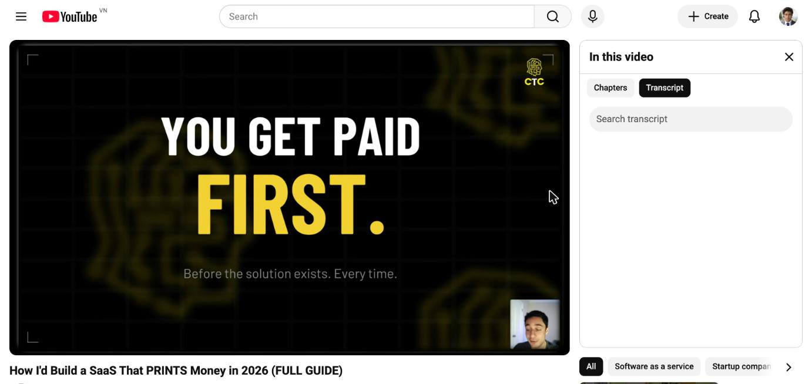

### 2.2. Chuỗi hành động không bao giờ thay đổi

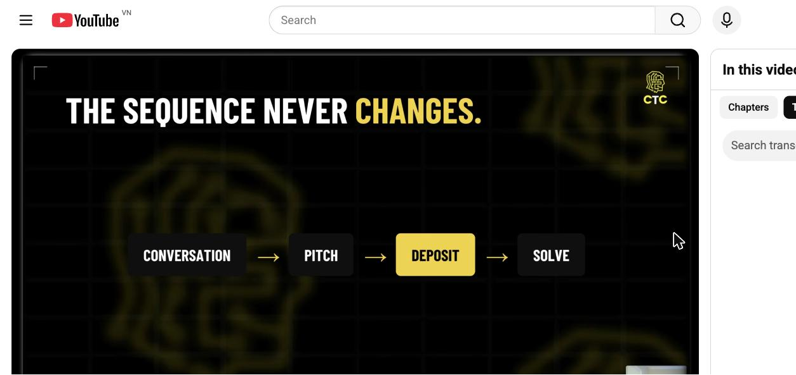

```
CONVERSATION → PITCH → DEPOSIT → SOLVE
```
**Việc build chỉ bắt đầu SAU khi tiền đã về tài khoản.**

### 2.3. Pitch gồm đúng 3 thứ

1. **What you saw** — bạn đã quan sát thấy gì trong quy trình của họ
2. **What it costs them** — nó đang ngốn của họ bao nhiêu (giờ / tiền / khách mất)
3. **What you'll do first** — bước đầu tiên bạn sẽ làm

### 2.4. THE INVOICE TEST — luật ngôn ngữ

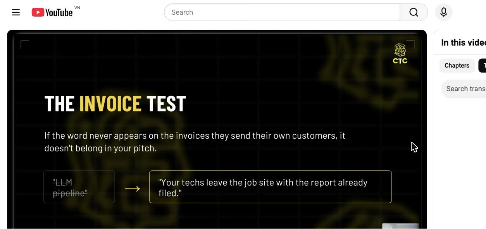

> **Nếu một từ không bao giờ xuất hiện trên hoá đơn mà họ gửi cho KHÁCH CỦA HỌ, từ đó không được có mặt trong pitch của bạn.**

| ❌ Đơn vị của bạn | ✅ Đơn vị của họ |
|---|---|
| API, pipeline, model, integration, agent, LLM, RAG, vector DB | visits, claims, no-shows, intakes, giờ overtime, khách tiềm năng bị mất, doanh thu bị mất |
| *"Tôi sẽ dựng LLM pipeline"* | *"Kỹ thuật viên của anh rời công trường là báo cáo đã nộp xong."* |

### 2.5. Tại sao người ta trả tiền cho thứ chưa tồn tại?

> **Họ không trả tiền cho CODE. Họ mua OUTCOME.**

Câu hỏi mà mọi dev đều tự vấn — *"Tôi không có case study, không có testimonial, có cả đống đối thủ giỏi hơn, sao ai lại trả tiền cho tôi?"* — sai từ tiền đề. Họ **không quan tâm** bạn code giỏi hay dở. Họ mua kết quả bạn cam kết.

Thêm 2 lý do bắt buộc phải thu tiền trước:
- **Làm free chỉ hút người chất lượng thấp.** Tiền là bộ lọc tách "khách du lịch" khỏi người thật sự nghiêm túc.
- **Khách đã trả tiền trả lời câu hỏi spec nhanh gấp nhiều lần** khách chưa trả đồng nào.

### 2.6. Câu chữ chính xác để đòi tiền

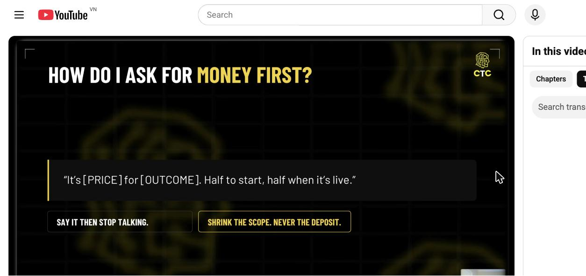

> **"It's [PRICE] for [OUTCOME]. Half to start, half when it's live."**
> *"[Giá] cho [kết quả]. Một nửa để bắt đầu, một nửa khi chạy được."*

Rồi **NGỪNG NÓI**. (Say it then stop talking.)

**Luật đàm phán — không thương lượng:**
- ❌ Không bao giờ nhận thanh toán sau khi build xong
- ❌ Không bao giờ giảm giá
- ✅ Muốn rẻ hơn → **THU HẸP SCOPE, không hạ giá** (*shrink the scope, never the deposit*)
- ✅ Tệ nhất: 50/50, hoặc chia theo milestone
- ✅ Nếu họ khăng khăng trả sau khi xong → **nói KHÔNG**

> **Không có cọc → không build.** (Ngoại lệ tồn tại, nhưng dưới 1% trường hợp.)

**Vì sao tiền quan trọng đến thế:**
> Money = validation = **specification sheet** = **requirements document**.

**Case:** *Ian* bán cho bạn của một đồng nghiệp cũ, gặp mặt trực tiếp. **$10,000** (5K trước, 5K sau). Không portfolio, không case study, chưa từng làm bao giờ. Người kia đồng ý vì **đang mua một outcome**.

---

## 3. BUILD V1 — PHIÊN BẢN ĐẦU PHẢI LÀM BẠN THẤY NHỤC

### 3.1. THE TWO-SOLUTION TEST

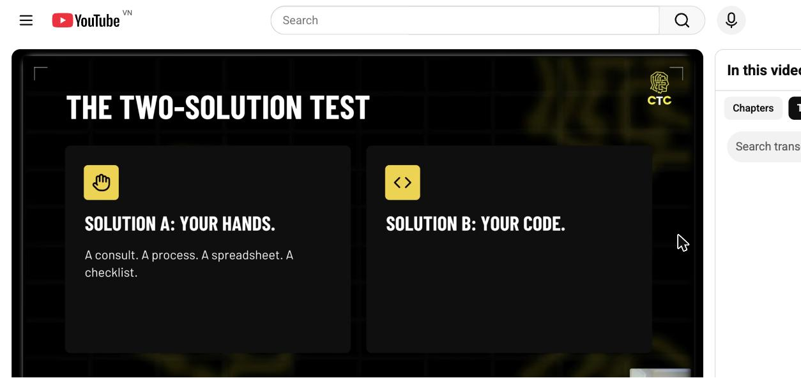

| **Solution A: BÀN TAY** | **Solution B: CODE** |
|---|---|
| Buổi tư vấn, một quy trình, một spreadsheet, một checklist, một workshop, một bản build one-off, một custom implementation | Phần mềm |

> **Nếu bạn không gọi tên được A, bạn CHƯA sẵn sàng cho B.**
> **"If the only fix you can think of is software, you do not understand the problem well enough."**

**Giải pháp đơn giản nhất KHÔNG BAO GIỜ là một SaaS.**

Nurse practitioner đã làm **thủ công** việc điền OASIS form + kiểm compliance cho các home-health agency qua dịch vụ tư vấn — **trước** khi nó thành phần mềm.

### 3.2. Thang hiệu quả — con số minh hoạ trong video

```
Bài toán gốc (khách tự làm):     3 giờ
→ Consult thủ công (Solution A):  45 phút   ← đã đủ để bán, đủ để thu tiền
→ Software (Solution B):           3 phút   ← chỉ đến sau, khi đã validate
```
45 phút vẫn tốt hơn 3 giờ **rất nhiều**. Bạn đã tạo giá trị thật, đã được trả tiền thật, và đã **hiểu bài toán tới xương** trước khi viết dòng code đầu tiên.

### 3.3. Đặc điểm bắt buộc của Solution A

- Làm **một mình** — không cần team, không cần funding, không cần xin phép ai
- Là **hình thức đơn giản nhất** của giải pháp
- Bán **outcome**, không bán phần mềm

> Software không phải "đẳng cấp cao hơn" service. Software chỉ là **hình thái cuối cùng của đòn bẩy** (final form of leverage).

---

## 4. KHI NÀO ĐƯỢC PHÉP BUILD SAAS? — REPEAT → VALIDATE → BUILD

### 4.1. Từ khách #1 đến khách #2

Cánh cửa nào mang lại khách #1 (network / chamber of commerce / badge industry) thì **dùng lại chính cánh cửa đó** cho khách #2. Cùng một message, chỉ đổi tên người nhận.

### 4.2. REFERRAL — đòn bẩy bị bỏ phí nhất

> **91% khách hàng sẵn sàng giới thiệu bạn cho người khác. Chỉ 11% từng được hỏi.**
> Referral **không tốn một xu**. Một referral tốt > 100 cold message.

**Script xin referral (nguyên văn):**
> *"Who's one other person you know that's dealing with [X problem]? Just do an intro from you and I'll take care of them."*
> *"Anh/chị còn biết ai đang gặp đúng vấn đề [X] không? Chỉ cần anh giới thiệu giúp em một câu, phần còn lại em lo."*

### 4.3. THE REPEAT LOG — công cụ trung tâm

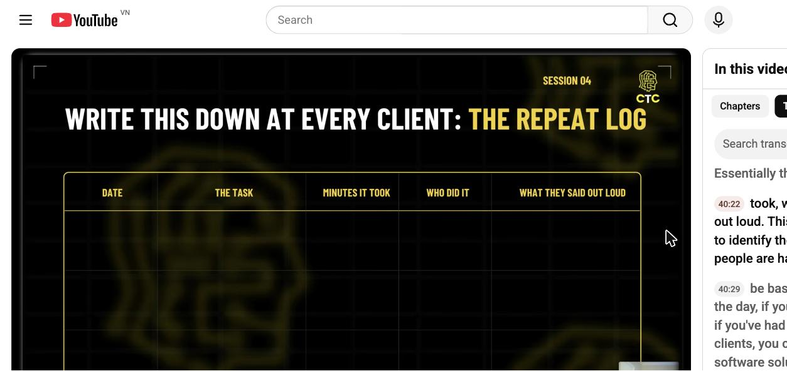

Ghi lại ở **mọi khách hàng**:

| DATE | THE TASK | MINUTES IT TOOK | WHO DID IT | WHAT THEY SAID OUT LOUD |
|---|---|---|---|---|
| | Việc gì | Mất bao nhiêu phút | Ai làm | **Họ đã nói nguyên văn gì** |

Cột cuối cùng là cột quan trọng nhất — nó chính là **copywriting cho landing page SaaS sau này**, và là bằng chứng cho thấy nhiều người đang gặp **cùng một** vấn đề.

### 4.4. TÍN HIỆU ĐƯỢC PHÉP BUILD

> **Nhiều BUYER KHÁC NHAU trả tiền cho CÙNG MỘT giải pháp.**
> ⚠️ Không phải cùng 1 khách trả 2 lần. Phải là **khách mới, cùng giải pháp**.

**Cách nhận ra bằng code:** khi bạn build cho 3 người cùng một vấn đề, bạn sẽ thấy **80% codebase giống hệt nhau**, chỉ 20% là custom (nối API riêng, khớp workflow riêng).
→ Lúc đó **nó không còn là custom work nữa. Nó là một SaaS đang đội lốt.**

Và: vấn đề lặp lại → **recurring problem = recurring revenue**.

> **SaaS thực chất chỉ là một "ANSWER KEY"** — đáp án bạn đã giải bằng tay nhiều lần, giờ in ra được hàng trăm nghìn bản.

### 4.5. Bảng đối chiếu quyết định

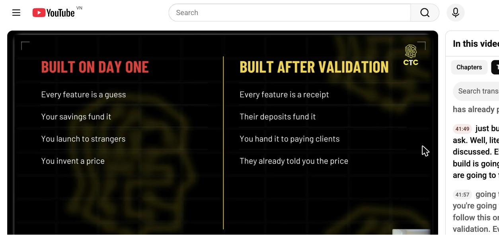

| **BUILT ON DAY ONE** ❌ | **BUILT AFTER VALIDATION** ✅ |
|---|---|
| Mỗi feature là một phỏng đoán | Mỗi feature là một **hoá đơn đã thu** |
| Tiền tiết kiệm của bạn nuôi nó | **Tiền cọc của khách** nuôi nó |
| Bạn launch cho người lạ | Bạn giao cho **khách đang trả tiền** |
| Bạn tự bịa ra giá | **Họ đã nói cho bạn biết giá** |

---

## 5. MARKETING & PHÂN PHỐI — CHỖ KHÁC BIỆT LỚN NHẤT

### 5.1. Bạn không cần launch. Bạn không cần ads.

> **Khách service của bạn CHÍNH LÀ kênh phân phối.**

- Launch cho người lạ → **churn trong ~2 tuần**, và bạn phải đoán giá.
- Upgrade khách sẵn có → họ đã dùng giải pháp nhiều tháng, đã quen, và **đã tự nói cho bạn biết mức giá**.

### 5.2. Script chuyển đổi Service → SaaS (nguyên văn của nurse)

> *"Tất cả những gì em vẫn làm thủ công cho anh, giờ đã có phần mềm. Anh vẫn trả đúng **$1,500/tháng** như cũ, vẫn nhận X, Y, Z như cũ — **nhưng giờ có thêm** tính năng A, B, C, D, E."*

→ Với khách, đây là **offer TỐT HƠN** (cùng giá, nhiều giá trị hơn).
→ Với bạn: **cùng doanh thu, không còn tốn giờ công, biên lợi nhuận nhảy vọt.**

Sandra làm y hệt: *"Mình có thể biến cái này thành phần mềm hoàn chỉnh, chỉ cần X, Y, Z."* → tất cả khách đều đồng ý.

### 5.3. Custom work không chết — nó thành ONBOARDING FEE

Mô hình **ServiceNow**:
```
80% giống nhau ở mọi khách  →  SaaS (giá cố định, subscription)
20% riêng của từng khách    →  Onboarding / Integration (tính phí riêng, high-ticket)
```

### 5.4. Thứ tự scale (ads đứng CUỐI, không phải đầu)

```
Khách service → Referral → Sở hữu cả một vertical
   → Trở thành "the industry person" cho vấn đề đó
      → CHỈ KHI ĐÓ mới đến ads & marketing đại trà
```

### 5.5. Định giá

> **Định giá phần mềm dựa trên SERVICE bạn đã bán, không dựa trên thị trường.**
> Vì bạn đã biết chính xác nó đáng giá bao nhiêu — có người đã trả đúng số đó.

### 5.6. Tiền lệ: mọi công ty tỷ đô đều đi đường này

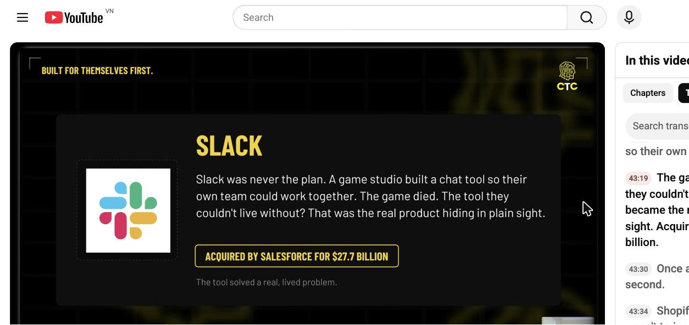

| Công ty | Service đầu tiên | Kết quả |
|---|---|---|
| **Mailchimp** | Agency thiết kế web ở Atlanta; khách SMB cần newsletter → chắp vá tool nội bộ | Bán cho Intuit **$12 tỷ** — **không nhận 1 đồng VC** |
| **Basecamp (37signals)** | Công ty tư vấn thiết kế web; build tool để quản lý dự án của chính mình → khách hỏi *"cho bọn tôi dùng với được không?"* | Vượt doanh thu agency **trong 18 tháng** |
| **Slack** | Studio game build chat tool cho đội mình. Game chết, tool sống. | Salesforce mua **$27,7 tỷ** |
| **Shopify** | Tobi chỉ muốn bán ván trượt tuyết online; phần mềm store quá tệ nên tự viết → chủ shop khác xin dùng | Công ty tỷ đô |
| **FreshBooks** | Agency 4 người; lỡ tay ghi đè một invoice cũ, bực quá tự viết công cụ bill khách | **>30 triệu người dùng** |

> **"Nobody skipped the work. The software is what the work LEFT BEHIND."**

---

## 6. BA ĐÒN BẨY KHI SAAS ĐÃ LIVE

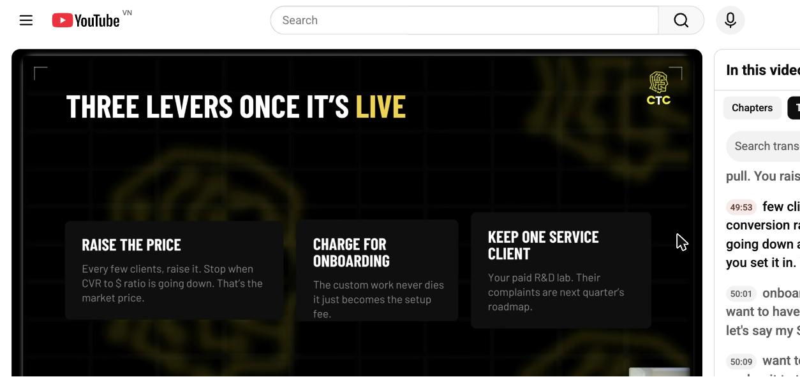

| Lever | Cách làm |
|---|---|
| **1. RAISE THE PRICE** | Cứ vài khách lại tăng giá. **Dừng khi tỷ lệ conversion/doanh thu bắt đầu đi xuống** — đó chính là giá thị trường thật. |
| **2. CHARGE FOR ONBOARDING** | Custom work không chết, nó thành setup fee. Cần một **gói high-ticket để neo giá**. VD: SaaS $1,000/tháng + gói có custom work để anchor. |
| **3. KEEP ONE SERVICE CLIENT** | Giữ **ít nhất 1 khách service** — họ là **phòng R&D được trả tiền** của bạn. Lời phàn nàn của họ = roadmap quý sau. |

---

## 7. TIMELINE & CON SỐ THẬT

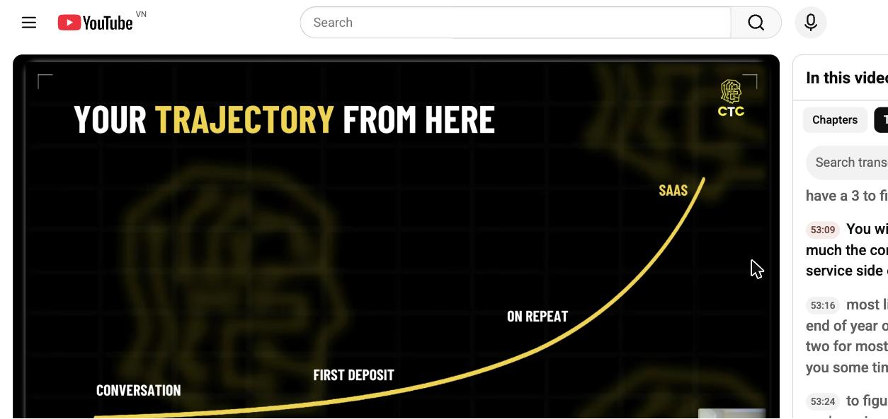

### 7.1. Lộ trình

```
CONVERSATION → FIRST DEPOSIT → ON REPEAT → SAAS
```

| Mốc | Thời gian | Bạn đang làm gì |
|---|---|---|
| **Năm 1** | 0–12 tháng | Conversations, deposits, service. **Chưa động vào SaaS.** |
| **Cuối Y1 / đầu Y2** | ~10–15 tháng | SaaS bắt đầu hình thành (đủ repeat log, đủ signal) |
| **Financial freedom** | **1–3 năm** | Từ **SERVICE**, chưa cần SaaS |
| **SaaS + Exit** | **3–5 năm** | Đủ để "không bao giờ phải lo về tiền nữa" |

> **Quan trọng:** bạn **không bị nghèo trong lúc chờ**. Service trả hoá đơn suốt quãng đường. Paul vẫn thu **$50K/tháng recurring từ service** trong khi đang build SaaS.

### 7.2. Thời gian thật của từng case

| Người | Thời gian ở trong ngành trước khi hiểu vấn đề | Thời gian chuyển Service → SaaS |
|---|---|---|
| **Nurse** | Chạy công ty tư vấn **2 năm** | **8 tháng** |
| **Sandra** | Làm trong ngành home care "một thời gian kha khá" | **~1 năm** |
| **Paul** | Nhanh nhất | **hơi dưới 1 năm** |

### 7.3. Toàn bộ con số được nêu trong video

**Kết quả sản phẩm**
- Nurse (HH Notes AI): **$35–40K trong tháng đầu**, check $10,000, số dư tài khoản $25,590. **0 đồng ads, 0 marketing.** Rút gọn quy trình **2–3 giờ → 2–3 phút**
- Paul: **$100K + equity** để build SaaS; **$50K/tháng recurring** từ service
- Sandra: nhiều khách đã ký; đi ra từ agency home-health

**Deal size của cộng đồng codetoceo**
- Benoa (Canada): **$30K CAD** → gia hạn **+$30K** → **4 referral nóng** → quỹ đầu tư của tỉnh chủ động liên hệ. Tổng deal đã chốt: **$325K CAD**
- Scott (Mỹ): **$149K** project fee + được trả tiền để build SaaS + equity
- "The mirror": **$50K** engagement, đang đàm phán productize cho **Home Depot**
- Ian: **$10K** (5K/5K) — deal đầu tiên, không case study
- Masa (Nhật, tiếng Anh không phải tiếng mẹ đẻ): **>$15K/tháng** đều đặn
- Chris: **>$20K** pipeline
- Marco: nghỉ việc, **6 con số + equity**
- John: nghỉ việc, **offer mua lại $4.5 triệu**
- Dom (Sydney), một founder ở Bangalore: cùng mô hình

**Con số thị trường / hành vi**
- Tỉ lệ thất bại của SaaS: **>99%**
- SMB tại Mỹ: **33 triệu**
- Referral: **91%** khách sẵn sàng giới thiệu — chỉ **11%** từng được hỏi
- Giá service điển hình trong case: **$1,500/tháng**
- Tỉ lệ code: **80% dùng lại được / 20% custom** sau 3 khách cùng vấn đề
- Bản thân Bgo: từng là manager lương **$250K/năm**, nghỉ việc sau khi ChatGPT ra mắt (30/11/2022)

---

## 8. 3 VIỆC PHẢI LÀM TRONG TUẦN NÀY

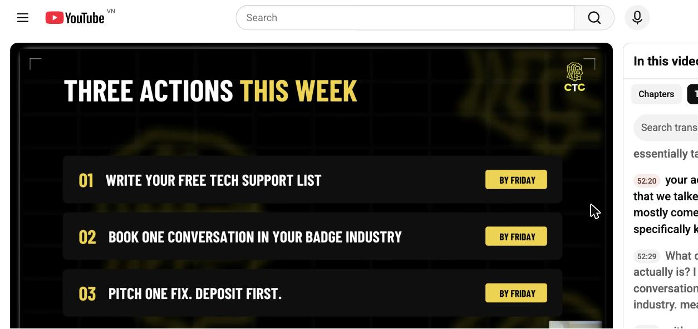

| # | Hành động | Deadline |
|---|---|---|
| **01** | **Viết "free tech support list"** — ai hay nhờ bạn vì bạn là dev? Bạn biết gì mà người khác không biết? Badge industry của bạn là gì? | Thứ Sáu |
| **02** | **Đặt lịch MỘT cuộc trò chuyện** với một chủ doanh nghiệp trong badge industry của bạn | Thứ Sáu |
| **03** | **Pitch MỘT fix** (không phải SaaS — chỉ một buổi tư vấn / một quy trình / một fix) và **nhận tiền cọc** | Thứ Sáu |

---

## 9. TỔNG KẾT MỘT TRANG

```
❌ SAI:  Idea → Build 6 tháng → Launch → Im lặng → Bỏ → Idea mới
✅ ĐÚNG: Unique Advantage → Conversation → Pitch (đơn vị của họ)
         → DEPOSIT → Giải bằng tay (Solution A)
         → Khách #2, #3 (referral) → Repeat Log
         → Nhiều buyer / cùng solution = SIGNAL
         → BUILD SAAS → Upgrade khách cũ → Own the vertical → MỚI chạy ads
```

**5 câu cần thuộc lòng:**
1. *You're not stuck because you can't build — you're stuck because you build first.*
2. *If the only fix you can think of is software, you don't understand the problem well enough.*
3. *They're not paying for your code. They're paying for the outcome.*
4. *Shrink the scope, never the deposit.*
5. *You don't build a SaaS. You EARN the right to build one.*
