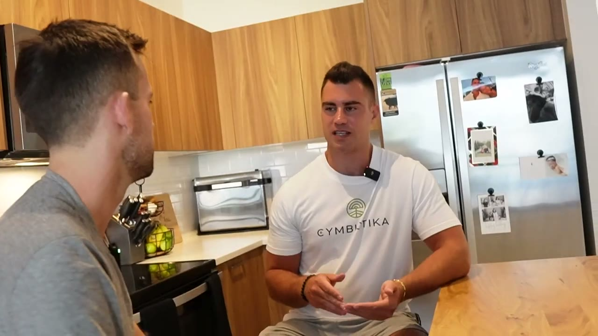
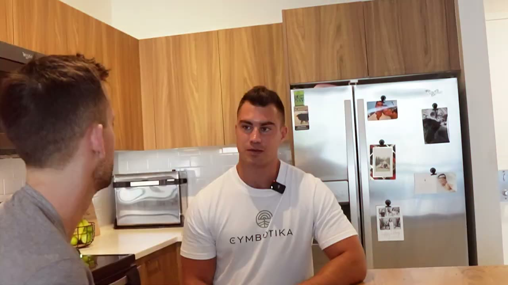
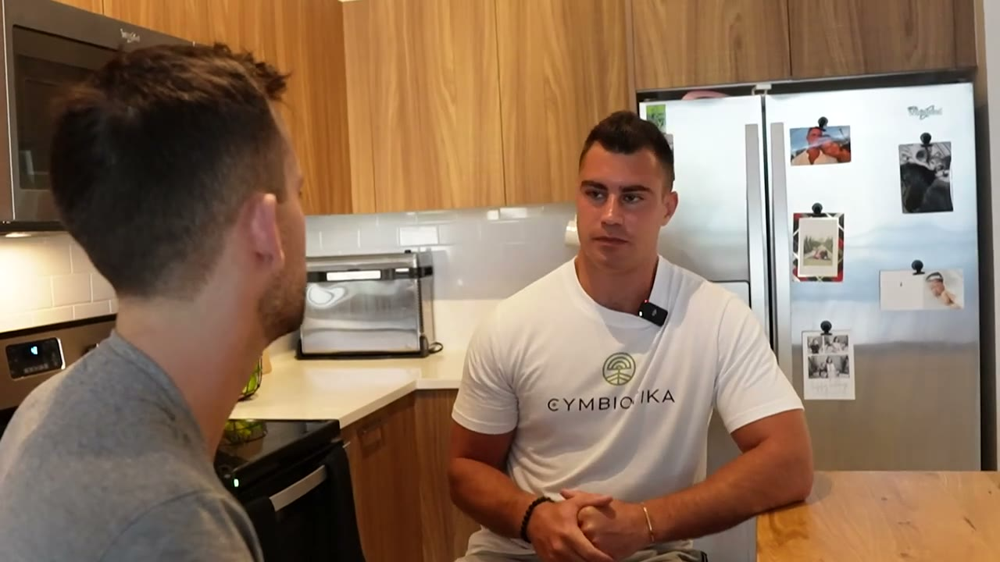
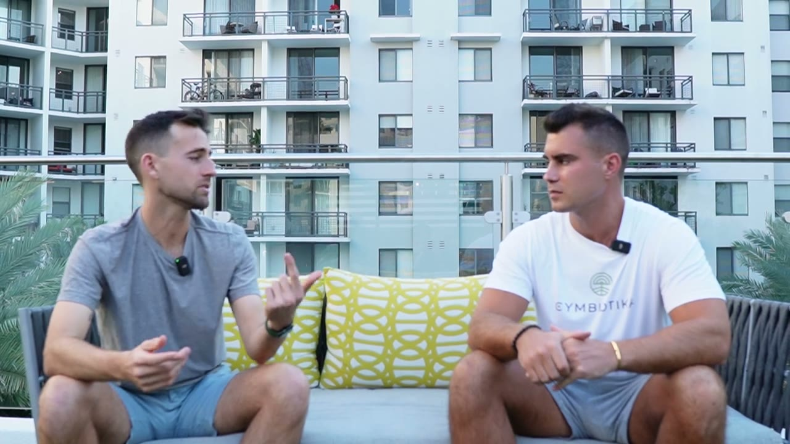
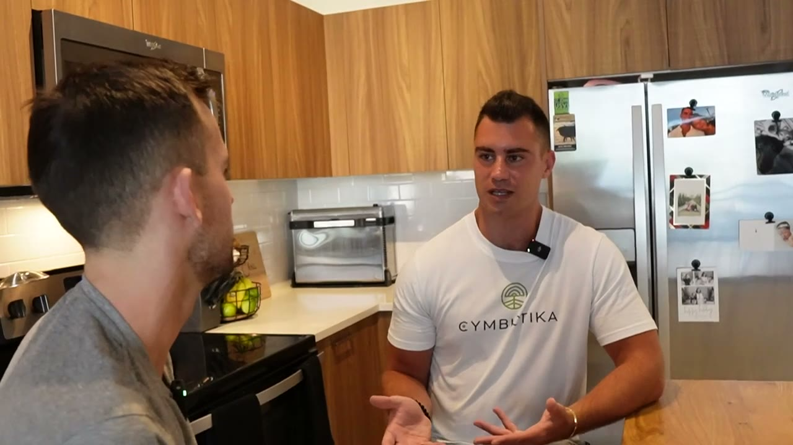
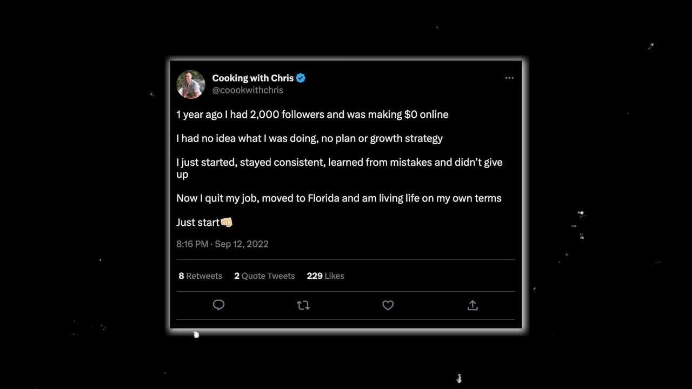
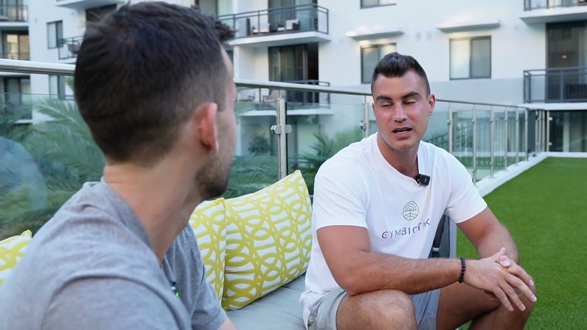
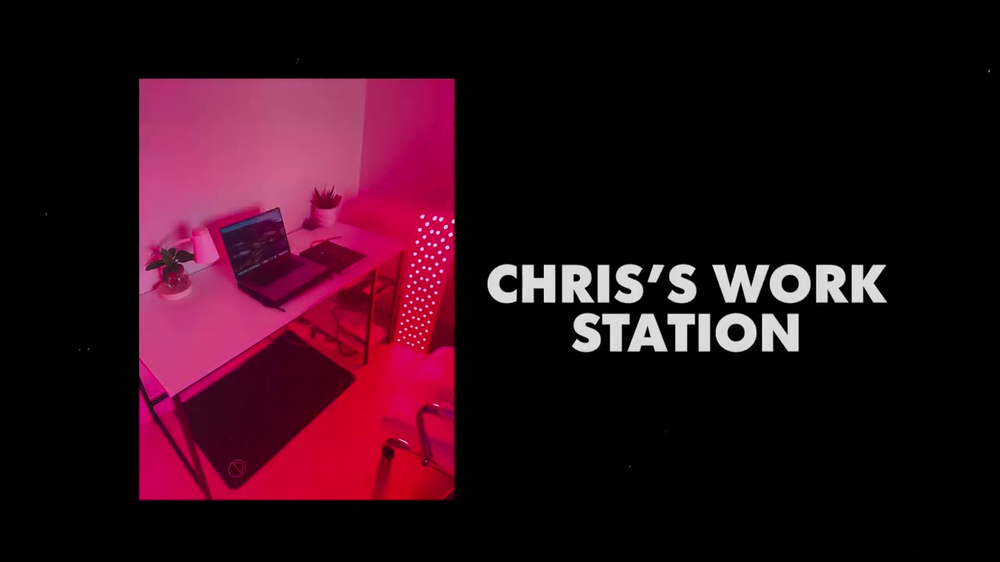

# Chris — $20-30K/tháng với chi phí vận hành $8/tháng

> **Tóm tắt 30 giây:** Chris đang làm ở một trung tâm wellness với lương **$17/giờ** thì điện thoại báo một đơn hàng **$450** — số tiền anh phải làm 26 giờ mới kiếm được. Anh nghỉ việc khi doanh thu đạt $5-8K/tháng và giờ làm $20-30K/tháng. Toàn bộ khách đến từ **Twitter organic**, không một đồng quảng cáo, và chi phí vận hành cả doanh nghiệp là **$8/tháng tiền Twitter Blue**. Cơ chế đắt nhất của case này ít người nhìn ra: **bữa tối anh nấu để ăn cũng chính là nội dung marketing, và công thức nấu bữa đó cũng chính là sản phẩm anh bán.** Chi phí sản xuất nội dung bằng 0 vì sản xuất chính là tiêu dùng.

## ⚠️ Cảnh báo trước khi đọc

1. **Video từ 3/2023 và rất ngắn (8 phút 57 giây).** Đây là case ngắn nhất và ít số liệu nhất trong ba case 2023. Không có breakdown kinh doanh sâu — phần lớn video là Chris nấu tôm và nói về đam mê.
2. **Kênh phân phối duy nhất là Twitter organic — và Twitter năm 2023 khác X năm 2026 rất nhiều.** Xem mục 7.
3. **Không có bất kỳ ảnh dashboard nào.** Toàn bộ con số là tự khai, dạng khoảng. Con số duy nhất có bối cảnh cụ thể là thông báo đơn $450 và mức lương cũ $17/giờ.
4. Không nêu tên thương hiệu, không nêu Twitter handle. Transcript chỉ có tên "Chris".

## 1. Con số

| Chỉ số | Giá trị |
|---|---|
| Doanh thu hiện tại | **$20.000-30.000/tháng** (Chris tự nói dạng khoảng; tiêu đề lấy mốc $30K) |
| Doanh thu lúc nghỉ việc | $5.000-8.000/tháng |
| **Chi phí vận hành** | **$8/tháng** (Twitter Blue) |
| Lương công việc cũ | $17/giờ |
| Đơn hàng làm anh đổi ý | $450 (≈ 26 giờ làm thuê) |
| Thời gian side hustle | ~1 năm tweet; ~6 tháng business chạy song song công việc |
| Kênh marketing | Twitter organic — **100%**, $0 quảng cáo |
| Đội ngũ | 1 người |
| Giờ gọi khách mỗi ngày | 2-5 giờ |
| Tuổi | 29 |

**Mâu thuẫn đã ghi rõ trong frontmatter:** tiêu đề video nói $30K/tháng, Chris nói "$20.000 đến $30.000". Tôi chọn mốc sàn $20K cho trường `revenue_usd_month` vì đây là con số tự khai không có bằng chứng, và nguyên tắc là không lấy mốc trần của một khoảng do chính người bán tự nêu.

## 2. Cơ chế đắt nhất — sản xuất nội dung chính là tiêu dùng ⭐⭐⭐

Phần này Chris nói lướt qua trong đoạn mô tả lịch làm việc, nhưng nó là **cơ chế cốt lõi** khiến doanh nghiệp này chạy được với chi phí $8/tháng.

Lịch một ngày của anh:

| Thời gian | Việc |
|---|---|
| Sáng | Routine, ăn sáng |
| Sáng-trưa | Vài tiếng trên máy tính — soạn meal plan, làm nội dung Twitter |
| Trưa | Tập gym |
| Chiều | **2-5 tiếng gọi điện với khách** |
| Tối | **Nấu bữa tối → chụp → đăng Twitter → bán được cookbook** |

Và đây là câu chốt:

> *"Rồi thường thì tôi nấu một món gì đó cho bữa tối và **chia sẻ nó trên Twitter, và cái đó giúp tôi bán cookbook** và mấy thứ khác."*

**Vì sao đây là cơ chế mạnh (và hầu như không ai nói ra):**

Với đa số creator, sản xuất nội dung là **chi phí thuần** — thời gian và tiền bỏ ra để có được sự chú ý, sau đó mới bán được thứ khác. Với Chris, ba việc **chồng khít lên nhau**:

1. **Anh phải ăn tối** (nhu cầu sinh học, không tránh được)
2. **Anh chụp bữa tối đó** (chi phí biên ≈ 30 giây)
3. **Công thức của chính bữa đó là sản phẩm anh bán** (cookbook)

Chi phí biên để tạo một đơn vị nội dung của anh gần bằng **0**, vì hoạt động sản xuất nội dung trùng với một hoạt động anh đã làm bất kể có kinh doanh hay không. Anh nói đúng ý này ở chỗ khác:

> *"Tôi trả khá nhiều tiền cho thực phẩm, để nấu bằng nguyên liệu chất lượng cao. Nhưng **tôi chắc cũng sẽ làm vậy dù có kiếm sống bằng nghề này hay không**."*

Và một lần nữa:

> *"Tôi sẽ làm việc này dù có được trả tiền hay không, vì đây là thứ tôi yêu thích. **Vậy thì tại sao không được trả tiền luôn?**"*

> **Bài kiểm tra để bạn tự áp dụng:** *"Có hoạt động nào tôi đã làm mỗi ngày, không thể bỏ, mà nếu tôi ghi lại nó thì thành nội dung, và nếu tôi đóng gói nó thì thành sản phẩm?"* Nếu bạn tìm được câu trả lời, bạn có một doanh nghiệp chi phí gần 0. Nếu không, bạn sẽ phải trả giá bằng thời gian hoặc tiền quảng cáo cho mỗi đơn vị chú ý — như hầu hết các case khác trong kho này.

Đối chiếu: [BulkMockup](../2026-02-11_how-i-built-a-12k-month-micro-saas/case.md) và [Blog to Pin](../2026-02-05_i-make-16k-month-even-in-a-tiny-niche/case.md) chạy content flywheel nhưng nội dung của họ là chi phí thuần — họ phải viết bài SEO. Chris thì không viết gì thêm, anh chỉ chụp bữa tối.

## 3. Bốn tầng sản phẩm — thang giá trị hoàn chỉnh ⭐⭐⭐

Chris có bốn dòng sản phẩm và chúng xếp thành một **value ladder** rất kinh điển:

| Tầng | Sản phẩm | Đặc điểm | Thời gian của anh |
|---|---|---|---|
| 1 | **Cookbook "essential recipes"** | Sản phẩm số, làm một lần bán mãi | 0 (sau khi làm xong) |
| 1b | **Cookbook tiết kiệm** — dùng phần thịt rẻ tiền | Cùng nội dung, **ICP khác**: người eo hẹp tiền | 0 |
| 2 | **Meal plan cá nhân hoá** | Bán chuẩn hoá, giao tuỳ biến | Trung bình |
| 3 | **Coaching dinh dưỡng 1-1** | Vé cao nhất | Cao — chính là 2-5 tiếng gọi/ngày |
| 3b | **Group coaching** | Giải nút thắt thời gian ở tầng 3 | Chia được cho nhiều khách |

**Ba điểm thiết kế đáng học:**

**(a) Cookbook thứ hai không phải sản phẩm mới — nó là cùng chuyên môn, khách khác.** Chris mô tả nó là *"budget cookbook, chỉ là mấy phần thịt rẻ hơn và những thứ tương tự."* Anh không phải học kỹ năng mới; anh chỉ đóng gói lại cho một phân khúc có ngân sách khác. Đây là cách rẻ nhất để tăng dòng sản phẩm.

**(b) Meal plan là "customization có kiểm soát".** Nghe qua giống dịch vụ nhưng thực chất là một quy trình chuẩn hoá:

> *"Người ta đến với tôi với các mục tiêu khác nhau, các vấn đề khác nhau, lịch trình khác nhau, và tôi may đo một meal plan cho họ. Nếu ai đó rất bận, hoặc đi công tác nhiều, hoặc không ăn được vài loại thực phẩm, tôi sẽ điều chỉnh cho họ và tôi cho họ cả công thức luôn."*

Anh **tái sử dụng cùng kho công thức** cho mọi khách — đó là lý do việc này scale được. Sản phẩm có vẻ cá nhân hoá nhưng nguyên liệu bên trong là tài sản dùng chung.

**(c) Group coaching xuất hiện chính xác ở chỗ nó phải xuất hiện.** Coaching 1-1 chính là 2-5 tiếng gọi/ngày của anh. Ở $20-30K/tháng, anh đang chạm trần thời gian. Group coaching là cách duy nhất để tăng doanh thu mà không tăng giờ.

> **Nhìn thẳng vào bản chất:** ở $20-30K/tháng nhưng dành 2-5 tiếng/ngày trên điện thoại, Chris **chưa** phải một doanh nghiệp — anh là một freelancer được trả rất tốt, có một cỗ máy marketing miễn phí. Doanh thu dừng ngay ngày anh dừng gọi điện. Đây là điểm khác biệt căn bản với các case micro-SaaS trong kho, và bạn cần thấy rõ trước khi chọn con đường này.

## 4. Nguyên tắc định giá — "giải một vấn đề đắt tiền" ⭐⭐

Câu hay nhất của video:

> *"**Nếu bạn giải một vấn đề đắt tiền, bạn sẽ được trả rất nhiều tiền để giải nó.** Sức khoẻ của con người rất quan trọng. Và nếu bạn có thể thay đổi cuộc đời ai đó vĩnh viễn chỉ trong hai, ba tháng làm việc với họ, thì nó đáng giá rất nhiều tiền. Và tôi nghĩ điều đó đúng với mọi thứ, không chỉ sức khoẻ."*

**Cơ chế:** giá không neo vào chi phí sản xuất của bạn (một meal plan mất anh 30 phút), cũng không neo vào thời gian (như [Scott Millard](../2023-03-27_he-built-a-600-000-one-person-business-with-video-ed/case.md) chỉ ra). Nó neo vào **quy mô hậu quả của vấn đề chưa giải quyết** đối với khách.

Đây là **cùng nguyên tắc** mà Scott dùng để lọc ICP ("chọn công ty có tiền") — nhưng Chris nêu ở dạng vấn đề, Scott nêu ở dạng túi tiền. Ghép hai lại thành một bộ lọc ý tưởng đầy đủ:

> **Bộ lọc ý tưởng ghép từ hai case 2023:** vấn đề phải (a) **đắt tiền với người mắc phải** — Chris, và (b) người mắc phải phải **có tiền để trả** — Scott. Thiếu (a) thì bạn phải cạnh tranh bằng giá rẻ. Thiếu (b) thì bạn cháy máu vì chu kỳ bán dài.

Và anh mở rộng thành định nghĩa về business nói chung — đơn giản đến mức dễ bị bỏ qua:

> *"Doanh nghiệp thật ra chỉ là **giúp người khác**. Nên nếu bạn tìm được cách giúp người ta ngay trong đời sống hàng ngày của mình — giúp một người, hai người — thì cái đó có thể thành một doanh nghiệp."*

## 5. Chống lại bệnh tối ưu hoá vặt ⭐⭐

Chris nêu thẳng cái bẫy anh từng mắc:

> *"Tôi nghĩ rất nhiều người mắc sai lầm là **cố tối ưu những thứ nhỏ không quan trọng**. Header Twitter, ảnh đại diện, có một bản kế hoạch kinh doanh hoàn hảo. Tất cả những thứ đó **không quan trọng**. Và có một ngày tôi chỉ nói — kệ mẹ nó, tôi sẽ bắt đầu đăng những gì tôi làm mỗi ngày và giữ đều đặn."*

**Cơ chế:** những việc tối ưu vặt hấp dẫn vì chúng **có kết thúc rõ ràng và không có rủi ro bị từ chối**. Chọn xong ảnh đại diện là xong; đăng một bài rồi không ai like thì đau. Não đi tìm việc có thể hoàn thành thay vì việc có thể thất bại. Đây là lý do người ta chỉnh landing page ba tuần thay vì gửi 20 email lạnh.

Và anh mô tả rất trung thực giai đoạn giữa:

> *"Điều lớn nhất chỉ là **đều đặn và xuất hiện mỗi ngày, kể cả khi bạn cảm giác như đang nói chuyện với một bức tường**. Rõ ràng khi bạn bắt đầu một doanh nghiệp trên mạng xã hội, bạn bắt đầu với rất ít follower. Nên có một thời gian tôi cảm giác như đang nói với bức tường, và nó bực bội thật."*

**Điểm bùng nổ của anh — cụ thể và đáng nhớ:**

> *"Nhưng rồi tôi viết một thread về **thịt bò ăn cỏ (grass-fed beef)** và nó bùng lên chỉ sau một đêm. Được vài trăm follower qua một đêm. Và tôi nghĩ — được rồi, cái này là thật."*

Vài **trăm** follower. Đó là toàn bộ "khoảnh khắc bùng nổ" của một doanh nghiệp $20-30K/tháng. Con số này quan trọng vì nó phá tan kỳ vọng sai: bạn không cần viral triệu view, bạn cần một tín hiệu đủ để biết mình đang đi đúng hướng.

> *"Người ta nản lòng sau một hai tháng khi nó không cất cánh như họ mong đợi. Và tôi nghĩ điều lớn nhất là **cứ tiếp tục làm, kể cả khi chưa có kết quả gì sớm**."*

## 6. Cách tìm điểm khác biệt — không phải kỹ năng, mà là GIAO của các kỹ năng ⭐⭐

Được hỏi lời khuyên cho đầu bếp, nghệ sĩ, người làm sáng tạo muốn biến nghề thành side hustle:

> *"Chỉ cần **ghi lại mọi thứ bạn làm** và nghĩ về những kỹ năng **độc nhất** mà bạn có. Có hàng tấn đầu bếp ngoài kia, hàng tấn người biết nấu ăn. Có hàng tấn chuyên gia dinh dưỡng. Nhưng nếu bạn có khả năng độc nhất để làm **một việc**, hãy khai thác nó."*

Và anh chỉ đúng điểm khác biệt của mình:

> *"Cái tôi làm được là nấu ra những bữa ăn **trông rất đẹp, ăn rất ngon, mà đồng thời cũng rất giàu dinh dưỡng và tốt cho sức khoẻ**."*

**Cơ chế — đây là điểm dễ hiểu sai nhất trong toàn bộ video:** Chris không giỏi nhất về nấu ăn (có hàng vạn đầu bếp giỏi hơn) và không giỏi nhất về dinh dưỡng (có hàng vạn chuyên gia bằng cấp hơn). Anh nằm ở **giao của hai tập hợp** — món ăn vừa đẹp/ngon vừa nhiều dinh dưỡng. Ở giao đó, tập cạnh tranh nhỏ hơn hàng trăm lần.

Đây là cùng logic thu hẹp ngách mà [Scott Millard](../2023-03-27_he-built-a-600-000-one-person-business-with-video-ed/case.md) mô tả bằng thang 4 nấc, chỉ khác là Scott thu hẹp theo **khách hàng** còn Chris thu hẹp theo **kỹ năng**. Cả hai đều đi tới cùng một kết quả — ít cạnh tranh hơn, dễ nói mình là ai hơn, tính giá cao hơn.

**Về chuyện tìm đam mê**, anh đưa quan điểm ngược với lời khuyên phổ thông:

> *"Tôi nghĩ phần lớn nó là về **sống cuộc đời của bạn và trải nghiệm nhiều thứ khác nhau**. Nếu bạn chỉ đang cố đi tìm một đam mê, bạn có lẽ sẽ không tìm thấy nó bằng cách chủ động đi tìm. Nên hãy sống, trải nghiệm nhiều thứ, và cái sẽ trở thành đam mê của bạn **sẽ tự tìm đến bạn**."*

**Mâu thuẫn trực tiếp với [Scott Millard](../2023-03-27_he-built-a-600-000-one-person-business-with-video-ed/case.md) — cùng đợt video, cách nhau 11 ngày:**

| Quan điểm | Ai nói | Đúng khi nào |
|---|---|---|
| Tôi sẽ làm việc này kể cả không được trả tiền — vậy tại sao không được trả luôn | Chris | Khách mua **chính bạn**. Nội dung là mặt bạn, giọng bạn, đời sống bạn. Bạn phải xuất hiện mỗi ngày trong nhiều năm — không có đam mê thật thì bạn bỏ ở tháng thứ tám |
| Theo đuổi đam mê là nhảm nhí. Theo cái bạn **giỏi**, để dành đam mê cho ngoài giờ | Scott | Khách là **doanh nghiệp** mua một **kết quả đo được**. Không ai quan tâm bạn có yêu công việc không, họ quan tâm CTR |

**Phân định:** không phải ai đúng ai sai, mà là **mô hình nào**. B2C personal brand → cần đam mê thật vì đam mê chính là sản phẩm. B2B productized service → không cần, và biến đam mê thành nghề còn có thể phản tác dụng.

## 7. ⚠️ Những gì đã lỗi thời (video 3/2023 → đọc năm 2026)

Đây là mục quan trọng nhất của case này, vì **kênh phân phối duy nhất của Chris đã thay đổi căn bản** kể từ khi video được quay.

| Chi tiết trong video | Tình trạng hiện nay |
|---|---|
| **Twitter organic là kênh duy nhất, hiệu quả 100%** | Đầu 2023 là **đỉnh cuối cùng** của meta "money Twitter" — thread dài, viết chuyên môn, reach organic tốt cho tài khoản nhỏ. Từ giữa 2023 trở đi, X đổi thuật toán mạnh — ưu tiên tài khoản **Premium trả phí**, ưu tiên **reply và video**, hạ reach cho bài có link ra ngoài. Meta thread dài đã suy giảm rõ rệt. **Nếu bạn bắt đầu hôm nay với chiến thuật đúng như Chris mô tả, kết quả sẽ khác đáng kể.** |
| **Twitter Blue $8/tháng** | Đã đổi tên thành X Premium, giá và các tầng đã thay đổi. Điểm cốt lõi — chi phí vận hành cực thấp — thì vẫn đúng. |
| **Thread dài là format thắng** | Format thắng hiện nay cho ngách đồ ăn/sức khoẻ là **video ngắn** (TikTok / Reels / Shorts), không phải thread văn bản. Nấu ăn là ngách **thiên về hình ảnh nhất có thể** — nó vốn đã sinh ra để làm video ngắn. Nếu sao chép mô hình này năm 2026, dịch chiến thuật sang short-form video, không phải Twitter thread. |
| **Ngách "nutrition coach trên mạng xã hội"** | Đã bão hoà nặng từ 2023 tới nay. Lượng huấn luyện viên dinh dưỡng bán meal plan và cookbook số tăng rất mạnh. Ngưỡng khác biệt hoá đã cao hơn nhiều. |
| **Bán cookbook PDF** | AI đã làm cho việc tạo ra "một cuốn cookbook PDF" gần như miễn phí, nên giá sàn của cookbook chung chung đã sụp. Thứ **không** bị AI thay là con người thật, ảnh thật, kết quả thật của khách thật — tức là phần Chris có mà file PDF không có. |

**Điều KHÔNG lỗi thời và vẫn là phần đáng giá nhất:** cơ chế nội dung-bằng-tiêu-dùng (mục 2), value ladder 4 tầng (mục 3), nguyên tắc "giải vấn đề đắt tiền" (mục 4), bài học chống tối ưu vặt (mục 5), và cách tìm giao của các kỹ năng (mục 6). Chỉ có **kênh** là hết hạn — **cấu trúc** thì không.

## 8. Cảnh báo thiên kiến nguồn

- **Không có một mảnh bằng chứng số liệu nào** trong video. Không dashboard, không Stripe, không ảnh chụp. Toàn bộ là lời kể. Đây là case có mức xác minh thấp nhất trong ba case 2023.
- **Chris quảng bá việc mua coaching — và Starter Story bán khoá học.** Nguyên văn: *"Tôi đã đầu tư vào bản thân, có mentor và business coach... Người ta nói suốt rồi, phải tiêu tiền mới kiếm được tiền... Nếu $5.000 đó có thể kiếm tiền cho bạn cả đời còn lại thì nó luôn đáng."* Đây gần như y hệt lời khuyên của [Scott Millard](../2023-03-27_he-built-a-600-000-one-person-business-with-video-ed/case.md) 11 ngày sau, trên cùng kênh. Hai founder liên tiếp cùng khuyên mua coaching, trên một kênh bán khoá học, là một mẫu hình đáng để bạn ghi nhận. Chris có nói thêm một điều kiện đúng — *"nếu bạn đang ở môi trường an toàn, chi phí sống đã được lo"* — nhưng vế đó thường bị bỏ qua khi trích dẫn.
- **Khoảng cách giữa tiêu đề và lời kể.** Tiêu đề: $30K. Lời kể: $20-30K. Chênh lệch 50% ở mốc dưới.
- Kênh chỉ phỏng vấn người đã thắng. Số lượng người đăng ảnh đồ ăn lên Twitter mỗi ngày trong hai năm và không kiếm được gì là con số không được kể.

## 9. Vì sao case nhỏ này đáng đọc hơn các case triệu đô

Đây là case có **rào cản gia nhập thấp nhất trong toàn bộ kho**:

| Tiêu chí | Chris | Case micro-SaaS trung bình trong kho |
|---|---|---|
| Vốn ban đầu | ~$0 | $2.000-20.000 (thuê dev, hạ tầng) |
| Chi phí vận hành | $8/tháng | $200-2.000/tháng |
| Kỹ năng kỹ thuật cần có | Không | Có (hoặc phải thuê) |
| Thời gian tới đồng doanh thu đầu tiên | ~1 năm đăng bài | 1-6 tháng build + phân phối |
| Rủi ro tài chính khi thất bại | Mất thời gian | Mất thời gian **và tiền** |
| Trần thu nhập | Có — giới hạn bởi giờ gọi khách | Không — sản phẩm số scale được |

**Kết luận thẳng thắn:** đây không phải mô hình tốt nhất, nó là mô hình có **rủi ro thấp nhất**. Nếu bạn đang ở điểm xuất phát — không vốn, không đội ngũ, không kỹ năng code — thì đây là con đường ít khả năng làm bạn mất tiền nhất. Đổi lại, nó có trần thu nhập và nó không tạo ra tài sản bán lại được.

Một cách dùng khôn ngoan: chạy mô hình Chris để **có dòng tiền và có khán giả**, rồi dùng cả hai để tài trợ cho một sản phẩm số có thể scale. Đó chính là đường đi của nhiều case sau này trong kho, ví dụ [Atlas](../2025-09-17_i-quit-youtube-built-a-1m-app-without-my-audience/case.md) (creator chuyển sang làm app).

## 10. Áp dụng cho tôi (indie hacker VN)

**Sao chép được gì:**

1. **Chạy bài kiểm tra "sản xuất = tiêu dùng".** Liệt kê những việc bạn làm mỗi ngày dù không kinh doanh — code, tập gym, học ngoại ngữ, chăm con, sửa xe, chơi nhạc cụ. Với mỗi việc hỏi hai câu: *(a) nếu tôi ghi lại nó thì có thành nội dung không? (b) nếu tôi đóng gói nó thì có thành sản phẩm không?* Nếu cả hai đều "có" — bạn có một doanh nghiệp chi phí gần 0. Đây là bài tập 20 phút và nó có giá trị hơn cả tháng đi tìm ý tưởng.
2. **Xây value ladder 4 tầng ngay từ đầu.** Sản phẩm số rẻ (bán mãi) → biến thể cho phân khúc khác → dịch vụ chuẩn hoá bán tuỳ biến → coaching 1-1 → coaching nhóm khi chạm trần giờ. Đừng bắt đầu bằng coaching 1-1 rồi mắc kẹt ở đó.
3. **Nhân đôi sản phẩm bằng cách đổi ICP, không đổi chuyên môn.** Cookbook thường và cookbook tiết kiệm là cùng một người viết, cùng một kiến thức, hai nhóm khách. Đây là cách rẻ nhất để tăng dòng doanh thu.
4. **Ngừng tối ưu vặt trong 30 ngày.** Không đổi logo, không sửa landing page, không viết business plan. Chỉ đăng mỗi ngày. Nếu sau 30 ngày không có gì, bạn mất 30 ngày. Nếu bạn đổi logo 30 ngày, bạn cũng mất 30 ngày nhưng không học được gì.
5. **Chuyển kênh cho đúng năm 2026.** Chris đúng về **cấu trúc** nhưng kênh của anh đã hết thời. Với ngách hình ảnh (đồ ăn, fitness, thủ công, làm đẹp), hãy làm **short-form video** thay vì thread văn bản. Với ngách văn bản/kỹ thuật, LinkedIn hoặc newsletter.

**Rào cản thật, không tô hồng:**

- **Đây là mô hình bán CHÍNH BẠN, và rào cản tiếng Anh ở đây gay gắt nhất trong ba case 2023.** Coaching 1-1 nghĩa là 2-5 tiếng nói chuyện điện thoại bằng tiếng Anh mỗi ngày với khách Mỹ, về một chủ đề nhạy cảm (sức khoẻ, cơ thể). Đây không phải mức tiếng Anh viết được email — đây là mức nghe hiểu accent và xây dựng niềm tin qua giọng nói. Nếu chưa tới mức đó, hãy giới hạn ở tầng 1 và 2 (sản phẩm số, meal plan) và bỏ tầng coaching.
- **Thị trường Việt Nam có ARPU quá thấp cho mô hình này.** Một cookbook số ở VN bán được 100-300 nghìn đồng; coaching dinh dưỡng 1-1 khó vượt 2-3 triệu/tháng. Để đạt $20K/tháng ở thị trường VN, bạn cần khối lượng khách gấp nhiều lần Chris. Nếu nhắm thị trường VN, hãy tính lại mục tiêu về mức $2.000-4.000/tháng — vẫn là con số rất tốt với chi phí sống VN, nhưng đừng lấy $30K làm kỳ vọng.
- **Chưa có tín nhiệm chuyên môn là rào cản pháp lý và niềm tin.** Chris tư vấn dinh dưỡng mà video không nêu bằng cấp nào. Ở Mỹ, đây là vùng xám được chấp nhận rộng rãi. Ở các ngách sức khoẻ khác (hoặc với thị trường khác), tư vấn không có chứng chỉ có thể là rủi ro pháp lý thật. Hãy kiểm tra quy định trước khi bán lời khuyên sức khoẻ.
- **Rủi ro nền tảng ở mức tối đa.** 100% khách đến từ một nền tảng duy nhất mà anh không sở hữu. X đổi thuật toán một lần là doanh thu bốc hơi. Nếu chạy mô hình này, việc đầu tiên phải làm là **chuyển người theo dõi sang danh sách email** — thứ bạn sở hữu.
- **Trần thu nhập bằng giờ làm.** 2-5 tiếng gọi điện mỗi ngày. Đây không phải thu nhập thụ động và không tạo ra tài sản.
- **Chu kỳ chờ dài.** Khoảng 1 năm đăng bài trước khi business khởi sắc, khoảng 18 tháng tới lúc nghỉ việc. Trong giai đoạn đó, cảm giác là *"nói chuyện với một bức tường"* — chính lời anh.

**Khi nào KHÔNG dùng mô hình này:**

- **Khi bạn không thật sự làm việc đó rồi.** Toàn bộ lợi thế chi phí của Chris đến từ việc anh **vốn đã nấu ăn mỗi ngày**. Nếu bạn chọn một ngách vì thấy nó kiếm tiền chứ không phải vì bạn đã sống trong đó, chi phí sản xuất nội dung của bạn quay về mức bình thường và bạn mất toàn bộ lợi thế — đồng thời bạn sẽ bỏ cuộc trong giai đoạn "nói với bức tường".
- **Khi bạn ngại lộ mặt.** Không có phiên bản ẩn danh của mô hình này. Sản phẩm là bạn.
- **Khi bạn muốn xây tài sản bán lại được.** Doanh nghiệp này gắn chặt với con người Chris và không tách ra được. Muốn exit thì đi hướng SaaS.
- **Khi bạn cần dòng tiền trong 6 tháng.** Chu kỳ khoảng một năm. Nếu cần tiền sớm hơn, mô hình [productized service của Scott](../2023-03-27_he-built-a-600-000-one-person-business-with-video-ed/case.md) cho tiền nhanh hơn nhiều — nhưng đòi hỏi bạn đã có kỹ năng bán được cho doanh nghiệp.

## Nguồn

- Video: <https://www.youtube.com/watch?v=hCvy-Rt7Naw> (8:57, đăng 16/03/2023, 28.785 view)
- [Transcript đầy đủ](transcript.md) · [Ảnh chụp](screenshots/)
