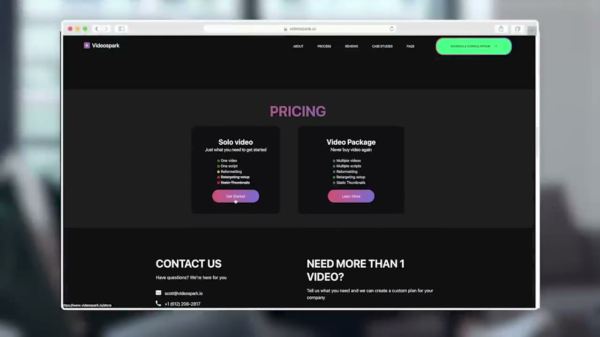
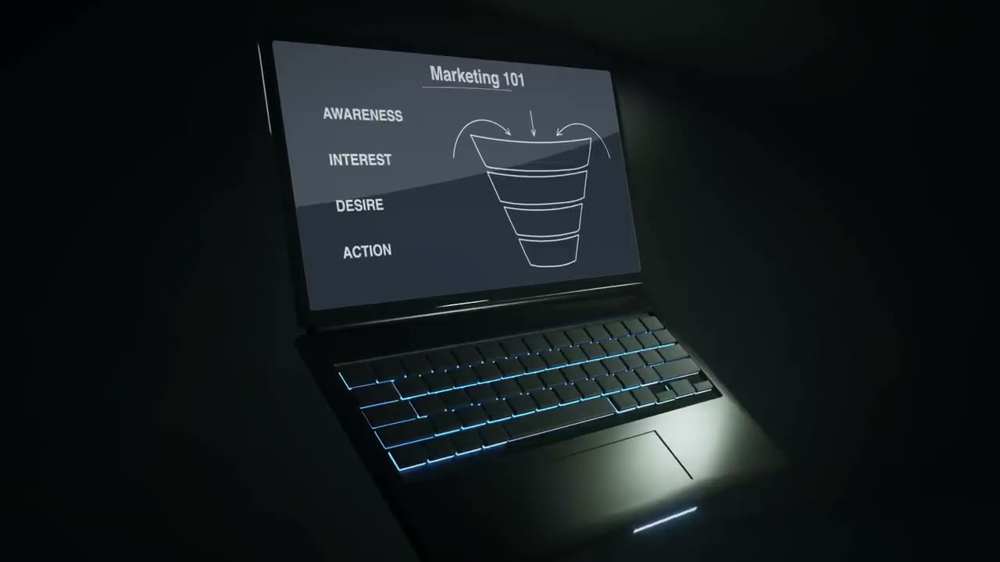
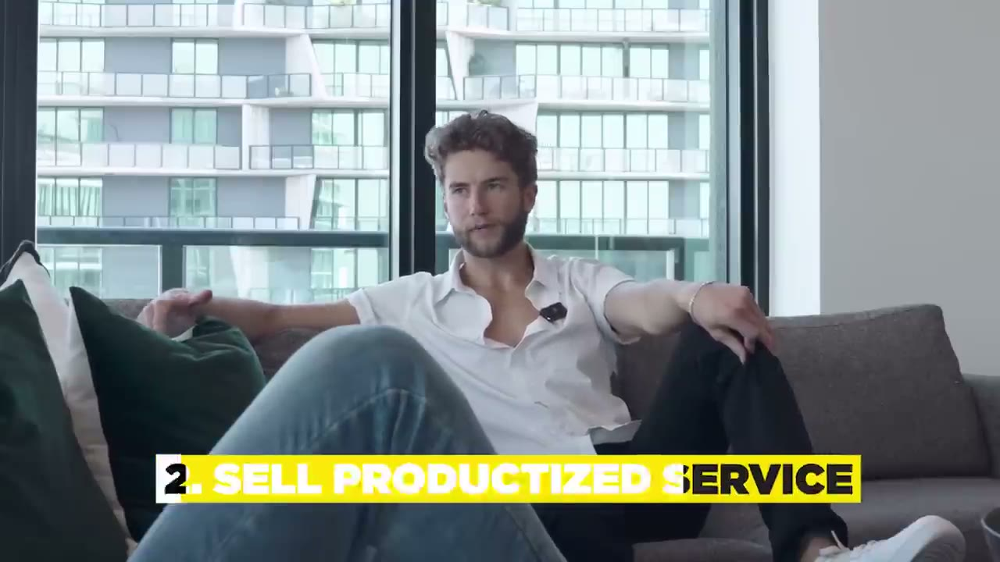
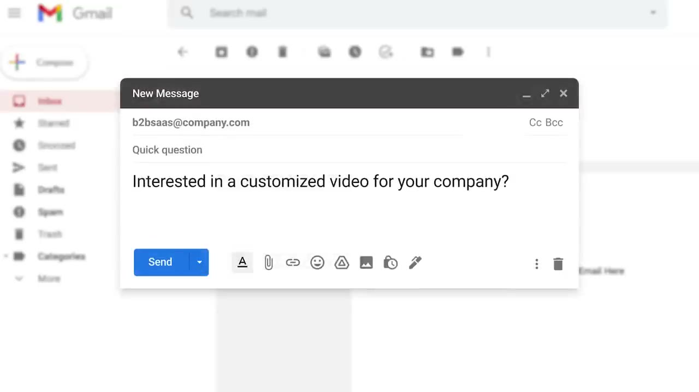
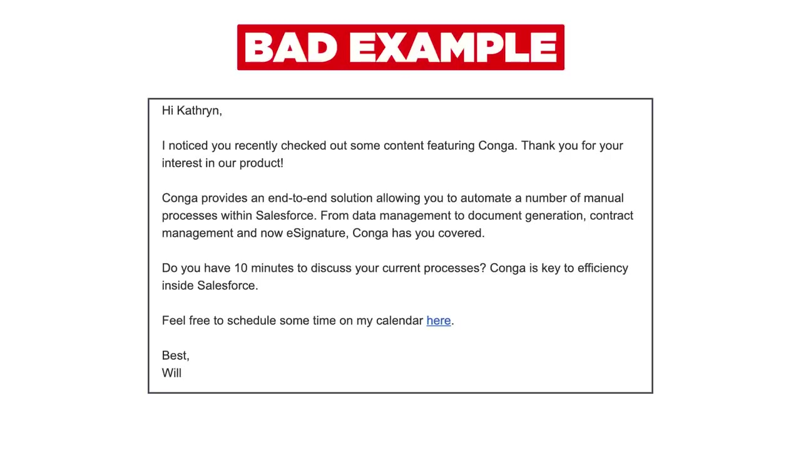

# He Built A $600,000 One Person Business (with video editing)

✅ **Đã phân tích sâu** → [`case.md`](case.md)

| | |
|---|---|
| **Video** | <https://www.youtube.com/watch?v=BskeAo66er0> |
| **Đăng** | 27/03/2023 |
| **Thời lượng** | 20:29 |
| **Lượt xem** | 187,649 |
| **Lượt thích** | 5,179 |
| **Video ID** | `BskeAo66er0` |

## Trong thư mục này

| File | Nội dung |
|---|---|
| [`case.md`](case.md) | **Phân tích đầy đủ** — ý tưởng, validate, GTM, áp dụng ở VN |
| [`meta.json`](meta.json) | Metadata gốc (chapters, heatmap, mô tả) |
| [`screenshots/`](screenshots/) | 10 ảnh 720p |

## Mô tả gốc

Here's how Scott went from freelance video editor to running a $50,000/month company in 1 year.
0:00 - Intro
0:27 - The business
0:47 - Type of clients he sells to
1:18 - What makes a valuable product
1:50 - Scott's early days
2:36 - Dropping out of college
3:17 - Building a resume
4:02 - How he started video editing
4:42 - Going from $50K/year to $50K/month
5:35 - How to turn your passion into a business
6:36 - Business Ideas
7:25 - The best business model
8:25 - Building a team
8:46 - Hiring overseas
9:17 - How to find good talent
9:41 - Costs + Techstack
10:47 - How to build an audience
11:

## Số liệu bắt được từ transcript

> Các đoạn founder nhắc tới con số, kèm timestamp để tua thẳng tới đó trong video.

_(không bắt được con số nào)_

## Chương

- `00:00` Intro
- `00:27` The business
- `00:47` Type of clients he sells to
- `01:18` What makes a valuable product
- `01:50` Scott's early days
- `02:36` Dropping out of college
- `03:17` Building a resume
- `04:02` How he started video editing
- `04:42` Going from $50K/year to $50K/month
- `05:35` How to turn your passion into a business
- `06:36` Business Ideas
- `07:25` The best business model
- `08:25` Building a team
- `08:46` Hiring overseas
- `09:17` How to find good talent
- `09:41` Costs + Techstack
- `10:47` How to build an audience
- `11:17` Advantages of a niche
- `11:56` Advice for beginners
- `12:19` Work setup
- `12:48` Growing the biz to $50K/month
- `13:43` Pivoting + Revenue in early days
- `14:14` Finding clients
- `14:37` Cold outreach + Cold email example
- `15:40` Sales funnel (secret sauce)
- `16:27` How to learn about business
- `17:24` Daily routine
- `18:26` Working on weekends
- `18:50` Vacations as an entrepreneur
- `19:26` Advice on passion

## Ảnh

1. `01_00m39s_ch-the-business.jpg` — 
2. `02_01m30s_ch-what-makes-a-valuable-product.jpg` — 
3. `03_02m48s_ch-dropping-out-of-college.jpg` — 
4. `04_03m29s_ch-building-a-resume.jpg` — 
5. `05_04m14s_ch-how-he-started-video-editing.jpg` — 
6. `06_04m54s_ch-going-from-50k-year-to-50k-month.jpg` — 
7. `07_05m47s_ch-how-to-turn-your-passion-into-a-business.jpg` — 
8. `08_06m37s_replay.jpg` — 
9. `09_14m24s_replay.jpg` — 
10. `10_15m38s_replay.jpg` — 

---

← [Quay lại index](../../index.md) · [Toàn bộ video](../README.md)
