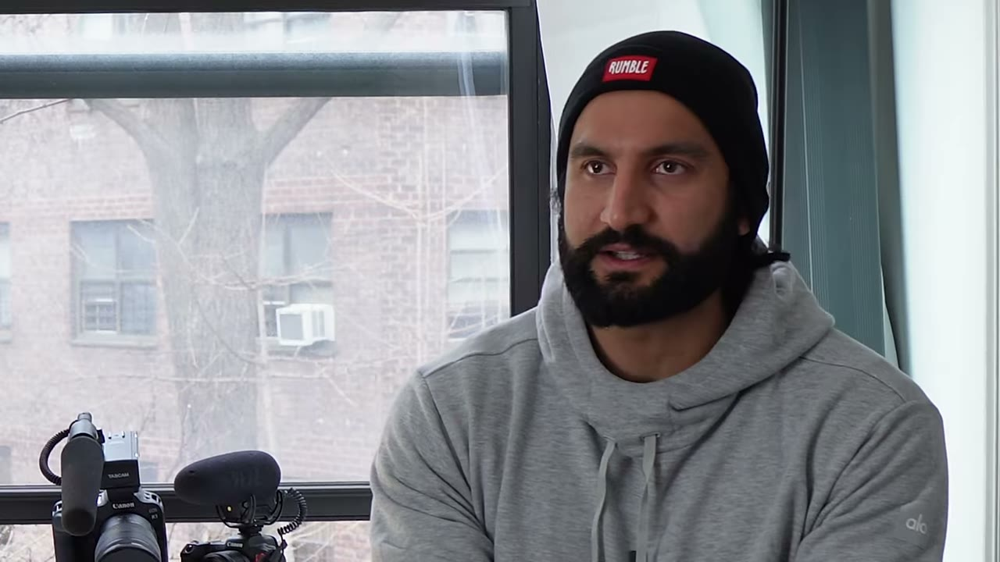
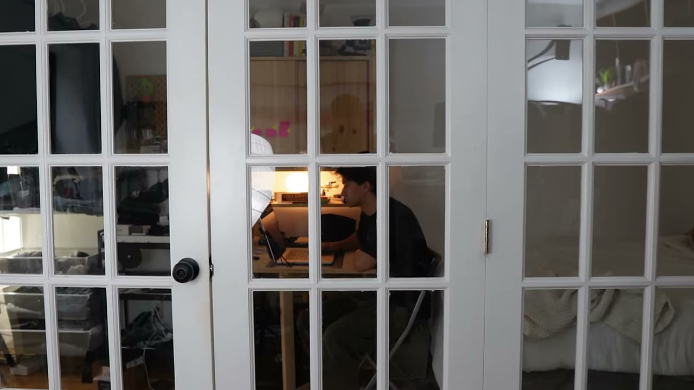
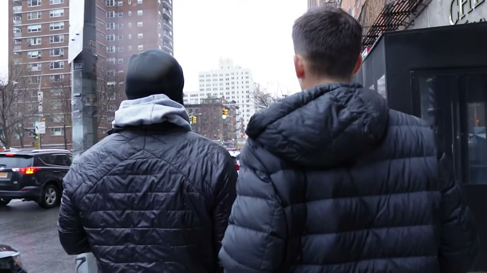

# He Makes $125,000/year As A Niche YouTuber

✅ **Đã phân tích sâu** → [`case.md`](case.md)

| | |
|---|---|
| **Video** | <https://www.youtube.com/watch?v=DZTApvWzMuY> |
| **Đăng** | 03/04/2023 |
| **Thời lượng** | 17:13 |
| **Lượt xem** | 36,731 |
| **Lượt thích** | 815 |
| **Video ID** | `DZTApvWzMuY` |

## Trong thư mục này

| File | Nội dung |
|---|---|
| [`case.md`](case.md) | **Phân tích đầy đủ** — ý tưởng, validate, GTM, áp dụng ở VN |
| [`meta.json`](meta.json) | Metadata gốc (chapters, heatmap, mô tả) |
| [`screenshots/`](screenshots/) | 10 ảnh 720p |

## Mô tả gốc

This is the story of how Shervin Shares went from his miserable 6-figure job to becoming a full time YouTuber living in New York City.
0:00 - Intro
0:59 - Shervin's Early Days
1:29 - How he made the decision to quit
2:34 - When is the right time to quit?
3:33 - Cutting down personal expenses
3:59 - How much is costs to do YouTube
4:30 - What is takes to be a YouTuber
5:00 - First starting on YouTube
5:22 - Best YouTube upload schedule
5:44 - How long did it take to get 1K subscribers?
6:20 - How long until you made $$$ from YouTube?
6:53 - Different ways to make money on YouTube
8:19 - His inc

## Số liệu bắt được từ transcript

> Các đoạn founder nhắc tới con số, kèm timestamp để tua thẳng tới đó trong video.

_(không bắt được con số nào)_

## Chương

- `00:00` Intro
- `00:59` Shervin's Early Days
- `01:29` How he made the decision to quit
- `02:34` When is the right time to quit?
- `03:33` Cutting down personal expenses
- `03:59` How much is costs to do YouTube
- `04:30` What is takes to be a YouTuber
- `05:00` First starting on YouTube
- `05:22` Best YouTube upload schedule
- `05:44` How long did it take to get 1K subscribers?
- `06:20` How long until you made $$$ from YouTube?
- `06:53` Different ways to make money on YouTube
- `08:19` His income streams
- `09:00` Living in NYC as a creator
- `09:51` Cost of living in NYC
- `11:00` Coffee vibes
- `11:10` Most viral video
- `11:58` Viral formula
- `12:47` Finding talent + hiring
- `13:24` Advice for new creators
- `14:03` How to find video ideas
- `14:58` How to meet other creators
- `16:06` Running a 5 minute mile
- `17:06` Final words

## Ảnh

1. `01_01m11s_ch-shervin-s-early-days.jpg` — 
2. `02_02m46s_ch-when-is-the-right-time-to-quit.jpg` — 
3. `03_03m45s_ch-cutting-down-personal-expenses.jpg` — 
4. `04_04m42s_ch-what-is-takes-to-be-a-youtuber.jpg` — 
5. `05_05m34s_ch-best-youtube-upload-schedule.jpg` — 
6. `06_06m32s_ch-how-long-until-you-made-from-youtube.jpg` — 
7. `07_08m31s_ch-his-income-streams.jpg` — 
8. `08_09m12s_ch-living-in-nyc-as-a-creator.jpg` — 
9. `09_10m03s_ch-cost-of-living-in-nyc.jpg` — 
10. `10_11m07s_ch-coffee-vibes.jpg` — 

---

← [Quay lại index](../../index.md) · [Toàn bộ video](../README.md)
