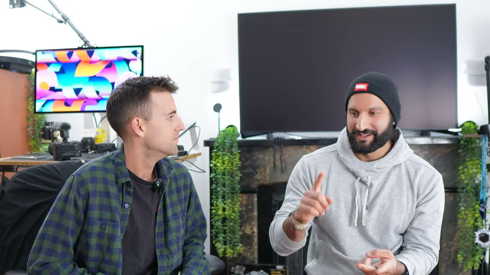
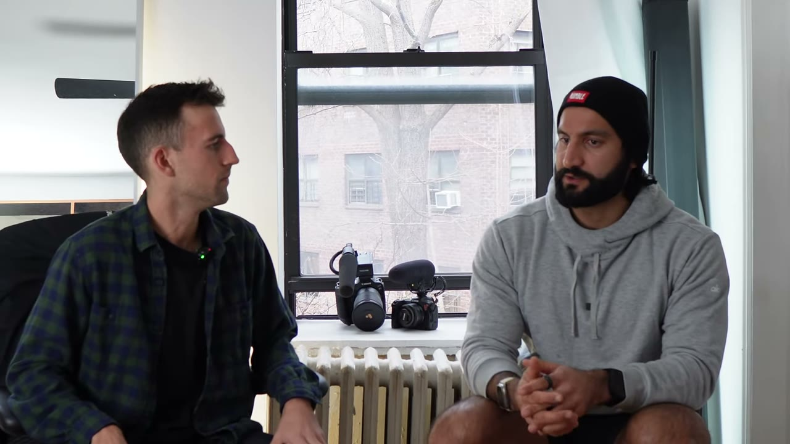
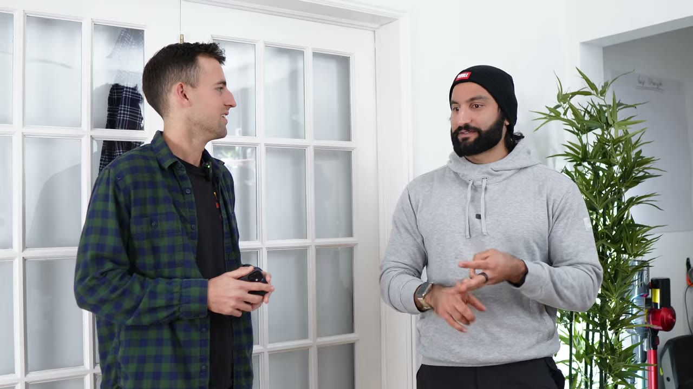
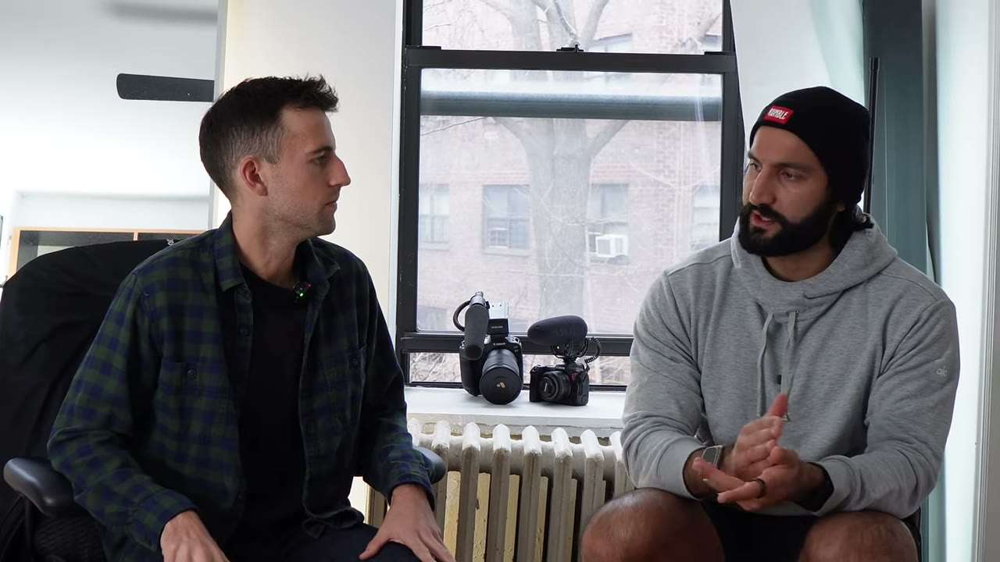
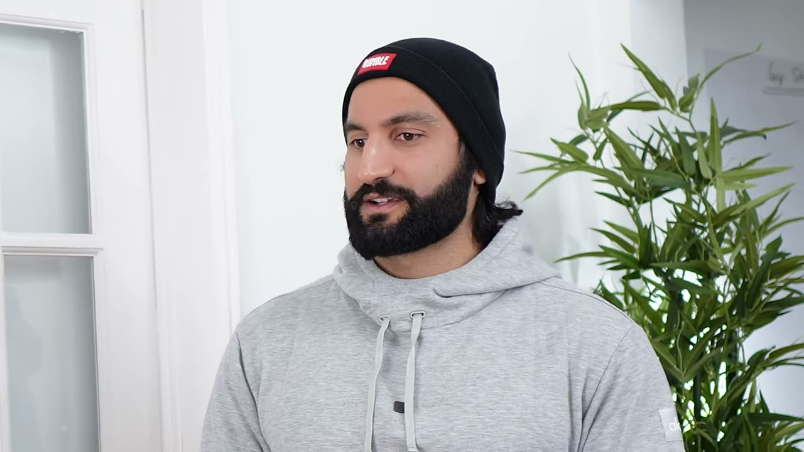
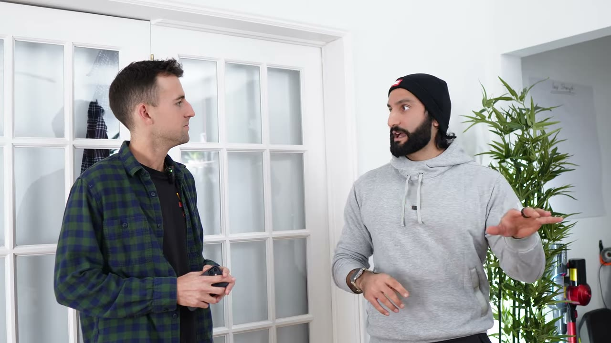
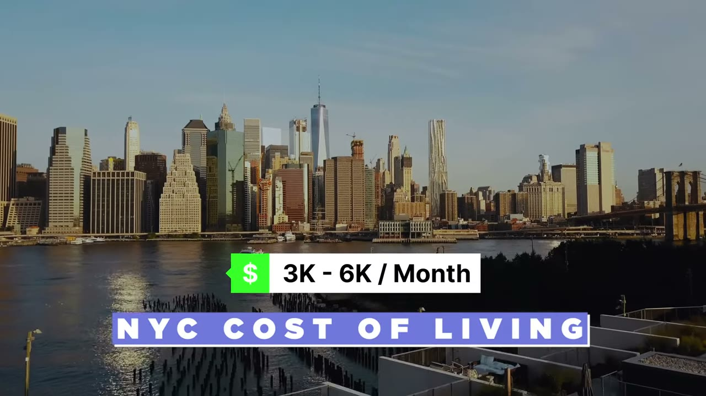

# Shervin Shares — $300 trong năm đầu tiên, six figures ở năm thứ năm

> **Tóm tắt 30 giây:** Shervin bỏ việc software engineer lương sáu chữ số để làm YouTube, và cả **năm đầu tiên anh kiếm được đúng $300**. Cách anh sống sót không phải là tăng view mà là **kéo chi phí sống xuống gần 0** — dọn về nhà bố mẹ, không tiền thuê nhà, không tiền ăn, không xe. Điểm đắt nhất của case: 80% doanh thu hiện tại đến từ **affiliate**, không phải AdSense — và cơ chế ra tiền là video review nhắm **từ khoá có ý định mua**, tức là chính playbook YouTube Search mà 3 năm sau các founder SaaS mới dùng để bán sản phẩm của chính họ.

## ⚠️ Cảnh báo trước khi đọc

1. **Video từ tháng 4/2023** — đây là một trong những case cũ nhất trong kho. Một số chi tiết đã lỗi thời (xem mục 8).
2. **Con số $125.000/năm chỉ nằm ở tiêu đề video.** Shervin không hề nói nó trong transcript, không có dashboard. Coi nó là con số marketing của Starter Story, không phải số liệu đã kiểm chứng.
3. Đây gần với thể loại **"How I Work"** hơn là breakdown kinh doanh — nhiều phần nói về chi phí sống ở New York, chạy 5 phút một dặm, gặp gỡ creator. Tôi chỉ giữ lại phần có giá trị vận hành.

## 1. Con số

| Chỉ số | Giá trị |
|---|---|
| Doanh thu năm đầu tiên | **$300** (cả năm) |
| AdSense đầu tiên | ~$10/tháng, phải chờ tới ngưỡng rút $100 |
| Thời điểm nghỉ việc | $2.000-3.000/tháng từ YouTube |
| Hiện tại (theo tiêu đề) | $125.000/năm ≈ $10.400/tháng |
| Cơ cấu doanh thu | **80% affiliate / 20% AdSense** |
| Thời gian lên 1.000 subscriber | 2-3 năm |
| Video viral nhất | 1.560.000 view |
| Tần suất đăng | 1-2 video/tuần |
| Tiền mặt lúc nghỉ việc | $5.000-10.000 (cộng danh mục đầu tư từ thời SWE) |
| Chi phí editor thuê ngoài | $7-10/giờ |

**Mâu thuẫn cần ghi rõ:** tiêu đề nói $125K/năm, Shervin nói $2-3K/tháng lúc nghỉ việc, và intro nói "six figures in revenue". Ba con số này ở ba mốc thời gian khác nhau nên không thực sự chọi nhau — nhưng chỉ có con số $2-3K/tháng và $300 là do chính anh nói ra.

## 2. Điểm đắt nhất — anh bán được lưu lượng, nhưng cho người khác ⭐⭐⭐

Đây là phần cần đọc kỹ nhất, vì nó là cả bài học lẫn lời cảnh báo.

Cơ chế kiếm tiền của Shervin, anh kể lại nguyên văn quá trình khám phá:

1. Anh làm video review một chiếc vòng đeo tay theo dõi thể chất.
2. Hãng có link giới thiệu — giới thiệu một người thì được **tặng 1 tháng miễn phí**.
3. Video có view. Bỗng dưng anh có **3 năm membership miễn phí**. Rồi thành **10 năm**.
4. *"Tôi có 10 năm membership thì tôi làm gì với nó?"*
5. Hãng chủ động liên hệ: chương trình affiliate của họ là **invite only**, mời anh tham gia. Thay vì tặng 1 tháng (~$30), họ trả **$50 tiền mặt**.

Và đây là câu chốt — Shervin tự rút ra công thức:

> *"Nếu tôi làm một video review sản phẩm, người ta tìm kiếm cái review đó, tôi cung cấp giá trị — một số người sẽ quyết định **không mua** vì video của tôi, một số sẽ mua. Và nếu tôi bảo họ dùng link của tôi, tôi kiếm được tiền. Và tiền đó giúp tôi làm thêm video."*

**Cơ chế vì sao nó hiệu quả:** người gõ "review [tên sản phẩm]" trên YouTube là người **đã ở cuối phễu mua hàng**. Họ không cần được thuyết phục là họ có vấn đề — họ đang chọn giải pháp. Đây là loại lưu lượng đắt nhất trên internet và Shervin lấy được nó miễn phí bằng cách quay một video.

**Nhưng đây là chỗ anh để tiền trên bàn.** So sánh trực tiếp:

| | Shervin (2023) | [Ben — FollowBuddy](../2026-03-19_i-make-17k-month-with-one-strategy/case.md) (2026) |
|---|---|---|
| Nguồn lưu lượng | YouTube search, ý định mua cao | YouTube search, ý định mua cao |
| Cách quay video | Review sản phẩm, so sánh | Review sản phẩm, so sánh |
| Ai sở hữu sản phẩm | **Người khác** | **Chính anh** |
| Thu về mỗi chuyển đổi | $50 một lần, hãng quyết định | ~$50/năm định kỳ, anh quyết định |
| Rủi ro | Hãng đóng affiliate là hết | Rủi ro nền tảng Instagram |

Cùng một kỹ năng, cùng một loại lưu lượng, khác nhau ở chỗ **ai sở hữu thứ được bán**. Ben xây sản phẩm rồi tự đẩy traffic vào; Shervin đẩy traffic vào sản phẩm của người khác và ăn hoa hồng. Chênh lệch giá trị bắt được là hàng chục lần.

> **Bài học rút ra cho bạn:** nếu bạn đang định làm affiliate/review, hãy tự hỏi trước — *cái tôi đang review có phiên bản nào tôi tự làm được không?* Nếu có, làm nó. Traffic là phần khó, và bạn đã làm được phần khó rồi.

## 3. Bài toán runway — anh không tăng doanh thu, anh hạ mẫu số ⭐⭐⭐

Đây là phần thực tế nhất của case và là lý do case này đáng đọc dù doanh thu nhỏ.

Khi Shervin nghỉ việc:
- Tài khoản ngân hàng: **$5.000-10.000**
- YouTube đang ra: **$2.000-3.000/tháng**
- Có danh mục đầu tư từ thời làm SWE (401k + tài sản khác) — coi là quỹ khẩn cấp, **không đụng vào**

> *"Trong tài khoản ngân hàng tôi nghĩ chỉ có 5 hay 10 nghìn đô. Nhưng tôi thấy yên tâm vì có những tài sản kia chống lưng. Tôi nghĩ nếu thật sự cần tiền, tôi sẽ bán bớt. Nhưng lúc đó tôi không muốn bán gì cả."*

Rồi anh làm điều mà hầu hết các case triệu đô trong kho này không bao giờ nhắc tới: **dọn về nhà bố mẹ.**

> *"Không tiền thuê nhà. Bố mẹ trả tiền ăn. Tôi không phải trả tiền xe. Tôi có cơ hội may mắn là được dựa vào họ."*

**Cơ chế:** runway = tiền mặt ÷ chi phí sống hàng tháng. Với $7.500 tiền mặt và chi phí $3.000/tháng, anh có 2,5 tháng. Với chi phí gần $0 và thu nhập $2-3K/tháng, anh có **runway vô hạn**. Anh không giải bài toán "làm sao kiếm nhiều hơn" — anh xoá luôn mẫu số.

**Và anh lặp lại đúng chiến thuật đó khi chuyển tới New York.** Ba creator ở chung một căn $4.500/tháng — anh và Tejas trả $1.600 mỗi người, Colt trả phần còn lại (căn phòng lớn hơn).

> *"Ưu tiên số một là địa điểm — tôi muốn ở giữa những creator khác. Ưu tiên số hai là tiết kiệm được nhiều nhất có thể. Nên bọn tôi tìm chỗ rẻ nhất mà cả ba ở được."*

Anh đặt tên cho nguyên tắc: **cắt chi phí xuống thấp nhất có thể, rồi chỉ chi cho những món ưu tiên cao nhất**. Với anh, món đó là: ở gần creator khác, cà phê (để đổi không gian làm việc), và gym/sauna.

**Áp dụng cho VN:** đây là lợi thế cấu trúc lớn nhất của bạn và bạn có thể chưa nhận ra. Một indie hacker Việt Nam ở với gia đình, chi phí sống $300-500/tháng, chỉ cần **một sản phẩm ra $500/tháng** là đã đạt trạng thái mà Shervin phải bỏ việc lương sáu chữ số ở Mỹ mới có. Bạn không cần $10K/tháng để tự do — bạn cần doanh thu vượt chi phí sống của **bạn**, và chi phí sống của bạn thấp hơn của anh ta 10 lần.

## 4. Playbook nội dung — đóng gói lại cùng một ý tưởng ⭐⭐⭐

Đây là chiến thuật cụ thể nhất trong toàn bộ video, và nó vẫn còn nguyên giá trị năm 2026.

Shervin muốn làm video về **Tongkat Ali** (một loại thảo dược tăng testosterone). Anh không quay ngay. Anh đi tìm cách **đóng gói** ý tưởng đó:

| Cách đặt tiêu đề | Kết quả tra cứu |
|---|---|
| "Tongkat Ali" | Các video này không chạy tốt lắm |
| "testosterone supplements" | Có thể tốt hơn |
| "how to gain muscle" | **Cái này sẽ chạy cực tốt** |

> *"Video có thể nói cùng một thứ, nhưng vấn đề là **đóng khung nó thế nào**."*

**Cơ chế:** nội dung của video không đổi, nhưng **quy mô nhu cầu** ở mỗi mức đóng gói khác nhau hàng chục lần. Người tìm "Tongkat Ali" đã biết tên sản phẩm — thị trường bé. Người tìm "how to gain muscle" chưa biết gì — thị trường khổng lồ. Anh bán cùng một viên thuốc cho ba tầng nhận thức khác nhau, và chọn tầng đông nhất.

Đây chính xác là **awareness ladder** mà [Ben của FollowBuddy](../2026-03-19_i-make-17k-month-with-one-strategy/case.md) hệ thống hoá 3 năm sau — nhưng Ben chạy ngược hướng (anh **bỏ** tầng chưa nhận thức để lấy ý định mua cao). Ai đúng?

**Phân định bằng cách bạn kiếm tiền:**
- Bạn sống bằng **AdSense/view** → đi lên tầng rộng như Shervin. Cần lượng view lớn, chuyển đổi không quan trọng.
- Bạn bán **sản phẩm của chính mình** → đi xuống tầng hẹp như Ben. Ít view nhưng đúng người, chuyển đổi cao.
- Bạn sống bằng **affiliate** → nằm ở giữa. Shervin chọn đúng vì affiliate cần khối lượng nhưng vẫn cần ý định mua.

**Tần suất đăng.** Shervin đã thử qua nhiều nhịp và chốt lại:

> *"1-2 lần/tuần, hoặc 2 lần/tháng — đó là ba nhịp tốt nhất cho YouTube, theo những gì tôi học được và quan sát được từ đa số mọi người."*

Anh từng làm **vlog hàng ngày** (quay ban ngày, dựng ban đêm, đăng sáng hôm sau) và làm các thử thách 30 ngày, 90 ngày. Rồi bỏ.

## 5. Công thức viral — và vì sao anh không quan tâm ⭐⭐

Video thành công nhất: **"I replaced my iPhone with an Apple Watch Ultra"** — 1,56 triệu view.

Công thức anh tự phân tích, gồm 3 yếu tố:

1. **Timing** — Apple Watch Ultra vừa ra mắt, cả internet đang nói về nó. Anh nhận máy hôm trước, quay hôm sau, đăng nhanh nhất có thể. *"Tôi không nghĩ phần dựng có gì hay. Chỉ là — tung ra ngay."*
2. **Topic** — người ta mê Apple Watch.
3. **Dữ liệu cũ** — anh **đã từng làm video này trước đó** và nó chạy khá. Anh không đánh cược, anh lặp lại một format đã có bằng chứng, với một sản phẩm đang hot.

**Cơ chế đáng học:** yếu tố (3) là thứ tách người làm nội dung nghiệp dư khỏi người chuyên nghiệp. Anh không đi tìm ý tưởng mới — anh **lôi lại format đã thắng** và gắn nó vào một sự kiện đang có nhu cầu tìm kiếm dâng cao. Chi phí rủi ro gần bằng 0.

Và phản ứng của anh khi có 1,5 triệu view thì đáng chú ý hơn cả video:

> *"Tôi kiểu — tôi thật sự không quan tâm. Chuyện đó không phải về view. Có một video viral thì cũng hay đấy. Nhưng nếu cả 1,5 triệu người đó xem video rồi không bao giờ quay lại, thì có ý nghĩa gì? Tôi muốn người ta quay lại. **Tôi thà có đều đặn 100.000 view còn hơn một video 10 triệu view.**"*

Với mô hình affiliate, anh đúng về mặt số học: 100.000 view/tháng đều đặn × 12 tháng = 1,2 triệu view **có thể dự báo được**, gắn với người xem tin anh. Một video 10 triệu view là một cú nhảy dù rồi tắt.

## 6. Đội ngũ và chi phí

**Tìm editor:**
- Kênh chính: **network** — hỏi bạn bè creator xem ai đang rảnh, đi các sự kiện gặp người rồi hỏi thẳng.
- Kênh phụ: **Upwork**.

> *"Khó tìm người giỏi lắm. Bạn thật sự phải lọc qua hàng trăm người mới ra được một editor tốt. Đó là cách tôi tìm được người đầu tiên. Rẻ — khoảng $7 đến $10 một giờ. Và nếu bạn thuê ngoài sang nước khác thì tiết kiệm được rất nhiều."*

**Lưu ý cho bạn:** ở phía bên kia của câu này chính là **cơ hội cho người Việt**. $7-10/giờ năm 2023 là mức mà creator Mỹ trả cho editor nước ngoài. Đây là cùng một cơ chế mà [Scott Millard](../2023-03-27_he-built-a-600-000-one-person-business-with-video-ed/case.md) và [Oceans](../2025-03-08_i-quit-my-job-accidentally-built-a-10m-business/case.md) khai thác từ phía chủ. Nếu bạn biết dựng video, đây là con đường vào ngành nhanh nhất — nhưng nhớ rằng bán giờ là trần thu nhập, không phải business (xem case Scott).

**Chi phí làm YouTube:**

> *"Bạn không cần chi đồng nào, và bạn phải chi tất cả mọi đồng. Tôi nghĩ tất cả nằm ở làm việc chăm chỉ và sự bền bỉ."*

## 7. Cách phân biệt người thật sự muốn làm — và lời khuyên cho người đang đi làm ⭐⭐

Shervin gặp rất nhiều creator và rút ra:

> *"Điều lớn nhất bạn học được là **rất nhiều người không thật sự muốn nó**. Họ nói là họ muốn. Họ bảo — ừ tôi muốn làm cái này, tôi có giấc mơ kia. Nhưng không ai thật sự muốn. Nếu bạn đủ đói, bạn làm được."*

Anh đưa ra một bài kiểm tra cụ thể:

> *"Không phải nghe cách họ **nói**. Mà là nhìn cái họ **xuất bản**. Họ có đăng đều không? Họ có thích nghi, học hỏi, tiến bộ không? Họ có hỏi xin giúp đỡ không?"*

Chi tiết hay: anh nói chính anh cũng dở khoản hỏi xin giúp đỡ, nhưng khi có người kém hơn anh một bậc hỏi anh feedback, anh nghĩ *"ồ, người này đói"* — và điều đó nhắc anh rằng anh cũng nên đi hỏi người trên anh.

**Lời khuyên cho người còn đang đi làm toàn thời gian:**

> *"Bắt đầu sáng tạo đi. Lấy một ngày trong tuần — ví dụ Chủ nhật — dành trọn ngày đó cho việc làm nội dung, và bắt đầu tạo đà. **Nếu bạn chưa tạo nội dung đều đặn thì việc nghỉ việc là không đáng.** Bạn phải xây được đà, xây được thói quen thật sự làm nó trước đã."*

Đây là chuẩn mực rõ ràng nhất trong video và đáng để bạn dùng làm bài test cho chính mình: **nếu bạn chưa duy trì được một ngày/tuần trong 3 tháng liền khi vẫn đi làm, đừng nghỉ việc.**

**Về việc chọn người xung quanh — "five chimps theory":**

> *"Bất cứ thứ gì bạn muốn đạt được, bạn phải ở giữa những người cũng đang làm điều đó."*

Cách anh tìm cộng đồng khi mới tới New York: lên **Meetup** và tìm bừa các sự kiện creator. Gặp được một người là người đó mời sang sự kiện khác → hiệu ứng cuộn tuyết. *"Chỉ cần có khoảng năm người bạn là creator, họ biết mọi sự kiện khác."*

## 8. ⚠️ Những gì đã lỗi thời (video 2023 → đọc năm 2026)

| Chi tiết trong video | Tình trạng hiện nay |
|---|---|
| Ngưỡng bật kiếm tiền 1.000 subs + 4.000 giờ xem | YouTube đã **hạ ngưỡng** cho một số hình thức kiếm tiền (fan funding) xuống 500 subs / 3.000 giờ từ giữa 2023. Vào YPP dễ hơn thời Shervin. |
| Daily vlog là format chủ đạo | Đã chết. Shorts và video dạng search/how-to chiếm ưu thế. |
| Editor nước ngoài $7-10/giờ | Mức này vẫn tồn tại nhưng cạnh tranh nặng hơn nhiều, và **AI dựng video** (cắt tự động, phụ đề, b-roll) đã ăn mất phần lớn công việc dựng cơ bản. Muốn bán giờ dựng video năm 2026 thì phải bán phần AI chưa làm được. |
| Review sản phẩm tech để ăn affiliate | Vẫn chạy, nhưng ngách tech gadget đã **cực kỳ bão hoà**. Từ khoá "best X" trên YouTube giờ có hàng trăm video. Ngách hẹp và ít người quay (như cách Ben làm) vẫn còn cửa; "review iPhone" thì không. |
| Tiền thuê $4.500/tháng cho căn 3 phòng ở NYC | Con số 2023, giờ đã cao hơn đáng kể. |
| Affiliate chỉ trả $50/lượt | Với SaaS/app hiện nay, affiliate recurring 20-30%/tháng phổ biến hơn nhiều — nếu bạn làm affiliate, hãy ưu tiên chương trình **recurring** thay vì one-time. |

**Điều KHÔNG lỗi thời:** logic runway, chiến thuật đóng gói lại từ khoá, công thức viral 3 yếu tố, và bài test "một ngày mỗi tuần trong 3 tháng".

## 9. Cảnh báo thiên kiến nguồn

- Starter Story chỉ phỏng vấn **người đã thành công**. Với mỗi Shervin, có hàng nghìn người cũng bỏ việc, cũng đăng 2-3 năm, và kiếm được $300 rồi bỏ cuộc. Bản thân video vô tình thừa nhận điều này: chính anh nói *"rất nhiều người không thật sự muốn nó"* — nhưng số liệu thực tế là đa số người **có** cố gắng vẫn không đạt được.
- Con số $125.000/năm là của Starter Story đặt ở tiêu đề, không có nguồn xác minh trong video.
- Câu chuyện "bỏ việc lương sáu chữ số" là chất liệu marketing rất tốt cho kênh. Nhưng để ý phần Shervin **không** kể ở phía trước: anh có một danh mục đầu tư từ thời làm SWE, có bố mẹ nuôi ăn ở, và có nền tảng kỹ thuật để quay lại nghề bất cứ lúc nào. Đó là ba tấm lưới an toàn mà đa số người xem không có.

## 10. Áp dụng cho tôi (indie hacker VN)

**Sao chép được gì:**

1. **Bài test một-ngày-mỗi-tuần.** Trước khi tính chuyện nghỉ việc, chạy 12 tuần liên tiếp, mỗi Chủ nhật làm nội dung. Nếu bạn bỏ giữa chừng — bạn đã tiết kiệm được một năm đời và rất nhiều tiền. Đây là bài test rẻ nhất trong toàn bộ kho này.
2. **Chiến thuật đóng gói từ khoá.** Trước khi quay bất kỳ video nào, viết ra 3 cách đặt tên cho **cùng một nội dung** ở 3 tầng nhận thức, tra lượng tìm kiếm từng cái, rồi chọn. Mất 15 phút, thay đổi kết quả gấp nhiều lần.
3. **Công thức viral 3 yếu tố.** Đừng đi tìm ý tưởng mới. Lấy format đã thắng của bạn + sự kiện đang hot + tung ra nhanh, chấp nhận dựng xấu. Với sản phẩm công nghệ, "nhanh" quan trọng hơn "đẹp".
4. **Lật ngược bài toán runway.** Đừng hỏi "cần bao nhiêu tiền để nghỉ việc". Hỏi "chi phí sống của tôi có thể xuống thấp tới đâu". Với chi phí sống VN, ngưỡng tự do của bạn có thể là $500-800/tháng — mức mà một sản phẩm nhỏ đạt được.
5. **Nếu bạn định làm affiliate, hãy hỏi trước — tôi tự làm được sản phẩm này không?** (Xem mục 2. Đây là bài học đắt nhất của case.)

**Rào cản thật, không tô hồng:**

- **Đây là mô hình cần MẶT và cần TIẾNG ANH.** Khác hẳn playbook YouTube Search kiểu Ben (màn hình + giọng nói, có thể làm bằng tiếng Việt). Shervin bán chính con người anh — vlog phòng ngủ, cà phê, chạy bộ. Nếu tiếng Anh của bạn có accent nặng hoặc bạn ngại lên hình, mô hình này **không dành cho bạn**; hãy đi theo hướng review màn hình + từ khoá ngách.
- **Chu kỳ quá dài.** 2-3 năm để lên 1.000 subscriber. $300 cho cả năm đầu. Không có kênh nào trong kho này có thời gian chờ dài hơn. Nếu bạn cần tiền trong 6-12 tháng, đây là mô hình sai.
- **Affiliate là doanh thu đi thuê, không phải tài sản.** Hãng có thể đóng chương trình, cắt tỉ lệ, hoặc đổi điều khoản bất cứ lúc nào. Bạn không sở hữu quan hệ với khách hàng, không sở hữu giá, không sở hữu sản phẩm. Điều duy nhất bạn sở hữu là kênh — nên hãy dùng nó để bán thứ của mình càng sớm càng tốt.
- **Affiliate trả theo địa lý người xem.** CPM AdSense và tỉ lệ chuyển đổi affiliate cho khán giả Việt Nam thấp hơn khán giả Mỹ nhiều lần. Nếu làm nội dung tiếng Việt, đừng kỳ vọng cấu trúc doanh thu 80/20 như anh — hãy tính tới bán sản phẩm số của chính mình từ đầu.
- **Anh có ba tấm lưới an toàn bạn có thể không có:** danh mục đầu tư từ nghề cũ, bố mẹ nuôi ăn ở, và bằng cấp kỹ thuật để quay lại việc lương cao bất cứ lúc nào. Hãy tự đánh giá lưới của mình trước khi nhảy.

**Khi nào KHÔNG dùng mô hình này:**

- Khi bạn **đã có sản phẩm**. Nếu bạn có sản phẩm rồi, đừng đi làm creator kiếm AdSense — hãy dùng cùng lượng công sức đó làm video search nhắm từ khoá bán hàng, như [FollowBuddy](../2026-03-19_i-make-17k-month-with-one-strategy/case.md) hoặc [Arvow](../2025-10-04_i-built-a-1m-saas-using-youtube/case.md). Cùng công sức, giá trị bắt được gấp hàng chục lần.
- Khi bạn **cần dòng tiền trong năm nay**. Hãy xem [Scott Millard](../2023-03-27_he-built-a-600-000-one-person-business-with-video-ed/case.md) — cùng thời điểm 2023, cùng xuất phát điểm nghèo, nhưng đi bằng productized service và đạt $50K/tháng trong **một năm** thay vì bốn.
- Khi bạn không có ai để dựa vào về chi phí sống. Không có nhà bố mẹ, không có tiết kiệm — thì mô hình cần 2-3 năm chờ này là canh bạc quá lớn.

## Nguồn

- Video: <https://www.youtube.com/watch?v=DZTApvWzMuY> (17:13, đăng 03/04/2023, 36.731 view)
- Kênh của Shervin: <https://www.youtube.com/@ShervinShares>
- [Transcript đầy đủ](transcript.md) · [Ảnh chụp](screenshots/)
