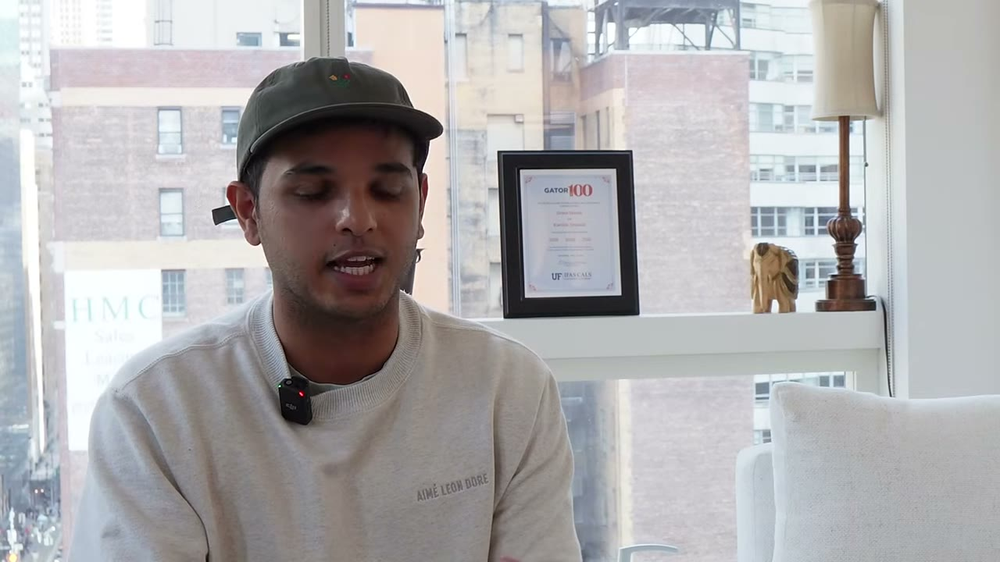
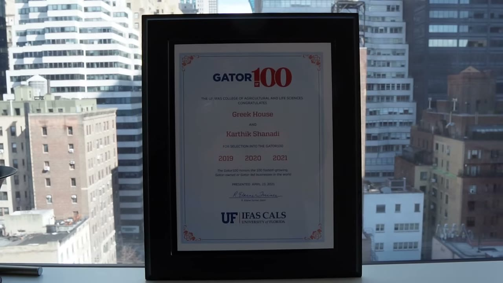
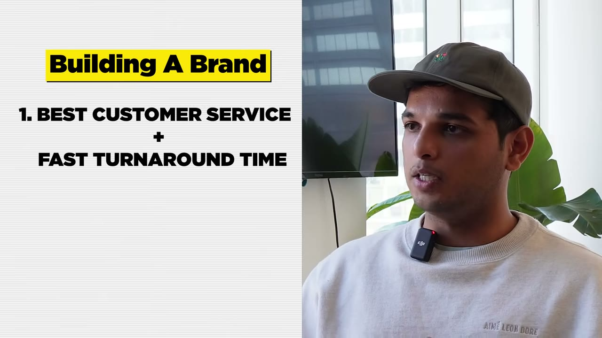

# He Turned $500 Into $10M

✅ **Đã phân tích sâu** → [`case.md`](case.md)

| | |
|---|---|
| **Video** | <https://www.youtube.com/watch?v=CnE_fLDqa7M> |
| **Đăng** | 09/04/2023 |
| **Thời lượng** | 18:22 |
| **Lượt xem** | 752,051 |
| **Lượt thích** | 11,681 |
| **Video ID** | `CnE_fLDqa7M` |

## Trong thư mục này

| File | Nội dung |
|---|---|
| [`case.md`](case.md) | **Phân tích đầy đủ** — ý tưởng, validate, GTM, áp dụng ở VN |
| [`meta.json`](meta.json) | Metadata gốc (chapters, heatmap, mô tả) |
| [`screenshots/`](screenshots/) | 10 ảnh 720p |

## Mô tả gốc

In this episode I went into Karthik Shanadi's New York City apartment to get his story and strategies for building a $10M clothing empire. He's an absolute hustler and has built 4 ecommerce companies in the apparel industry, and he shares his advice on marketing, growing an online apparel company, and how to start a business today. Hope you guys enjoy!
0:00 - Intro
1:00 - All his businesses
3:10 - Finding the idea
4:20 - Building the business with a full time job
5:13 - How he stays motivated
6:35 - How he started the business (early days)
8:00 - Scariest moments
9:47 - Fulfillment and logisti

## Số liệu bắt được từ transcript

> Các đoạn founder nhắc tới con số, kèm timestamp để tua thẳng tới đó trong video.

_(không bắt được con số nào)_

## Chương

- `00:00` Intro
- `01:00` All his businesses
- `03:10` Finding the idea
- `04:20` Building the business with a full time job
- `05:13` How he stays motivated
- `06:35` How he started the business (early days)
- `08:00` Scariest moments
- `09:47` Fulfillment and logistics
- `11:23` How to build in saturated markets
- `12:11` How to build a brand
- `13:17` Marketing strategies
- `15:30` 3 required skills for entrepreneurship
- `17:26` How to start a business

## Ảnh

1. `01_01m12s_ch-all-his-businesses.jpg` — 
2. `02_03m22s_ch-finding-the-idea.jpg` — 
3. `03_04m32s_ch-building-the-business-with-a-full-time-job.jpg` — 
4. `04_05m25s_ch-how-he-stays-motivated.jpg` — 
5. `05_06m47s_ch-how-he-started-the-business-early-days.jpg` — 
6. `06_07m58s_replay.jpg` — 
7. `07_09m59s_ch-fulfillment-and-logistics.jpg` — 
8. `08_11m35s_ch-how-to-build-in-saturated-markets.jpg` — 
9. `09_12m23s_ch-how-to-build-a-brand.jpg` — 
10. `10_13m18s_replay.jpg` — 

---

← [Quay lại index](../../index.md) · [Toàn bộ video](../README.md)
