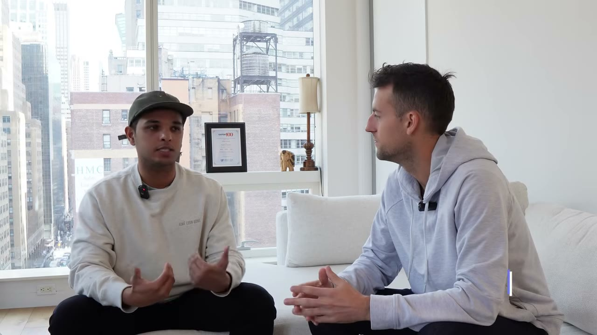
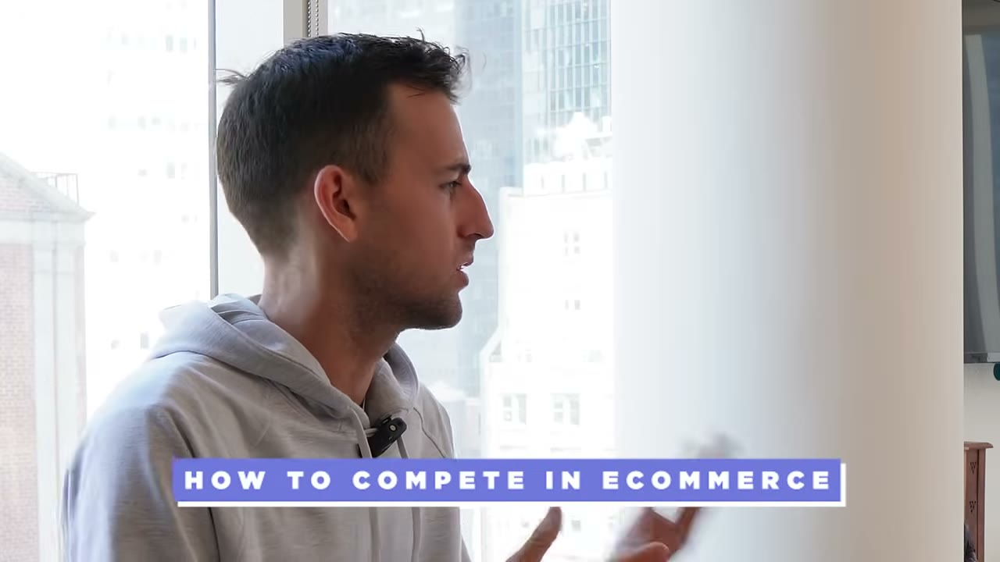
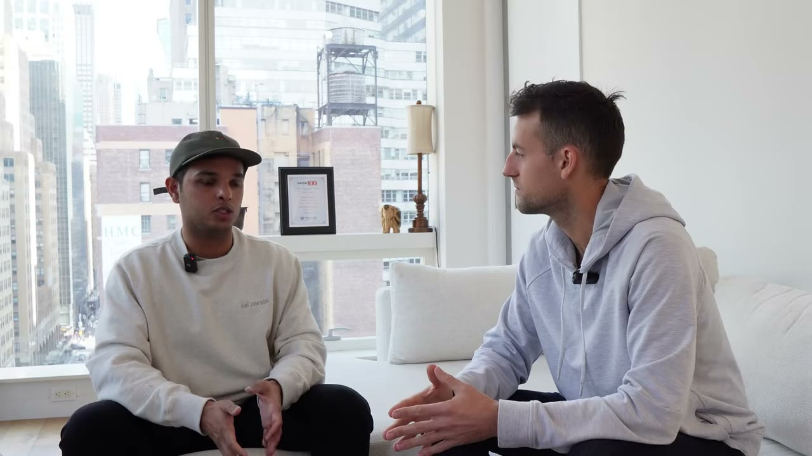

# Greek House → Athletes Thread — con hào làm bằng giấy phép, không phải công nghệ

> **Tóm tắt 30 giây.** Karthik và đồng sáng lập Luke bắt đầu bằng **khoảng 500 USD** trong nhà hội sinh viên năm 2013, bán áo in theo yêu cầu. Năm đầu **50.000 USD**, năm hai **100.000 USD** — làm bán thời gian giữa lúc đi học. Sau khi tốt nghiệp, anh vào Amazon rồi Salesforce và **làm sáu ngày một tuần suốt hai năm rưỡi**: đi làm ca đêm, về ngủ, dậy làm doanh nghiệp riêng, rồi lại đi làm. Đến nay bốn thương hiệu đã tạo ra hơn **10 triệu USD**. Và con hào của họ không phải công nghệ — mà là **khoảng 300 giấy phép nhượng quyền từ các trường đại học**, thứ mà theo anh **99,99% công ty không vượt qua nổi**.

## 1. Con số

| Chỉ số | Giá trị |
|---|---|
| Vốn ban đầu | **~500 USD** |
| Năm 1 | 50.000 USD |
| Năm 2 | 100.000 USD |
| Tổng tích luỹ | **hơn 10 triệu USD** |
| **Giấy phép nhượng quyền** | **~300 trường đại học** |
| Lịch làm việc giai đoạn đầu | **6 ngày làm, 1 ngày nghỉ, trong ~2,5 năm** |

**Bốn thương hiệu, bốn ngách trong cùng một ngành:**

| Thương hiệu | Phục vụ ai |
|---|---|
| **Greek House** | hội sinh viên nam và nữ |
| **College Thread** | phòng ban và tổ chức trong trường |
| **Threadly** | doanh nghiệp, gây quỹ, tổ chức phi lợi nhuận |
| **Athletes Thread** | vận động viên sinh viên và trường đại học |

Cùng chiến lược với [danh mục Kaching: bốn app cùng phục vụ một mục tiêu, bán cho tệp khách đã tin mình](../2025-04-19_my-apps-make-4-5m-year-with-0-marketing/case.md) — nhưng ở đây các ngách được chia theo **loại khách hàng**, không theo điểm chạm.

## 2. Con hào bằng giấy phép — và cách một thay đổi luật tạo ra doanh nghiệp mới ⭐⭐⭐⭐⭐

Khi được hỏi làm sao khác biệt trong thương mại điện tử — nơi ai cũng mở được cửa hàng Shopify — câu trả lời của anh rất thẳng:

> Điều tuyệt vời khi ở trong ngành nhượng quyền là **có rất nhiều rào cản để tới được chỗ chúng tôi đang đứng**. Trước hết bạn cần **giấy phép của các trường đại học**, rồi bạn cần **quyền từ từng vận động viên**. **Chỉ riêng rào cản đó thôi, 99,99% công ty sẽ không vượt qua nổi.**

**Đây là một dạng con hào ít được nói tới trong kho case này:** không phải công nghệ, không phải thương hiệu, không phải mạng lưới — mà là **sự phiền phức về mặt hành chính và pháp lý mà bạn đã chịu đựng và người khác chưa.**

Và cơ hội thứ hai đến từ **một thay đổi luật**: phán quyết về **name, image and likeness (NIL)** cho phép vận động viên sinh viên kiếm tiền từ tên tuổi và hình ảnh của mình. Vì đã ở trong không gian nhượng quyền nhiều năm, họ **nhìn thấy cơ hội trước** và ra mắt Athletes Thread — hàng hoá đồng thương hiệu giữa trường và vận động viên.

**Bài học chuyển giao:** hãy để ý các **thay đổi quy định pháp luật trong ngành bạn đang ở**. Chúng tạo ra thị trường mới gần như qua đêm, và **người đã có sẵn hạ tầng tuân thủ là người hưởng lợi đầu tiên**. Đây là cùng loại tín hiệu với [Alex Goldberg theo dõi dòng vốn đầu tư đổ vào telemedicine](../2024-03-30_i-make-1m-year-with-one-website/case.md) — nhưng nguồn tín hiệu là luật thay vì tiền.

## 3. Hoá đơn 40.000 USD — bài học tuân thủ ⭐⭐⭐⭐⭐

Đây là câu chuyện đáng giá nhất video và nó là một cảnh báo thật.

Bốn tháng sau khi anh chuyển hẳn sang làm toàn thời gian, một tổ chức cấp phép gửi thông báo: **anh chưa trả tiền bản quyền và có hàng loạt doanh số không được báo cáo.**

> Chúng tôi kiểu *"anh đang nói gì vậy?"* Rồi chúng tôi tìm hiểu và phát hiện ra: **ồ, hoá ra nhượng quyền là cả một chuyện — chúng tôi phải được phê duyệt, phải trả tiền bản quyền.** Và chúng tôi bị kiểm toán.
>
> Nói ngắn gọn: **hoá đơn 40.000 USD, bốn tháng sau khi bắt đầu.** Lúc đó chúng tôi đang làm doanh thu chưa tới một triệu, nên đó là khoảng **4% chi phí — và chúng tôi thậm chí không có 40.000 USD trong ngân hàng.**

Cách họ xử lý:

> Chúng tôi quay lại tổ chức cấp phép và nói: *"chúng tôi muốn ở trong ngành này lâu dài, chúng tôi sẽ làm cho đúng — hãy cho chúng tôi thời gian. Chúng tôi trả một khoản lớn ngay bây giờ và phần còn lại trong 12–14 tháng."*

Anh gọi đó là **bài học rất đắt giá**, và thừa nhận lúc đó anh nghĩ mình sẽ phải quay lại đi làm công ty.

**Điểm rút ra — và nó áp dụng rộng hơn nhiều so với ngành áo in:**

Chính thứ tạo ra con hào của họ (yêu cầu cấp phép) suýt giết họ khi họ chưa hiểu nó. **Rào cản pháp lý là con dao hai lưỡi: nó chặn đối thủ, nhưng nó cũng chặn bạn nếu bạn bước vào mà không đọc luật chơi.** Với bất kỳ ai định vào ngành có quy định — thực phẩm chức năng, y tế, tài chính, nhượng quyền thương hiệu — hãy tính chi phí tuân thủ **trước**, không phải sau.

## 4. Lịch làm việc — mức độ khắc nghiệt cần được nói rõ ⭐⭐⭐⭐

Anh mô tả rất cụ thể, và đây là dữ liệu quan trọng cho ai đang cân nhắc làm side hustle:

**Giai đoạn Amazon:** ca làm từ **tối thứ Tư tới sáng Chủ nhật**. Anh vào lúc **11 giờ đêm**, tan ca **11 giờ trưa tới 12 giờ**, về nhà ngủ, **dậy vào buổi tối và bắt đầu làm Greek House**, rồi lại vào ca Amazon. Lặp lại.

**Giai đoạn Salesforce:** lịch bình thường hơn — vào 8 giờ sáng, tan lúc 5 giờ rưỡi chiều, **rồi làm tới nửa đêm**, và lặp lại.

**Cuối tuần:** thường được nghỉ **một ngày, thứ Bảy**.

> Về cơ bản là **sáu ngày làm, một ngày nghỉ, suốt khoảng hai năm rưỡi.**

**Động lực anh nêu ra** — và nó rất cụ thể, không sáo rỗng:
- Gia đình nhập cư từ Ấn Độ, anh sang Mỹ năm 7 tuổi, **chứng kiến bố mẹ làm việc cật lực**
- Bố mẹ **từ bỏ mọi thứ về mặt gia đình** để đưa anh em anh sang
- Anh nói **muốn làm bố mẹ tự hào** là động lực số hai, và *"nó vượt lên gần như mọi thứ khác"*
- Mỗi lần về Ấn Độ anh **nhận ra mình may mắn thế nào** khi được sống ở nơi có thể xây startup không rào cản
- Gia đình có truyền thống kinh doanh — **hơn 24 nhà hàng ở Ấn Độ**

**Tôi ghi lại lịch làm việc này nguyên trạng vì nó cần được nhìn thẳng:** đây không phải mô hình "4 tiếng mỗi tuần". Đây là **hai năm rưỡi gần như không có ngày nghỉ**, và nó là cái giá thật đứng sau con số 10 triệu USD.

## 5. Bốn kênh marketing — và thứ tự của chúng ⭐⭐⭐⭐

Anh liệt kê theo đúng thứ tự lịch sử:

**1. Email chủ động một đối một, rồi chuyển thành bán hàng chủ động.** Anh gọi đó là con đường *"phản hồi trực tiếp"*, và lý do rất thực dụng: **hiệu quả về chi phí, mở rộng được, và họ tìm được rất nhiều email và liên hệ trên mạng.**

**2. Chương trình đại sứ hoặc affiliate.** Và anh chỉ ra một lợi ích kép mà ít ai tính:

> Điều tuyệt ở các chương trình đó là bạn **không chỉ lan truyền lời về sản phẩm — bạn đang tìm những người ủng hộ bán thương hiệu thay bạn**. [...] Nếu bạn gửi họ sản phẩm miễn phí, đúng là có chi phí ban đầu, **nhưng họ cũng tạo ra nội dung cho bạn ở đầu kia** — bạn tái sử dụng được nó và xây thương hiệu tiếp.
>
> **Một mũi tên trúng hai đích: bạn có nội dung, và bạn có người quảng bá.**

**3. Quảng cáo tìm kiếm trả phí.** Lý do anh chọn tìm kiếm thay vì mạng xã hội rất rõ:

> Khi ai đó tìm trên Google một chiếc áo của [một vận động viên cụ thể], **họ đang thực sự tìm đúng món đó. Mức độ ý định rất cao.** Còn mạng xã hội thì bạn chỉ đang cố đẩy sản phẩm trước mặt họ dựa trên sở thích hoặc nhân khẩu học.

Đây là sự phân biệt mà [Nico cũng nêu: nền tảng tìm kiếm vs nền tảng ngắt quãng](../2025-03-31_i-locked-myself-in-a-room-made-17-apps-sold-2-for-26/case.md).

**4. Các sàn — mà anh gọi là "marketing miễn phí".**

> Nếu bạn đưa được sản phẩm lên **Etsy**, hãy đưa lên. Nếu đưa được lên **Google Shopping**, hãy đưa lên. [...] Tôi thấy giờ nhiều người **bấm thẳng vào tab Shopping** khi tìm kiếm sản phẩm.

**Điểm cần lưu ý về thứ tự:** anh bắt đầu bằng **cold email**, kênh không cần tiền và không cần khán giả. Với người mới ở Việt Nam, đây là kênh khả thi nhất trong bốn kênh trên.

## 6. Cách họ giữ được nhà cung cấp tốt — một ý tưởng thông minh ⭐⭐⭐⭐

Họ **không tự sản xuất gì**, mà làm việc với các đối tác in ấn khắp nước Mỹ. Anh nói:

> Ở hầu hết các ngành, ở cấp nhà phân phối như chúng tôi, **tìm nhà sản xuất thì dễ — tìm nhà sản xuất TỐT mới khó.**

Và cách họ giành được đối tác tốt rất đáng học:

> Chúng tôi đến gặp xưởng in và nói: *"chúng tôi muốn làm việc với các anh, đây là giá của chúng tôi — **nhưng chúng tôi cũng sẽ cung cấp công nghệ cho các anh**, để khi phục vụ tài khoản của chúng tôi, **các anh tốn một phần mười thời gian so với phục vụ khách khác**, vì chúng tôi sẽ giữ mọi thứ ngăn nắp và sạch sẽ cho các anh."*

Họ xây một **cổng thông tin cho nhà cung cấp** để đối tác quản lý đơn hàng hiệu quả, và **tự động hoá, tinh gọn dây chuyền sản xuất** cho họ.

**Đây là một dạng đòn bẩy đàm phán mà rất ít người nghĩ tới:** thay vì cạnh tranh bằng giá hoặc khối lượng, họ **giảm chi phí vận hành của chính nhà cung cấp**. Kết quả: họ trở thành khách hàng mà đối tác muốn giữ, chứ không phải khách hàng phải xin xỏ.

## 7. Cách họ xây thương hiệu ⭐⭐⭐

Ba lớp, theo thứ tự anh nêu:

**1. Dịch vụ khách hàng và tốc độ giao hàng.** Cam kết cụ thể: **phản hồi dưới 4 giờ**, **giao hàng trong 2–3 ngày làm việc**. Anh nói họ *"thúc ép nhà cung cấp rất mạnh"* để đạt được cam kết đó.

**2. Chi tiết sản phẩm vật lý:** nhãn cổ áo riêng, bao bì tuỳ chỉnh.

**3. Mạng xã hội:** đội ngũ trẻ và yêu thể thao, làm nội dung mà **sinh viên, vận động viên và cả các đội thể thao đều thấy hợp**.

Điểm 1 đáng chú ý: **họ chọn tốc độ làm điểm khác biệt đầu tiên**, không phải giá hay thiết kế. Trong ngành hàng đặt theo yêu cầu, thời gian chờ là điểm đau lớn nhất — cùng logic với [đội hỗ trợ 24/7 của Kaching](../2025-04-19_my-apps-make-4-5m-year-with-0-marketing/case.md).

## 8. Ba kỹ năng anh cho là quan trọng nhất ⭐⭐⭐

**1. Giao tiếp** — và anh chia rất rõ: **tốc độ, chất lượng, sự rõ ràng**, qua nhiều hình thức: viết, nói, **và cả quay video gửi cho đội**. Mục tiêu: *"tạo ra sự hoà hợp bất đồng bộ trong công ty, nơi bạn không cần phải họp mới giải quyết được vấn đề."*

**2. Khả năng tự học bất cứ thứ gì.** Anh kể một chi tiết rất thật: nhân viên gặp vấn đề và tìm tới anh, **mà anh cũng không biết đáp án — nên anh lên Google tìm.** Điều anh muốn truyền: *"luôn có câu trả lời ngoài kia cho vấn đề của bạn."*

**3. Vây quanh mình bằng người giỏi hơn** — đồng sáng lập tốt, cố vấn đã từng ở vị trí của bạn, và **những người dám nói thẳng, dám phê bình.**

## 9. Cảnh báo thiên kiến nguồn

- **Một đoạn chào bán Starter Story** với ưu đãi dùng thử.
- **Không có ảnh chụp báo cáo tài chính nào.** Con số hơn 10 triệu USD là lời tự khai, và nó là **doanh thu tích luỹ qua khoảng 10 năm**, không phải doanh thu năm.
- **Không có một con số biên lợi nhuận, chi phí hàng bán, hay tồn kho nào.** Với ngành hàng vật lý đặt theo yêu cầu, đây là những con số quyết định — và chúng vắng mặt hoàn toàn.
- **Tiêu đề "500 USD thành 10 triệu USD"** ghép vốn ban đầu với doanh thu tích luỹ 10 năm. Đây là kiểu đóng khung cần cảnh giác.
- **Bối cảnh:** anh có **gia đình làm kinh doanh với hơn 24 nhà hàng**, tốt nghiệp và được nhận vào **Amazon rồi Salesforce**. Đây là nền tảng và mạng lưới thật, không phải xuất phát điểm bằng không.
- **Toàn bộ mô hình gắn với hệ thống thể thao đại học Mỹ** — hội sinh viên, giấy phép trường, phán quyết NIL. Đây là một trong những case **ít chuyển giao nhất** trong kho về mặt thị trường.

## 10. Áp dụng cho tôi (indie hacker VN)

**Sao chép được ngay:**

1. **Tìm con hào bằng sự phiền phức.** Câu hỏi: *trong ngành tôi biết, có thủ tục hay giấy phép nào mà hầu hết người ta bỏ cuộc giữa chừng không?* Nếu có, việc vượt qua nó chính là lợi thế — nhưng **hãy tính chi phí tuân thủ trước**.
2. **Theo dõi thay đổi quy định pháp luật** trong ngành bạn hiểu. Chúng tạo ra thị trường mới, và người có sẵn hạ tầng hưởng lợi đầu tiên.
3. **Cold email một đối một** — kênh đầu tiên của họ, không cần vốn, không cần khán giả. Đây là điểm khởi đầu khả thi nhất.
4. **Chương trình đại sứ đổi sản phẩm lấy nội dung + quảng bá.** Hai lợi ích từ một khoản chi.
5. **Giành nhà cung cấp bằng cách giảm chi phí vận hành cho họ**, thay vì cạnh tranh bằng giá. Đây là ý tưởng dùng được ở mọi ngành có chuỗi cung ứng.
6. **Đưa sản phẩm lên các sàn** như một kênh miễn phí song song với website riêng.
7. **Cam kết SLA cụ thể** (phản hồi dưới 4 giờ) làm điểm khác biệt đầu tiên.

**Rào cản thật:**

- **Toàn bộ ngách phụ thuộc vào hệ thống đại học Mỹ.** Không chuyển giao được. Lấy **cơ chế**, đừng lấy **ngách** — đây là lý do tôi để `replicability_vn: 2`.
- **Đây là hàng vật lý:** cần chuỗi cung ứng, tồn kho, vận chuyển, đổi trả. Vốn nặng và vận hành phức tạp.
- **Rủi ro tuân thủ là thật và đắt.** Hoá đơn 40.000 USD khi chưa có tiền trong ngân hàng.
- **Hai năm rưỡi làm sáu ngày một tuần.** Đây là cái giá được nói rõ, và nó nên được cân nhắc nghiêm túc chứ không lãng mạn hoá.

**Khi KHÔNG nên đi con đường này:**

- **Khi bạn không chịu được rủi ro pháp lý và tuân thủ.** Con hào của họ chính là thứ suýt giết họ.
- **Khi bạn cần biên lợi nhuận cao và chi phí thấp.** Hàng vật lý đặt theo yêu cầu có chi phí vốn hàng bán rất thật, và video không cho bạn số nào để tính.
- **Khi bạn không có sức khoẻ hoặc hoàn cảnh cho phép làm sáu ngày một tuần trong nhiều năm.**

## Nguồn

- Video: [He Turned $500 Into $10M](https://www.youtube.com/watch?v=CnE_fLDqa7M) — Starter Story, 09/04/2023, 752.051 view
- [Transcript đầy đủ](transcript.md) · [Ảnh chụp màn hình](screenshots/)
