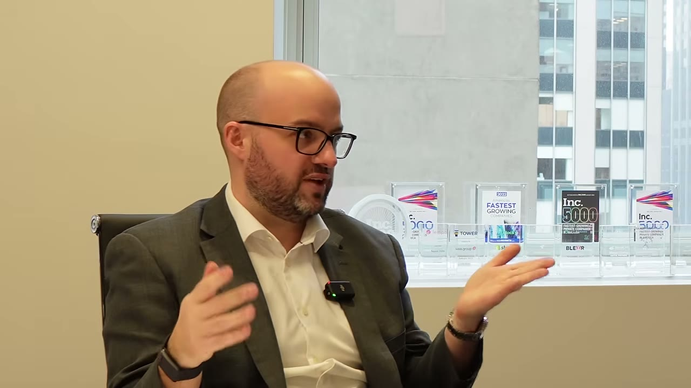
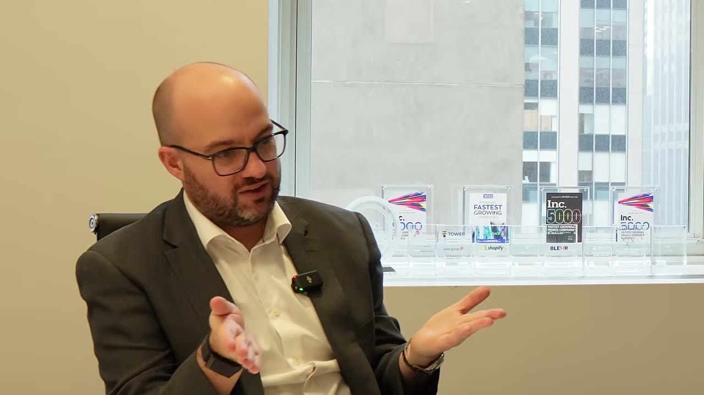
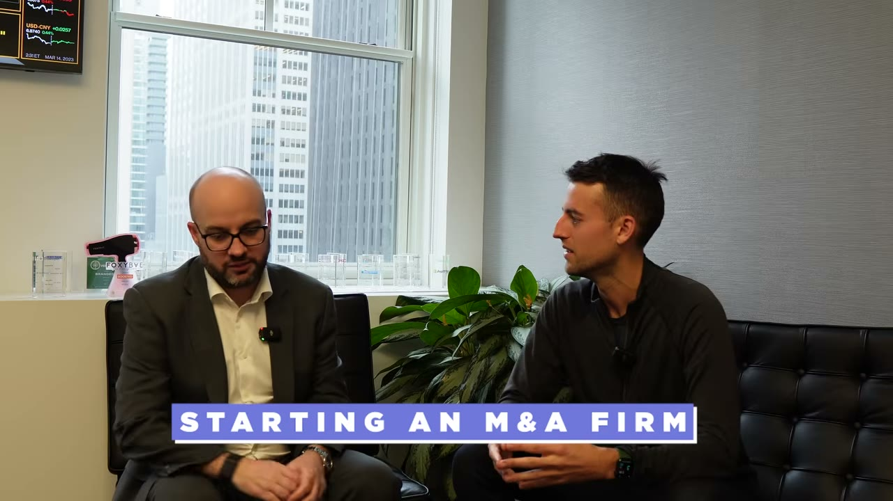
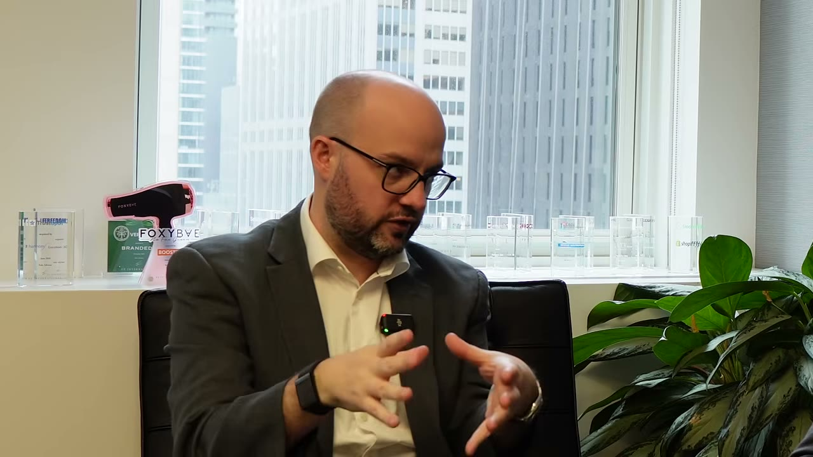
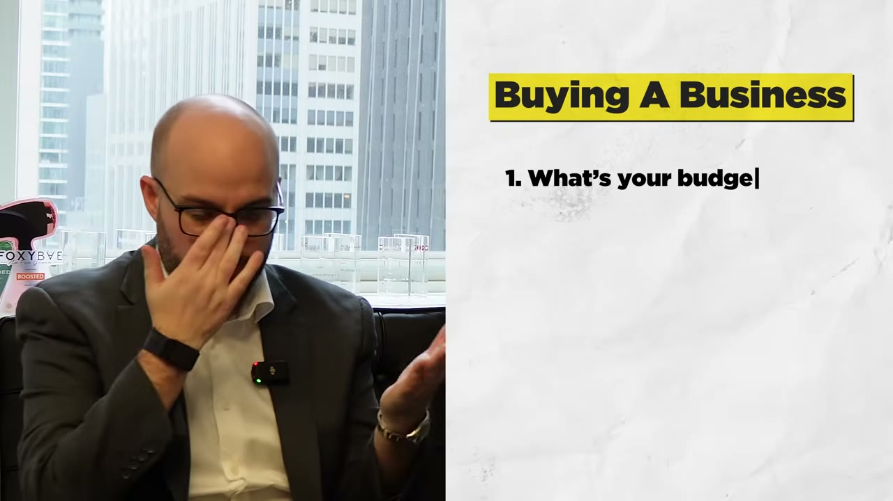
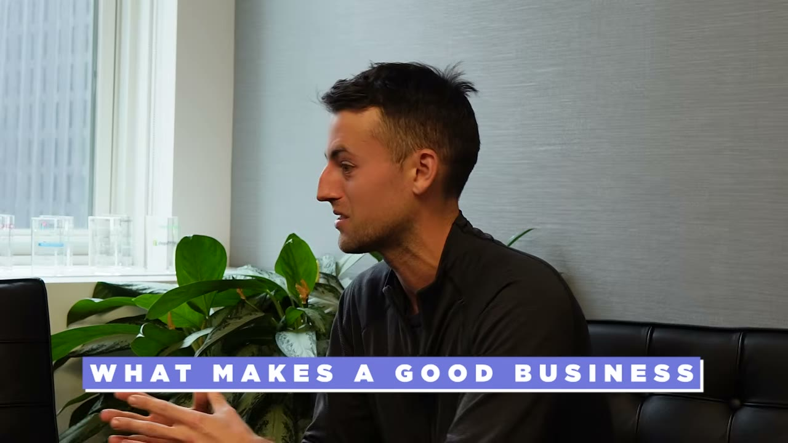
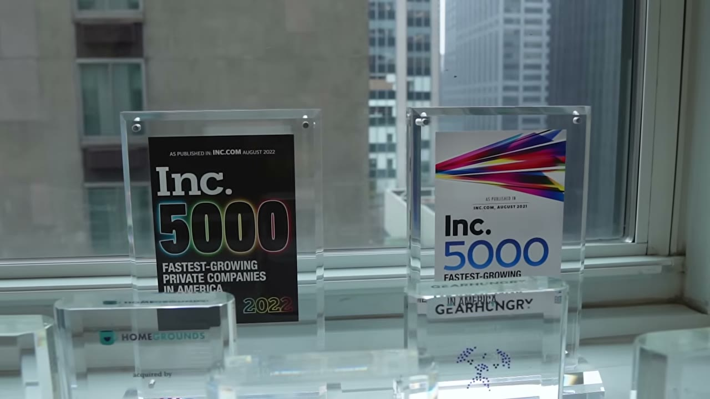
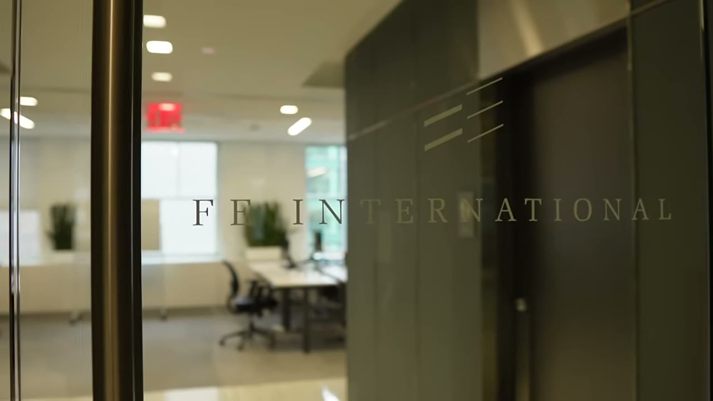
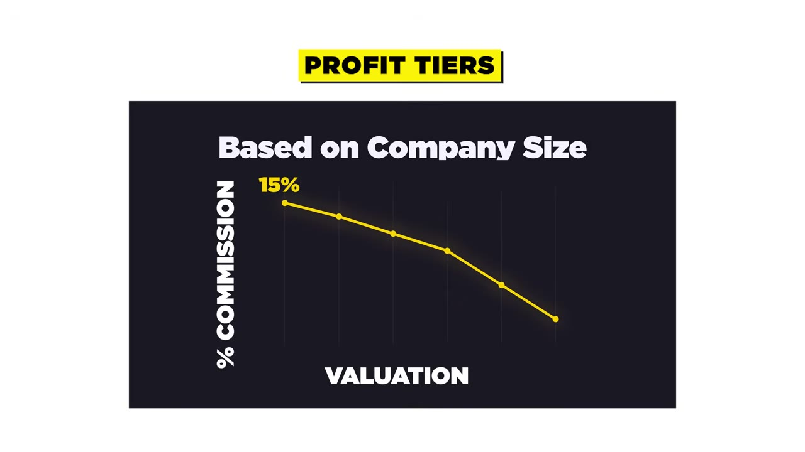
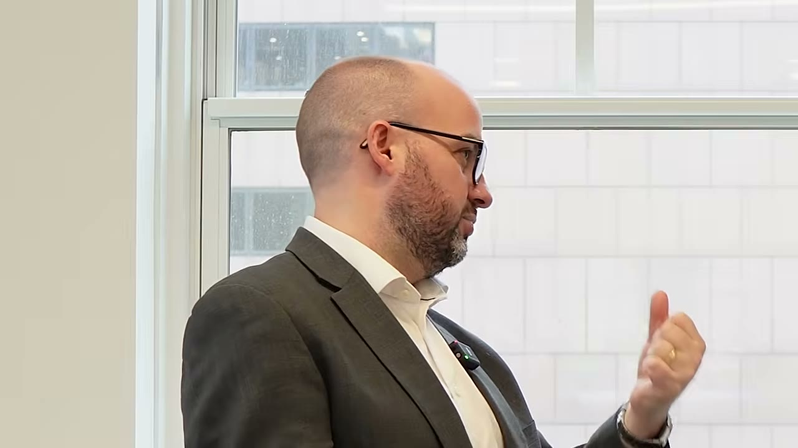

# Zero to $1.1B from Flipping Websites

✅ **Đã phân tích sâu** → [`case.md`](case.md)

| | |
|---|---|
| **Video** | <https://www.youtube.com/watch?v=Km0FNcBI9CM> |
| **Đăng** | 17/04/2023 |
| **Thời lượng** | 18:43 |
| **Lượt xem** | 247,034 |
| **Lượt thích** | 5,654 |
| **Video ID** | `Km0FNcBI9CM` |

## Trong thư mục này

| File | Nội dung |
|---|---|
| [`case.md`](case.md) | **Phân tích đầy đủ** — ý tưởng, validate, GTM, áp dụng ở VN |
| [`meta.json`](meta.json) | Metadata gốc (chapters, heatmap, mô tả) |
| [`screenshots/`](screenshots/) | 10 ảnh 720p |

## Mô tả gốc

In this episode I talked to Thomas Smale in his New York City Office to get his story and some advice on how to buy and sell businesses. He's done over $1B dollars in sales without even knowing how to develop a website, and he shares his advice on how to flip businesses, how to negotiate, and how he would start again if he had $0 dollars. This is a perfect episode for anyone who is hesitant on starting a business, and would rather buy one and build it from there. 
0:00 - Intro
0:49 - Getting into M&A
2:50 - Self-taught website flipper
4:17 - How he started an M&A firm
5:40 - Using the Pareto P

## Số liệu bắt được từ transcript

> Các đoạn founder nhắc tới con số, kèm timestamp để tua thẳng tới đó trong video.

_(không bắt được con số nào)_

## Chương

- `00:00` Intro
- `00:49` Getting into M&A
- `02:50` Self-taught website flipper
- `04:17` How he started an M&A firm
- `05:40` Using the Pareto Principle to make more money
- `06:36` How to buy a business
- `08:02` How to spot good businesses
- `09:46` Selling a $10M+ business
- `10:41` How he got the 8-figure deal
- `11:23` How much profit he makes per deal
- `11:56` How to value a business
- `12:56` Buying a business VS starting one
- `14:26` How to negotiate
- `16:33` How to buy a business from scratch

## Ảnh

1. `01_01m01s_ch-getting-into-m-a.jpg` — 
2. `02_03m02s_ch-self-taught-website-flipper.jpg` — 
3. `03_04m29s_ch-how-he-started-an-m-a-firm.jpg` — 
4. `04_05m52s_ch-using-the-pareto-principle-to-make-more-mo.jpg` — 
5. `05_06m48s_ch-how-to-buy-a-business.jpg` — 
6. `06_08m14s_ch-how-to-spot-good-businesses.jpg` — 
7. `07_09m36s_replay.jpg` — 
8. `08_10m53s_ch-how-he-got-the-8-figure-deal.jpg` — 
9. `09_11m35s_ch-how-much-profit-he-makes-per-deal.jpg` — 
10. `10_12m25s_replay.jpg` — 

---

← [Quay lại index](../../index.md) · [Toàn bộ video](../README.md)
