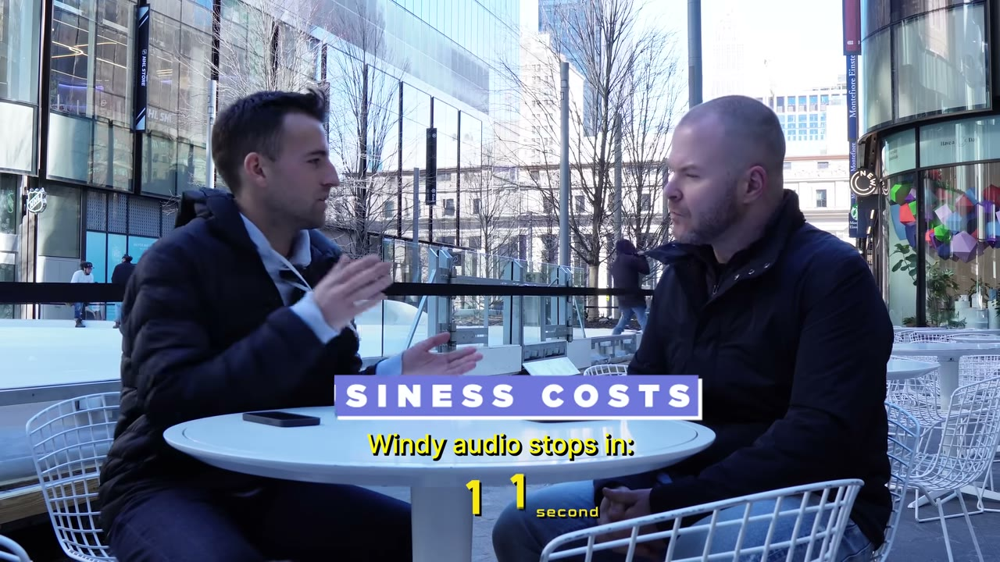

# The Solopreneur: He Makes $1.7M With 0 Employees

✅ **Đã phân tích sâu** → [`case.md`](case.md)

| | |
|---|---|
| **Video** | <https://www.youtube.com/watch?v=v6IF-lVuvbs> |
| **Đăng** | 24/04/2023 |
| **Thời lượng** | 12:02 |
| **Lượt xem** | 663,689 |
| **Lượt thích** | 14,771 |
| **Video ID** | `v6IF-lVuvbs` |

## Trong thư mục này

| File | Nội dung |
|---|---|
| [`case.md`](case.md) | **Phân tích đầy đủ** — ý tưởng, validate, GTM, áp dụng ở VN |
| [`meta.json`](meta.json) | Metadata gốc (chapters, heatmap, mô tả) |
| [`screenshots/`](screenshots/) | 10 ảnh 720p |

## Mô tả gốc

In this episode, Justin Welsh meets me in downtown New York city to show me exactly how he's built a one person business to over $1.7M/year. He shares his content strategy, tools he uses, daily routine, and some A1 advice for beginner entrepreneurs looking to start a solo business. Enjoy!
0:00 - Intro
0:59 - How he makes money
1:55 - Revenue
2:05 - How to become a solopreneur
3:18 - When he left his 9-5
5:01 - Costs to run a one-person business
6:06 - Content Marketing Strategy
7:54 - How to find ideas for content
8:57 - Daily routine as a solopreneur
10:16 - The fastest way to learn and grow

## Số liệu bắt được từ transcript

> Các đoạn founder nhắc tới con số, kèm timestamp để tua thẳng tới đó trong video.

_(không bắt được con số nào)_

## Chương

- `00:00` Intro
- `00:59` How he makes money
- `01:55` Revenue
- `02:05` How to become a solopreneur
- `03:18` When he left his 9-5
- `05:01` Costs to run a one-person business
- `06:06` Content Marketing Strategy
- `07:54` How to find ideas for content
- `08:57` Daily routine as a solopreneur
- `10:16` The fastest way to learn and grow
- `11:14` Advice for new solopreneurs

## Ảnh

1. `01_00m35s_usd-700.jpg` — 
2. `02_01m23s_replay.jpg` — 
3. `03_02m08s_usd-1-7-m.jpg` — 
4. `04_03m55s_metric.jpg` — 
5. `05_05m13s_ch-costs-to-run-a-one-person-business.jpg` — 
6. `06_06m18s_ch-content-marketing-strategy.jpg` — 
7. `07_08m06s_ch-how-to-find-ideas-for-content.jpg` — 
8. `08_09m06s_replay.jpg` — 
9. `09_10m28s_ch-the-fastest-way-to-learn-and-grow.jpg` — 
10. `10_11m26s_ch-advice-for-new-solopreneurs.jpg` — 

---

← [Quay lại index](../../index.md) · [Toàn bộ video](../README.md)
