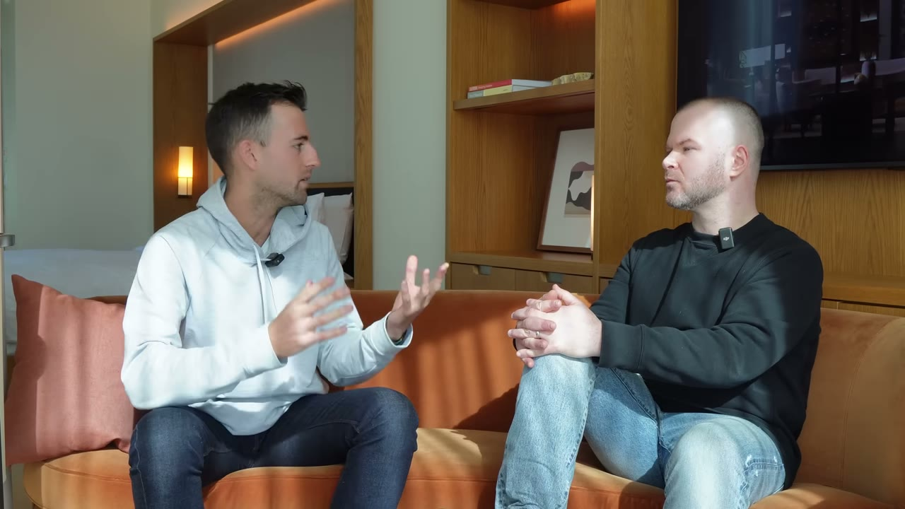
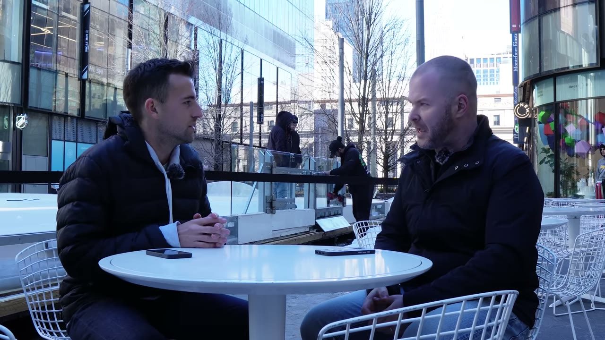

# Justin Welsh — phễu bốn tầng, 620 USD chi phí, và cơn hoảng loạn khởi đầu tất cả

> **Tóm tắt 30 giây.** Justin Welsh đưa một công ty lên **50 triệu USD doanh thu định kỳ trong 4,5 năm** với vai trò VP Sales. Rồi ngày **16/12/2018**, anh lên cơn hoảng loạn nặng — tê tay, lú lẫn, bò trên sàn, la hét và ảo giác. Vợ anh gọi cấp cứu. *"Đó về cơ bản là dấu chấm hết cho sự nghiệp công nghệ của tôi."* Bốn năm sau, anh kiếm **1,7 triệu USD một năm, một mình, chi phí 620 USD mỗi tháng, và chưa từng chạy một quảng cáo trả phí nào.** Cỗ máy của anh chỉ có bốn tầng, và anh mô tả nó trong chưa tới hai phút.

## 1. Con số

| Chỉ số | Giá trị |
|---|---|
| Doanh thu năm ngoái | **~1,7 triệu USD** |
| Dự kiến năm nay | ~2,5 triệu USD |
| **Chi phí vận hành** | **~620 USD/tháng** |
| Nhân sự | **0** |
| Chi quảng cáo | **0 — chưa bao giờ chạy** |
| Newsletter | **gần 100.000 người** |
| Giờ làm | **~5 giờ/ngày** |

**Ba nguồn thu:**

| Nguồn | Nội dung |
|---|---|
| **Khoá học** (chính) | hai khoá: dùng LinkedIn hiệu quả để xây doanh nghiệp, và xây hệ thống nội dung của riêng bạn |
| **Tài trợ newsletter** | bán cho công ty muốn tiếp cận đúng tệp độc giả của anh |
| **Email trả phí** | mỗi tháng gửi một email dạy kỹ thuật viết quảng cáo cho mạng xã hội |

**Chi phí, từng khoản:**

| Công cụ | USD/tháng |
|---|---|
| **Kajabi** (nền tảng khoá học và website) | **399 — phần lớn chi phí** |
| testimonial.to, Taplio, Hypefury | phần còn lại |
| **Tổng** | **~620** |

Anh nói rõ: *"gần như toàn bộ tiền tôi đầu tư vào doanh nghiệp đều là công cụ."* Không quảng cáo, không nhân viên, rất hiếm khi dùng freelancer.

## 2. Phễu bốn tầng — cỗ máy toàn bộ ⭐⭐⭐⭐⭐

Anh mở đầu bằng một câu đáng chú ý: *"Nó không phức tạp như nhiều người tưởng đâu."*

| Tầng | Ở đâu | Mục đích |
|---|---|---|
| **1. Khám phá** | LinkedIn + Twitter, **2–3 lần/ngày** | để người **chưa từng biết anh** tìm thấy anh |
| **2. Niềm tin** | **newsletter tuần** + các bài hướng dẫn dài trên website | *"cho người ta thấy bộ não bạn hoạt động ra sao"* |
| **3. Chuyên môn và thẩm quyền** | cùng nội dung dài đó | — |
| **4. Lời mời** | cuối bài dài | **không hối thúc** |

Và anh nói rõ **cơ chế của tầng 2**, đây là chỗ tinh tế nhất:

> Niềm tin với tôi đến từ việc **thực sự cho người ta thấy bộ não bạn hoạt động thế nào**. Và cách dễ nhất để cho ai đó thấy bộ não bạn hoạt động ra sao là **nội dung dạng dài**.
>
> Nên mỗi ngày, việc tôi làm là **kéo người từ Twitter và LinkedIn về website của mình.**

**Về lời mời, anh cố tình làm nhẹ:**

> Lời mời của tôi **không hung hăng**. Không phải kiểu *"này, bạn cần mua khoá học của tôi ngay bây giờ, khẩn cấp"*. Nó chỉ là: **nếu bạn thấy bài dài này hữu ích, nếu bạn tin tôi là người có thể giúp bạn giải quyết vấn đề của mình, thì đây là vài lựa chọn với giá phải chăng.**

**Phép tính anh đưa ra để giải thích vì sao một người làm được 1,7 triệu:**

> Nếu bạn có một triệu người theo dõi và **1 hoặc 2%** trong số đó mua một sản phẩm vài trăm đô, thì **đột nhiên bạn thấy điều này khá khả thi.**

Đối chiếu: [Thomas Frank thu 90.000 USD từ danh sách chờ 3.200 người](../2024-04-18_i-made-2-5m-selling-a-digital-product/case.md) và [Colin thu 284.000 USD từ 11.000 email](../2024-05-12_i-make-1m-month-from-bed/case.md). Ba founder, cùng một cấu trúc: **khán giả → danh sách sở hữu → sản phẩm giá vài trăm đô.**

## 3. Lịch làm việc — mức độ kỷ luật đáng chú ý ⭐⭐⭐⭐

Anh mô tả một ngày rất chi tiết, và điểm đáng học là **tính cố định**:

| Giờ | Việc |
|---|---|
| 5h30–6h30 | dậy |
| **8h15 sáng giờ miền Đông** | **nội dung ra ĐÚNG giờ này mỗi ngày, trên cả LinkedIn và Twitter** |
| sau đó | **tương tác với khán giả ít nhất 45–60 phút** |
| 9h30–11h | tới phòng gym cùng vợ (lái xe 20 phút) |
| 11h30–12h | ăn trưa |
| **12h–13h trở đi** | **làm việc sáng tạo, 3–4 tiếng cường độ cao** |

Và **phân bổ theo ngày trong tuần:**

- **Thứ Hai** — viết newsletter
- **Thứ Ba, Tư, Năm** — làm nội dung
- **Thứ Sáu** — dự án chiến lược: xây sản phẩm mới, dựng dịch vụ mới, gặp gỡ người thú vị

**Anh gọi đó là "một cuộc hẹn cố định với mạng xã hội mỗi sáng."** Việc đăng đúng một khung giờ mỗi ngày là quyết định vận hành, không phải sở thích: nó biến việc sản xuất nội dung từ một quyết định hàng ngày thành một thói quen không cần bàn cãi.

Đối chiếu với [Ramsri dành 2 tiếng chiều thứ Bảy](../2025-06-18_i-make-100k-year-from-2-ai-side-projects/case.md) và [Matt Giovanisci làm 1 video dài + 3 video ngắn mỗi tuần](../2024-05-04_i-turned-one-website-into-1m-year/case.md) — **lịch cố định là mẫu số chung của mọi doanh nghiệp nội dung bền trong kho này.**

## 4. Cách tìm ý tưởng nội dung ⭐⭐⭐⭐

Anh liệt kê rất cụ thể:

- **Đăng ký nhiều newsletter tổng hợp** — mỗi sáng hộp thư có sẵn các câu chuyện lớn nhất và bài của các nhà sáng tạo anh thích
- **Xem các kênh YouTube liên quan tới lĩnh vực của mình và tìm video phổ biến nhất của họ** — *"vì nếu nó là video ăn khách trên YouTube thì nhiều khả năng nó cũng cộng hưởng với khán giả của tôi"*
- **Luôn tìm thứ để đặt góc nhìn riêng vào** — *"bạn không muốn viết đúng thứ người khác trong ngành đã viết. Bạn muốn lấy chủ đề phổ biến, lấy những thứ khó với khách hàng lý tưởng của mình, rồi đặt góc nhìn của bạn lên đó."*
- **Ghi lại ngay khi ý tưởng xuất hiện** — anh dùng điện thoại, kể cả khi đang đi bộ: *"nếu bạn để nó trôi qua mà không ghi lại, tôi không bao giờ nhớ nổi."*

## 5. "Nhà sáng tạo theo giả thuyết" ⭐⭐⭐⭐

Cách anh cải thiện đến từ nghề cũ:

> Cách tôi nâng cấp là **tôi là một nhà sáng tạo vận hành theo giả thuyết** — đúng như khi tôi còn là lãnh đạo bán hàng ở sự nghiệp trước. Nghĩa là **đặt một giả thuyết, kiểm chứng nó, xem nó có chạy không.**
>
> Nếu chạy, **làm gấp đôi, gấp ba, gấp năm lần.** Nếu không, **loại bỏ nó hoàn toàn.**

Và lời khuyên đi kèm: *"hãy thử thật nhiều thứ, ném mọi thứ bạn có thể vào tường. Đó là con đường dễ nhất để giỏi lên trong đúng loại hình kinh doanh này."*

Đây là cùng phương pháp với [Jure chọn một kênh, dồn toàn lực hai tháng, rồi gấp đôi vào cái đã chạy](../2025-04-12_i-make-60k-month-with-4-apps/case.md).

## 6. Câu cuối — và nó nên được đọc cùng cả kho case này ⭐⭐⭐⭐⭐

Lời khuyên của anh cho người mới:

> Điều đầu tiên tôi làm là **nghĩ thật sâu về thứ bạn yêu thích làm mà bạn cũng rất giỏi**. Tìm ra thứ đó. Hỏi bạn bè, hỏi gia đình, rồi **ra ngoài và bắt đầu nói về nó trên mạng.**
>
> Lời khuyên số một của tôi là: **hãy bắt đầu.** Ai cũng muốn học mọi thứ, đọc mọi cuốn sách, nghe mọi podcast. **Việc bắt đầu sẽ dạy bạn nhiều gấp trăm lần so với đọc câu chuyện của tôi hay nghe tôi nói** — vì hành trình của bạn sẽ rất khác hành trình của tôi.
>
> **Mọi lời khuyên đều phụ thuộc vào bối cảnh, kể cả lời khuyên của tôi.**

Câu cuối đó là câu tôi cho là quan trọng nhất trong toàn bộ 180 case này. Nó lặp lại chính xác điều [Dmytro của ScreenshotOne nói: "đừng nghe ai cả, kể cả tôi"](../2024-11-22_how-i-built-it-12k-month-micro-saas/case.md).

Và nó là lý do mỗi case trong kho này đều có mục **"khi KHÔNG nên dùng"** — vì lời khuyên không có điều kiện áp dụng thì không phải lời khuyên, nó chỉ là một câu chuyện.

## 7. Cảnh báo thiên kiến nguồn

- **Không có ảnh chụp dashboard doanh thu nào.** Con số 1,7 triệu và dự kiến 2,5 triệu là lời tự khai. Đáng chú ý: **con số 620 USD chi phí thì rất cụ thể và kiểm chứng được** (Kajabi 399 USD là giá công khai) — điều đó làm tăng độ tin cậy cho phần chi phí, nhưng không xác nhận phần doanh thu.
- **Anh bán khoá học về LinkedIn**, tức sản phẩm của anh chính là *"cách làm điều tôi vừa kể"*. Đây là dạng thiên kiến cần lưu ý ở mọi case bán giáo dục kinh doanh — bao gồm cả chính kênh Starter Story.
- **Bối cảnh quyết định mà tiêu đề làm mờ:** anh là **cựu VP Sales đưa một công ty lên 50 triệu USD ARR**, và trước đó có 5 năm tại ZocDoc. Toàn bộ nội dung anh bán là **kinh nghiệm bán hàng và xây doanh nghiệp thật**, không phải kiến thức tự học từ internet. Người không có nền đó sẽ không có gì để dạy.
- **Đây là mô hình đòi hỏi khoảng một triệu người theo dõi** theo chính phép tính của anh. Con số đó mất nhiều năm.
- **Video không nêu tỷ lệ hoàn tiền, churn của email trả phí, hay tỷ lệ chuyển đổi thực tế** — những con số quyết định độ bền của mô hình.

## 8. Áp dụng cho tôi (indie hacker VN)

**Sao chép được ngay:**

1. **Phễu bốn tầng**: mạng xã hội để được khám phá → nội dung dài để xây niềm tin → lời mời nhẹ ở cuối. Cấu trúc này không cần vốn và không phụ thuộc nền tảng nào cụ thể.
2. **Đăng đúng một khung giờ cố định mỗi ngày**, và dành 45–60 phút tương tác ngay sau đó.
3. **Phân bổ ngày trong tuần theo loại công việc** — thứ Hai viết bài dài, giữa tuần làm nội dung, thứ Sáu làm việc chiến lược.
4. **Tìm ý tưởng bằng cách xem video phổ biến nhất của các kênh cùng lĩnh vực**, rồi đặt góc nhìn riêng vào.
5. **Vận hành theo giả thuyết:** thử, đo, gấp đôi cái chạy, loại bỏ hoàn toàn cái không chạy.
6. **Giữ stack công cụ tinh gọn.** 620 USD/tháng cho một doanh nghiệp 1,7 triệu USD là mốc để so sánh.

**Rào cản thật:**

- **Anh có chuyên môn bán hàng cấp lãnh đạo để bán.** Đây là rào cản lớn nhất: mô hình này bán **kinh nghiệm**, và bạn phải có kinh nghiệm đáng tiền trước đã.
- **LinkedIn và Twitter tiếng Anh** với khán giả doanh nghiệp phương Tây — cần viết tiếng Anh ở mức thuyết phục được người mua khoá học vài trăm đô.
- **Cần nhiều năm để đạt quy mô khán giả** mà phép tính của anh giả định.
- **Kajabi và các nền tảng tương tự** cần thanh toán quốc tế và xử lý thuế.

**Khi KHÔNG nên đi con đường này:**

- **Khi bạn chưa có chuyên môn đáng bán.** Bán khoá học về việc bán khoá học là vòng lặp mà thị trường đang bão hoà nặng.
- **Khi bạn không chịu được việc xuất hiện công khai mỗi ngày.** Toàn bộ mô hình đứng trên sự đều đặn 2–3 bài/ngày trong nhiều năm.
- **Khi bạn cần thu nhập trong 12 tháng.** Anh mất khoảng bốn năm, và bắt đầu từ một điểm rất thấp về tinh thần.

## Nguồn

- Video: [The Solopreneur: He Makes $1.7M With 0 Employees](https://www.youtube.com/watch?v=v6IF-lVuvbs) — Starter Story, 24/04/2023, 663.689 view
- [Transcript đầy đủ](transcript.md) · [Ảnh chụp màn hình](screenshots/)
