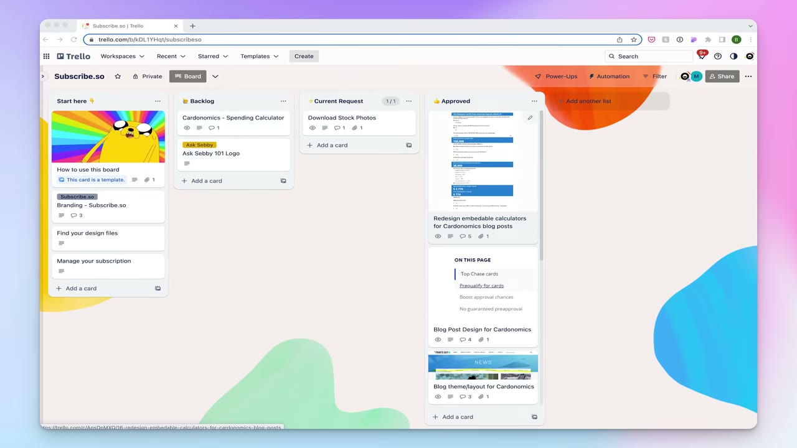

# I Make $1.3M/Year With One Skill

✅ **Đã phân tích sâu** → [`case.md`](case.md)

| | |
|---|---|
| **Video** | <https://www.youtube.com/watch?v=dXKzST0FE-A> |
| **Đăng** | 17/05/2023 |
| **Thời lượng** | 10:57 |
| **Lượt xem** | 1,045,911 |
| **Lượt thích** | 27,472 |
| **Video ID** | `dXKzST0FE-A` |

## Trong thư mục này

| File | Nội dung |
|---|---|
| [`case.md`](case.md) | **Phân tích đầy đủ** — ý tưởng, validate, GTM, áp dụng ở VN |
| [`meta.json`](meta.json) | Metadata gốc (chapters, heatmap, mô tả) |
| [`screenshots/`](screenshots/) | 8 ảnh 720p |

## Mô tả gốc

In this episode, I meet up with Brett from DesignJoy so I could ask him how he built a $1.3M per year one-person business WHILE working a 9-5. 
He reveals the secrets behind his pricing strategy, how he found his idea, and some actionable advice on how anyone can use this special business model to turn a single skill into a $1M/year business. Hope you all enjoy!
0:00 - Intro
0:52 - The $1.3M/year business model
1:24 - How he runs the business
2:06 - Finding the idea & building it
2:59 - Working a 9-5 while building the business
3:23 - Pricing strategy
4:10 - How to build a productized service 

## Số liệu bắt được từ transcript

> Các đoạn founder nhắc tới con số, kèm timestamp để tua thẳng tới đó trong video.

_(không bắt được con số nào)_

## Chương

- `00:00` Intro
- `00:52` The $1.3M/year business model
- `01:24` How he runs the business
- `02:06` Finding the idea & building it
- `02:59` Working a 9-5 while building the business
- `03:23` Pricing strategy
- `04:10` How to build a productized service with one skill
- `04:52` Costs & tools
- `05:19` Solopreneur marketing strategies
- `05:58` How to find ideas & build them fast
- `06:40` Starter Story Trial
- `07:14` How to get better at design
- `07:56` Day in the life / routine
- `09:10` Advice for entrepreneurs

## Ảnh

1. `01_01m07s_usd-5-000.jpg` — 
2. `02_02m48s_replay.jpg` — 
3. `03_03m57s_usd-5-000.jpg` — 
4. `04_05m06s_replay.jpg` — 
5. `05_06m10s_ch-how-to-find-ideas-build-them-fast.jpg` — 
6. `06_07m02s_usd-1.jpg` — 
7. `07_08m08s_ch-day-in-the-life-routine.jpg` — 
8. `08_09m22s_ch-advice-for-entrepreneurs.jpg` — 

---

← [Quay lại index](../../index.md) · [Toàn bộ video](../README.md)
