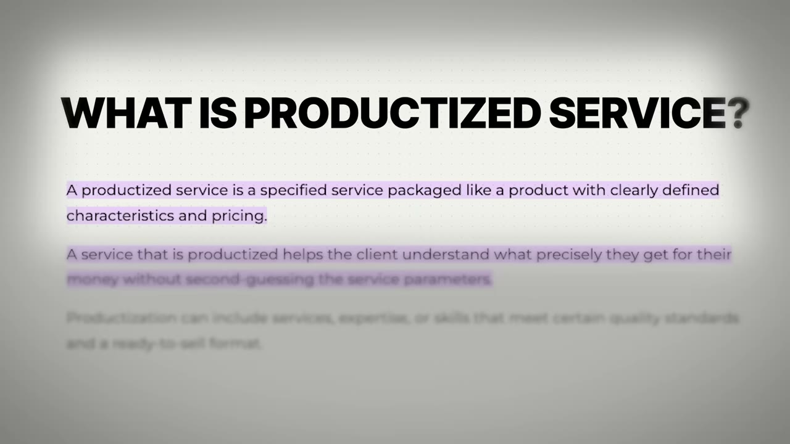
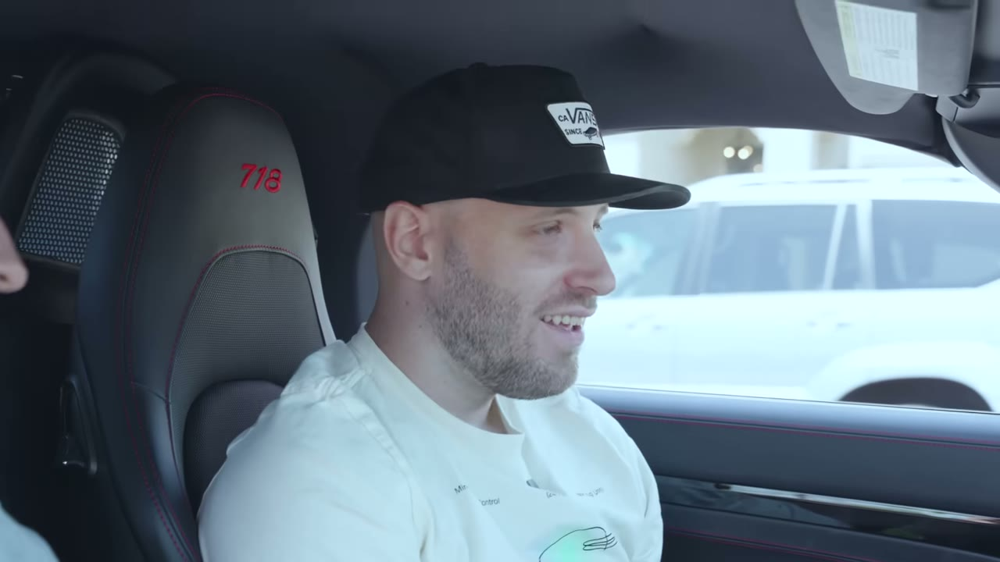

# DesignJoy 2023 — Brett tự kể, và lời thú nhận về 3,5 năm bị bất an giữ chân

> **Tóm tắt 30 giây.** Brett Williams bán **thiết kế theo dạng thuê bao**: khoảng **20 khách × 5.000 USD/tháng**, **không nhân viên, không nhà thầu, chưa từng có ai giúp**. Chi phí vận hành: **đúng 176 USD một tháng**. Anh dựng toàn bộ trong **một ngày thứ Bảy**. Nhưng chi tiết đắt nhất nằm ở cuối video: anh **giữ công việc toàn thời gian suốt 3,5 năm**, chỉ nghỉ khi DesignJoy đã kiếm **80.000 USD/tháng** — và **doanh thu tăng gấp đôi ngay tháng sau khi anh nghỉ**. Anh gọi đó là lãng phí hai năm.

## ⚠️ Kho này có HAI video về DesignJoy

| | Video này (5/2023) | [The $1.8M Solopreneur Playbook (1/2024)](../2024-01-13_the-1-8m-solopreneur-playbook/case.md) |
|---|---|---|
| Người nói | **Brett tự kể** | **Pat Walls phân tích từ ngoài** — Brett không nói câu nào |
| Doanh thu | 1,3 triệu USD/năm | 1,8 triệu USD/năm |

Nên đọc cả hai: video này có **lời tự thuật và các chi tiết vận hành**, video kia có **phân tích cấu trúc và thang giá**. Chênh lệch 1,3 → 1,8 triệu qua 8 tháng cũng là một điểm dữ liệu về tốc độ tăng trưởng.

## 1. Con số

| Chỉ số | Giá trị |
|---|---|
| Doanh thu | **1,3 triệu USD/năm** |
| Khách hàng | ~20 |
| Giá | ~5.000 USD/tháng/khách |
| **Chi phí vận hành** | **đúng 176 USD/tháng** |
| Nhân sự | **0** |
| Thời gian dựng sản phẩm | **6–7 tiếng, một ngày thứ Bảy** |
| Chi marketing | **0 USD** |
| Ngưỡng nghỉ việc | **80.000 USD/tháng** |

**Bảng chi phí — một trong những cơ cấu tinh gọn nhất trong toàn kho:**

| Công cụ | Ghi chú |
|---|---|
| Adobe + Shutterstock | **100 USD/tháng — khoản đắt nhất** |
| Figma, Webflow | phần còn lại |
| Trello, Airtable | **bản miễn phí** |
| **Tổng** | **176 USD** |

Đối chiếu: [Thomas Frank chi dưới vài trăm USD](../2024-04-18_i-made-2-5m-selling-a-digital-product/case.md), [ScreenshotOne chi 4.500 USD vì phải render trên server](../2024-11-22_how-i-built-it-12k-month-micro-saas/case.md). **Dịch vụ đóng gói có cấu trúc chi phí của một sản phẩm số, nhưng không cần xây sản phẩm.**

## 2. Cách vận hành — và ba quyết định làm nên toàn bộ mô hình ⭐⭐⭐⭐⭐

**Quyết định 1 — Hàng đợi thay cho lịch họp.**

Mỗi khách có **một bảng Trello riêng** và được truy cập ngay lập tức — anh nói đó là **điểm bán hàng lớn** của mô hình dịch vụ đóng gói. Họ nhập yêu cầu vào hàng đợi, và anh **làm từng cái một**. Mỗi yêu cầu mất **30 phút tới một tiếng**, gửi đi, qua vòng phản hồi, rồi lặp lại.

**Quyết định 2 — Không họp. Với ai. Bao giờ.**

> Sau khi onboard xong, **không có cuộc gọi Zoom nào. Thậm chí gần như không có cả trao đổi qua Slack.** Mọi thứ diễn ra **bất đồng bộ**, và điều đó cho phép tôi **dành trọn cả ngày chỉ để làm thiết kế.**

Đây là quyết định cấu trúc quan trọng nhất. Với 20 khách, chỉ cần mỗi khách một cuộc gọi 30 phút mỗi tuần là mất 10 tiếng — tức một phần tư tuần làm việc biến mất. **Anh không tối ưu việc họp, anh xoá bỏ nó.**

**Quyết định 3 — Giá cố định, yêu cầu không giới hạn.**

Anh giải thích rất rõ vì sao đây **không phải retainer**:

> Retainer thì vẫn theo dõi thời gian và về bản chất bạn vẫn trả theo giờ, chỉ là được đóng gói thành một mức giá cố định. Còn cách tôi làm: có khách **trả tới 5.000 USD cho một giờ** nếu họ chỉ gửi một yêu cầu, và có khách **chỉ 300 USD một giờ** nếu họ gửi nhiều. **Đơn giá theo giờ phụ thuộc vào việc khách gửi bao nhiêu yêu cầu.**

**Ý nghĩa kinh tế:** anh chuyển toàn bộ rủi ro sử dụng sang phía khách — nhưng đổi lại, khách nhận được **sự đơn giản và quyền truy cập ngay**. Và vì anh **chọn đúng loại việc mình làm nhanh** (xem mục 3), phần lớn yêu cầu đều nằm trong vùng 30–60 phút.

## 3. Lời khuyên sắc nhất: chọn thứ bạn LÀM NHANH, không phải thứ bạn làm được ⭐⭐⭐⭐⭐

Khi được hỏi làm sao người khác đóng gói kỹ năng của mình, câu trả lời của anh rất cụ thể:

> Dù bạn ở ngành nào — viết nội dung, dựng video, hay chỉ làm thumbnail YouTube, hay thiết kế — **hãy tìm những thứ bạn giỏi và thu hẹp lại.**
>
> Với tôi, tôi là designer, nghĩa là về kỹ thuật tôi làm được rất nhiều thứ. Nhưng **có những thứ tôi giỏi**: thương hiệu, thiết kế sản phẩm, thiết kế landing page. **Tôi không bận tâm tới phần còn lại, vì tôi không nhanh ở những thứ đó.**
>
> **Hãy tìm những thứ bạn NHANH**, dựng một gói quanh nó, gộp lại, đặt một mức giá vừa hấp dẫn vừa xứng đáng với thời gian của bạn. Rồi dựng một website. Đơn giản vậy thôi.

**Vì sao "nhanh" là tiêu chí đúng, không phải "giỏi":** trong mô hình giá cố định với yêu cầu không giới hạn, **tốc độ chính là biên lợi nhuận**. Một việc bạn làm giỏi nhưng chậm sẽ ăn hết lợi nhuận của cả tháng. Đây là bộ lọc mà rất ít người nêu ra, và nó chuyển giao được cho mọi dịch vụ đóng gói.

## 4. Dựng trong một ngày, và triết lý làm tối thiểu ⭐⭐⭐⭐

Toàn bộ DesignJoy được dựng trong **một ngày thứ Bảy, khoảng 6–7 tiếng**: một **trang Webflow một trang** cộng cấu trúc bảng Trello. Ra mắt trên Product Hunt.

Và ý tưởng thì không phải của anh:

> Tôi tình cờ thấy một agency khác làm thứ tương tự — họ làm cho **thiết kế đồ hoạ**, còn tôi là **web designer**, tôi làm landing page và thiết kế sản phẩm. Tôi nghĩ mình có thể lấy thứ họ làm, áp vào thứ mình giỏi, và **biến nó thành lựa chọn chất lượng cao nhất trên thị trường**.
>
> Về cơ bản là **lấy một ý tưởng đã tồn tại và làm nó tốt hơn.**

Cùng công thức với [Data Fetcher mượn API Connector từ Google Sheets sang Airtable](../2025-08-13_how-i-built-it-23k-month-micro-saas/case.md) và [NotionForms sao chép tính năng Forms của Airtable](../2024-11-07_how-i-built-it-37k-month-notion-app/case.md).

**Triết lý test ý tưởng của anh nhất quán tới mức đáng nhớ:**

> Tôi làm **mức tối thiểu tuyệt đối có thể**. Với DesignJoy là một ngày. Với khoá học của tôi, tôi **chỉ ngồi trong xe, thu vài file audio rồi tải lên. Xong.**
>
> Tôi thà làm vậy còn hơn bỏ hàng tuần, hàng tháng xây một thứ rốt cuộc có thể thất bại và phí thời gian.

## 5. Marketing 0 đồng ⭐⭐⭐

Đường đi rất gọn:
1. **Product Hunt** — anh gọi đó là cách ra mắt "khá sáo mòn", nhưng nó mang lại khách ngay
2. **Build in public**, tham gia nhiều cộng đồng
3. **Twitter** — anh mới lên khoảng một năm trước thời điểm quay, tự nhận là *"rất muộn"*, và xây được lượng theo dõi vừa phải. **Giờ hầu hết khách hàng tiềm năng đến từ đó — cứ mỗi lần anh tweet.**

Lưu ý điều [case DesignJoy 2024 chỉ ra](../2024-01-13_the-1-8m-solopreneur-playbook/case.md): các playbook về dịch vụ đóng gói thường **giấu mất phần kênh phân phối**, và đó là 80% khối lượng công việc thật. Ở video này Brett có nói ra kênh của mình — nhưng nó là **Twitter tiếng Anh trong cộng đồng thiết kế và indie hacker**, tức vẫn là một tài sản phải xây nhiều năm.

**Cách anh học thiết kế** cũng đáng ghi, vì nó không lãng mạn:

> Điều lớn nhất — nghe không vui đâu — là **cứ làm thôi**. Tôi không học thiết kế ở trường. Tôi tự dạy mình. Tôi ở trong các phần mềm thiết kế cả ngày, **bắt chước những thiết kế tốt đã có sẵn**. [...] Tôi **làm các dự án giả** — tìm một dự án rồi tự làm lại thương hiệu hoặc thiết kế lại nó.
>
> Miễn là bạn đang làm, miễn là bạn còn ở trong Figma đẩy từng pixel mỗi ngày, **rồi bạn sẽ tới.**

## 6. Lời thú nhận cuối — phần đắt nhất video ⭐⭐⭐⭐⭐

Khi được hỏi sẽ nói gì với chính mình lúc mới bắt đầu, câu trả lời của anh rất thẳng:

> Tôi là một **doanh nhân khá bất an**. Tôi không nghĩ mình là người duy nhất như vậy. Tôi có thể trông có vẻ tự tin, nhưng thực ra không. **Tôi thấy mình thấp hơn rất nhiều người.**
>
> Nên khi tạo ra DesignJoy, **có lý do tôi giữ công việc toàn thời gian cho tới khi kiếm được 80.000 USD** — đó là mức độ bất an của tôi về việc liệu nó có thật sự chạy được không.
>
> Điều đó mang tới rất nhiều căng thẳng. *Nếu nó không kéo dài thì sao? Tôi sẽ làm gì? Kế hoạch dự phòng của tôi là gì?* Nó **kìm chân tôi rất lâu**.

Và rồi con số:

> Tôi gần như hình dung DesignJoy như **một ngôi sao băng** — nó tới quá nhanh, và tôi cảm thấy nó cũng có thể tan biến nhanh như vậy. Điều đó ngăn tôi nhảy.
>
> **Và khi tôi nhảy, doanh thu của tôi tăng gấp đôi ngay tháng sau.** Khi tôi rời công việc để làm DesignJoy toàn thời gian, **nó gấp đôi tháng kế tiếp**. Tôi đã lãng phí quá nhiều thời gian làm hai việc cùng lúc — **nếu tôi có niềm tin vào bản thân, tôi đã ở vị trí hôm nay từ hai năm trước.**

**Đây là điểm dữ liệu quan trọng và nó đi ngược với phần lớn lời khuyên trong kho.** Rất nhiều case khuyên giữ công việc chính:

| Case | Cách làm | Kết quả |
|---|---|---|
| [Alex Goldberg](../2024-03-30_i-make-1m-year-with-one-website/case.md) | đổi sang việc nhẹ hơn để có 9-5 thật | nghỉ khi thu nhập bằng lương |
| [Ramsri](../2025-06-18_i-make-100k-year-from-2-ai-side-projects/case.md) | **chủ động không bao giờ nghỉ** | 8.500 USD/tháng, 1–2 giờ/tuần |
| [Sebastian](../2025-06-21_how-i-built-it-15k-month-mobile-app/case.md) | nghỉ, thất bại, **quay lại đi làm**, rồi nghỉ lần hai | thành công ở lần hai |
| **Brett** | **giữ việc 3,5 năm tới 80K/tháng** | **doanh thu gấp đôi ngay khi nghỉ** |

**Cách phân định tôi rút ra:** giữ việc chính là **bảo hiểm rẻ khi doanh thu còn thấp** — nhưng khi nó đã vượt xa lương của bạn, công việc chính không còn là bảo hiểm nữa, **nó là trần tăng trưởng**. Brett trả giá hai năm để học điều đó, và anh nói ra để người khác không phải trả.

**Một mâu thuẫn nhỏ cần ghi:** ở phút 3:16 anh nói *"tôi nghỉ khi kiếm 80.000 một tháng"*, còn ở phút 9:21 anh nói *"80K một năm"*. Phần mở đầu video và ngữ cảnh (doanh thu 1,3 triệu/năm) đều ủng hộ con số **theo tháng** — nên tôi lấy 80K/tháng, nhưng ghi lại để bạn biết.

## 7. Cảnh báo thiên kiến nguồn

- **Một đoạn chào bán Starter Story** (6:29–7:00) với ưu đãi dùng thử 1 USD trong 7 ngày.
- **Không có ảnh chụp dashboard doanh thu nào.** Con số 1,3 triệu là lời tự khai.
- **Mâu thuẫn 80K/tháng vs 80K/năm** trong cùng video — xem mục 6.
- **Câu chốt của Pat ở cuối** (*"làm thiết kế đi rồi bạn sẽ có một chiếc Porsche"*) là kiểu đóng khung mà bạn nên bỏ qua.
- **Bối cảnh không được nêu đủ:** Brett là **web designer chuyên nghiệp** và đã làm việc đó cả sự nghiệp trước đó. "Một ngày để dựng" là kết quả của nhiều năm thành thạo Figma và Webflow.
- **Video này có hơn 1 triệu lượt xem** — cao nhất trong nhóm case tôi viết — và mô hình dịch vụ đóng gói đã **đông hơn rất nhiều** kể từ 2023. Bản thân Brett cũng thừa nhận anh lấy ý tưởng từ một agency khác.

## 8. Áp dụng cho tôi (indie hacker VN)

Đây là một trong những case **dễ áp dụng nhất trong kho**: không cần vốn, không cần sản phẩm, không cần lập trình.

**Sao chép được ngay:**

1. **Bộ lọc "thứ tôi làm NHANH"** — liệt kê mọi việc bạn làm được, rồi gạch bỏ những việc bạn không nhanh. Phần còn lại là sản phẩm của bạn.
2. **Xoá bỏ họp hành ngay từ điều khoản dịch vụ.** Hàng đợi + bất đồng bộ. Đây là quyết định giúp một người phục vụ được 20 khách.
3. **Giá cố định, yêu cầu không giới hạn, quyền truy cập ngay** — và bán chính "quyền truy cập ngay" như điểm khác biệt.
4. **Dựng trong một ngày.** Một trang Webflow hoặc Framer cộng một bảng Trello.
5. **Lấy một mô hình đã có, áp vào kỹ năng của bạn, làm nó chất lượng cao nhất.**
6. **Làm dự án giả để luyện tay** trong lúc chưa có khách.

**Rào cản thật:**

- **Khách hàng là công ty phương Tây trả 5.000 USD/tháng.** Rào cản không phải kỹ năng thiết kế mà là **niềm tin và kênh** — họ cần thấy portfolio, thấy bạn có mặt trong cộng đồng, và thường cần hợp đồng cùng thanh toán quốc tế.
- **Twitter tiếng Anh trong cộng đồng thiết kế** là kênh chính của anh, và nó mất nhiều năm.
- **Mô hình này đã đông hơn nhiều so với 2023.** Nếu vào bây giờ, bạn cần một ngách hẹp hơn hoặc một lợi thế tốc độ rõ ràng.
- **Đây là mô hình đổi thời gian lấy tiền có trần.** 20 khách là gần hết công suất một người; muốn hơn thì phải tuyển, và lúc đó biên lợi nhuận đổi hẳn.

**Khi KHÔNG nên đi con đường này:**

- **Khi kỹ năng của bạn không có nhu cầu cao và không thể làm nhanh.** [Case DesignJoy 2024 nêu rõ mô hình này không chạy với kế toán hay dựng video](../2024-01-13_the-1-8m-solopreneur-playbook/case.md) vì cầu thấp và chạm tay nhiều.
- **Khi bạn muốn xây tài sản bán được.** Mô hình phụ thuộc hoàn toàn vào chính bạn — không có bạn thì không có doanh nghiệp.
- **Khi bạn cần thu nhập thụ động.** Anh làm việc mỗi ngày, và mỗi yêu cầu đều do chính tay anh làm.

## Nguồn

- Video: [I Make $1.3M/Year With One Skill](https://www.youtube.com/watch?v=dXKzST0FE-A) — Starter Story, 17/05/2023, 1.045.911 view
- [Transcript đầy đủ](transcript.md) · [Ảnh chụp màn hình](screenshots/)
