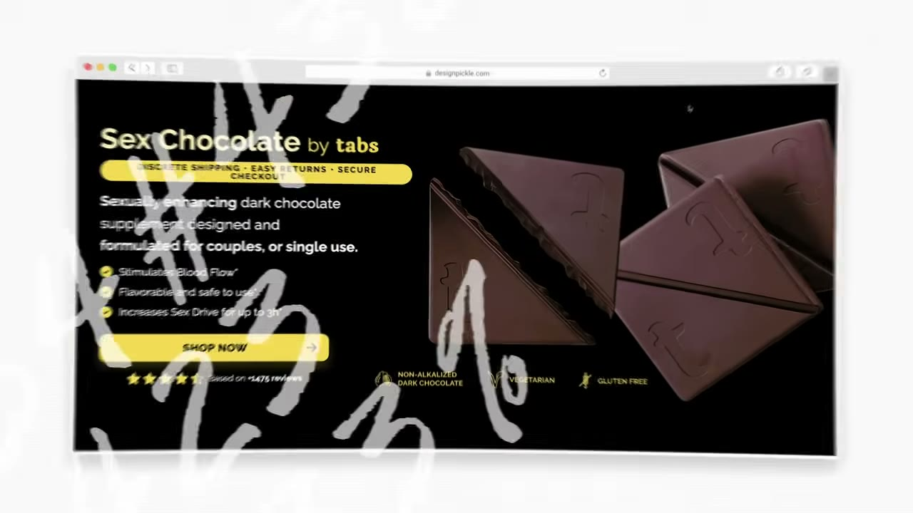
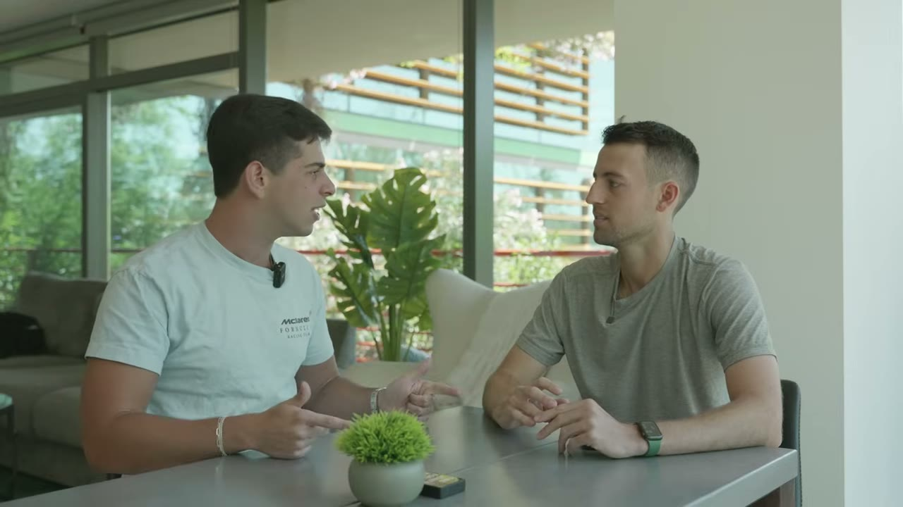
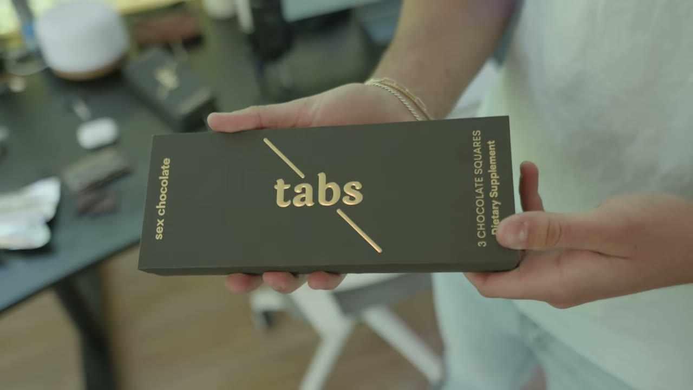
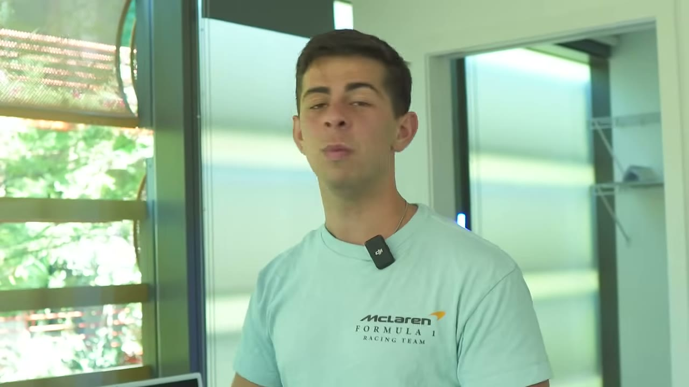
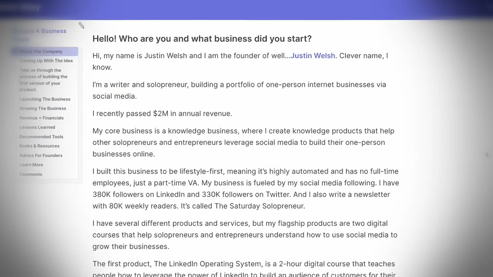
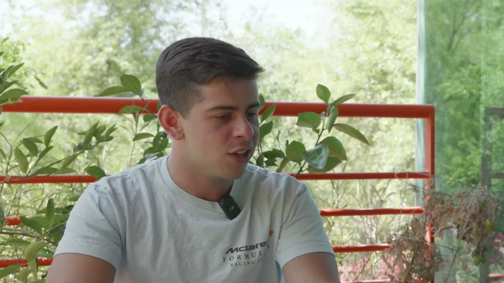
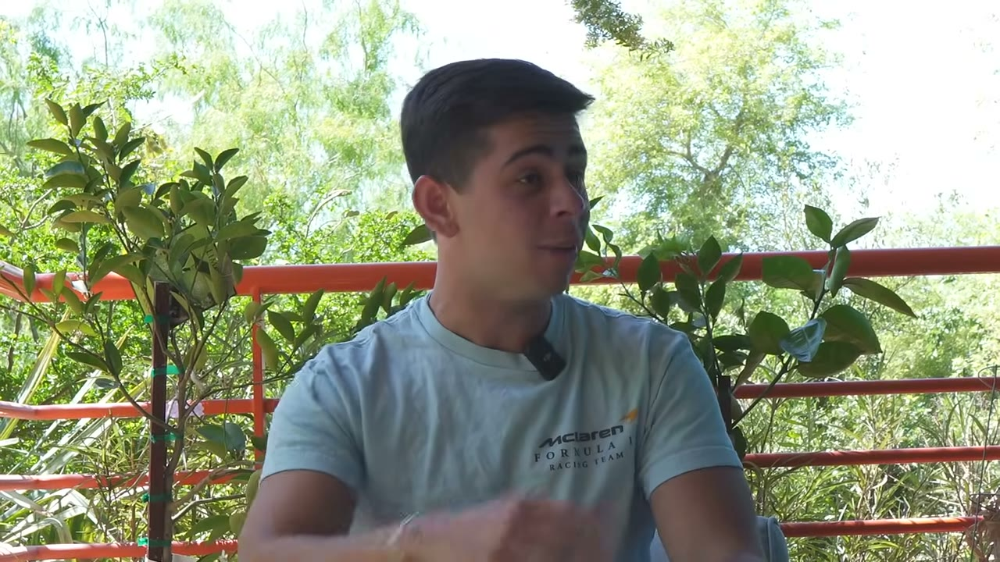
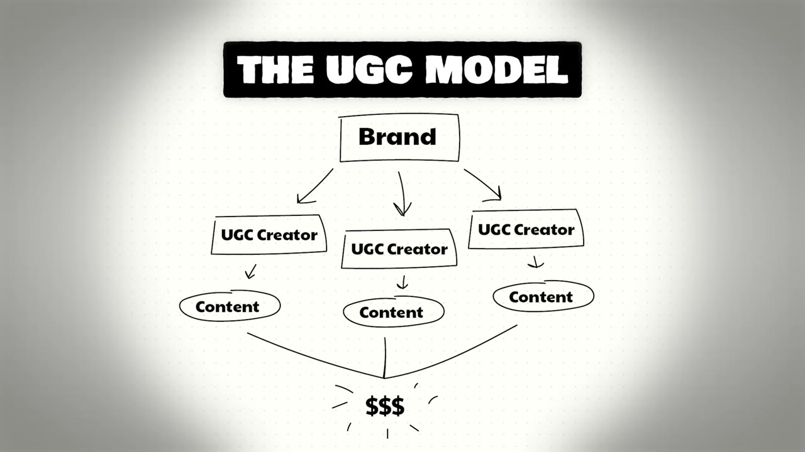

# I Make $11M/Year Selling One Product

✅ **Đã phân tích sâu** → [`case.md`](case.md)

| | |
|---|---|
| **Video** | <https://www.youtube.com/watch?v=5C3YCTL-36c> |
| **Đăng** | 07/06/2023 |
| **Thời lượng** | 13:19 |
| **Lượt xem** | 436,556 |
| **Lượt thích** | 10,472 |
| **Video ID** | `5C3YCTL-36c` |

## Trong thư mục này

| File | Nội dung |
|---|---|
| [`case.md`](case.md) | **Phân tích đầy đủ** — ý tưởng, validate, GTM, áp dụng ở VN |
| [`meta.json`](meta.json) | Metadata gốc (chapters, heatmap, mô tả) |
| [`screenshots/`](screenshots/) | 10 ảnh 720p |

## Mô tả gốc

Update (July 2025):
In this episode, I met up with Oliver Brocato to ask him exactly how he built Tabs Chocolate to $11M/year using a viral content strategy... and he tells it all. He shared how he built the product from scratch, how he found the idea, and the viral formula he uses generate millions. Hope you enjoy this one!
0:00 - Intro
1:02 - The $11M Business
1:30 - How he found the idea
2:15 - Viral psychology
3:01 - How to create product from scratch
4:14 - Shipping & Logistics Mistakes
5:16 - Starter Story Special
6:06 - Building a Brand VS Dropshipping
8:05 - The early days
9:24 - Costs

## Số liệu bắt được từ transcript

> Các đoạn founder nhắc tới con số, kèm timestamp để tua thẳng tới đó trong video.

_(không bắt được con số nào)_

## Chương

- `00:00` Intro
- `01:02` The $11M Business
- `01:30` How he found the idea
- `02:15` Viral psychology
- `03:01` How to create product from scratch
- `04:14` Shipping & Logistics Mistakes
- `05:16` Starter Story Special
- `06:06` Building a Brand VS Dropshipping
- `08:05` The early days
- `09:24` Costs
- `10:16` How to find manufacturer's
- `10:41` The Viral Strategy
- `11:41` Viral Video Formula
- `12:07` Other marketing channels
- `12:33` Advice for entrepreneurs

## Ảnh

1. `01_01m14s_ch-the-11m-business.jpg` — 
2. `02_02m27s_ch-viral-psychology.jpg` — 
3. `03_03m13s_ch-how-to-create-product-from-scratch.jpg` — 
4. `04_04m26s_ch-shipping-logistics-mistakes.jpg` — 
5. `05_05m28s_ch-starter-story-special.jpg` — 
6. `06_06m04s_replay.jpg` — 
7. `07_08m17s_ch-the-early-days.jpg` — 
8. `08_09m36s_ch-costs.jpg` — 
9. `09_10m44s_replay.jpg` — 
10. `10_11m40s_replay.jpg` — 

---

← [Quay lại index](../../index.md) · [Toàn bộ video](../README.md)
