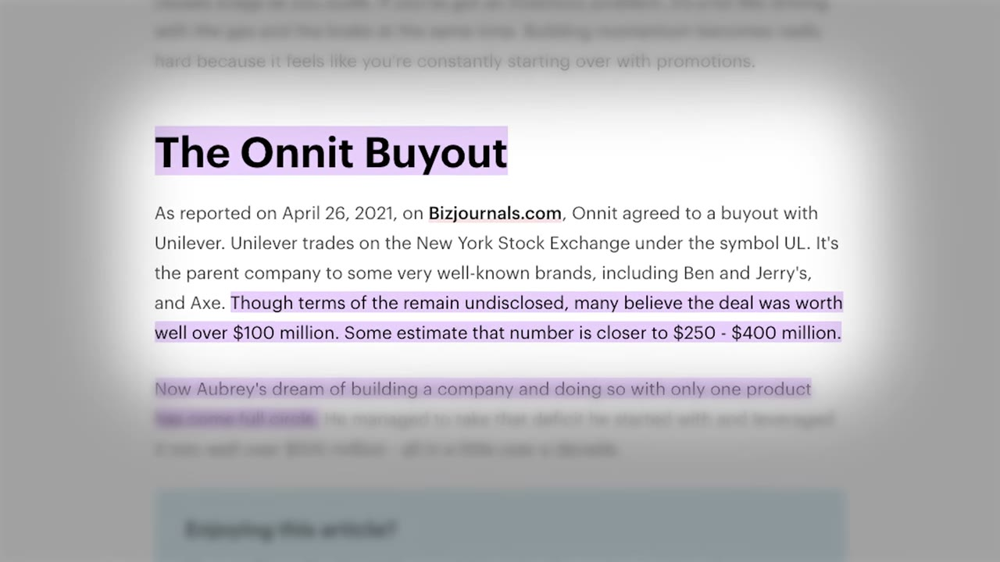
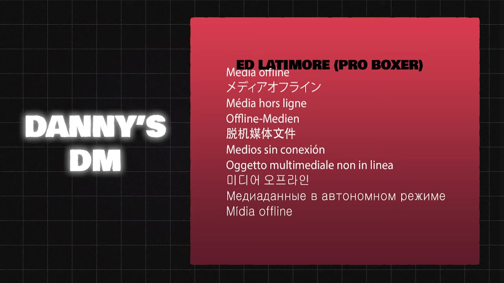
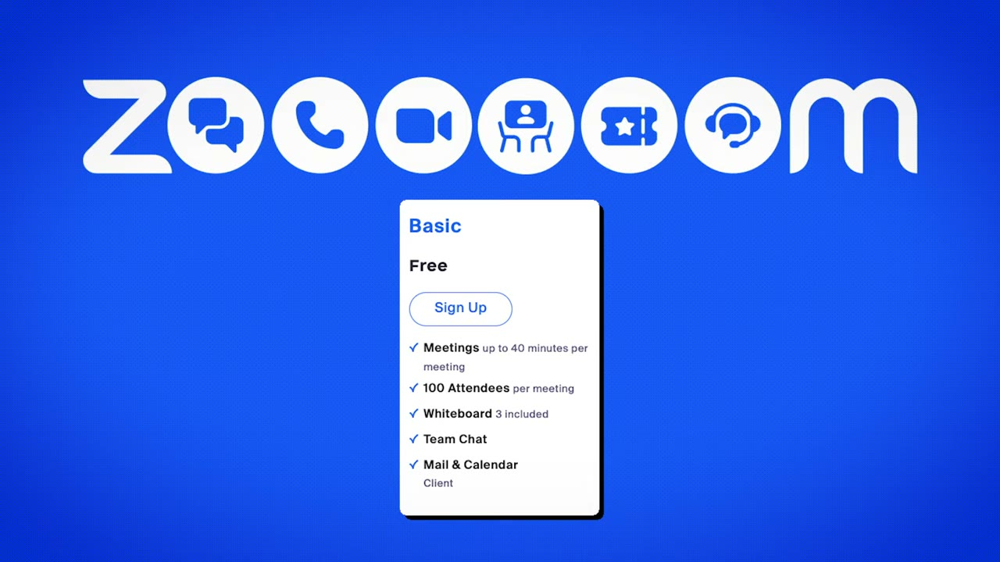
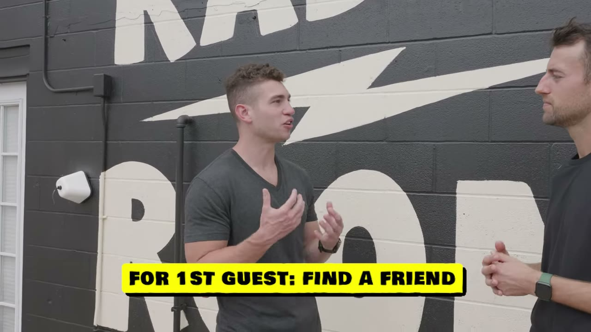
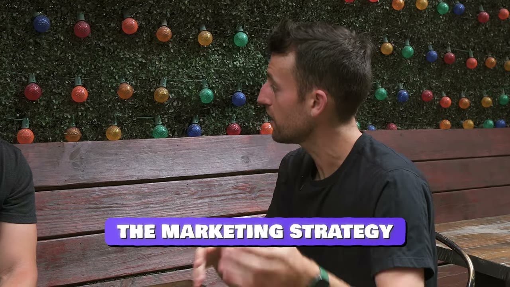

# How To Build A $100M Podcast Empire

✅ **Đã phân tích sâu** → [`case.md`](case.md)

| | |
|---|---|
| **Video** | <https://www.youtube.com/watch?v=Fk2J2U7669o> |
| **Đăng** | 21/06/2023 |
| **Thời lượng** | 14:58 |
| **Lượt xem** | 29,803 |
| **Lượt thích** | 895 |
| **Video ID** | `Fk2J2U7669o` |

## Trong thư mục này

| File | Nội dung |
|---|---|
| [`case.md`](case.md) | **Phân tích đầy đủ** — ý tưởng, validate, GTM, áp dụng ở VN |
| [`meta.json`](meta.json) | Metadata gốc (chapters, heatmap, mô tả) |
| [`screenshots/`](screenshots/) | 10 ảnh 720p |

## Mô tả gốc

In this episode I fly out to Austin, TX, to meet up with a podcast legend: Danny Miranda. He shares with me the reason everyone should start a podcast, how he makes money, and how he lands dream guests. Hope you guys enjoy! 
0:00 - Intro
1:04 - Why podcasting?
1:46 - The early days
2:20 - The opportunity of podcasting
3:06 - Podcasting business models
4:02 - The biggest podcast businesses
4:41 - How to start a podcast
5:19 - Tools & equipment
5:41 - How to become a great interviewer
6:27 - How to get your first guest
7:30 - How to land big guests
8:49 - Exclusive Danny Interview
9:42 -  Market

## Số liệu bắt được từ transcript

> Các đoạn founder nhắc tới con số, kèm timestamp để tua thẳng tới đó trong video.

_(không bắt được con số nào)_

## Chương

- `00:00` Intro
- `01:04` Why podcasting?
- `01:46` The early days
- `02:20` The opportunity of podcasting
- `03:06` Podcasting business models
- `04:02` The biggest podcast businesses
- `04:41` How to start a podcast
- `05:19` Tools & equipment
- `05:41` How to become a great interviewer
- `06:27` How to get your first guest
- `07:30` How to land big guests
- `08:49` Exclusive Danny Interview
- `09:42` Marketing Strategy
- `10:34` Clip & Content Schedule
- `11:22` How to build a unique podcast
- `12:26` Staying consistent
- `13:24` Daily routines & habits
- `14:24` Advice for podcasters

## Ảnh

1. `01_01m16s_ch-why-podcasting.jpg` — 
2. `02_01m58s_ch-the-early-days.jpg` — 
3. `03_03m18s_ch-podcasting-business-models.jpg` — 
4. `04_04m14s_ch-the-biggest-podcast-businesses.jpg` — 
5. `05_04m53s_ch-how-to-start-a-podcast.jpg` — 
6. `06_05m31s_ch-tools-equipment.jpg` — 
7. `07_06m39s_ch-how-to-get-your-first-guest.jpg` — 
8. `08_07m42s_ch-how-to-land-big-guests.jpg` — 
9. `09_09m01s_ch-exclusive-danny-interview.jpg` — 
10. `10_09m54s_ch-marketing-strategy.jpg` — 

---

← [Quay lại index](../../index.md) · [Toàn bộ video](../README.md)
