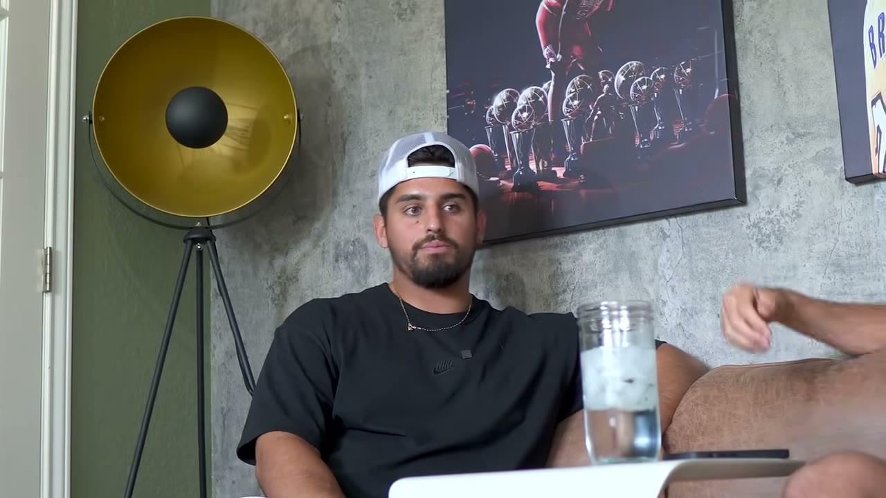
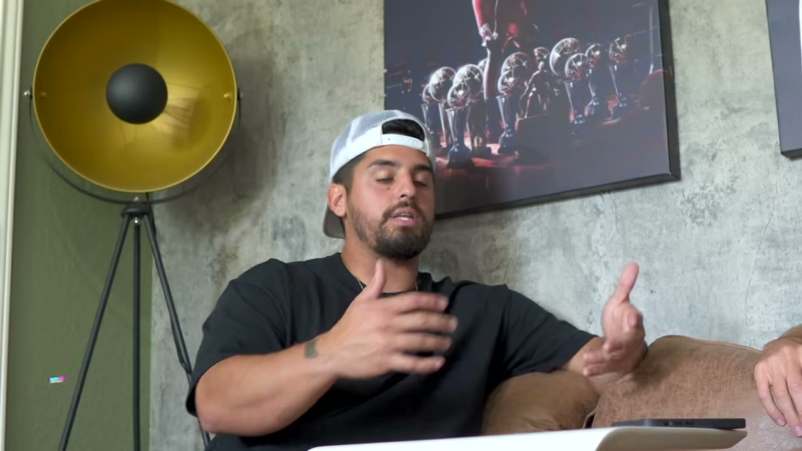
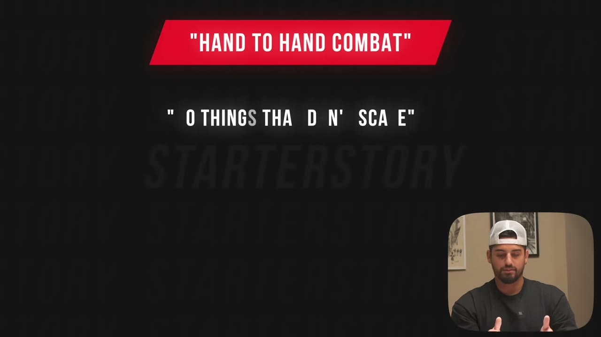
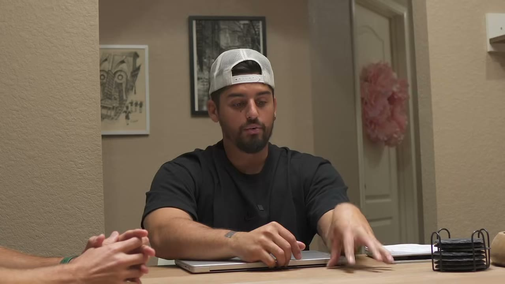
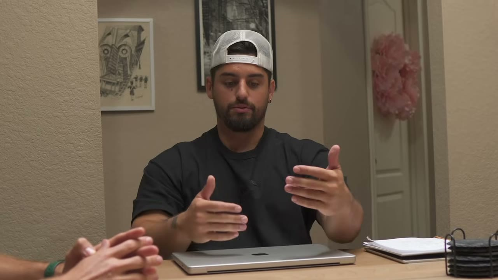
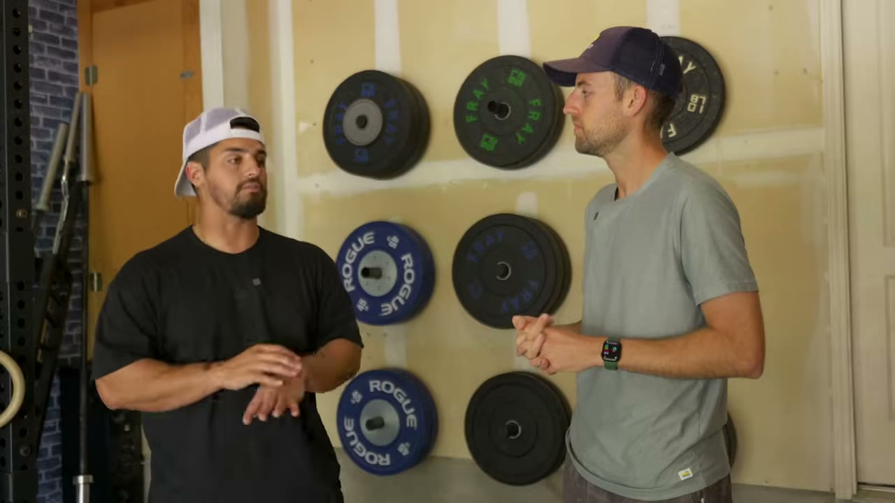
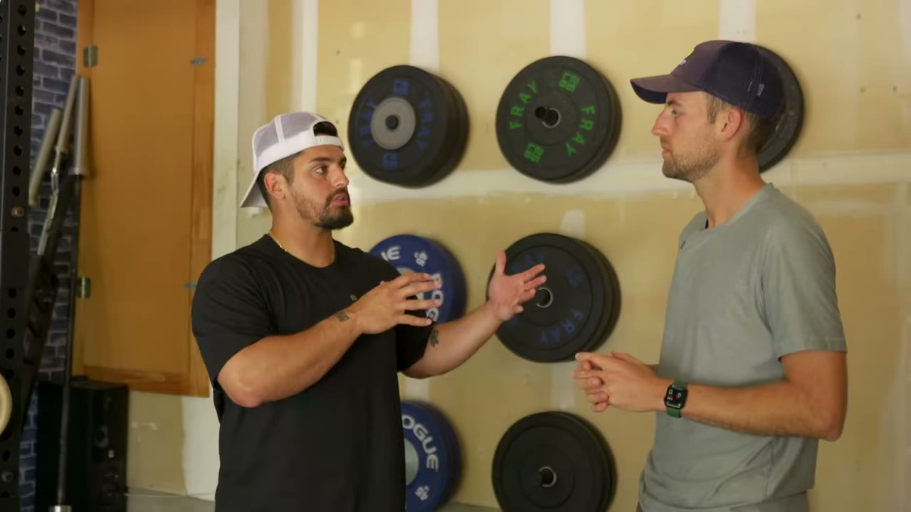
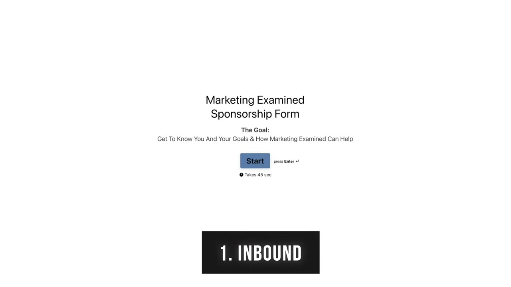

# I Make $845,601 Writing This Online...

✅ **Đã phân tích sâu** → [`case.md`](case.md)

| | |
|---|---|
| **Video** | <https://www.youtube.com/watch?v=5MaPEK-yVVY> |
| **Đăng** | 11/07/2023 |
| **Thời lượng** | 12:30 |
| **Lượt xem** | 140,281 |
| **Lượt thích** | 5,085 |
| **Video ID** | `5MaPEK-yVVY` |

## Trong thư mục này

| File | Nội dung |
|---|---|
| [`case.md`](case.md) | **Phân tích đầy đủ** — ý tưởng, validate, GTM, áp dụng ở VN |
| [`meta.json`](meta.json) | Metadata gốc (chapters, heatmap, mô tả) |
| [`screenshots/`](screenshots/) | 10 ảnh 720p |

## Mô tả gốc

In this episode, I meet up with Alex from Marketing Examined to ask him how he makes $800,000/year writing online… and it might be easier than you think.
He reveals how to get your first 1,000 newsletter subscribers, how to land big time sponsors, and the 4 key elements to build a $1M newsletter business from scratch.  Hope this one inspires some of you to start!
0:00 - Intro
0:52 - The Business Model + Revenue
1:33 - Finding the idea
2:13 - Building a 9-figure newsletter
2:56 - How to find a niche
4:32 - Blueprint for first 1,000 subscribers
5:36 - The outreach method
6:04 - Finding interesti

## Số liệu bắt được từ transcript

> Các đoạn founder nhắc tới con số, kèm timestamp để tua thẳng tới đó trong video.

_(không bắt được con số nào)_

## Chương

- `00:00` Intro
- `00:52` The Business Model + Revenue
- `01:33` Finding the idea
- `02:13` Building a 9-figure newsletter
- `02:56` How to find a niche
- `04:32` Blueprint for first 1,000 subscribers
- `05:36` The outreach method
- `06:04` Finding interesting topics
- `06:35` How to monetize
- `07:32` Tools
- `08:02` Outsourcing writers
- `08:28` How to grow a newsletter
- `09:28` Finding advertisers & pricing
- `10:07` How to get better at marketing
- `10:36` Daily routine
- `11:33` Advice for new entrepreneurs

## Ảnh

1. `01_01m04s_ch-the-business-model-revenue.jpg` — 
2. `02_01m45s_ch-finding-the-idea.jpg` — 
3. `03_02m25s_ch-building-a-9-figure-newsletter.jpg` — 
4. `04_03m08s_ch-how-to-find-a-niche.jpg` — 
5. `05_04m44s_ch-blueprint-for-first-1-000-subscribers.jpg` — 
6. `06_06m11s_replay.jpg` — 
7. `07_06m47s_ch-how-to-monetize.jpg` — 
8. `08_07m49s_replay.jpg` — 
9. `09_08m40s_ch-how-to-grow-a-newsletter.jpg` — 
10. `10_09m40s_ch-finding-advertisers-pricing.jpg` — 

---

← [Quay lại index](../../index.md) · [Toàn bộ video](../README.md)
