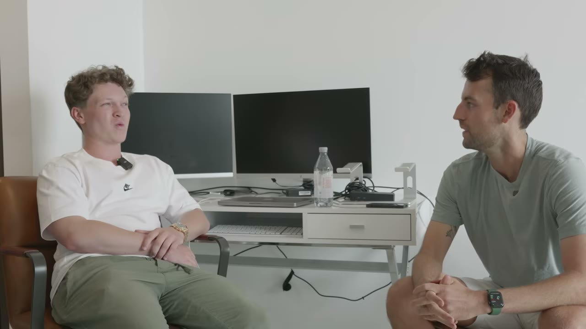
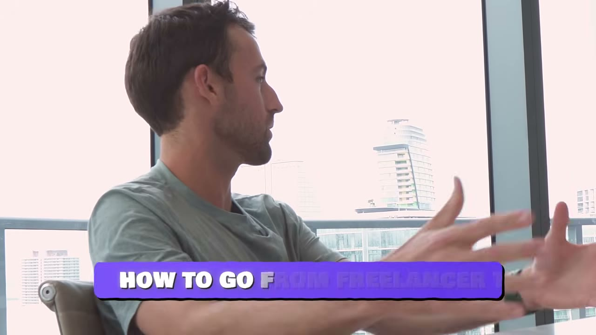
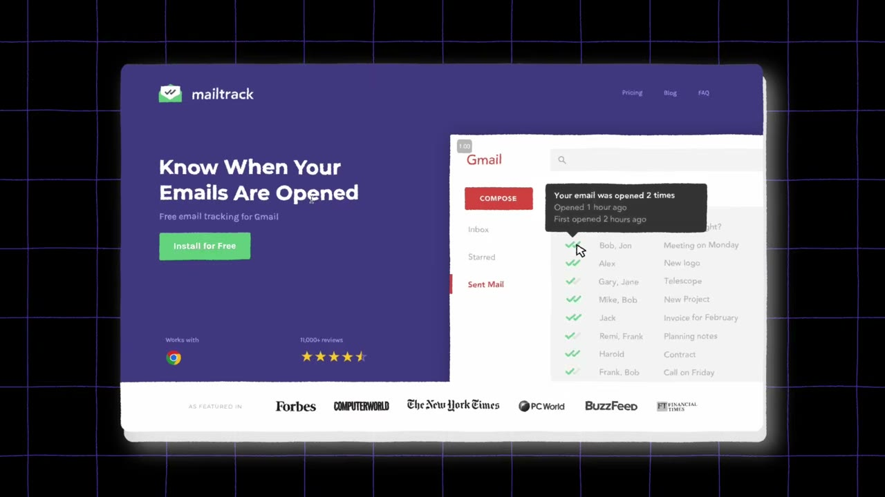
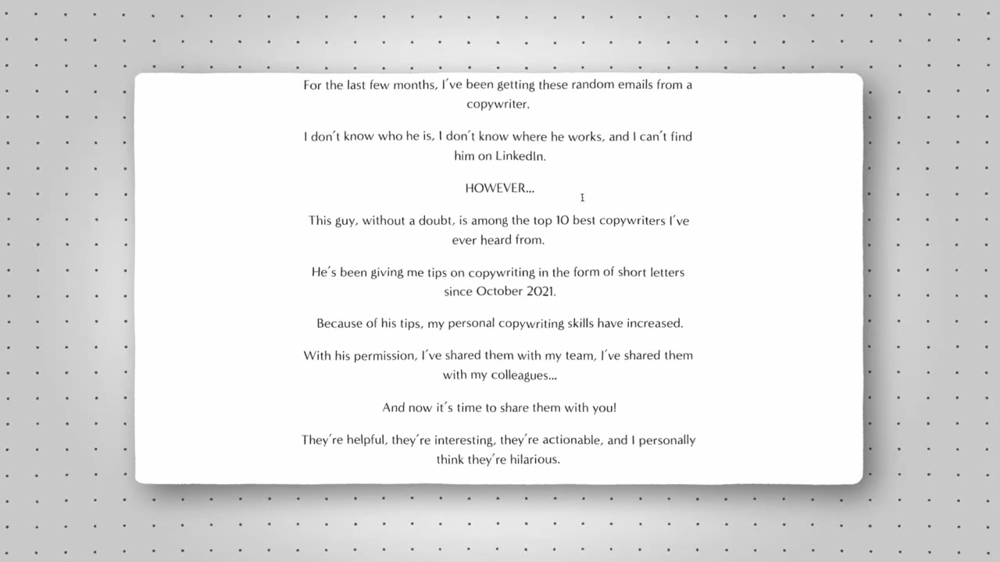
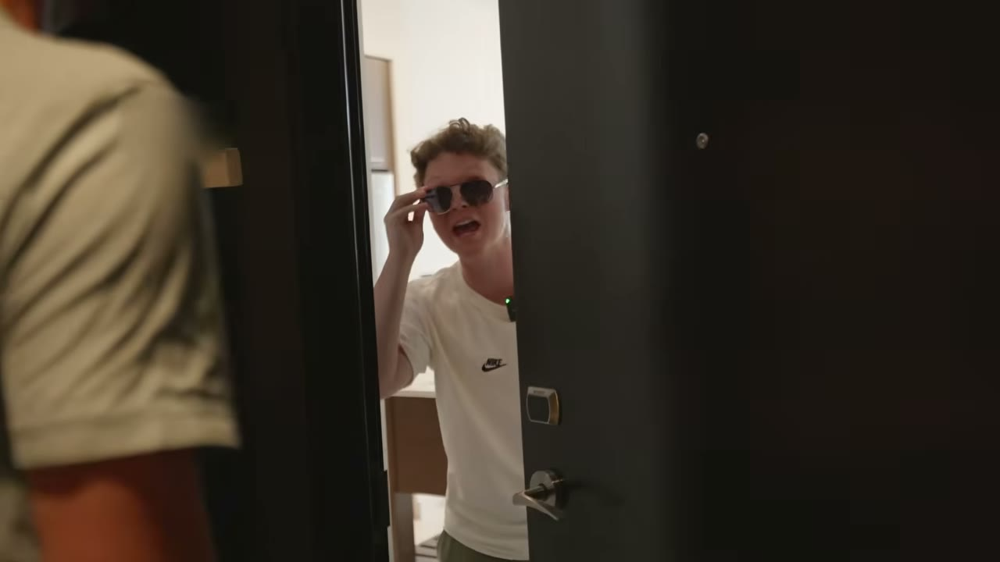
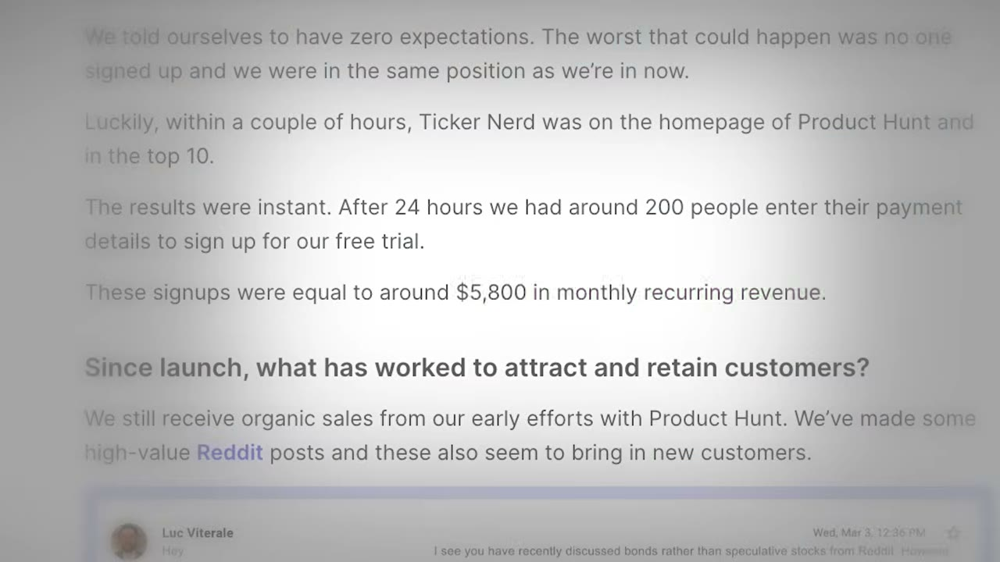

# Cardinal Mason — 2,3 triệu USD ở tuổi 21, và tấm bản đồ đầy đủ của nấc thang freelance

> **Tóm tắt 30 giây:** Mason bỏ đại học, đóng thùng hàng với **10 USD/giờ**. Khách copywriting đầu tiên của anh là một music blog trả **1,5 cent/từ — tức 15 USD cho 1.000 từ**. Anh tìm khách bằng cách **lướt Instagram đợi quảng cáo hiện ra**, tra ra founder, rồi gửi cold email. Hợp đồng thật đầu tiên: **2.500 USD/tháng** — anh nói *"với tôi lúc đó đó là cả một năm thu nhập"*. Đỉnh freelance: **48.000 USD/tháng**, và anh thừa nhận nó **không bền vững**. Anh chuyển thành agency (*multiple six figures/năm*), rồi thành công ty giáo dục Copy MBA (**1 triệu USD trong 96 ngày**). Tổng tích luỹ tới tuổi 21: **2,3 triệu USD**. Giá trị thật của video không nằm ở con số mà ở **trần thu nhập cụ thể của từng nấc thang** — và ở một lời tiên đoán về AI mà năm 2026 đã lung lay nghiêm trọng.

## 1. Con số

| Giai đoạn | Con số | Ghi chú |
|---|---|---|
| Trước đó | **10 USD/giờ** đóng thùng hàng | |
| Khách đầu tiên | 1,5 cent/từ = **15 USD/1.000 từ** | music blog, *"they made no money"* |
| Hợp đồng thật đầu tiên | **2.500 USD/tháng** | emails + ads + blogs |
| Đỉnh freelance | **48.000 USD/tháng** | *"wasn't sustainable, but I did it anyway"* |
| Agency email marketing | *multiple six figures/năm* | không có con số cụ thể |
| Copy MBA | **1 triệu USD trong 96 ngày** | cửa sổ ra mắt, không phải mức đều |
| Tổng tích luỹ tới tuổi 21 | **2,3 triệu USD** | gộp cả ba mảng |
| Vốn để bắt đầu | **~40 USD** | domain + Carrd |

**Cảnh báo số liệu — quan trọng để không hiểu sai case này:**

1. **2,3 triệu USD là TÍCH LUỸ TRỌN ĐỜI, không phải doanh thu năm.** Nó cộng gộp doanh thu freelance nhiều năm + agency + khoá học. Tiêu đề *I Made $2.3M* dễ khiến người xem nghĩ đây là mức đang chạy. Không phải.
2. **Video KHÔNG nêu doanh thu tháng hiện tại của bất kỳ mảng nào.** Đây là lỗ hổng lớn nhất. Đỉnh 48K/tháng là quá khứ, agency chỉ được mô tả mơ hồ, Copy MBA chỉ có con số của đợt ra mắt.
3. **Không có một dashboard, một biên lai nào trong 13 phút.** Tương tự [Assembly](../2023-09-20_hes-launching-a-new-1m-business-every-month/case.md) cùng lô 2023. Chuẩn bằng chứng của Starter Story năm 2023 thấp hơn hẳn các video 2025-2026 trong kho.
4. **Một con số ASR chắc chắn sai.** Transcript ghi *"there's about 45 to 5,000 freelance copywriters in America"* — vô nghĩa. Xem [mục 3](#3-lập-luận-thị-trường-chưa-bão-hoà--và-vì-sao-phải-đọc-ngược-) để biết vì sao con số này đáng ngờ dù có sửa thế nào.

## 2. Nấc thang thu nhập — phần đáng giá nhất của video ⭐⭐⭐

Đây là thứ hiếm: một người **đã leo hết cả ba nấc** và nói ra trần của từng nấc.

> *"You're probably not going to be a freelancer for the rest of your life... What I see a lot is people will sort of **reach the top of freelancer income, which is around 30 to 40k a month**. But if you want to get to like **100, 200, 500k a month**, you kind of **have to build something else**. You have to hire people, you have to learn new skills, you have to learn more about fulfillment, **you have to become an operator**. It's all kinds of different skills."*

| Nấc | Trần thu nhập | Bạn bán cái gì | Kỹ năng phải học để lên nấc sau |
|---|---|---|---|
| **Freelance** | 30–40K USD/tháng | giờ của chính bạn | tuyển người, fulfillment, quản lý |
| **Agency** | 100–500K USD/tháng | giờ của người khác | vận hành, xây quy trình |
| **Info product / giáo dục** | không trần cứng | kiến thức, biên gần 100% | marketing, giữ chân học viên, uy tín |

**Vì sao trần 30-40K/tháng tồn tại:** freelance cao cấp là bán thời gian với đơn giá cao. Ở 40K/tháng bạn đã dùng hết số giờ tỉnh táo trong tuần. Mason đẩy lên 48K và mô tả nó là *"kind of just cracked out just writing for eight hours a day straight"* — anh đã vượt trần, và nó không bền.

**Đây là mâu thuẫn quan trọng nhất của case này với kho.**

[Brett Williams của DesignJoy](../2024-01-13_the-1-8m-solopreneur-playbook/case.md) làm **1,8 triệu USD/năm ≈ 150K USD/tháng**, **một mình**, **6 giờ/ngày**, **không nhân viên, không freelancer**. Tức là Brett **đã phá thẳng cái trần mà Mason nói là không thể phá** — mà không hề trở thành operator.

**Ai đúng? Phân định bằng bản chất của dịch vụ, không bằng ý chí:**

| | Copywriting (Mason) | Thiết kế landing page (Brett) |
|---|---|---|
| Đơn vị bán | chữ, chiến dịch, email | một sản phẩm hoàn chỉnh, bàn giao xong là xong |
| Quan hệ với khách | liên tục, cần họp, cần hiểu ngữ cảnh, cần sửa nhiều vòng | **một yêu cầu tại một thời điểm, gửi qua Trello, không họp** |
| Có thể đóng gói thành quy trình cứng? | khó — mỗi khách một giọng, một sản phẩm | **có** — nhu cầu lặp lại, output chuẩn hoá được |
| Cách nâng thu nhập | thêm khách → thêm giờ | **nâng giá cho cùng khối lượng** — 449 → 8.000 USD/tháng |

**Nguyên tắc rút ra:** trần của freelance **không phải là con số cố định, nó là hàm của việc dịch vụ đó có đóng gói được không**. Nếu dịch vụ của bạn cần nhiều tiếp xúc và tuỳ biến (copywriting, tư vấn, kế toán) → Mason đúng, muốn vượt trần phải thuê người. Nếu dịch vụ của bạn ít tiếp xúc và output chuẩn hoá được (thiết kế, dựng video mẫu, chỉnh sửa) → **Brett đúng, hãy nâng giá và đặt luật, đừng tuyển người**.

Lưu ý thêm: [Hunter Hammonds của Assembly](../2023-09-20_hes-launching-a-new-1m-business-every-month/case.md) đặt đúng câu hỏi phân biệt này ở dạng gọn nhất — *"how are you actually building a business and not just **freelancing in disguise as solopreneurship**?"* Mason chính là người đã đâm vào bức tường đó ở 48K/tháng.

## 3. Lập luận thị trường chưa bão hoà — và vì sao phải đọc ngược ⭐⭐

Mason đưa ra một phép tính nghe rất thuyết phục:

> *"There are **35 million small businesses in the US alone**. There's about **[45 to 5,000 — ASR hỏng]** freelance copywriters in America. So for it to be saturated, **every single copywriter would have to have like 3,000 clients**, and you only need four, five, six clients to make really solid money, like six figures."*

**Vấn đề với lập luận này — ba lớp:**

1. **Con số ASR hỏng.** *"45 to 5,000"* không có nghĩa. Từ chính phép tính của anh (35 triệu ÷ 3.000 khách/người) suy ra anh đang giả định khoảng **12.000 copywriter** ở Mỹ. Bất kỳ con số nào khác đều làm sập kết luận.
2. **35 triệu doanh nghiệp nhỏ ≠ 35 triệu khách hàng tiềm năng.** Tuyệt đại đa số doanh nghiệp nhỏ ở Mỹ là hộ kinh doanh cá thể không có ngân sách marketing. Số doanh nghiệp thực sự chi 2.500 USD/tháng cho một copywriter tự do nhỏ hơn nhiều bậc.
3. **Người nói câu này bán khoá học copywriting.** Đây là điểm then chốt. Lập luận *"thị trường còn rất rộng, bạn cứ vào đi"* là **chính xác cái mà Copy MBA cần bạn tin** để mua khoá học.

Anh còn thêm một lớp nữa, cũng là lập luận bán hàng kinh điển:

> *"Everyone is really lazy. If I get a video talking about copywriting and it has a hundred thousand views, for any hundred thousand views that I get, there's probably another **five people** that are actually trying it, and **four of them are going to give up in like a month**. So if you actually genuinely want to work, then there's more than enough to go around."*

*(Con số "five people trên 100.000 view" gần như chắc chắn là ASR sai — hợp lý hơn là 500. Nhưng ý thì rõ.)*

**Điều này không có nghĩa Mason nói dối.** Cơ chế *phần lớn người bỏ cuộc trong tháng đầu* là có thật và quan sát được ở mọi ngành. Chỉ là: **khi một người kiếm tiền từ việc dạy X nói với bạn rằng X chưa bão hoà, hãy tự đi kiểm chứng cầu bằng 20 cold email trước khi tin.** Đúng cùng loại cảnh báo áp dụng cho [Joe Popelas](../2023-08-30_meet-the-kid-who-made-1m-with-chatgpt/case.md) — người cũng bán khoá học và cũng nói ngành của mình còn *"nhiều năm nữa mới bão hoà"* (rồi bão hoà trong vài tháng).

## 4. 🚨 Lời tiên đoán về AI — phần lỗi thời nhất của video

Đây là đoạn cần cảnh báo mạnh nhất. Tháng 8/2023, Mason được hỏi thẳng *"nghe nói AI sẽ giết copywriting"*:

> *"The reality is that **AI is good, but it's a tool**. AI does not just instantly know what to do, what to write. AI is a tool that copywriters can use to write better, write clearer, think better... But the reason someone's hiring a copywriter is because they don't even know where to start. A lot of business owners — it's not that they don't have time or that they just need someone to do it. It's usually because they need someone to **think on their behalf. AI can't do that yet.** ... **Any prompt AI gets has to be from someone who fundamentally understands copywriting.**"*

**Trạng thái năm 2026:**

- **Vế "AI không tự nghĩ thay bạn" đã yếu đi rất nhiều.** Mô hình hiện tại đọc được website, phân tích được đối thủ, đề xuất được góc tiếp cận — tức làm được phần lớn cái mà năm 2023 gọi là *thinking on their behalf*.
- **Vế "prompt phải đến từ người hiểu copywriting" vẫn còn đúng một phần** — nhưng nó đã tụt từ *lợi thế cạnh tranh* xuống thành *điều kiện tối thiểu*. Nó không còn đủ để bán dịch vụ 2.500 USD/tháng.
- **Điều đã KHÔNG bị AI phá:** phần Mason mô tả gián tiếp mà không nhấn mạnh — **quan hệ, niềm tin, và việc chịu trách nhiệm cho kết quả**. Chase thuê Mason không vì Mason viết nhanh, mà vì Mason đã tạo được quan hệ (mục 5). Đó mới là phần bền.

**Cảnh báo động cơ:** Mason bán khoá học copywriting. Trong tháng 8/2023, khi ChatGPT vừa làm cả ngành hoảng loạn, câu trả lời *"AI chỉ là công cụ"* là câu trả lời **bắt buộc phải nói** để giữ doanh thu khoá học. Hãy đối chiếu với [FormulaBot](../2024-02-11_i-built-a-1m-ai-app-no-code/case.md), nơi founder thừa nhận thẳng rằng **10% churn của anh là do chính ChatGPT nuốt mất tính năng** — đó là lời khai của người không có động cơ nói AI vô hại.

**Nếu bạn định học copywriting năm 2026:** đừng học để bán *chữ*. Học để bán **kết quả kinh doanh** — góc tiếp cận, kiểm thử, con số chuyển đổi. Phần soạn chữ đã bị AI hạ giá xuống gần 0; phần *biết nên nói gì với ai và đo bằng cái gì* thì chưa.

## 5. Cách kiếm khách đầu tiên — cơ chế cụ thể, còn dùng được ⭐⭐⭐

Phần này **không lỗi thời** và là phần thực dụng nhất video.

### Vấn đề: không thể Google ra khách hàng

> *"You can't just Google **companies that will pay me to write copy** — like, there's no search for that."*

### Giải pháp: dùng chính quảng cáo của họ làm danh sách khách hàng

> *"So I went to Instagram and **I would just wait for ads**. Every three or four posts on Instagram would be an ad, and so I eventually found a bunch of companies using that. **I figure out who the founder is, then figure out what their email is**, and then I would just send them a cold email."*

**Vì sao cơ chế này thông minh và tại sao nó vẫn hiệu quả năm 2026:**

Một công ty **đang chạy quảng cáo** đã tự chứng minh ba điều mà bạn không thể biết bằng cách nào khác:
1. Họ **có ngân sách marketing** — họ đang tiêu tiền ngay lúc này.
2. Họ **quan tâm tới chuyển đổi** — quảng cáo là kênh đo được.
3. Bạn **nhìn thấy chính bản copy của họ** → bạn có thể chỉ ra chỗ dở và đề xuất bản tốt hơn ngay trong email đầu tiên.

Đây là **danh sách khách hàng đã được tiền lọc sẵn, miễn phí**, và nó là phiên bản chủ động của cùng cơ chế mà [Nick Buzz của Baked](../2024-09-01_faceless-from-immigrant-to-1m-year/case.md) dùng ở dạng công khai (quote-tweet chê landing page người lạ kèm bản sửa lại). Mason gửi riêng, Nick đăng công khai — cùng một logic *"tôi đã làm việc trước khi bạn thuê tôi"*.

**Áp dụng ở VN năm 2026:** thay Instagram bằng **thư viện quảng cáo Facebook** (Ads Library — công khai, tra được theo ngành), hoặc TikTok Creative Center. Bạn có thể lọc ra danh sách công ty đang chạy ads ở Việt Nam trong 30 phút.

### Bộ công cụ 40 USD

> *"The bare minimum that you can do copywriting with is like **40 bucks**... it's a domain and a website. Domain off Google Domains, website off Carrd. I know people that will do it without a website — I don't recommend it."*

| Công cụ | Việc |
|---|---|
| Google Domains | tên miền |
| **Carrd** | website một trang |
| **MailTrack** | biết email đã được mở, được forward hay chưa |
| **Hunter.io** | tìm địa chỉ email của founder |

**MailTrack là công cụ đáng chú ý nhất** — nó biến cold email từ đoán mò thành có dữ liệu. Nếu email được mở 3 lần và forward, đó là tín hiệu để follow-up ngay. Nếu chưa mở sau 4 ngày, vấn đề nằm ở tiêu đề, không phải ở nội dung.

### Câu chuyện định giá — imposter syndrome dưới dạng số

> *"He was like, **what would you charge for that?** And I was like, **2,500 bucks a month**. And he was like, **done, bro**. Like that was **a year of income for me**. I felt like I snuck in somewhere... **that is imposter syndrome**."*

Khách đồng ý **ngay lập tức** — dấu hiệu kinh điển của việc báo giá quá thấp. Mason cũng kể anh **hỏi mẹ có nên đeo cà vạt không** trước cuộc gọi. Chi tiết này đáng nhớ hơn mọi lời khuyên về định giá: **người trả 2.500 USD/tháng không quan tâm bạn bao nhiêu tuổi hay mặc gì; họ quan tâm bạn có giải quyết được việc không.**

## 6. Cách xây quan hệ — câu chuyện chiếc áo liền quần ⭐⭐⭐

Đây là đoạn hay nhất video và là bài học marketing tinh tế nhất.

Mason muốn tiếp cận **Chase** — người có ảnh hưởng lớn trong giới email marketing, mà Mason chỉ biết qua Twitter (*"he was famous to me"*). Chase vừa có con.

> *"I got one of the team members to give me his address. And **I went and made a custom onesie for his daughter**. On the front of the onesie it said **email marketing is dead** — and then **crossed out**, it said **email marketing is dad**. And he put it on his daughter. He was like, **dude, who did this?** And then someone eventually told him, **Mason did that**. And so that started the relationship."*

Rồi anh đóng lại bằng một câu chào hàng gần như hoàn hảo:

> *"I told him, **dude, listen, I'm not trying to pump your tires or anything, but I'm a fan and I think I could help you a lot. So if there's anything you need, you let me know and I'll just write it** — blogs, emails, tweets, I'll do whatever."*

**Vì sao món quà này hiệu quả trong khi 99% cold outreach thất bại — bốn cơ chế chồng lên nhau:**

1. **Nó là bằng chứng năng lực, không phải lời hứa.** *Email marketing is dead → is dad* chính là một trò chơi chữ — tức là một mẩu copywriting. Chase không cần đọc CV; anh cầm sản phẩm trên tay.
2. **Nó nhắm vào người Chase yêu hơn cả bản thân** (con gái mới sinh), không nhắm vào công việc của Chase.
3. **Nó không xin gì cả.** Không kèm link, không kèm báo giá.
4. **Nó tạo ra một câu hỏi.** *"Ai làm cái này?"* — Mason được **người khác giới thiệu**, thay vì tự giới thiệu. Đây là điểm then chốt: cùng một thông điệp, khi đến từ bên thứ ba, có trọng lượng gấp nhiều lần.

Kết quả dài hạn: Chase cho anh một trong những gig đầu tiên, và tại thời điểm quay Mason **vẫn viết cho Chase** — anh chính là nhân vật *"Alex"* trong series *Alex in my inbox* mà Chase gửi cho danh sách email của mình.

Ảnh chụp này cho thấy Chase mô tả anh là *"among the top 10 best copywriters I've ever heard from"* và đã gửi tips từ **tháng 10/2021**. Nói cách khác: Mason đã **ghostwrite dưới danh nghĩa của một người có uy tín lớn hơn** trong nhiều năm — một cơ chế xây uy tín mà chính anh không nhấn mạnh trong video.

**Đây là cùng nguyên tắc mà [Hunter Hammonds](../2023-09-20_hes-launching-a-new-1m-business-every-month/case.md) mô tả ở quy mô lớn hơn:** *"I slowly over years just built my network by never asking for anything, just always giving."* Hai người, hai ngành, cùng một cơ chế.

## 7. Retainer vs one-off — sai lầm khiến freelancer mắc kẹt ⭐⭐

> *"It's such a silly mistake. What people do is **they don't understand that they can get recurring agency-style retainers — 2, 3, 4 grand a month** to work with a client. And they just do these one-off gigs: they write **a hundred product descriptions, they get paid $1,000** to do it, and then **they're on the chase for the next client**."*

| | One-off gig | Retainer |
|---|---|---|
| Thu nhập | 1.000 USD một lần | 2.000–4.000 USD **mỗi tháng** |
| Sau khi xong | quay về số 0, đi tìm khách mới | tự động lặp lại |
| Thời gian bán hàng | mỗi tháng bán lại từ đầu | bán một lần |
| Hiểu biết về khách | nông, mỗi lần một khách mới | sâu dần → làm nhanh hơn, kết quả tốt hơn |

**Cơ chế thật:** với one-off, **chi phí bán hàng bị tính lại mỗi tháng** và nó ăn hết thời gian làm việc. Với retainer, bạn khấu hao chi phí bán hàng qua nhiều tháng, đồng thời hiểu khách ngày càng sâu — công việc trở nên nhanh hơn trong khi giá giữ nguyên. **Biên lợi nhuận theo giờ của bạn tăng dần theo thời gian.** Đó mới là điều làm nên tiền.

Mason cũng đặt ra một chuẩn công bằng rõ ràng:

> *"If you're only doing one email a week and they're paying you 800 bucks a month, I'd say that's probably kind of fair. **You should do more stuff, provide value** — dude, that's all you have to do."*

Đây là cùng lời khuyên *over-deliver để có referral* mà [Hunter Hammonds](../2023-09-20_hes-launching-a-new-1m-business-every-month/case.md) đặt làm quy tắc số 2 của productized service.

## 8. Freelancing như một khoá học MBA được trả tiền ⭐⭐⭐

Đây là insight tôi cho là **bị đánh giá thấp nhất** trong toàn bộ video.

> *"Instead of trying to squeeze as much juice as they can out of being a freelancer, [smart freelancers] will usually **work with a couple dozen companies over the course of two or three years**. And with those people, **they'll learn from them what they're doing**. So I worked with a lot of agencies, I worked with a lot of info guys, I worked with a lot of ecommerce brands. **I kind of had my pick. I was like, I know how all these businesses work.** I really liked the idea of an agency, and so that was why I chose to go from freelance to agency. And **it made it way easier for me to learn how to do that**."*

**Cơ chế:** freelancing cho bạn **quyền nhìn vào bên trong hàng chục mô hình kinh doanh — và họ trả tiền cho bạn để làm điều đó.** Bạn thấy được ai có biên tốt, ai vất vả, kênh nào thật sự chạy, quy trình nào lộn xộn. Sau 2-3 năm, bạn không chọn mô hình kinh doanh bằng cách đoán — bạn chọn từ **danh mục đã tự tay sờ vào**.

**Đây là cùng cơ chế với [Joe Popelas](../2023-08-30_meet-the-kid-who-made-1m-with-chatgpt/case.md)** — người tìm ra ý tưởng book brand vì một nhà xuất bản **cho anh xem số liệu thật** trong một cuộc gọi tư vấn. Cả hai đều không brainstorm ý tưởng. Cả hai đều **mua vé vào phòng có sổ sách**.

**Với indie hacker VN đang phân vân giữa đi làm thuê và làm sản phẩm:** đây là lập luận mạnh nhất cho việc làm freelance/agency **có chủ đích** trong 1-2 năm. Không phải để kiếm tiền, mà để **thu thập bản đồ**. Điều kiện: bạn phải chủ động hỏi khách về mô hình kinh doanh của họ, chứ không chỉ cắm đầu giao việc.

## 9. Cách giỏi nhanh — và một mẹo về năng suất

Công thức của Mason không có gì bí ẩn: **khối lượng cực lớn + ngâm mình toàn phần**.

> *"When I was at my best was when I was just **cracked out, writing for eight hours a day straight**... **Immerse yourself in the world** of whatever you're trying to do. I was reading a lot of copy, I was writing a lot of copy, I was editing a lot of copy for my teammates, I was listening to podcasts about marketing, watching YouTube videos. **Dude, it was all I did.**"*

Anh tự nói rõ đây **không thực tế với đa số**: *"that's not realistic for a lot of people, some people have jobs."*

Cộng thêm định luật Parkinson dưới dạng rất dễ nhớ:

> *"**If you give someone 10 hours to do a task, it's going to take them 10 hours. But if you give them one hour, it'll take about an hour.** You think your garbage can is full — and then you push it down and realize that it's only like 25% full."*

Cụ thể: bạn đang làm 40 giờ/tuần với 3 khách. Thêm 1 khách nữa **không** thành 50 giờ — bạn sẽ tự tìm cách nhét nó vào. Đây là lập luận thực dụng cho việc **thêm khách trước, tối ưu quy trình sau**.

**Cảnh báo cân bằng:** cùng công thức này đã đưa Mason lên 48K/tháng rồi anh phải thừa nhận *"không bền vững"*. Trong kho có ví dụ rõ hơn: [Nick Buzz](../2024-09-01_faceless-from-immigrant-to-1m-year/case.md) làm 16-20 giờ/ngày với 12 dự án cùng lúc rồi kiệt sức. **Ép năng suất là chiến thuật ngắn hạn để vượt qua giai đoạn 0→1, không phải chế độ vận hành.**

## 10. Ngày làm việc hiện tại — chân dung của người đã lên nấc trên

> *"My days are very boring. I wake up late around nine, stay in bed until 9:45, walk to the coffee shop... **Usually I'll start the day writing something just to get in the groove** — I think it's a good habit to write every morning. I usually get on calls in the morning because I have a lot of energy... Most of it is content too, so I'll go live once or twice, make a video for TikTok. **Like that's all my job really is.** ... At this point **my team is big enough where I can just think of stuff and be like, Abby do this, Allie do this, Griff do this, Ben do this**."*

Đối chiếu với nấc thang ở mục 2, đây là bằng chứng anh **đã lên nấc ba**: công việc chính là **sản xuất nội dung để bán khoá học** và **giao việc**. Anh vẫn giữ vài khách freelance — nhưng vì lý do khác:

> *"I still have a couple of freelance clients that I still work with **just because I need to stay sharp**."*

**Đây là một chi tiết đáng học:** người bán khoá học dạy nghề X mà không còn hành nghề X sẽ dạy kiến thức ôi. Giữ vài khách thật là cách chống lại điều đó — và cũng là điều bạn nên kiểm tra khi mua bất kỳ khoá học nào.

## 11. Cảnh báo thiên kiến nguồn 🚨

- **Founder bán khoá học copywriting (Copy MBA).** Đây là động cơ xuyên suốt video: mọi câu trả lời về *thị trường còn rộng*, *AI không giết được nghề này*, *ai cũng làm được* đều là những câu mà một người bán khoá học **phải** nói. Anh nói thẳng mục tiêu: *"I want to make as many people very wealthy as I possibly can"* và *"My main sole focus, the only thing that I genuinely want to grow, is Copy MBA."*
- **Ảnh 04 là quảng cáo của Starter Story, KHÔNG phải số liệu của Mason.** Overlay *$5.800* trong tên file thuộc đoạn quảng cáo ở phút 05:02 — kể chuyện *Luke đọc case study rồi làm newsletter kiếm 5.800 USD trong 30 ngày*. Ảnh thực tế chụp một case study khác (Ticker Nerd) trên chính trang Starter Story. **Cùng một kịch bản quảng cáo được dán vào cả ba video 2023** trong lô này. Đây là quảng cáo, không phải dữ liệu.
- **Kênh Starter Story chỉ phỏng vấn người thắng.** Không có video về hàng nghìn người học copywriting năm 2021-2023 và không kiếm được đồng nào.
- **Không có bằng chứng số liệu nào.** Không dashboard, không biên lai, không hợp đồng.
- **Chính video tự châm biếm điều này ở câu cuối** — và câu đó đáng để nhớ:

> *"Follow these steps and you'll be a multimillionaire copywriter. **Overnight. It takes no work. You don't have to do anything.**"*

Đó là Pat Walls nói mỉa. Nhưng nó cũng là mô tả chính xác cách phần lớn người xem sẽ hiểu video này.

- **Tên riêng:** video chỉ gọi anh là **Cardinal Mason**. Theo nguồn ngoài video, tên thật là **Mason Doerr**. Tôi ghi lại nhưng không dùng nó ở đâu khác trong case này.

## 12. Áp dụng cho tôi (indie hacker VN)

**Sao chép được ngay:**

1. **Cách xây danh sách khách hàng từ quảng cáo.** Mở **Facebook Ads Library**, lọc theo Việt Nam và theo ngành. Mỗi quảng cáo bạn thấy là một công ty đang tiêu tiền marketing. Tra founder, gửi email/tin nhắn kèm **một bản sửa cụ thể cho chính quảng cáo đó**. Đây là cách vào cửa rẻ nhất và ít cạnh tranh nhất — vì hầu như không ai chịu làm việc trước khi được trả tiền.
2. **Bộ công cụ dưới 1 triệu đồng.** Domain + Carrd + MailTrack + Hunter.io. Không có lý do tài chính nào để không bắt đầu tuần này.
3. **Bán retainer, không bán gig.** Ngay từ khách đầu tiên, hãy chào *"X đầu việc mỗi tháng, giá Y"* thay vì báo giá theo dự án. Con số cụ thể ở VN sẽ khác, nhưng cấu trúc thì giống hệt.
4. **Coi 1-2 năm freelance là khoá MBA được trả lương** (mục 8). Ghi chép mô hình kinh doanh của từng khách — biên, kênh, chỗ tắc. Đó là kho ý tưởng SaaS chất lượng cao nhất bạn có thể có, và nó miễn phí.
5. **Món quà tạo ra câu hỏi *ai làm cái này?*** (mục 6). Cơ chế này không cần tiền, chỉ cần chú ý. Nó hiệu quả ở VN không kém — có thể còn hơn, vì ít người làm.

**Rào cản thật, không tô hồng:**

- **Copywriting tiếng Anh cho khách Mỹ đòi trình độ bản ngữ.** Đây không phải rào cản kỹ thuật mà là **rào cản trần giá**. Bạn có thể viết tiếng Anh đúng ngữ pháp; nhưng copy chuyển đổi cần cảm nhận nhịp điệu, tham chiếu văn hoá, và giọng điệu — thứ mất nhiều năm. Trước khi tính chuyện 2.500 USD/tháng, hãy thành thật về việc này.
- **Thị trường copywriting VN trả thấp hơn nhiều bậc.** Retainer 2-4K USD/tháng của Mason tương đương 50-100 triệu VND — mức mà rất ít doanh nghiệp SME Việt chi cho một người viết tự do. Thực tế bạn sẽ ở vùng 5-20 triệu/tháng cho mỗi khách, tức cần **gấp 5-10 lần số khách** để ra cùng thu nhập.
- **AI đã hạ giá phần soạn chữ.** Đây là thay đổi lớn nhất từ 2023 tới 2026 và Mason đã dự đoán sai (mục 4). Khách bây giờ hỏi *"cái này ChatGPT làm được mà?"* ngay trong cuộc gọi đầu tiên. Bạn cần câu trả lời tốt hơn *"AI chỉ là công cụ"* — cụ thể là **bạn phải bán kết quả đo được, không bán chữ**.
- **Thu nhập không đều và không có bảo hiểm.** Mất một khách retainer là mất 30-50% thu nhập tháng đó. Cần đệm tiền mặt 3-6 tháng trước khi nghỉ việc chính.
- **Trần 30-40K USD/tháng có thật, và nấc kế tiếp cần kỹ năng hoàn toàn khác.** Tuyển người, quản lý chất lượng, dòng tiền, thuế — không có gì trong đó liên quan tới việc viết. Nhiều freelancer giỏi thất bại ở nấc này.

**Khi nào KHÔNG dùng mô hình này:**

- **Khi bạn muốn thu nhập thụ động hoặc tài sản bán được.** Freelance là bán thời gian, agency là bán thời gian của người khác. Cả hai đều dừng khi bạn dừng, và cả hai đều bán lại với bội số rất thấp. Nếu mục tiêu là tài sản, hãy đi thẳng vào sản phẩm — xem [ScreenshotOne](../2024-11-22_how-i-built-it-12k-month-micro-saas/case.md) hoặc [ChartDB](../2026-02-25_i-built-a-niche-app-to-9k-mrr/case.md).
- **Khi dịch vụ của bạn đóng gói được thành output chuẩn hoá.** Lúc đó đừng thuê người theo lời Mason — hãy **nâng giá và đặt luật** theo [DesignJoy](../2024-01-13_the-1-8m-solopreneur-playbook/case.md). 150K USD/tháng một mình vẫn khả thi, chỉ là với loại dịch vụ khác.
- **Khi bạn định vào nghề này CHỈ vì nghe nói dễ kiếm tiền.** Chính Mason nói phần lớn người bỏ cuộc trong tháng đầu. Nếu bạn không thật sự thích viết, tám tiếng viết mỗi ngày là địa ngục — và đó là giá phải trả để đi từ 15 USD/1.000 từ lên 2.500 USD/tháng.
- **Khi bạn định bán khoá học ngay khi vừa thành công.** Đây là nấc ba của thang, và nó **chỉ bền nếu bạn còn hành nghề thật** — chính Mason giữ vài khách freelance *"để không cùn"*. Bán khoá học khi chưa đủ chiều sâu là cách nhanh nhất để đốt uy tín.

## Nguồn

- Video: <https://www.youtube.com/watch?v=9pP4qSrt5GU> (13:08, đăng 23/08/2023, 111.180 view)
- [Transcript đầy đủ](transcript.md) · [Ảnh chụp](screenshots/)
