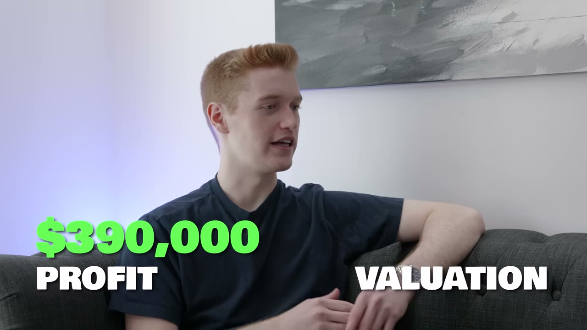
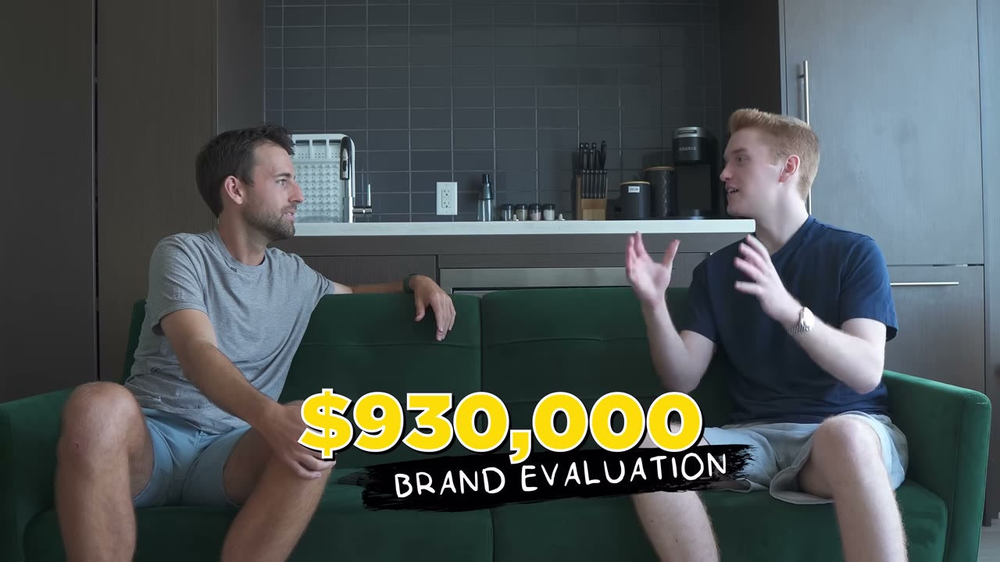
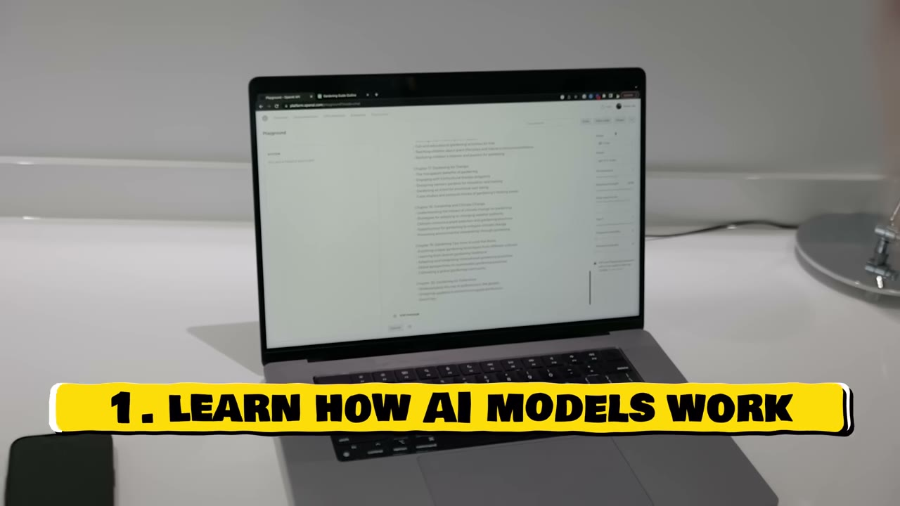
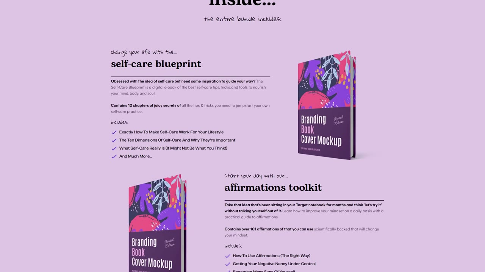
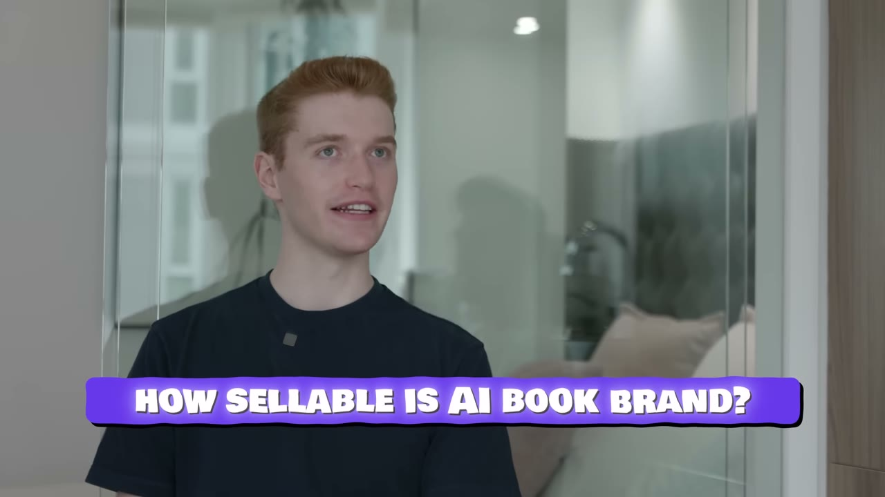

# Ebook viết bằng AI — 390K lợi nhuận, và một cửa sổ cơ hội đã đóng sập

> ## 🚨 CẢNH BÁO LỖI THỜI — ĐỌC TRƯỚC TIÊN
>
> **Video này quay tháng 8/2023. Bối cảnh AI đã thay đổi hoàn toàn kể từ đó.** Đây là video **cũ nhất và lỗi thời nhất** trong kho về mặt AI. Lợi thế cạnh tranh của Joe năm 2022 là *biết cách bắt GPT-3 viết một cuốn sách đọc được, với giá 3 USD* — một kỹ năng mà năm 2026 **bất kỳ ai cũng làm được trong 5 phút, gần như miễn phí**. Đừng đọc case này như một playbook để sao chép. Hãy đọc nó như **một mẫu vật về vòng đời của arbitrage AI**: cửa sổ mở khoảng 12 tháng, người vào sớm ăn hết, người vào sau ăn lỗ. Chi tiết ở [mục 6](#6-vì-sao-case-này-đã-chết--và-nó-dạy-bạn-điều-gì-).
>
> **Phần vẫn còn dùng được:** quy trình Pinterest Ads (mục 4) và vai trò của landing page (mục 5). Hai thứ đó không phụ thuộc vào AI.

> **Tóm tắt 30 giây:** Joe Popelas, 20 tuổi, sinh viên khoa học máy tính ở Toronto, từng xếp hàng lên kệ siêu thị với **11 USD/giờ**. Tháng 7/2022 anh gặp một nhà xuất bản và được xem báo cáo: họ thu **khoảng 2 triệu USD mỗi tháng** chỉ bằng bán sách. Anh về nhà, dùng GPT-3 sinh **40 cuốn ebook trong 2 tháng** (giá vốn ~3 USD/cuốn), rồi bán chúng bằng **Pinterest Ads nhắm vào phụ nữ trung niên**. Ngày 03/10/2022 anh lãi **20 USD**. Ngày 28/12/2022 anh lãi **1.000 USD trong một ngày**. Tổng lợi nhuận tích luỹ tại thời điểm quay: **390.000 USD**, biên **70-80%**. Nhưng **tiêu đề video là sai**: không có con số 1 triệu USD nào trong toàn bộ 12 phút.

## 1. Con số

| Chỉ số | Giá trị | Ghi chú |
|---|---|---|
| Lợi nhuận tích luỹ | **390.000 USD** | có overlay xác nhận trên màn hình |
| Định giá | 930.000 USD | **lời chào mua đầu tiên**, không phải giá đã bán |
| Biên lợi nhuận | 70–80% | lời founder |
| Giá vốn một cuốn sách | ~3 USD với GPT-3 | lời founder |
| Chi phí công cụ | ~200 USD/tháng | subscription các extension |
| Chi phí lớn nhất | **tiền quảng cáo** | founder nói đây là khoản duy nhất ăn đáng kể vào lợi nhuận |
| Số sách cuối 09/2022 | 40 cuốn | trong 2 tháng |
| Ngày lãi đầu tiên | 20 USD — 03/10/2022 | |
| Ngày lãi 1.000 USD đầu tiên | 28/12/2022 | ~3 tháng sau |
| Vốn khởi động | *"có thể dưới 500 USD nếu làm đúng ngay từ đầu"* | anh thừa nhận đã mắc nhiều lỗi tốn tiền |
| Nhân sự | 1 + 1 proofreader theo retainer | |

**Tiêu đề video mâu thuẫn với chính nội dung video.** Tiêu đề: *Meet The Kid Who Made $1M with ChatGPT*. Mô tả: *one of the only kids who ACTUALLY made $1M*. Nội dung: 390K lợi nhuận + 930K định giá. **Không con số nào là 1 triệu.** Nhiều khả năng kênh cộng 390K + 930K ≈ 1,3 triệu rồi làm tròn xuống — nhưng cộng lợi nhuận với định giá là phép tính vô nghĩa. Đây là video **1 triệu view** — mức lan toả cao nhất trong lô 2023 — và nó lan xa chính vì con số ở tiêu đề.

**Định giá 930K là gì:** Joe đăng thông tin doanh nghiệp lên vài marketplace để *"thăm dò"*, và lời chào mua **đầu tiên** anh nhận được là 930.000 USD. Anh **không bán**. Tại thời điểm quay, anh đang bán **40% cổ phần** cho một nhà đầu tư. Một lời chào mua chưa qua thẩm định (due diligence) **không phải là định giá**.

## 2. Nguồn gốc ý tưởng — phần duy nhất còn nguyên giá trị ⭐⭐⭐

Đây là phần tôi cho là đáng học nhất, và nó **không liên quan gì tới AI**.

Chuỗi sự kiện:

1. **2020** — Joe tốt nghiệp phổ thông, mày mò làm một use case cho **GPT-3** (thời điểm đó GPT-3 còn ở beta có giới hạn).
2. Anh **ghi việc đó lên LinkedIn** — một mục nhỏ ghi rằng anh làm use case cho OpenAI GPT-3 beta.
3. **Người lạ bắt đầu nhắn tin hỏi anh** về kinh nghiệm với OpenAI. Anh trả lời miễn phí một thời gian, rồi **bắt đầu thu tiền tư vấn**.
4. **Tháng 7/2022**, một trong những người đó — một công ty xuất bản — họp với anh và **cho anh xem số liệu thật của họ**.

> *"They showed me their stats and how much money they were making off of selling books. That was **a complete eye-opener** for me. I didn't realize how many people bought books. **Per month, their revenue was about 2 million dollars**, which was absolutely insane to me. I thought, why can't I just start up something similar because **what they were doing was so insanely simple**. But they were **not doing anything AI book related**."*

5. Anh **không nói gì với họ về ý tưởng của mình** trong cuộc gọi đó. Tháng 8 anh bắt đầu sinh sách.

**Cơ chế cần rút ra:** Joe không tìm ý tưởng bằng cách brainstorm hay lướt Reddit. Anh **đặt mình vào vị trí được nhìn thấy sổ sách của người khác**. Công cụ để làm điều đó là *một dòng trên LinkedIn về một kỹ năng hiếm*.

Đây là cùng một cơ chế với [Ben của FollowBuddy](../2026-03-19_i-make-17k-month-with-one-strategy/case.md) — người tìm ra ý tưởng vì khán giả liên tục hỏi anh cùng một câu — và với [Alex Lieberman](../2023-11-02_the-multipreneur-hes-building-a-10m-portfolio-of-inc/case.md). **Ý tưởng tốt không đến từ suy nghĩ, nó đến từ vị trí quan sát.** Nếu bạn có một kỹ năng mà thị trường đang khan, hãy công khai nó — luồng thông tin đi vào sẽ là tài sản lớn hơn chính kỹ năng đó.

**Điểm này vẫn đúng nguyên vẹn năm 2026.** Chỉ có điều kỹ năng hiếm bây giờ không còn là *biết dùng GPT-3*.

## 3. Cách sinh sách — và vì sao nó không phải điều bạn nghĩ ⭐⭐

Joe nói rất rõ điều này:

> *"**It's not as easy as just putting into ChatGPT, write me a book on whatever.** Initially, this wasn't the way I did it, but this is the best way to do it now. You get ChatGPT to **create the book outline**. Let's say, for example, you have five chapters and then per each chapter, there are five topics. You are going to go through **each topic in each chapter and generate that topic**."*

Tức là: **outline trước, rồi sinh từng mục nhỏ một** — 5 chương × 5 chủ đề = 25 lần sinh riêng biệt. Lý do kỹ thuật năm 2022: cửa sổ ngữ cảnh của GPT-3 quá nhỏ để giữ mạch cả cuốn sách.

**Năm 2026 lý do đó không còn.** Cửa sổ ngữ cảnh hiện tại thừa sức giữ cả cuốn sách. Nhưng **nguyên tắc thì vẫn đúng**: sinh có cấu trúc luôn tốt hơn sinh một phát, vì bạn kiểm soát được bố cục và tránh lặp ý.

Chi tiết đáng học hơn — cách anh học viết sách:

> *"I literally knew nothing about books... When I created my first book, it was probably **the worst book anybody could ever read**. Like there was no congruency, nothing. **As I actually started purchasing my competitor's books and reading through them, I knew exactly what I needed to include.**"*

**Anh bỏ tiền mua sách của đối thủ và đọc chúng để tìm ra cấu trúc.** Đây là research rẻ nhất và bị bỏ qua nhiều nhất. Cùng một hành vi với [Tomer của CalBuddy](../2026-08-09_i-copied-a-huge-app-now-i-make-80k-month/case.md) khi anh mổ xẻ app Mỹ trước khi làm bản tiếng Hebrew.

Quy trình kiểm soát chất lượng ban đầu: anh **tự đọc soát toàn bộ**, từng chương từng mục, một vòng chỉnh sửa, rồi mới xuất bản. Sau này mới thuê proofreader theo retainer.

## 4. Pinterest Ads — phần vẫn dùng được năm 2026 ⭐⭐⭐

Đây là phần Joe nói *"phần lớn tiền của tôi kiếm được từ đây"*, và nó **không phụ thuộc vào AI**.

> *"**Majority of my money has been made off of Pinterest ads.**"*

Quy trình hai giai đoạn:

### Giai đoạn 1 — Consideration campaign để DÒ NGÁCH

> *"Consideration campaigns are going to give you a **general idea of which niche you should be selling your product in**. You're going to **test out different niches** with consideration campaigns."*

Đây không phải chiến dịch để bán. Đây là **chiến dịch để hỏi thị trường xem nó quan tâm cái gì**. Bạn tung nhiều ngách cùng lúc với ngân sách nhỏ, đọc tín hiệu click, rồi mới quyết định đổ tiền vào đâu.

**Cơ chế:** consideration campaign được Pinterest tối ưu theo *lượt click/lưu*, rẻ hơn conversion campaign rất nhiều. Bạn mua **thông tin** với giá rẻ trước khi mua **khách hàng** với giá đắt.

### Giai đoạn 2 — Conversion campaign để BÁN

> *"Then you're going to go way more granular. You're gonna **set up your Pinterest tag** and then move into conversion campaigns where you're really gonna **dial in every single stat**. Take a look at everything, your landing page copy, whether people are converting **above the fold, below the fold**, all of that."*

Bắt buộc phải cài **Pinterest tag** trước — không có tag thì không có dữ liệu chuyển đổi để thuật toán học.

**Vì sao Pinterest chứ không phải Facebook hay Google:** Pinterest là nền tảng nơi người dùng đang **chủ động lên kế hoạch** (đám cưới, giảm cân, trang trí nhà, self-care). Ý định mua ở đó cao hơn newsfeed, mà CPM lại rẻ hơn Meta. Đây là cùng logic **arbitrage CPM** mà [Tomer của CalBuddy](../2026-08-09_i-copied-a-huge-app-now-i-make-80k-month/case.md) khai thác ở thị trường Israel năm 2026 — chỉ khác là Tomer arbitrage theo **ngôn ngữ**, Joe arbitrage theo **nền tảng**.

**Chân dung khách hàng, nói thẳng không màu mè:** *"I market them on Pinterest to middle-aged moms."*

## 5. Landing page — chỗ tiền thật sự được chốt ⭐⭐

> *"The landing page is going to give you room to show the lead **value stacks**, what's provided, **chapter previews**, everything. It gives you so much more real estate to sell them on the product. **It's almost impossible to sell if you don't do a landing page.**"*

Ba chức năng của landing page trong mô hình này:
1. **Value stack** — liệt kê mọi thứ khách nhận được, để một cuốn ebook 3 USD giá vốn trông ra một gói giá trị.
2. **Chapter preview** — giảm rủi ro cảm nhận. Khách thấy trước nội dung.
3. **Điểm chạm đầu tiên với thương hiệu.**

> *"A landing page is also the **first touch point where the lead is going to get a really good idea of your overall brand image**. So if your landing page is really, really bad, it doesn't look professional, **they're gonna bounce right away and you're gonna get a bounce rate of over 80%, over 70%. That's when you know that your landing page just doesn't look professional.**"*

**Ngưỡng chẩn đoán rất dùng được:** bounce rate trên 70-80% từ traffic quảng cáo = vấn đề nằm ở landing page, không phải ở quảng cáo. Đây là con số bạn đo được ngay tuần đầu.

**Một chi tiết đáng chú ý trong ảnh chụp này:** các bìa sách trên trang vẫn hiện dòng chữ **"Branding Book Cover Mockup"** — tức đây là **template mockup chưa được thay bìa thật**. Có hai cách đọc: hoặc đây là trang demo/nháp Starter Story quay lại, hoặc trang bán hàng thật đúng là dùng mockup chưa hoàn thiện. Tôi không kết luận được từ video. Nhưng nếu là vế thứ hai, nó **mâu thuẫn trực tiếp** với chính lời khuyên của Joe về việc landing page phải trông chuyên nghiệp — và cũng cho thấy tiêu chuẩn "đủ tốt" của mô hình này thấp đến mức nào.

Nội dung sản phẩm nhìn thấy được trong ảnh: *self-care blueprint* (12 chương) và *affirmations toolkit* (101 câu khẳng định), bán theo **bundle**. Đây là ngách self-help mềm cho phụ nữ — nơi mà giá trị cảm nhận đến từ **cảm giác được chăm sóc**, không phải từ độ chính xác thông tin. Điều đó giải thích vì sao sách do AI viết vẫn bán được ở đây mà sẽ không bán được ở ngách kỹ thuật.

## 6. Vì sao case này đã chết — và nó dạy bạn điều gì 🚨⭐⭐⭐

Joe được hỏi thẳng về bão hoà, và câu trả lời của anh **đã sai** khi nhìn lại từ 2026:

> *"I'm sure there's gonna be many, many, like hundreds of book brands popping up, but the market is so huge. **By the point that I predict or expect it to get saturated, I'll be well on my way. I think that'll be years down the line though.**"*

**Thực tế:** thị trường ebook AI bão hoà **trong vòng vài tháng**, không phải vài năm. Amazon KDP phải áp giới hạn 3 đầu sách/ngày và yêu cầu khai báo nội dung AI ngay trong tháng 9/2023 — tức **chỉ vài tuần sau khi video này lên sóng**.

### Lợi thế nào của Joe đã bốc hơi

| Lợi thế 2022–2023 | Tình trạng 2026 |
|---|---|
| Biết cách bắt GPT-3 viết sách đọc được | **Không còn là kỹ năng.** Bất kỳ ai cũng làm được, chất lượng cao hơn nhiều |
| Giá vốn 3 USD/cuốn = rào cản với người khác | **Gần bằng 0 với tất cả mọi người.** Không còn là rào cản |
| Rất ít người biết mô hình này | **1 triệu người đã xem đúng video này** — và đó chỉ là một video |
| Pinterest Ads rẻ, ít cạnh tranh ở ngách này | Cạnh tranh tăng mạnh, CPM lên |
| Người mua chưa dị ứng với nội dung AI | **Người mua giờ nhận ra nội dung AI và phản ứng tiêu cực** |

### Quy luật rút ra — dùng được cho MỌI làn sóng công nghệ ⭐⭐⭐

**Khi một công nghệ mới xuất hiện, có hai loại cơ hội:**

- **Loại A — arbitrage kỹ năng.** Bạn kiếm tiền vì *biết dùng công cụ mà người khác chưa biết*. Cửa sổ này **luôn đóng**, thường trong 6-18 tháng. Joe ở loại này.
- **Loại B — sản phẩm có moat riêng.** Công nghệ mới chỉ là nguyên liệu; giá trị nằm ở phân phối, thương hiệu, dữ liệu, hoặc quan hệ khách hàng. Cửa sổ này **không đóng theo công nghệ**.

**Trong kho này, so sánh trực tiếp:**

| Case | Loại | Kết cục |
|---|---|---|
| Ebook AI của Joe (2023) | A — arbitrage thuần | Mô hình chết theo cửa sổ |
| [FormulaBot](../2024-02-11_i-built-a-1m-ai-app-no-code/case.md) (2024) | A dịch dần sang B | ~10 bản sao xuất hiện trong vài tuần; **10% churn là do chính ChatGPT nuốt mất tính năng** |
| [StealthGPT](../2024-07-28_i-turned-150-into-2m-year/case.md) (2024) | A đội lốt SaaS | 190K MRR nhưng **lợi nhuận chỉ 10-30K** vì đốt ~100K/tháng tiền ads |
| [Jenni AI](../2024-01-28_the-underdog-from-his-parents-basement-to-25m/case.md) (2024) | B — sản phẩm + phân phối | Vẫn sống, hơn 3 triệu USD ARR |
| [CalBuddy](../2026-08-09_i-copied-a-huge-app-now-i-make-80k-month/case.md) (2026) | B — moat là **ngôn ngữ và thị trường**, không phải AI | 81K/tháng, AI chỉ là công cụ build |

**Đây là bài học đắt nhất của case này:** nếu năm 2026 bạn định làm một business mà lợi thế duy nhất là *tôi biết dùng AI giỏi hơn người khác* — bạn đang ở **loại A**, và bạn đang mua vé vào một cửa sổ đã đóng từ lâu. Hãy hỏi: **nếu ngày mai AI miễn phí và ai cũng dùng thành thạo, tôi còn lại cái gì?** Với CalBuddy, câu trả lời là *tôi vẫn là app tiếng Hebrew duy nhất*. Với Joe, câu trả lời là *không còn gì*.

Điều đáng nói: **Joe cũng nhận ra điều này** và tự bảo vệ bằng hai nước đi — bán 40% cổ phần lấy tiền mặt, và **chuyển sang bán khoá học dạy làm book brand**. Xem mục 8.

## 7. Chiến lược thoát — bán từng phần thay vì bán cả công ty ⭐⭐

Phần này **không lỗi thời** và áp dụng được cho mọi micro-business.

> *"Initially, I didn't think it would be super sellable and I wanted to **test the waters**. What I did is actually **posted a bunch of the details just on a few marketplaces. I just wanted to see what investors would offer**. The very first offer I got for the entire business was $930,000."*

Rồi:

> *"Now I'm actually working with an investor who is **purchasing 40% of my book brand**, and I'm able to continue building up another book brand to then maybe sell another 40%. So it's a **completely repeatable process**... you don't have to sell the whole corporation. **You can sell just parts of it.**"*

**Hai cơ chế đáng chép:**

1. **Đăng lên marketplace để ĐỊNH GIÁ, không phải để bán.** Chi phí gần bằng 0, và bạn nhận về một con số thật từ thị trường thay vì tự đoán. Đây là cách rẻ nhất để biết tài sản của mình đáng bao nhiêu.
2. **Bán cổ phần thiểu số thay vì bán đứt.** Bạn lấy tiền mặt về (giảm rủi ro cá nhân) nhưng vẫn giữ quyền vận hành và phần lớn upside. Khác với các case bán đứt trong kho như [MakeLogo AI và TalkNotes](../2025-03-31_i-locked-myself-in-a-room-made-17-apps-sold-2-for-26/case.md) hay [4 app của case flipping](../2025-11-09_i-flipped-4-apps-and-made-500-000/case.md).

**Cảnh báo:** với một business mà lợi thế đang bốc hơi như của Joe, **bán 40% ở đỉnh là nước đi rất khôn** — và cũng là chỉ dấu cho thấy chính anh không tin mô hình này sống lâu.

## 8. Cảnh báo thiên kiến nguồn 🚨

Case này có **mật độ tín hiệu cảnh báo cao nhất** trong ba video 2023 của lô này.

1. **Tiêu đề bịa số.** *$1M with ChatGPT* trong khi video chỉ có 390K lợi nhuận và 930K định giá chào mua. Video này đạt **1.046.733 view** — cao gấp 6-9 lần hai video còn lại cùng lô. Con số ở tiêu đề chính là thứ tạo ra lượt xem đó.
2. **Founder bán khoá học.** Joe nói thẳng: *"Now I'm working a lot... I'm **teaching people how to build their own book brand**. That's been extremely rewarding. **I've had some really successful students.**"* — Người kiếm tiền từ việc dạy mô hình X có động cơ mạnh để nói rằng mô hình X **chưa bão hoà**. Chính câu trả lời lạc quan về bão hoà ở mục 6 nên được đọc dưới ánh sáng này.
3. **Kênh Starter Story bán thư viện case study** và chèn quảng cáo ở phút 05:02 với **cùng một kịch bản** (*Luke đọc case study, làm newsletter, kiếm 5.800 USD trong 30 ngày*) được dán y hệt vào cả ba video 2023 trong lô này.
4. **Kênh chỉ phỏng vấn người thắng.** Không có video nào về hàng nghìn người copy mô hình ebook AI năm 2023 và lỗ tiền quảng cáo.
5. **Không có dashboard.** Chỉ có một overlay đồ hoạ do kênh dựng ghi *$390,000 PROFIT*. Không có Stripe, không có báo cáo Pinterest Ads, không có báo cáo thuế.
6. **Không nêu tên thương hiệu sách.** Không thể kiểm chứng độc lập. Với một case study kinh doanh, đây là một lỗ hổng lớn — và cũng có thể là chủ ý để tránh bị copy.
7. **Tên riêng ASR sai:** transcript đọc thành *Joe Poplis* / *Joe Popolis*. Tên đúng theo mô tả video là **Joe Popelas**.

## 9. Áp dụng cho tôi (indie hacker VN)

**Sao chép được gì — và tôi nói rõ: KHÔNG PHẢI mô hình ebook AI.**

Ba thứ trong case này còn giá trị năm 2026:

1. **Quy trình paid ads hai giai đoạn.** Consideration campaign ngân sách nhỏ để *dò ngách* trước, rồi mới conversion campaign để *bán*. Áp dụng được cho Facebook, TikTok, Google — không riêng Pinterest. Với ngân sách VN, đây là cách mua thông tin rẻ trước khi mua khách đắt.
2. **Ngưỡng chẩn đoán landing page.** Bounce rate trên 70% từ traffic trả tiền = sửa trang, đừng sửa quảng cáo. Cộng ba thành phần bắt buộc: value stack, preview nội dung, và tín hiệu chuyên nghiệp.
3. **Cách đặt mình vào vị trí nhìn thấy sổ sách người khác.** Công khai một kỹ năng hiếm → người có tiền tìm đến bạn → bạn nhìn thấy mô hình kinh doanh thật của họ. Đây là cỗ máy tìm ý tưởng bền hơn mọi danh sách *100 business idea*.

**Rào cản thật — vì sao tôi cho `replicability_vn` là 1:**

- **Mô hình gốc đã chết.** Không phải khó, mà là **đã hết**. Lợi thế của Joe là chi phí sinh nội dung và độ hiếm của kỹ năng — cả hai đều bằng 0 vào 2026. Copy nó bây giờ là đốt tiền quảng cáo cho một sản phẩm không có gì đặc biệt.
- **Pinterest gần như không có thị trường ở VN.** Chân dung *middle-aged American mom lên Pinterest lập kế hoạch self-care và sẵn sàng trả 20-40 USD cho một bundle ebook* **không tồn tại ở Việt Nam**. Nếu làm, bạn buộc phải nhắm thị trường Mỹ — nghĩa là copy tiếng Anh phải chuẩn bản ngữ, thanh toán quốc tế, xử lý refund và chargeback bằng tiếng Anh.
- **Người mua giờ nhận ra nội dung AI.** Năm 2022 khách không nghĩ tới chuyện đó. Năm 2026, một ebook self-help viết giọng AI bị nhận ra ngay và tạo ra refund, chargeback, review xấu. Chargeback trên Stripe/PayPal cao có thể khiến bạn **bị khoá tài khoản thanh toán** — mất luôn cả kênh thu tiền.
- **Cần vốn quảng cáo trước, doanh thu sau.** Đây là mô hình **media buying**, không phải mô hình sản phẩm. Bạn cần đủ tiền để lỗ trong giai đoạn dò ngách, và đủ kỷ luật để tắt chiến dịch đúng lúc. [StealthGPT](../2024-07-28_i-turned-150-into-2m-year/case.md) là ví dụ hoàn hảo về việc mô hình này ăn hết lợi nhuận như thế nào ở quy mô lớn — 190K MRR nhưng chỉ giữ được 10-30K.
- **Rủi ro pháp lý và đạo đức.** Bán nội dung do AI sinh mà không khai báo đang bị siết ở nhiều nền tảng. Với ngách sức khoẻ hoặc tài chính, còn thêm rủi ro trách nhiệm nội dung.

**Khi nào KHÔNG dùng mô hình này:**

- **Luôn luôn, nếu lợi thế duy nhất của bạn là biết dùng AI.** Đây là quy luật ở mục 6. Hãy hỏi *nếu AI miễn phí và ai cũng giỏi, tôi còn gì?* trước khi viết dòng code hay dòng prompt đầu tiên.
- **Khi bạn không có tiền để lỗ trong giai đoạn test.** Không có kênh organic trong mô hình này. Không ads = không doanh thu, ngay lập tức. So sánh với [FollowBuddy](../2026-03-19_i-make-17k-month-with-one-strategy/case.md) — 0 USD quảng cáo, toàn bộ khách từ YouTube search — hoặc [các case Reddit](../2025-08-09_how-i-used-reddit-to-build-a-25k-month-business/case.md).
- **Khi bạn muốn xây tài sản dài hạn.** Sản phẩm không có subscription, không có network effect, không có dữ liệu người dùng. Mỗi tháng bạn phải mua lại toàn bộ khách hàng từ đầu. Chính Joe cũng chọn bán 40% thay vì giữ.

**Nếu tôi thật sự muốn làm digital product năm 2026:** đọc [Thomas Frank với template Notion](../2024-04-18_i-made-2-5m-selling-a-digital-product/case.md) thay vì case này. Cùng là sản phẩm số biên cao, nhưng moat của Thomas là **một kênh YouTube ngách 230.000 subscriber** — thứ không ai copy được bằng ChatGPT.

## Nguồn

- Video: <https://www.youtube.com/watch?v=irEi7DVBHdA> (12:07, đăng 30/08/2023, 1.046.733 view)
- [Transcript đầy đủ](transcript.md) · [Ảnh chụp](screenshots/)
