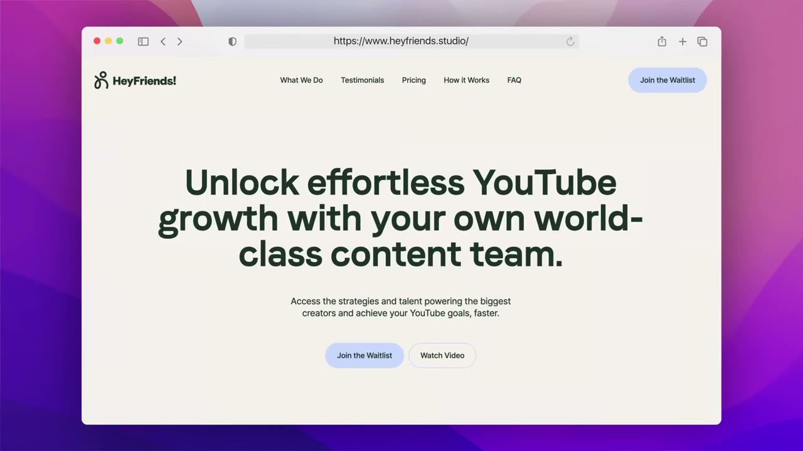
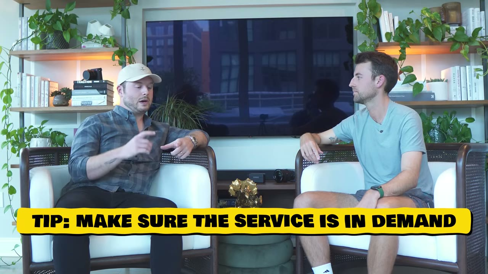
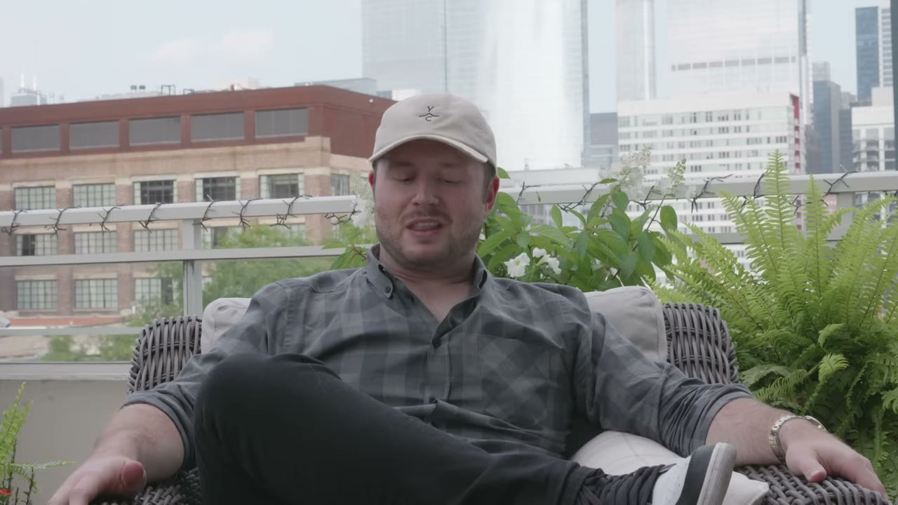
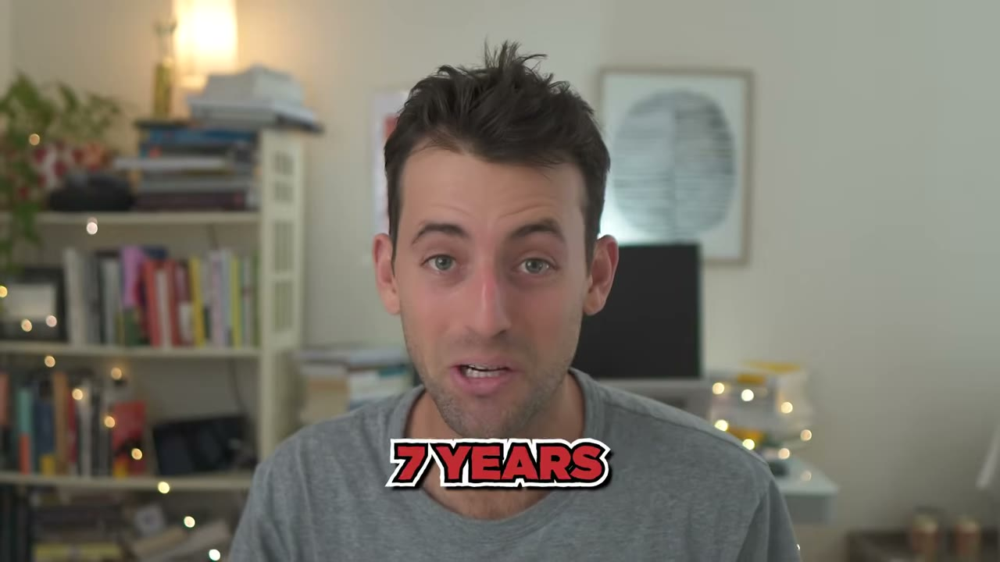

# Assembly — mua đứt kênh phân phối bằng cổ phần, thay vì tự xây trong 5 năm

> **Tóm tắt 30 giây:** Hunter Hammonds mất **15 năm** và nhiều lần thất bại — trong đó một startup có **3,2 triệu người dùng hoạt động nhưng không kiếm được tiền, phải bán tháo tài sản** — trước khi tìm ra công thức này. Anh không xây khán giả. Anh **ghép một dịch vụ đóng gói sẵn với một creator đã có sẵn đúng khán giả đó, rồi chia cổ phần thật cho creator**. Ali Abdaal dạy hàng nghìn người làm YouTube → mở agency YouTube (Hey Friends, **10.000 USD/tháng cho 6 video**). Dan Ko làm animation → mở studio animation (Keyframe). Trong **4 tháng**, 4 công ty, đội ngũ từ 3 lên **hơn 50 người**. Nhưng đây cũng là case cần đọc kỹ nhất trong kho về mặt số liệu: **không có một dashboard nào**, tiêu đề là mục tiêu chứ không phải kết quả, và founder tự thừa nhận *we really had to cut a lot of corners*.

## 1. Con số

| Chỉ số | Giá trị | Bằng chứng |
|---|---|---|
| Mục tiêu | 12 công ty × 1 triệu USD/năm trong 12 tháng | lời founder |
| Đã ra mắt công khai | 4 công ty trong 4 tháng | lời founder |
| ARR mỗi công ty | *over a million a year* — 3/4 ở mức *multiple seven figures* | lời founder, không dashboard |
| Sàn ARR danh mục suy ra | ≥ 4 triệu USD/năm ≈ 333K USD/tháng | **tôi tự tính**, không phải số của video |
| Mốc founder nhắm | 1 triệu USD **mỗi tháng** vào cuối 2023 | *on track* — chưa đạt lúc quay |
| Giá Hey Friends | 10.000 USD/tháng → 6 video YouTube/tháng | lời founder |
| ACV Off Menu | 60.000 – 75.000 USD/khách trọn vòng đời | lời founder |
| Churn Off Menu | *decently high* — không nêu con số | lời founder |
| Nhân sự | 3 → hơn 50 trong 4 tháng | lời founder |
| Giờ làm | 10–14 giờ/ngày, 6 ngày/tuần | lời founder |

**Cảnh báo số liệu — đọc trước khi tin bất cứ điều gì bên dưới.**

1. **Không có một dashboard, một biên lai, một ảnh chụp Stripe nào trong 14 phút video.** Toàn bộ là lời tự khai. So sánh: [DesignJoy](../2024-01-13_the-1-8m-solopreneur-playbook/case.md) ít nhất còn có một biên lai Stripe 7.995 USD; [Baked](../2024-09-01_faceless-from-immigrant-to-1m-year/case.md) có một dashboard 55.026 USD MRR.
2. **Tiêu đề nói dối theo hướng có lợi.** *He's Launching A New $1M Business Every Month* — thực tế là **mục tiêu 12 tháng**, và lúc quay mới có 4 công ty sau 4 tháng, mỗi công ty *trên* 1 triệu ARR (tức có thể là 1,05 triệu).
3. **ARR ≠ doanh thu đã thu.** Với agency, *run rate* thường được tính bằng MRR tháng gần nhất × 12. Với một business mới 4 tháng tuổi và churn cao, con số này rất dễ thổi.
4. **Ảnh chụp trang Hey Friends lúc quay vẫn là nút *Join the Waitlist*.** Một agency đang ở chế độ waitlist mà được tính vào danh mục *trên 1 triệu ARR* là điều đáng đặt câu hỏi — dù hoàn toàn có thể họ đã có khách ký hợp đồng riêng.

> **Kiểm chứng ngoài video (2026, không phải nội dung video — chỉ để tham khảo):** Assembly vẫn tồn tại, Off Menu vẫn hoạt động và Hunter vẫn là CEO. Nhưng **mục tiêu 12 công ty trong 12 tháng đã KHÔNG hoàn thành đúng hạn** — các nguồn công khai chỉ ghi nhận khoảng 5 công ty được ra mắt. Hey Friends cũng vướng tranh cãi công khai trên YouTube. Tôi chưa xác minh được chi tiết nào ngoài việc mục tiêu 12-trong-12 không thành. Hãy coi đây là chỉ dấu, không phải bằng chứng.

## 2. Cơ chế thật: mua kênh phân phối bằng cổ phần ⭐⭐⭐

Đây là phần đáng giá duy nhất và cũng là phần dễ hiểu sai nhất của case.

Mọi indie hacker đều gặp cùng một bức tường: **sản phẩm thì làm được, nhưng không ai biết mình tồn tại.** Cách thông thường là mất 2-5 năm xây audience (xem [Marc Lou](../2026-04-26_how-i-work-77k-month-solopreneur/case.md), [Dickie Bush](../2024-07-13_he-quit-his-job-and-makes-10m-year-writing-online/case.md)).

Hunter làm ngược: anh **không xây audience, anh mua nó bằng cổ phần**.

> *"They're not like affiliate partners. **They're actual partners in these businesses.** They're really instrumental in helping get them off the ground."*

Khác biệt cốt lõi so với affiliate marketing:
- Affiliate = creator lấy 20-30% một lần, hết hứng là bỏ, không có động lực dài hạn.
- **Cổ phần = creator gắn đời mình vào doanh nghiệp.** Họ mang không chỉ traffic mà cả *insight vận hành* — vì họ chính là khách hàng lý tưởng.

### Bộ lọc chọn cặp creator ⟷ dịch vụ: *product audience fit*

Hunter đặt tên riêng cho tiêu chí này, và nó chặt hơn *product market fit*:

> *"If you take Ali Abdaal, for example, it made total sense for Ali to have a YouTube agency **because he taught thousands of people how to succeed on YouTube**."*

Nghĩa là: creator phải đã **dạy** đúng cái nghề mà agency sẽ bán. Không phải chỉ nổi tiếng, mà là **nổi tiếng vì đúng kỹ năng đó**. Khán giả của Ali Abdaal đã tin anh về YouTube → không cần bán, chỉ cần mở cửa.

Bảng ghép của Assembly:

| Công ty | Dịch vụ | Creator |
|---|---|---|
| Hey Friends | done-for-you YouTube agency | Ali Abdaal |
| Off Menu | full-service design agency | (không nêu creator trong video) |
| Viral Cuts | short-form video cao cấp | Sam Parr, Cody Sanchez |
| Keyframe | animation studio | Dan Ko |

*(Transcript ASR đọc thành "Ali Abdel" — tên đúng là **Ali Abdaal**, đối chiếu với ảnh chụp trang heyfriends.studio.)*

### 4 điều kiện Hunter tìm trước khi mở một công ty mới

> *"We're looking for a **really crowded market**."*

Đọc kỹ: anh cố tình tìm thị trường **đông đúc**, không phải ngách trống. Bốn điều kiện:

1. **Thị trường thật sự đông.** Đông = đã có cầu được xác thực, không cần đi giáo dục khách hàng.
2. **Thương hiệu tốt hơn hẳn**, ra mắt kèm sẵn case study và success story.
3. **Trải nghiệm concierge**, cảm giác cao cấp — chứ không phải rẻ hơn.
4. **Một creator được tin cậy** làm cú hích phân phối ở giai đoạn đầu.

**Vì sao chọn thị trường đông?** Vì ba yếu tố còn lại của anh (brand, trải nghiệm, phân phối) đều là **vũ khí giành thị phần**, không phải vũ khí tạo thị trường. Với một người có sẵn network creator, cạnh tranh trong biển đỏ dễ hơn nhiều so với việc thuyết phục thị trường mới rằng vấn đề đó tồn tại.

**Đây chính xác là điều bạn KHÔNG nên sao chép nếu không có network.** Không có creator, bốn điều kiện trên rút xuống còn ba, và ba cái đó không thắng nổi ai trong một thị trường đông.

Hunter thừa nhận thẳng:

> *"First, I have to acknowledge that **we kind of have an unfair advantage**. We're really fortunate that we have a great network. There's no big sales pitch for us to go to a creator... Really what we're doing at the end of the day is just **talking to our friends**."*

Và anh nói cách anh xây được network đó — mất **hàng năm**:

> *"I slowly over years just built my network by **never asking for anything, just always giving**. Along the way, you build a lot of trust and people know you as a person that is just really high integrity, really loyal. I think that's a really special thing that a lot of people miss when they look for that like quick buck."*

## 3. Chống lại thói quen bán *unlimited* ⭐⭐⭐

Đây là điểm Assembly **mâu thuẫn trực diện** với case nổi tiếng nhất của mô hình này trong kho.

> *"**We're really not big fans of the idea of unlimited**, so we really wanna make sure that our customers understand exactly what they're getting for when they pay us money."*

Hey Friends: **10.000 USD/tháng = 6 video YouTube chất lượng cao.** Con số cứng, không mập mờ.

Ngược lại, [Brett Williams của DesignJoy](../2024-01-13_the-1-8m-solopreneur-playbook/case.md) bán đúng chữ *unlimited design requests*, leo giá từ 449 lên 8.000 USD/tháng, và ăn nên làm ra.

**Ai đúng? Cả hai — nhưng ở hai chế độ khác nhau:**

| | DesignJoy (unlimited) | Assembly (volume cố định) |
|---|---|---|
| Người thực hiện | **1 người**, chính founder | **hơn 50 nhân viên** |
| Cách chặn tràn | luật cứng — mỗi khách chỉ 1 yêu cầu đang hoạt động, xếp hàng | hợp đồng ghi rõ 6 video/tháng |
| Chi phí biên | gần 0 (thời gian của chính mình) | **lương thật, trả hàng tháng** |
| Rủi ro khi khách đòi nhiều | founder mệt | **lỗ tiền mặt ngay lập tức** |

**Nguyên tắc rút ra:** *unlimited* chỉ an toàn khi bạn tự làm và có cơ chế xếp hàng. **Ngay khi bạn trả lương cho người khác, unlimited biến thành một quyền chọn bán khống mà bạn phát cho khách hàng miễn phí.** Với 6 video/tháng, Hunter biết chính xác cần bao nhiêu editor cho mỗi khách — anh có thể lập kế hoạch tuyển dụng. Brett thì không cần vì Brett chỉ có Brett.

Nếu bạn định làm productized service ở VN với freelancer thuê ngoài: **theo Hunter, không theo Brett.**

## 4. Churn cao mà vẫn ổn — với điều kiện gì ⭐⭐

Câu thẳng thắn nhất video:

> *"I think every subscription or productized service wants to view their business from the standpoint of MRR. But at the end of the day, **there's a finite nature to a lot of these projects**. Off Menu has decently high churn. But what's crazy is that it doesn't matter because our **average customer value is 60 to 75,000 dollars** while they're with us, and the margins are fantastic."*

Đây là mâu thuẫn thứ hai với kho, lần này với [Alex Lieberman của StoryArb](../2023-11-02_the-multipreneur-hes-building-a-10m-portfolio-of-inc/case.md) — người định nghĩa **PMF chính là retention**, và coi việc agency ghostwriting chỉ giữ khách 3-5 tháng là bệnh cần chữa.

**Phân định bằng ba biến, không phải bằng quan điểm:**

1. **ACV.** Off Menu: 60-75K USD/khách. Ở mức đó, mất khách không đau bằng mất một khách 7K/tháng ở StoryArb.
2. **Bản chất công việc.** Redesign thương hiệu là **dự án hữu hạn** — khách rời đi vì *xong việc*, không phải vì *thất vọng*. Ghostwriting là công việc **vô hạn** — khách rời đi nghĩa là bạn làm chưa đủ tốt. Churn ở hai loại này mang ý nghĩa hoàn toàn khác nhau.
3. **Có động cơ nạp lại đầu phễu hay không.** Assembly có khán giả creator bơm lead liên tục và miễn phí. Nếu bạn không có, churn cao là án tử vì CAC sẽ ăn hết biên.

**Câu hỏi tự vấn:** *"khi khách rời đi, họ rời vì đã xong việc hay vì tôi làm chưa đủ tốt?"* Nếu là vế đầu, đừng ám ảnh MRR — hãy đo ACV và biên. Nếu là vế sau, Alex đúng và bạn đang có vấn đề sản phẩm.

## 5. Cách scale từ 3 lên 50 người trong 4 tháng ⭐⭐

Phương pháp anh gọi tên thẳng:

> *"Let's **move super fast, break fucking everything** and just create this **wake of chaos**, and then stop and just clean it all up."*

Và anh không giấu cái giá:

> *"I do want to be honest and say like, for us to hit that scale so quickly **we really had to cut a lot of corners**, which has its pros and its cons. But fortunately I think we did a good job of recruiting people that were okay with that, that could **thrive in that sense of ambiguity**."*

**Cơ chế tuyển dụng khác nhau theo loại vai trò** — đây là chi tiết vận hành hữu ích:

| Loại vai trò | Ví dụ | Cách tuyển |
|---|---|---|
| Ít người, chất lượng cao | designer cấp principal/creative director cho Off Menu | 100% qua network, tuyển chọn rất kỹ |
| Nhiều người, cần nhanh | 50 video editor cho Viral Cuts / Hey Friends | tuyển kỹ **vài người đầu tiên**, sau đó chạy bằng **thưởng giới thiệu** |

> *"One of our secrets to recruiting is just being **a really great, generous employer**."*

**Vì sao referral hiệu quả cho vai trò khối lượng lớn:** editor giỏi biết editor giỏi khác, và họ không giới thiệu bạn bè vào chỗ tệ. Cơ chế này tự lọc chất lượng — nhưng chỉ chạy được **sau khi** bạn đã có vài người đầu tiên thật sự tốt và thật sự hài lòng. Đó là lý do bước một phải tuyển kỹ.

## 6. Khung DAMN — cách chia tuần khi điều hành nhiều công ty ⭐⭐

Hunter làm 10-14 giờ/ngày, 6 ngày/tuần. Cách anh chia:

**D-A-M-N = Decisions, Actions, Messages.**

| Ngày | Việc |
|---|---|
| Thứ 2 | **Decisions** — thức dậy với đống dữ liệu từ team, ra quyết định tối ưu cho các công ty đang chạy và đang ươm |
| Thứ 3 | **Actions** — hành động cần làm để đẩy các quyết định hôm qua đi tiếp |
| Thứ 4 | **Messages** — truyền đạt tất cả những điều đó cho team |
| Thứ 5 | Gọi điện — nói chuyện với CEO khác, hỗ trợ sales call |
| Thứ 6 | Viết, deep work |

**Vì sao cách này hoạt động khi bạn có nhiều business:** context switching giữa 4 công ty trong cùng một ngày là thứ giết chết chất lượng quyết định. Gom **cùng một LOẠI công việc** cho **tất cả công ty** vào cùng một ngày thì não chỉ phải chuyển ngữ cảnh về *chủ đề*, không phải về *chế độ tư duy*. Đây là cùng logic mà [Marc Lou](../2026-04-26_how-i-work-77k-month-solopreneur/case.md) và [Jacky Chow](../2026-03-22_i-make-250k-month-from-13-businesses-after-losing-ev/case.md) áp dụng khi vận hành danh mục.

## 7. Productized service chỉ là bệ phóng, không phải đích ⭐⭐

Điều Hunter nhấn mạnh và ít người nghe kỹ:

> *"I want to be clear. **It's just the launch pad.** We just view productized services as the first phase of what we're building. When you think about productized services, you have this fantastic **free cash flow engine**. From there, the question is, what do you do with all that free cash flow? ... We're looking at products, we're looking at SaaS, we're looking at really interesting ways for us to scale... **beyond this notion of a human being is required to turn a profit**."*

Đây là chiến lược y hệt [Late Checkout](../2024-06-08_the-multipreneur-he-makes-10m-year-with-6-businesses/case.md) và [Alex Lieberman](../2023-11-02_the-multipreneur-hes-building-a-10m-portfolio-of-inc/case.md): **agency là máy in tiền mặt để tài trợ cho những cược có leverage cao hơn.** Agency có biên tốt nhưng bị chặn trần vì lợi nhuận buộc phải tỉ lệ thuận với số người.

**Với indie hacker VN, đây là điểm quan trọng nhất của case:** nếu bạn đang phân vân giữa làm agency và làm SaaS, câu trả lời của Hunter không phải *chọn một*, mà là **agency trước để có dòng tiền, SaaS sau bằng tiền đó**. Khác biệt so với gọi vốn: bạn giữ 100% cổ phần.

## 8. Lời khuyên cụ thể cho người muốn bắt đầu

Ngưỡng vào cửa Hunter đưa ra rất dễ nhớ:

> *"If you think that you have a skill set and **you're better at that skill than let's say 80% of the market**, yeah, you could probably build a successful productized service around that."*

Ba điều phải nắm:

1. **Nghĩ kỹ về MÔ HÌNH, không chỉ về dịch vụ.** Value prop phải cực rõ, và cấu trúc phải lành mạnh để scale được.
2. **Liên tục over-deliver** — *"because that's how you'll build your business long term because **you need referrals**."*
3. Câu đắt nhất video:

> *"How are you actually **building a business and not just freelancing in disguise as solopreneurship**?"*

**Cách phân biệt trong thực tế:** nếu bạn nghỉ 2 tuần và doanh thu về 0 → bạn đang freelance. Nếu quy trình, thương hiệu và đội ngũ vẫn giao được việc → bạn có business. [Cardinal Mason](../2023-08-23_i-made-2-3m-writing-like-a-5th-grader/case.md) chạm đúng bức tường này ở mức 48K USD/tháng và phải chuyển sang agency.

## 9. Lời khuyên cho chính mình 10 năm trước ⭐⭐

> *"The number one piece of advice I would give myself is to **create content, share publicly what I'm doing. That's my biggest regret in my career. 100% is that I didn't spend the last decade building an audience**."*

**Đây là mâu thuẫn thẳng thừng thứ ba với kho.** [Ben của FollowBuddy](../2026-03-19_i-make-17k-month-with-one-strategy/case.md) nói *"xây audience là lãng phí thời gian"* và chỉ bám ý định tìm kiếm trên YouTube.

**Phân định bằng câu hỏi bạn đang bán gì:**

| Bạn bán | Nên chọn | Vì sao |
|---|---|---|
| Công cụ giải một vấn đề người ta **chủ động gõ tìm** (app unfollow, chuyển đổi file) | Ben — bỏ audience, làm SEO | Không ai cần tin bạn, họ chỉ cần công cụ chạy được |
| Dịch vụ **10.000 USD/tháng** dựa trên niềm tin và gu thẩm mỹ | Hunter — audience/creator là bắt buộc | Không ai chuyển 10K cho một cái tên lạ |

Hunter tiếc vì anh bán thứ đắt tiền và cần niềm tin. Ben không tiếc vì anh bán 50 USD/năm cho vấn đề đau ngay lập tức. **Giá bán quyết định bạn có cần audience hay không.**

Hai lời khuyên còn lại của anh: nghĩ rõ hơn về mục tiêu dài hạn (*"10 năm trước tôi chỉ kiếm tiền rồi tiêu tiền"*), và **nuôi dưỡng quan hệ dài hạn** — chính điểm yếu anh thừa nhận:

> *"I get kind of introverted. I get lost in whatever it is I'm doing and I'm horrible at following up with friends... It's not easy to pick up that phone and be like, how you been, dude?"*

Trớ trêu: **toàn bộ mô hình kinh doanh của Assembly được xây trên chính kỹ năng mà Hunter tự nhận mình yếu nhất.** Anh mất 15 năm để bù đắp nó.

## 10. Cảnh báo thiên kiến nguồn

- **Kênh Starter Story bán khoá học/thư viện case study** và chèn quảng cáo ngay giữa video (phút 05:07). Đoạn quảng cáo dùng chính câu chuyện *Luke đọc case study rồi làm newsletter kiếm 5.800 USD trong 30 ngày* — câu này được dán y hệt vào **cả ba video 2023** trong lô này. Đó là kịch bản bán hàng, không phải dữ liệu.
- **Kênh chỉ phỏng vấn người đang thắng.** Không có video nào về 8 công ty còn lại trong mục tiêu 12-trong-12 mà (theo nguồn ngoài) đã không kịp ra mắt.
- **Founder có động cơ thổi số.** Assembly là holding company đang tuyển người và tìm creator đối tác. Con số ARR to đẹp là công cụ tuyển dụng.
- **Một chi tiết ASR đáng ngờ:** transcript ghi *"I built that business into the figures of revenue"* — thiếu một chữ (nhiều khả năng là *eight figures*). Nguồn ngoài ghi Everest đạt 8 chữ số. Tôi để nguyên vì video không nói rõ.
- Tên riêng ASR đọc sai: **Hunter Hammonds** (transcript ghi Hammons), **Ali Abdaal** (transcript ghi Ali Abdel). Đối chiếu với mô tả video và ảnh chụp.

## 11. Áp dụng cho tôi (indie hacker VN)

**Sao chép được gì — phiên bản thu nhỏ, thực tế:**

1. **Bộ lọc *product audience fit* dùng được ngay và miễn phí.** Đừng tìm creator đông follower nhất. Tìm người **đã dạy đúng kỹ năng bạn định bán dịch vụ**. Ở VN: một người dạy chạy ads TikTok trên YouTube → mở dịch vụ chạy ads TikTok trọn gói; một người dạy dựng video → mở studio dựng video. Khán giả của họ đã tự phân loại thành người có nhu cầu.
2. **Chào cổ phần thật, đừng chào affiliate.** Bạn không có tiền để mua traffic, nhưng bạn có 100% cổ phần của một công ty chưa tồn tại. Với creator VN đang bị chặn trần thu nhập ở mảng nội dung, một business thật có sản phẩm giao được là đề nghị hấp dẫn hơn 20% hoa hồng.
3. **Bán volume cố định, không bán unlimited.** *"5 video/tháng, 20 triệu"* dễ định giá, dễ tuyển người, dễ nói không. Chép nguyên tắc này của Hunter, đừng chép DesignJoy trừ khi bạn tự làm một mình.
4. **Vào thị trường đông, thắng bằng trải nghiệm.** Thiết kế, dựng video, viết nội dung ở VN đều rất đông — đó là ưu điểm: cầu đã được xác thực, bạn không phải giáo dục ai. Thắng bằng brand tử tế, onboarding rõ ràng, giao đúng hẹn.
5. **Dùng agency làm bệ phóng cho SaaS.** Đây là con đường dòng tiền dương duy nhất cho người không có vốn: agency nuôi bạn 12-18 tháng, đồng thời cho bạn thấy đúng chỗ nào trong quy trình đáng viết thành phần mềm.

**Rào cản thật — case này khó sao chép nhất trong lô 2023:**

- **Toàn bộ mô hình đứng trên network 15 năm.** Hunter thừa nhận đây là *unfair advantage*. Anh có Sahil Bloom, Ali Abdaal, Sam Parr, Cody Sanchez trong danh bạ. Nếu bạn không có network tương đương ở VN, bốn công ty trong bốn tháng là điều **không thể**, không phải khó.
- **Đây là business dùng NGƯỜI, không phải dùng CODE.** Từ 3 lên 50 người trong 4 tháng nghĩa là: hợp đồng lao động, bảo hiểm, thuế TNCN, quản lý chất lượng, người nghỉ việc giữa dự án. Chi phí quản lý này là thứ mà một solo dev không hình dung nổi cho tới khi phải trả lương tháng đầu tiên.
- **Dòng tiền âm ngay lập tức.** Bạn trả lương editor vào ngày 5, khách B2B thanh toán sau 30-45 ngày. Với 10 nhân sự × 15 triệu, bạn cần **giữ sẵn 150-300 triệu vốn lưu động** trước khi có đồng lợi nhuận nào. Đây là loại rủi ro hoàn toàn khác với việc deploy một app lên Vercel.
- **Rào cản tiếng Anh là rào cản DOANH THU, không phải rào cản kỹ thuật.** ACV 60-75K USD chỉ tồn tại ở thị trường Mỹ. Cùng dịch vụ đó ở VN, khách trả 20-50 triệu/tháng — tức bạn cần gấp 20-30 lần số khách để ra cùng doanh thu, với cùng chi phí quản lý.
- **Rủi ro creator = rủi ro nền tảng, nhưng tệ hơn.** Nếu creator đối tác dính scandal, mất động lực, hoặc đơn giản là chán, toàn bộ kênh phân phối của bạn tắt trong một đêm — và bạn không kiểm soát được gì. Hey Friends đã vướng tranh cãi công khai. Trước khi ký, hãy hỏi: *nếu ngày mai người này biến mất, tôi còn gì?*
- **Số liệu không có bằng chứng.** Đừng dùng con số của case này để làm mốc kỳ vọng. Hãy dùng **cơ chế**, bỏ qua **con số**.

**Khi nào KHÔNG dùng mô hình này:**

- **Khi bạn không có network creator và không có 6-12 tháng để xây nó.** Không có phiên bản rút gọn. Cách vào cửa thay thế cho người không network là con đường của [Nick Buzz với Baked](../2024-09-01_faceless-from-immigrant-to-1m-year/case.md) — tài khoản X ẩn danh, đăng bằng chứng năng lực công khai mỗi ngày, không xin gì cả — nhưng cách đó mất nhiều tháng và không có gì đảm bảo.
- **Khi mục tiêu của bạn là tự do thời gian.** Hunter làm 10-14 giờ/ngày, 6 ngày/tuần và anh nói thẳng điều đó. Đây là mô hình đổi thời gian lấy quy mô. Nếu bạn muốn 6 giờ/ngày và không nhân viên, đọc [DesignJoy](../2024-01-13_the-1-8m-solopreneur-playbook/case.md).
- **Khi bạn muốn giá trị doanh nghiệp (exit multiple).** Agency dựa trên người bán được bội số thấp. Đó chính là lý do Hunter gọi nó là *bệ phóng* chứ không phải đích. Nếu bạn muốn bán công ty, đi thẳng vào sản phẩm — xem [các case flipping app](../2025-10-21_i-made-1m-flipping-apps/case.md).
- **Khi bạn chỉ có một mình.** Bốn công ty trong bốn tháng cần một đội core đã làm việc với nhau nhiều năm. Hunter nói rõ: *"I'm only able to do it because I've got a fantastic team... guys that I've worked with for years."*

## Nguồn

- Video: <https://www.youtube.com/watch?v=wqN-gjnpns8> (14:52, đăng 20/09/2023, 161.057 view)
- [Transcript đầy đủ](transcript.md) · [Ảnh chụp](screenshots/)
