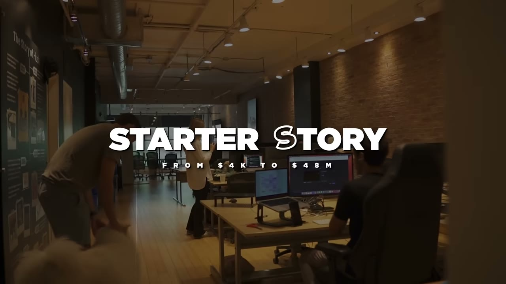
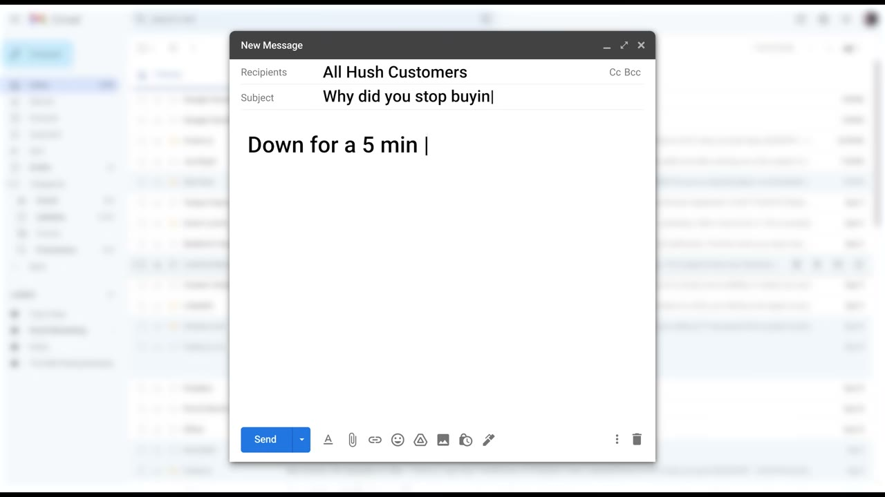
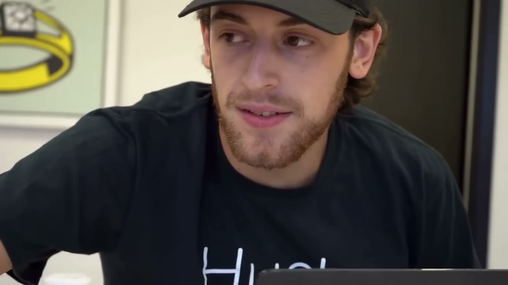

# The Underdog: He Turned His Last $4,000 Into $48M

✅ **Đã phân tích sâu** → [`case.md`](case.md)

| | |
|---|---|
| **Video** | <https://www.youtube.com/watch?v=IuoscQiQQLg> |
| **Đăng** | 27/09/2023 |
| **Thời lượng** | 13:15 |
| **Lượt xem** | 1,516,501 |
| **Lượt thích** | 33,126 |
| **Video ID** | `IuoscQiQQLg` |

## Trong thư mục này

| File | Nội dung |
|---|---|
| [`case.md`](case.md) | **Phân tích đầy đủ** — ý tưởng, validate, GTM, áp dụng ở VN |
| [`meta.json`](meta.json) | Metadata gốc (chapters, heatmap, mô tả) |
| [`screenshots/`](screenshots/) | 6 ảnh 720p |

## Mô tả gốc

In this video, I flew out to Toronto to get the full story of Hush Blankets. Aaron and Leor started this business while working their 9-5's, and they made one of the craziest rebounds I've ever seen from an ecommerce business - the best part, Aaron shared exactly how they did it.
Our Links

## Số liệu bắt được từ transcript

> Các đoạn founder nhắc tới con số, kèm timestamp để tua thẳng tới đó trong video.

_(không bắt được con số nào)_

## Chương

- `00:00` Intro
- `01:08` The Beginning
- `04:55` The Breakthrough
- `06:06` The Kickstarter
- `07:46` The 2020s
- `09:56` The 2021s

## Ảnh

1. `01_01m07s_replay.jpg` — 
2. `02_01m55s_replay.jpg` — 
3. `03_04m58s_replay.jpg` — 
4. `04_06m18s_ch-the-kickstarter.jpg` — 
5. `05_07m58s_ch-the-2020s.jpg` — 
6. `06_10m08s_ch-the-2021s.jpg` — 

---

← [Quay lại index](../../index.md) · [Toàn bộ video](../README.md)
