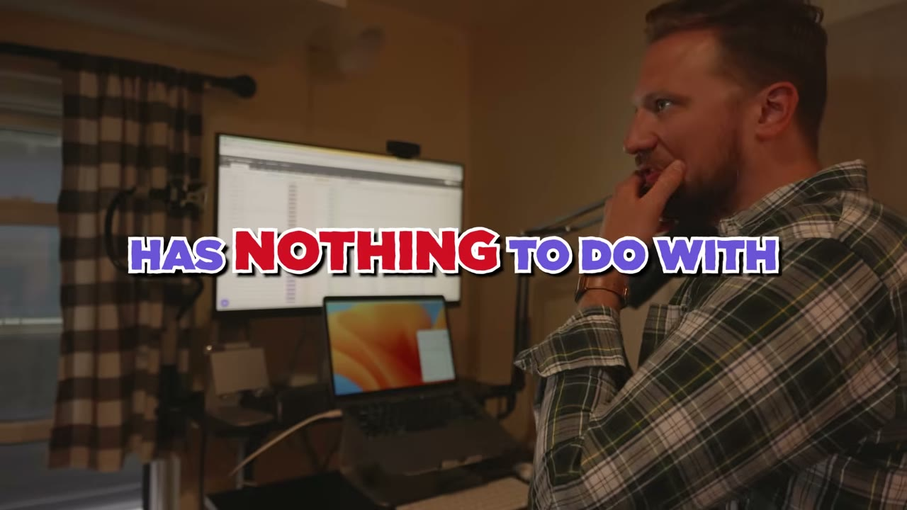
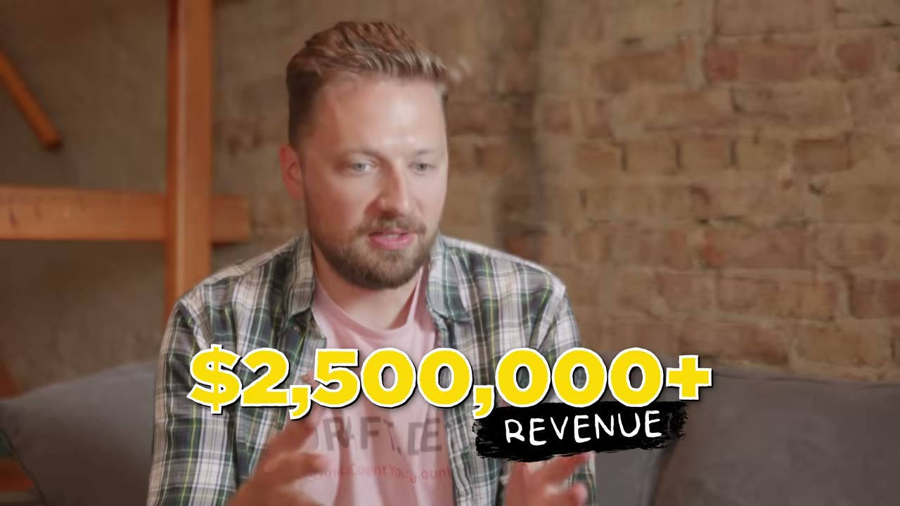
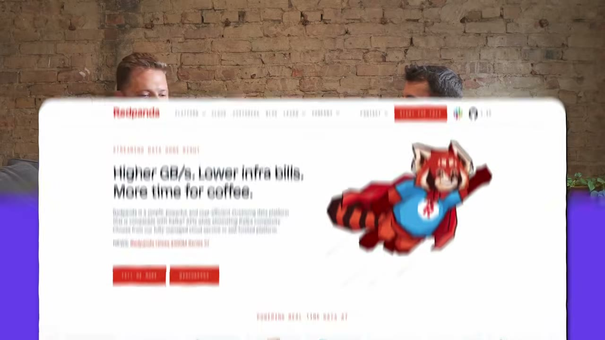
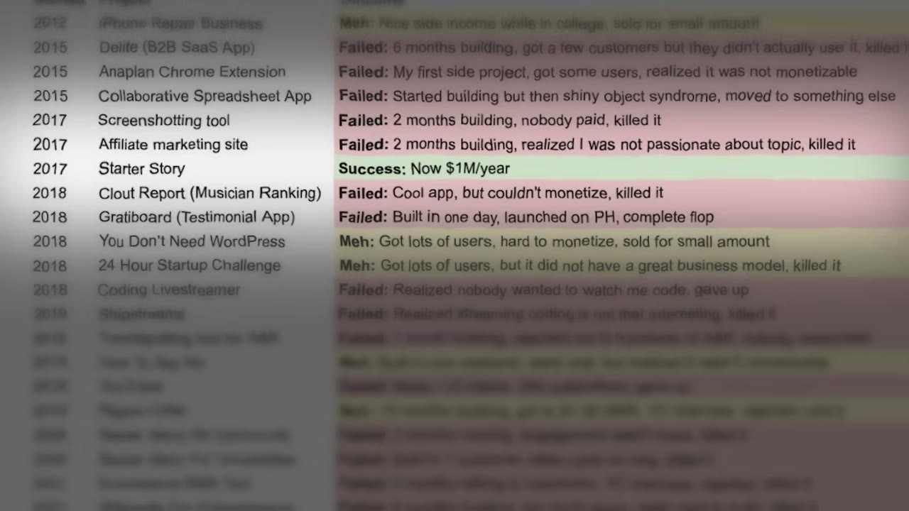

# He Built A $2.5M/Year Business In 2 Years

✅ **Đã phân tích sâu** → [`case.md`](case.md)

| | |
|---|---|
| **Video** | <https://www.youtube.com/watch?v=i6kCkGmJc9M> |
| **Đăng** | 04/10/2023 |
| **Thời lượng** | 14:13 |
| **Lượt xem** | 118,026 |
| **Lượt thích** | 1,861 |
| **Video ID** | `i6kCkGmJc9M` |

## Trong thư mục này

| File | Nội dung |
|---|---|
| [`case.md`](case.md) | **Phân tích đầy đủ** — ý tưởng, validate, GTM, áp dụng ở VN |
| [`meta.json`](meta.json) | Metadata gốc (chapters, heatmap, mô tả) |
| [`screenshots/`](screenshots/) | 9 ảnh 720p |

## Mô tả gốc

In this video, I flew out to Chicago to meet Karl Hughes - a guy who built a $2,500,000 business in just 2 years. He shared how he literally got started without a landing page or a website - AND, how anyone can launch a profitable productized service with just one skill. He's also one of the most down to earth people I've met so far. Hope you guys enjoy!
Our Links

## Số liệu bắt được từ transcript

> Các đoạn founder nhắc tới con số, kèm timestamp để tua thẳng tới đó trong video.

_(không bắt được con số nào)_

## Chương

- `00:00` <Untitled Chapter 1>
- `01:58` TYPICAL CLIENT
- `02:38` BACKSTORY
- `05:38` TEAM SETUP
- `10:22` 2. Market Timing

## Ảnh

1. `01_00m36s_usd-100-m.jpg` — 
2. `02_01m22s_usd-2-5-m.jpg` — 
3. `03_02m10s_ch-typical-client.jpg` — 
4. `04_02m50s_ch-backstory.jpg` — 
5. `05_05m50s_ch-team-setup.jpg` — 
6. `06_08m44s_replay.jpg` — 
7. `07_09m19s_usd-5-800.jpg` — 
8. `08_10m34s_ch-2-market-timing.jpg` — 
9. `09_14m02s_usd-2-5-m.jpg` — 

---

← [Quay lại index](../../index.md) · [Toàn bộ video](../README.md)
