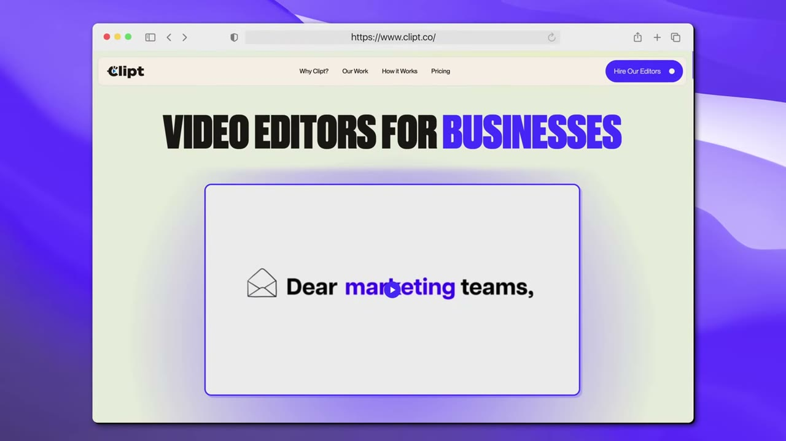
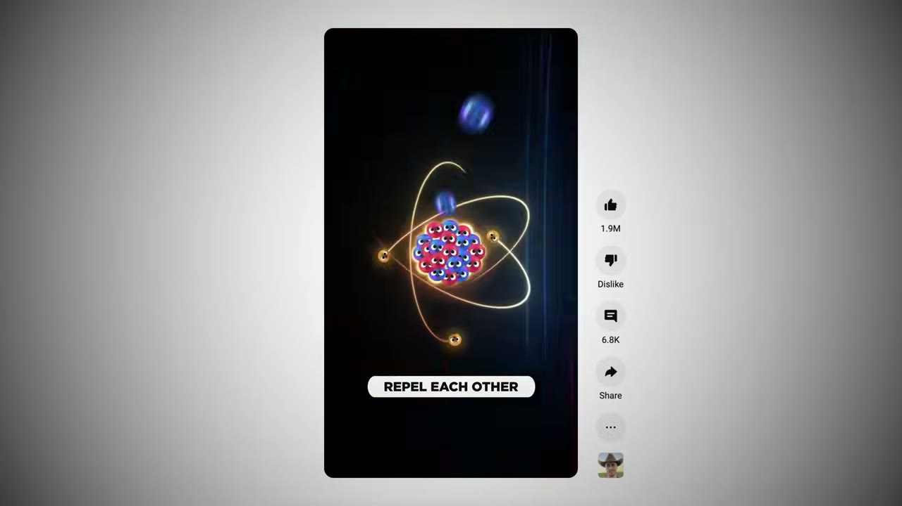
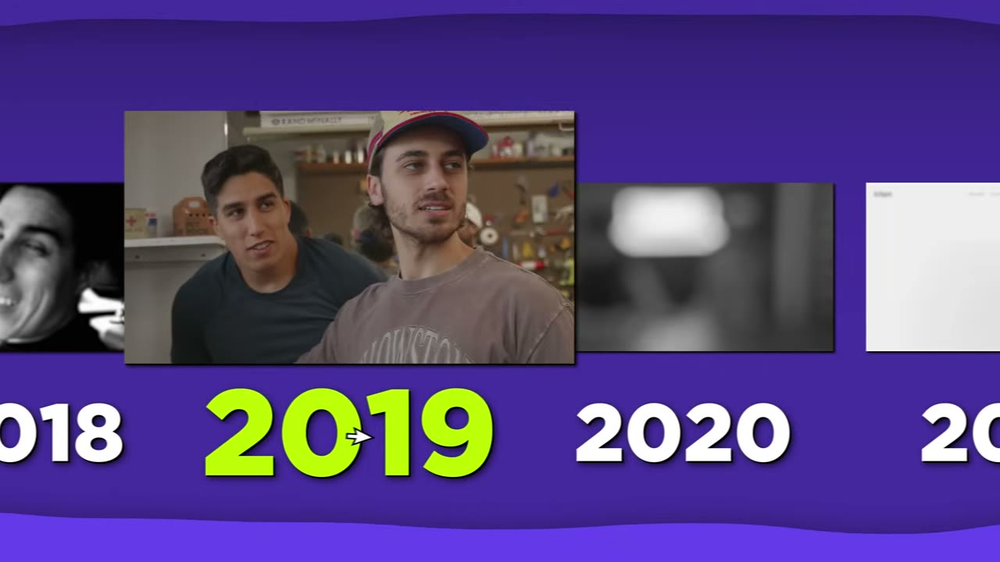
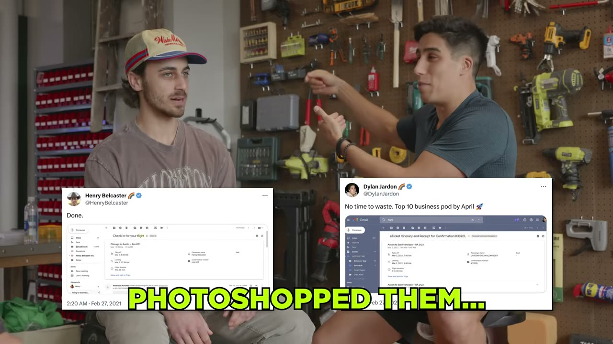
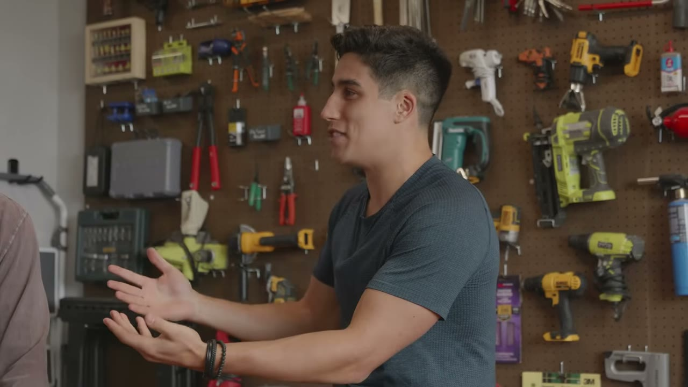
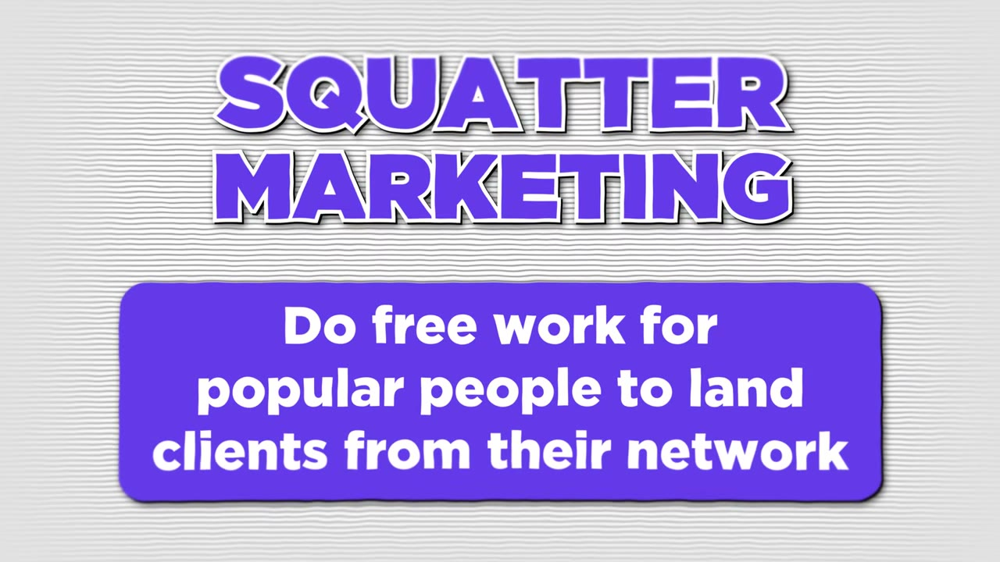
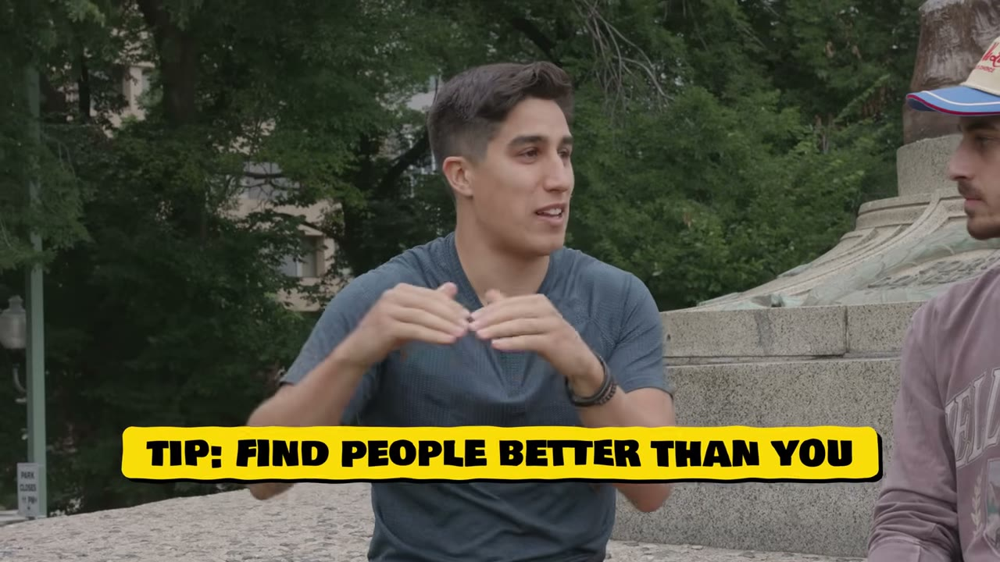
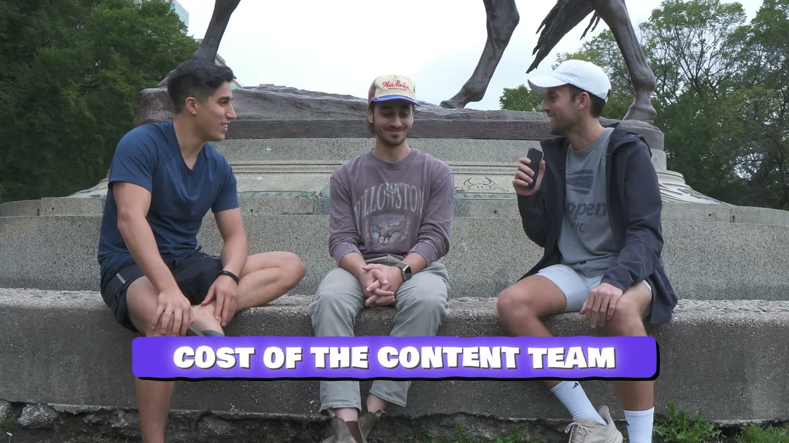
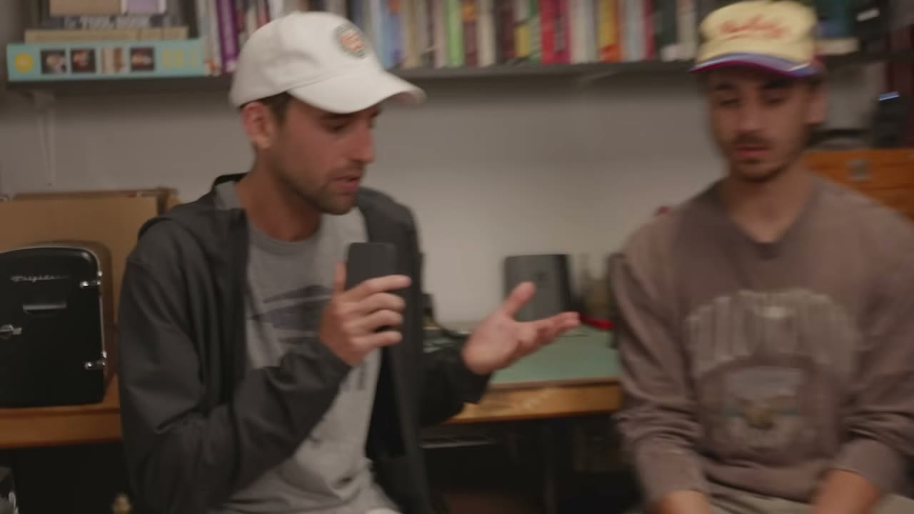

# They Built A $2M Business To Fund Their Dreams

✅ **Đã phân tích sâu** → [`case.md`](case.md)

| | |
|---|---|
| **Video** | <https://www.youtube.com/watch?v=e6COsh5wfNA> |
| **Đăng** | 18/10/2023 |
| **Thời lượng** | 14:37 |
| **Lượt xem** | 57,496 |
| **Lượt thích** | 1,400 |
| **Video ID** | `e6COsh5wfNA` |

## Trong thư mục này

| File | Nội dung |
|---|---|
| [`case.md`](case.md) | **Phân tích đầy đủ** — ý tưởng, validate, GTM, áp dụng ở VN |
| [`meta.json`](meta.json) | Metadata gốc (chapters, heatmap, mô tả) |
| [`screenshots/`](screenshots/) | 10 ảnh 720p |

## Mô tả gốc

In this video, I'm in Chicago to meet Dylan and Henry - two college roommates who built a $2M/Year business to fund their creative dreams. They share their strategies for landing BIG clients (Ali Abdaal, Will Smith, Naval...), AND the secret that has gotten them over 1 billion views on YouTube. But the best part about their business - they optimize for fun first... THEN for money.
0:00 - Intro
1:04 - Meet The Boys
1:26 - Business Breakdown
2:04 - Content Strategy
2:28 - 1 Billion Views
2:43 - Background
3:43 - Finding The Idea (Blitz Strategy)
4:56 - How They Self-Funded The Business
5:38 - La

## Số liệu bắt được từ transcript

> Các đoạn founder nhắc tới con số, kèm timestamp để tua thẳng tới đó trong video.

_(không bắt được con số nào)_

## Chương

- `00:00` Intro
- `01:04` Meet The Boys
- `01:26` Business Breakdown
- `02:04` Content Strategy
- `02:28` 1 Billion Views
- `02:43` Background
- `03:43` Finding The Idea (Blitz Strategy)
- `04:56` How They Self-Funded The Business
- `05:38` Landing Big Clients (Squatter Marketing)
- `07:08` How To Create Viral Content
- `08:09` How To Hire
- `08:45` Where To Find Talented Editors
- `09:22` Costs of The Team
- `09:56` Starting A Business With A Friend
- `10:58` Content OVER Money
- `11:30` Day in the life
- `12:05` Future Vision & Strategy
- `12:59` How To Find Profitable Ideas
- `13:30` Advice

## Ảnh

1. `01_01m16s_ch-meet-the-boys.jpg` — 
2. `02_02m16s_ch-content-strategy.jpg` — 
3. `03_02m55s_ch-background.jpg` — 
4. `04_04m18s_replay.jpg` — 
5. `05_05m14s_usd-40-000.jpg` — 
6. `06_05m50s_ch-landing-big-clients-squatter-marketing.jpg` — 
7. `07_06m49s_usd-25-m.jpg` — 
8. `08_08m21s_ch-how-to-hire.jpg` — 
9. `09_09m25s_replay.jpg` — 
10. `10_10m58s_usd-2-m.jpg` — 

---

← [Quay lại index](../../index.md) · [Toàn bộ video](../README.md)
