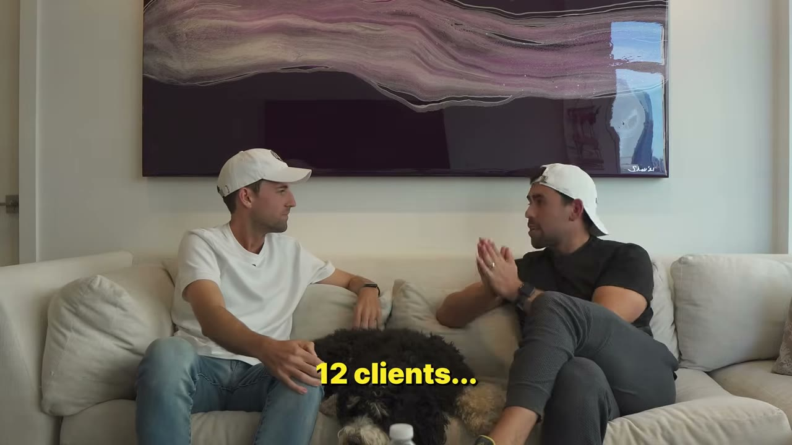
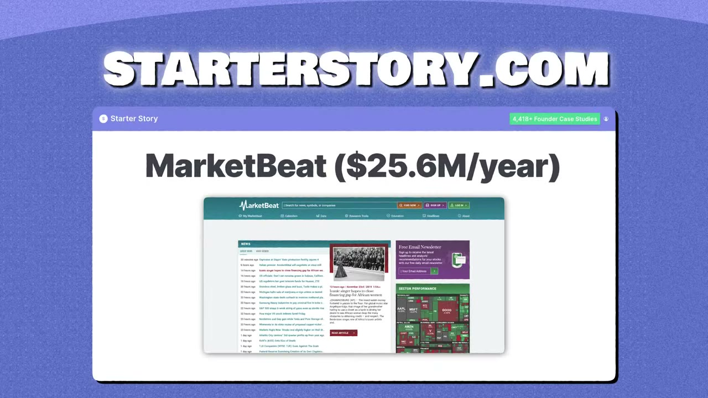

# The Multipreneur: He’s Building A $10M Portfolio of Income Streams

✅ **Đã phân tích sâu** → [`case.md`](case.md)

| | |
|---|---|
| **Video** | <https://www.youtube.com/watch?v=nzVcbrLl9VU> |
| **Đăng** | 02/11/2023 |
| **Thời lượng** | 18:21 |
| **Lượt xem** | 343,556 |
| **Lượt thích** | 8,598 |
| **Video ID** | `nzVcbrLl9VU` |

## Trong thư mục này

| File | Nội dung |
|---|---|
| [`case.md`](case.md) | **Phân tích đầy đủ** — ý tưởng, validate, GTM, áp dụng ở VN |
| [`meta.json`](meta.json) | Metadata gốc (chapters, heatmap, mô tả) |
| [`screenshots/`](screenshots/) | 9 ảnh 720p |

## Mô tả gốc

In this video, I'm I flew out to New York City to meet up with Alex Lieberman -the guy who sold his newsletter for $75M. Now he's onto a new venture - to become a Multipreneur. He share's exactly how he plans to build a personal holding company with several tiny businesses - AND, the scrappy method he used to get his first business idea off the ground. Enjoy it!
Our Links

## Số liệu bắt được từ transcript

> Các đoạn founder nhắc tới con số, kèm timestamp để tua thẳng tới đó trong video.

_(không bắt được con số nào)_

## Chương

_(không có chapter)_

## Ảnh

1. `01_00m53s_usd-7-000.jpg` — 
2. `02_01m41s_usd-75-m.jpg` — 
3. `03_03m15s_usd-10-m.jpg` — 
4. `04_06m26s_usd-1.jpg` — 
5. `05_07m28s_usd-25-m.jpg` — 
6. `06_08m19s_replay.jpg` — 
7. `07_09m20s_usd-7-000.jpg` — 
8. `08_12m27s_usd-100.jpg` — 
9. `09_13m38s_replay.jpg` — 

---

← [Quay lại index](../../index.md) · [Toàn bộ video](../README.md)
