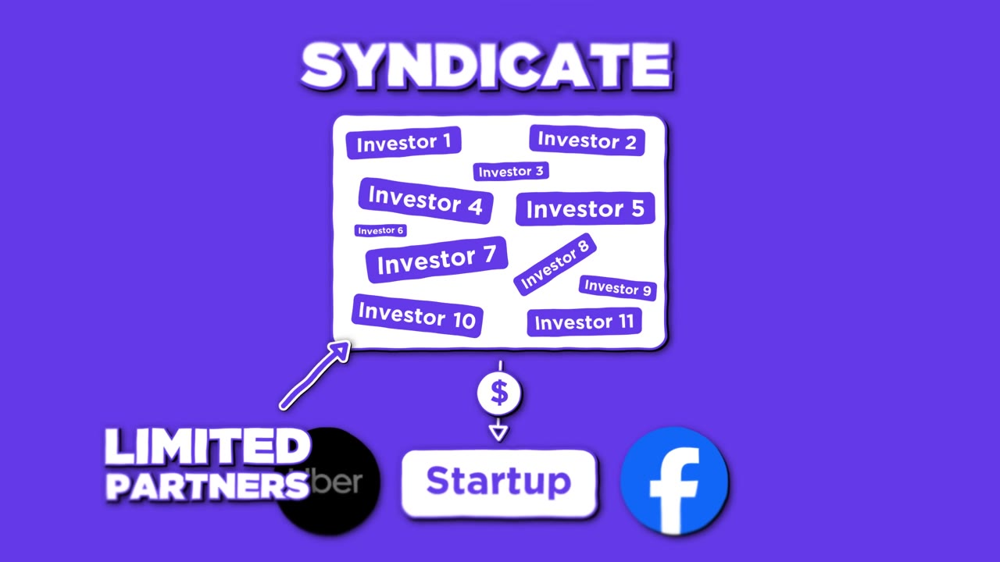
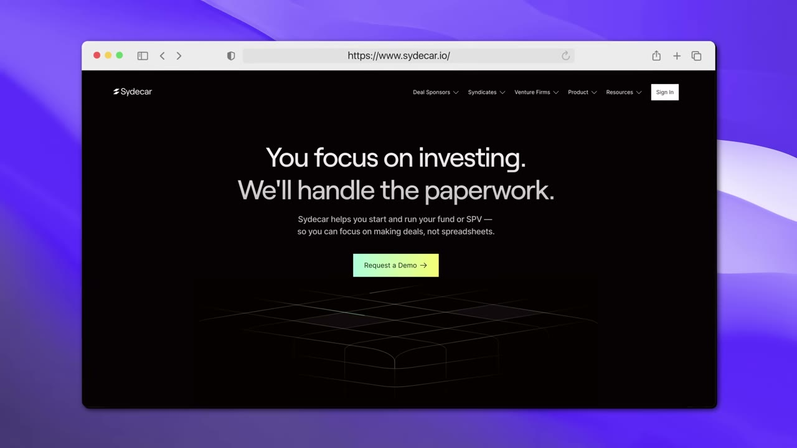
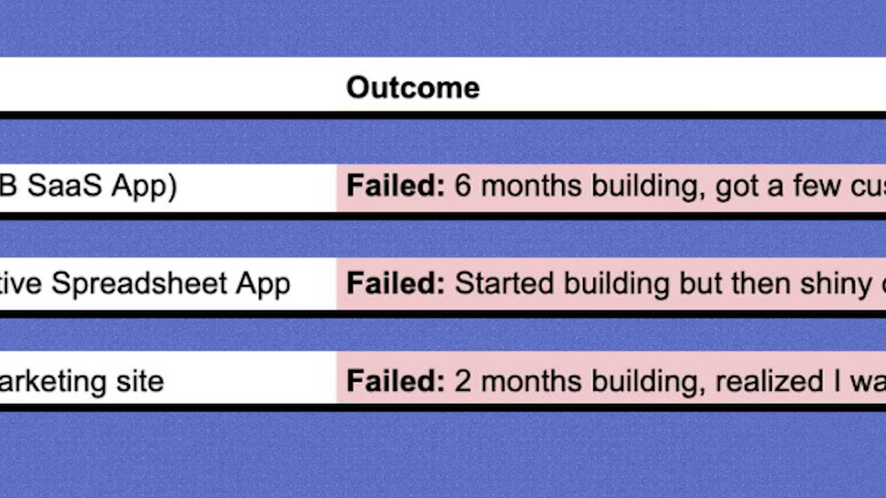

# I Became A Venture Capitalist With Only $1,000

✅ **Đã phân tích sâu** → [`case.md`](case.md)

| | |
|---|---|
| **Video** | <https://www.youtube.com/watch?v=p3xa6mpxvOY> |
| **Đăng** | 15/11/2023 |
| **Thời lượng** | 17:26 |
| **Lượt xem** | 92,571 |
| **Lượt thích** | 2,387 |
| **Video ID** | `p3xa6mpxvOY` |

## Trong thư mục này

| File | Nội dung |
|---|---|
| [`case.md`](case.md) | **Phân tích đầy đủ** — ý tưởng, validate, GTM, áp dụng ở VN |
| [`meta.json`](meta.json) | Metadata gốc (chapters, heatmap, mô tả) |
| [`screenshots/`](screenshots/) | 7 ảnh 720p |

## Mô tả gốc

In this video, I'm in New York City talking to Alex Pattis - the guy who has invested over $60M into startups, while starting with only $1,000. In this video, we talk about how he manages a $60M fund while still working a full-time job and, everything you need to know about Syndicates.
*Please note that this video is for informational and educational purposes only. It is not intended to be investment advice or a recommendation to buy or sell any specific securities or financial products. Viewers should always conduct their own research and consult with a qualified financial advisor before maki

## Số liệu bắt được từ transcript

> Các đoạn founder nhắc tới con số, kèm timestamp để tua thẳng tới đó trong video.

_(không bắt được con số nào)_

## Chương

- `00:00` Intro
- `01:32` What is a Syndicate
- `06:57` Starter Story
- `08:02` Interview
- `13:51` Investment Process

## Ảnh

1. `01_00m38s_usd-1-000.jpg` — 
2. `02_01m56s_usd-1-000.jpg` — 
3. `03_03m01s_replay.jpg` — 
4. `04_07m09s_ch-starter-story.jpg` — 
5. `05_07m55s_usd-5-800.jpg` — 
6. `06_08m42s_usd-6-m.jpg` — 
7. `07_14m03s_ch-investment-process.jpg` — 

---

← [Quay lại index](../../index.md) · [Toàn bộ video](../README.md)
