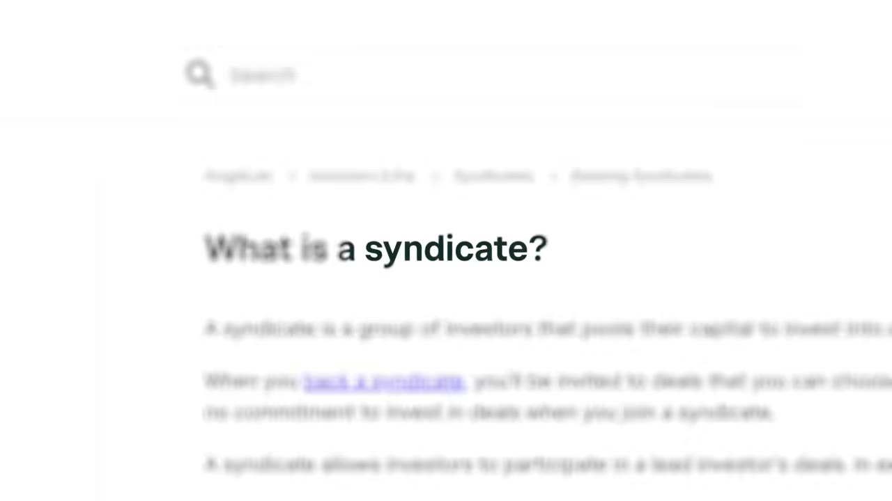
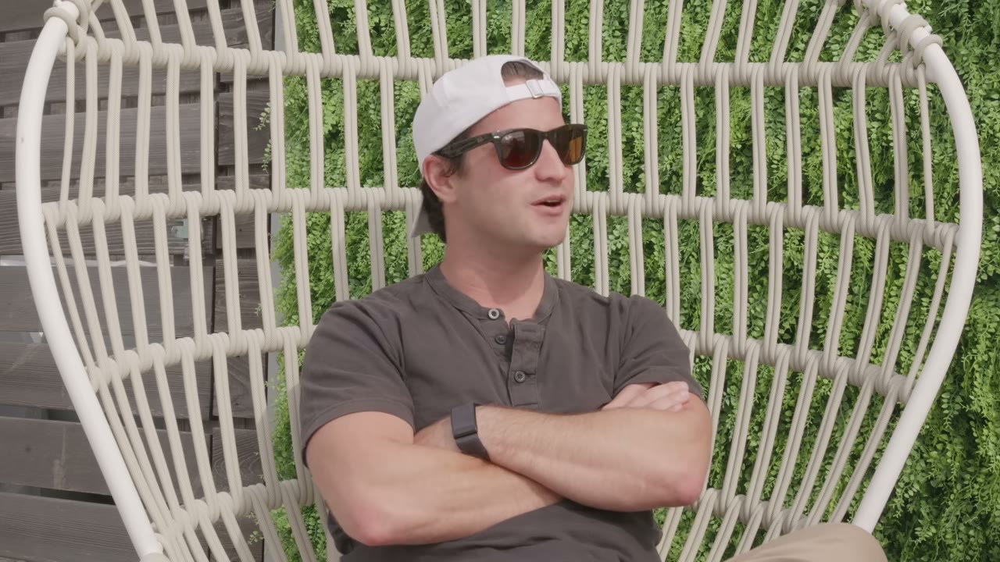
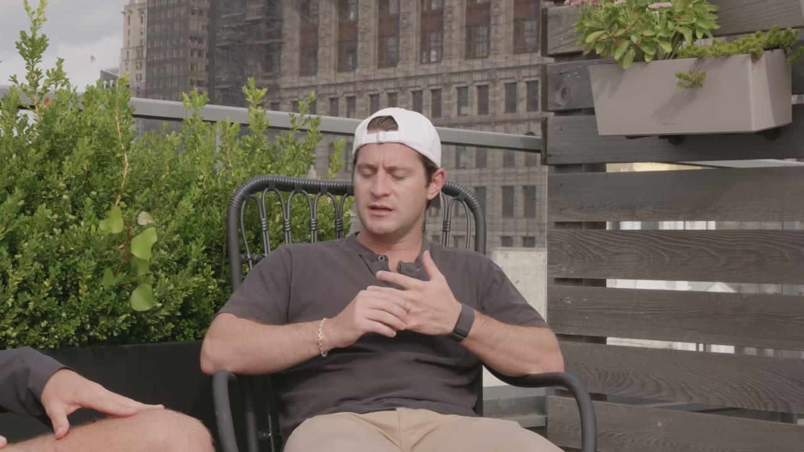

# Alex Pattis — chiến lược "cho đi trước", và vì sao case này đáng đọc dù bạn không bao giờ làm đầu tư

> **Tóm tắt 30 giây.** Alex Pattis đã rót vốn vào **275 công ty và triển khai khoảng 60 triệu USD** — trong khi **vẫn giữ công việc toàn thời gian**, chia thời gian 70/30. Anh không giàu; anh bắt đầu bằng **1.000 USD**. Cơ chế là SPV: anh gom nhiều tấm séc nhỏ thành một khoản đủ lớn để lên bảng cổ đông. Nhưng thứ đáng học nhất trong case này **không phải mô hình tài chính** — mà là cách anh xây quan hệ với những người mạnh hơn mình rất nhiều: **anh gửi cho họ 10, 20 cơ hội miễn phí trước khi xin bất cứ thứ gì.**

## ⚠️ Về case này

Đây là case về **một mô hình kinh doanh** (nghề dẫn dắt syndicate) và **một chiến lược xây quan hệ**, không phải khuyến nghị đầu tư. Đầu tư giai đoạn sớm là hoạt động **rủi ro rất cao**, phần lớn khoản đầu tư mất trắng, và chính founder nói rõ điều đó. Tôi để `replicability_vn: 1` vì mô hình SPV như anh mô tả gắn với khung pháp lý Mỹ (nhà đầu tư đủ điều kiện, AngelList/Carta) và **không chuyển giao trực tiếp sang Việt Nam**.

**Phần chuyển giao được là mục 3 — và nó rất đáng đọc kể cả khi bạn chưa bao giờ nghĩ tới đầu tư.**

## 1. Con số

| Chỉ số | Giá trị |
|---|---|
| Số công ty đã rót vốn | **275** |
| Tổng vốn triển khai | **~60 triệu USD** |
| Số tiền anh bắt đầu | **1.000 USD** |
| Mức tối thiểu cho nhà đầu tư | **1.000 USD/deal** |
| Phân bổ thời gian | **70% việc chính / 30% syndicate** |
| Phí anh nhận | **20% carry** — chỉ khi có lãi |

**Deal đầu tiên:** công ty đang gọi 2 triệu USD ở **định giá 6 triệu**. Anh được tham gia 150.000 USD ở tranche cuối. Công ty đó **gần đây gọi vốn ở định giá 500 triệu** — khoảng **83 lần**.

## 2. Mô hình hoạt động thế nào ⭐⭐⭐

Cơ chế rất gọn:

1. Anh **chốt được suất tham gia** trong một vòng gọi vốn (allocation)
2. Anh lập một **SPV** — một pháp nhân riêng cho đúng deal đó, qua các nền tảng như AngelList, Sidecar, Carta
3. Nhà đầu tư góp **tối thiểu 1.000 USD** vào SPV
4. SPV đứng tên trên bảng cổ đông của công ty
5. Nếu có exit, anh lấy **20% phần lợi nhuận vượt vốn gốc**; nhà đầu tư giữ 80%

Anh giải thích tỷ lệ sở hữu bằng một ví dụ đơn giản: nếu SPV rót 100.000 USD và bạn góp 1.000 USD, **bạn sở hữu 1% của pháp nhân đó**.

**Điểm đáng chú ý về động cơ:** *"nói ngắn gọn, **tôi chỉ kiếm được tiền nếu tôi trả lại vốn cho nhà đầu tư của mình**."* Không có phí quản lý — khác hẳn quỹ truyền thống.

**Quy trình một deal, có mốc thời gian rõ:**

| Bước | Thời gian |
|---|---|
| Chốt allocation với founder | — |
| Viết deal memo + lập SPV **song song** | **~2 ngày** |
| Gửi tài liệu cho nhà đầu tư, để họ quyết định | **1–2 tuần** |
| Đóng SPV, chuyển tiền cho công ty | — |

## 3. Chiến lược "deal flow hustle guy" — phần đáng học nhất ⭐⭐⭐⭐⭐

Đây là lý do case này đáng đọc kể cả khi bạn không quan tâm tới đầu tư, vì nó giải một bài toán ai cũng gặp: **làm sao xây quan hệ với người mạnh hơn mình rất nhiều, khi bạn chẳng có gì để đổi?**

Anh nói thẳng vấn đề:

> **Hầu hết các quỹ tôi gặp đều chẳng quan tâm gì tới tôi.** Séc của tôi nhỏ, tôi không đáng kể với họ.

Và giải pháp:

> Nhưng nếu bạn có thể **chia sẻ những cơ hội chất lượng cao**, hoặc thực sự **tìm ra một deal mà cuối cùng họ tham gia**, thì bạn sẽ thấy mối quan hệ đó thay đổi khá nhiều — họ bắt đầu **muốn giữ bạn vui vẻ và giữ bạn trong đầu.**

Và đây là con số khiến chiến lược này đáng tin:

> Tôi có những ví dụ về các quỹ mà tôi **đã gửi cho họ chắc 10, 20 deal**, và **mãi tới cái thứ 20 họ mới thực sự tham gia** vào một vòng. Còn bây giờ, một số người mà tôi đã dành **vài năm chia sẻ deal** thì **giờ mới bắt đầu cho tôi xem trước những deal họ đang dẫn dắt.**

**Vì sao điều này quan trọng và chuyển giao được:**

- **Tỷ lệ chuyển đổi là 1/20**, và **thời gian là vài năm**. Anh nói ra con số đó — điều rất hiếm, vì nó cho thấy chiến lược này thật sự khắc nghiệt đến đâu
- Anh **tự đặt cho mình một thương hiệu**: *"deal flow hustle guy"* — một vai trò có thể mô tả trong ba chữ, và đó là lý do người ta nhớ tới anh
- Anh **cho đi thứ mình có** (thông tin, thời gian tìm kiếm) chứ không phải thứ mình không có (tiền, uy tín)

**Áp dụng ra ngoài đầu tư:** nếu bạn muốn vào một mạng lưới mà bạn chưa xứng đáng, hãy tìm **thứ bạn có thể cho đi mà họ thấy giá trị nhưng không muốn tốn công làm** — rồi cho đi khoảng 20 lần trước khi xin bất cứ điều gì. Đây cũng là điều [Thomas Frank gọi là "fan first"](../2024-04-18_i-made-2-5m-selling-a-digital-product/case.md) và [Erikas làm khi rao ba tài sản cụ thể để tìm co-founder](../2025-04-19_my-apps-make-4-5m-year-with-0-marketing/case.md).

## 4. Năm nguồn tìm cơ hội — một bánh đà ⭐⭐⭐⭐

Anh liệt kê năm cách, và điểm hay là **chúng nuôi lẫn nhau**:

1. **Đồng syndicate với các syndicate lead khác** — khi ai đó có allocation lớn hơn khả năng lấp đầy, họ tìm anh
2. **Quan hệ với các quỹ đầu tư** — thành quả của chiến lược ở mục 3
3. **Chính các founder trong danh mục** — họ giới thiệu bạn bè founder của họ, và giới thiệu này đến kèm thiện cảm sẵn
4. **Các nhà đầu tư thiên thần khác** — họ luôn chỉ lấy một phần rất nhỏ nên **không cạnh tranh với anh**, và họ chia sẻ qua lại
5. **Chính tệp nhà đầu tư của anh** — nhiều người trong số họ là founder, CEO, trưởng bộ phận sản phẩm, kỹ thuật, bán hàng

**Điểm cấu trúc đáng học:** nguồn 3 và 5 chỉ tồn tại **sau khi** anh đã làm được một thời gian — tức bánh đà này **tăng tốc theo thời gian** chứ không tuyến tính. Đó là lý do anh nói ba năm rưỡi gần đây mới là lúc mọi thứ thực sự bùng.

## 5. Bộ lọc đánh giá ⭐⭐⭐⭐

Anh nêu bốn tiêu chí, và cái thứ tư là cái thực dụng nhất:

**1. Founder và mức độ phù hợp của họ với ngành.** Họ có ở lại lâu dài không? Họ có hiểu thị trường này dựa trên vai trò trước đây và những vấn đề họ từng giải? Họ đã từng làm founder nhiều lần chưa? Đã từng thành công ở vai trò co-founder hay CEO chưa?

**2. Thị trường có lớn và đang tăng trưởng không?** Có cơ hội để đây thành một công ty rất lớn — hoặc thậm chí **nhiều công ty lớn cùng tồn tại** trong thị trường đó?

**3. Có dấu hiệu sớm của product-market fit không?** Anh thừa nhận thường đầu tư khi lực kéo còn rất hạn chế.

**4. Ai đang đồng đầu tư trong vòng này?** — và đây là chỗ anh rất thẳng thắn:

> **Tôi không được xây dựng như một quỹ tổ chức có phí quản lý** để làm việc này chín tới năm và thực hiện toàn bộ quy trình thẩm định như một quỹ chuyên nghiệp. Nên việc **dựa vào các quỹ được thiết lập để dẫn dắt vòng, đặt điều khoản và thẩm định** cũng khá quan trọng.

**Đây là một sự trung thực đáng ghi nhận, và cũng là một cảnh báo:** anh đang **thuê ngoài phần thẩm định** cho các quỹ lớn. Điều đó hợp lý với nguồn lực của anh, nhưng nó cũng nghĩa là **chất lượng quyết định của anh phụ thuộc vào chất lượng quyết định của người khác**.

Anh cũng nói rõ về bản chất rủi ro của lớp tài sản này:

> Khi đầu tư vào startup giai đoạn sớm, bạn thực sự đang cố tìm **một hoặc vài người thắng lớn** — và khi tôi nói thắng lớn, tôi nói **50, 100, 250 lần**. Công ty đó sẽ phải bù cho **10, 20, 30, 50 khoản thua** khác. Để làm tốt việc này, **bạn phải làm rất nhiều deal, bạn phải đa dạng hoá.**

## 6. Làm bán thời gian như thế nào ⭐⭐⭐

Chi tiết vận hành đáng chú ý — anh vẫn giữ công việc chính:

- Anh là **người dậy sớm**, và đó là **vài tiếng làm việc trước khi ngày làm chính bắt đầu**
- **Họp buổi tối muộn**
- **Gặp founder uống cà phê vào cuối tuần**
- Tỷ lệ: **70% việc chính, 30% syndicate**

Và lý do anh chịu được nhịp đó:

> Tôi cũng tin vào **tầm nhìn dài hạn** ở đây. Tôi nghĩ có một cơ hội lớn hơn. **Đây là một hạng mục đang lớn lên, và tôi muốn được biết đến như người dẫn dắt syndicate ở đó.**

Đối chiếu: [Ramsri chủ động không nghỉ việc](../2025-06-18_i-make-100k-year-from-2-ai-side-projects/case.md), [Alex Goldberg đổi sang việc nhẹ hơn thay vì nghỉ](../2024-03-30_i-make-1m-year-with-one-website/case.md). Ba founder giữ việc chính vì ba lý do khác nhau — với Alex Pattis, lý do là **anh cần thời gian để bánh đà quan hệ quay đủ vòng**, và công việc chính trả tiền cho những năm đó.

## 7. Cảnh báo thiên kiến nguồn

- **Một đoạn quảng cáo Starter Story khoảng 1 phút** (6:59–7:55) chèn giữa, kèm ví dụ đơn lẻ về "Luke thu 5.800 USD trong 30 ngày".
- **Không có bất kỳ ảnh chụp báo cáo danh mục hay sao kê nào.** Con số 275 công ty và 60 triệu USD là lời tự khai.
- **Chưa có exit nào được nêu tên.** Anh nói về một công ty tăng từ 6 triệu lên 500 triệu định giá — nhưng **đó là định giá trên giấy, không phải tiền đã về tay ai**. Trong đầu tư giai đoạn sớm, khoảng cách giữa "định giá tăng" và "thu được tiền" thường là **nhiều năm** và không phải lúc nào cũng đóng lại.
- **Không có số liệu về tỷ lệ thua.** Anh nói cần bù cho "10, 20, 30, 50 khoản thua" nhưng **không cho biết tỷ lệ thực tế trong danh mục 275 công ty của anh.** Đây là con số quan trọng nhất và nó vắng mặt.
- **Toàn bộ mô hình phụ thuộc vào khung pháp lý Mỹ** — nhà đầu tư đủ điều kiện (accredited investor), các nền tảng SPV. Video không nhắc tới bất kỳ giới hạn pháp lý nào.
- **Giai đoạn được kể (2020–2023) là giai đoạn định giá startup rất cao.** Bối cảnh đó đã thay đổi đáng kể, và video không đặt câu chuyện vào chu kỳ thị trường.

## 8. Áp dụng cho tôi (indie hacker VN)

**Sao chép được ngay — và phần này không liên quan gì tới đầu tư:**

1. **Chiến lược "cho đi 20 lần trước khi xin".** Tìm thứ bạn có thể cho đi mà người mạnh hơn thấy giá trị nhưng ngại tốn công làm. Với anh là tìm deal; với bạn có thể là giới thiệu khách hàng, tổng hợp thông tin, hay giải một vấn đề kỹ thuật nhỏ.
2. **Tự đặt cho mình một vai trò mô tả được trong ba chữ.** "Deal flow hustle guy" là lý do người ta nhớ anh. Bạn là ai trong một câu?
3. **Chấp nhận tỷ lệ 1/20 và khung thời gian nhiều năm** cho việc xây quan hệ. Anh nói con số đó ra, và nó ngăn bạn bỏ cuộc ở lần thứ ba.
4. **Nhận diện bánh đà:** những nguồn cơ hội chỉ xuất hiện *sau khi* bạn đã làm một thời gian. Điều đó nghĩa là năm đầu luôn chậm hơn bạn tưởng, và năm thứ ba nhanh hơn bạn tưởng.
5. **Lịch làm việc của người có việc chính:** vài tiếng sáng sớm, họp tối muộn, gặp gỡ cuối tuần.

**Vì sao mô hình chính không áp dụng được:**

- **SPV, nhà đầu tư đủ điều kiện, AngelList/Carta** đều gắn với khung pháp lý Mỹ.
- **Huy động vốn từ nhiều người ở Việt Nam để đầu tư** là hoạt động chịu quy định chặt chẽ. Đây không phải rào cản kỹ thuật mà là rào cản pháp lý, và nó nghiêm túc.
- Anh xây được vì anh **ở New York**, làm ở startup và có mạng lưới trong hệ sinh thái đó.

**Khi KHÔNG nên nghĩ tới con đường này:**

- **Khi bạn coi đây là cách kiếm tiền.** Mô hình carry chỉ trả tiền khi có exit — có thể **nhiều năm sau**, và có thể **không bao giờ**.
- **Khi bạn không chịu được việc phần lớn khoản đầu tư mất trắng.** Chính anh mô tả cấu trúc đó rất rõ.
- **Khi bạn định tự thẩm định.** Anh thừa nhận anh dựa vào quỹ lớn làm việc đó — nếu bạn không có quyền tiếp cận các quỹ đó, bạn đang tự làm phần khó nhất mà không có công cụ.

## Nguồn

- Video: [I Became A Venture Capitalist With Only $1,000](https://www.youtube.com/watch?v=p3xa6mpxvOY) — Starter Story, 15/11/2023, 92.571 view
- [Transcript đầy đủ](transcript.md) · [Ảnh chụp màn hình](screenshots/)
