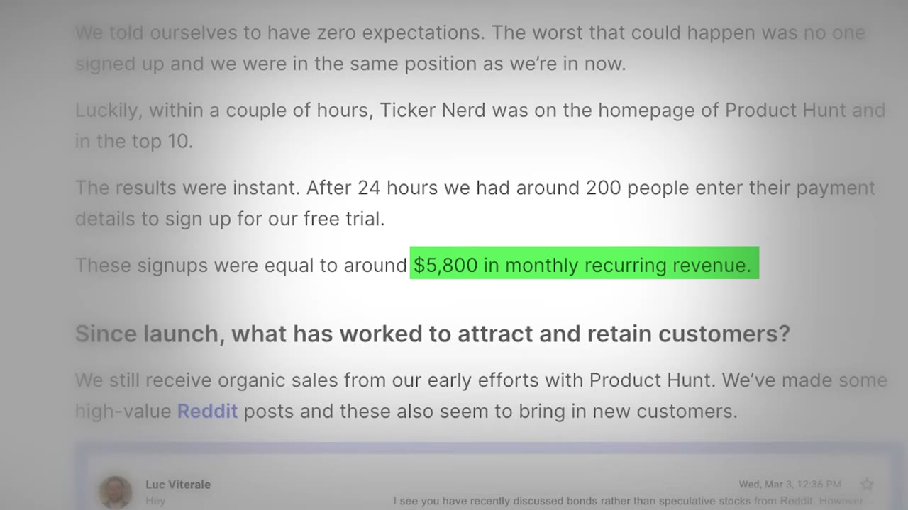
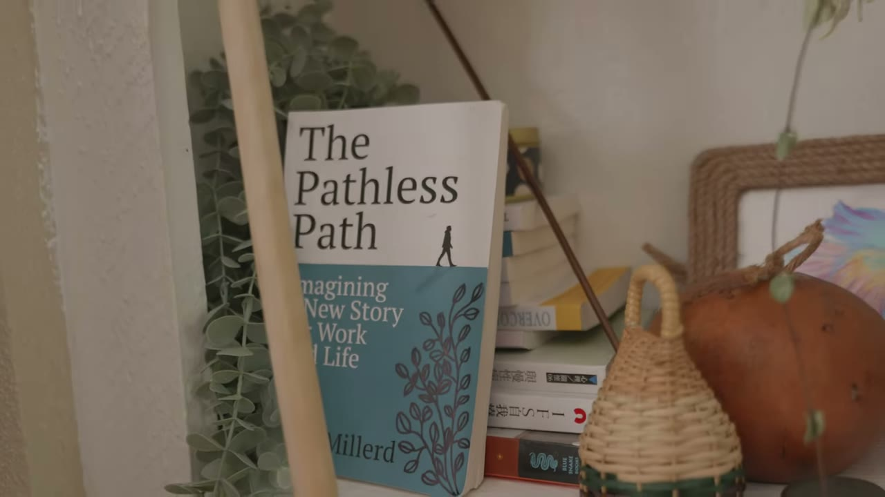

# I Quit My $250K Job To Become an Author

✅ **Đã phân tích sâu** → [`case.md`](case.md)

| | |
|---|---|
| **Video** | <https://www.youtube.com/watch?v=lWwZ-fsD8gM> |
| **Đăng** | 20/12/2023 |
| **Thời lượng** | 13:16 |
| **Lượt xem** | 19,669 |
| **Lượt thích** | 618 |
| **Video ID** | `lWwZ-fsD8gM` |

## Trong thư mục này

| File | Nội dung |
|---|---|
| [`case.md`](case.md) | **Phân tích đầy đủ** — ý tưởng, validate, GTM, áp dụng ở VN |
| [`meta.json`](meta.json) | Metadata gốc (chapters, heatmap, mô tả) |
| [`screenshots/`](screenshots/) | 9 ảnh 720p |

## Mô tả gốc

In this video, I flew out to Austin Texas to talk to Paul Millerd - the guy who quit a cozy $250,000 corporate consulting job to write a book. When Paul first started his journey to become an author and solopreneur, he ran into a lot of problems. But, eventually he found his way using a mindset he calls "The Pathless Path". He shares how The Pathless Path help him find his passion, why he chose to self-publish his book, and exactly how much money he’s made as a self published author. Hope you guys enjoy!
Our Links

## Số liệu bắt được từ transcript

> Các đoạn founder nhắc tới con số, kèm timestamp để tua thẳng tới đó trong video.

_(không bắt được con số nào)_

## Chương

- `00:00` Intro Summary
- `01:28` Tell me more about you
- `02:54` Tell me about that time
- `04:00` Why did you selfpublish
- `04:35` The process of writing the book
- `06:16` Why I wrote the book
- `07:00` The pathless path
- `07:59` Selfpublishing
- `09:10` Royalty Numbers
- `09:35` Cost Breakdown
- `10:04` Monetization
- `10:54` Writing
- `11:45` Typical Day

## Ảnh

1. `01_01m56s_usd-75-000.jpg` — 
2. `02_03m06s_ch-tell-me-about-that-time.jpg` — 
3. `03_04m34s_usd-7.jpg` — 
4. `04_06m07s_usd-5-800.jpg` — 
5. `05_07m12s_ch-the-pathless-path.jpg` — 
6. `06_08m11s_ch-selfpublishing.jpg` — 
7. `07_09m45s_usd-742.jpg` — 
8. `08_11m06s_ch-writing.jpg` — 
9. `09_11m57s_ch-typical-day.jpg` — 

---

← [Quay lại index](../../index.md) · [Toàn bộ video](../README.md)
