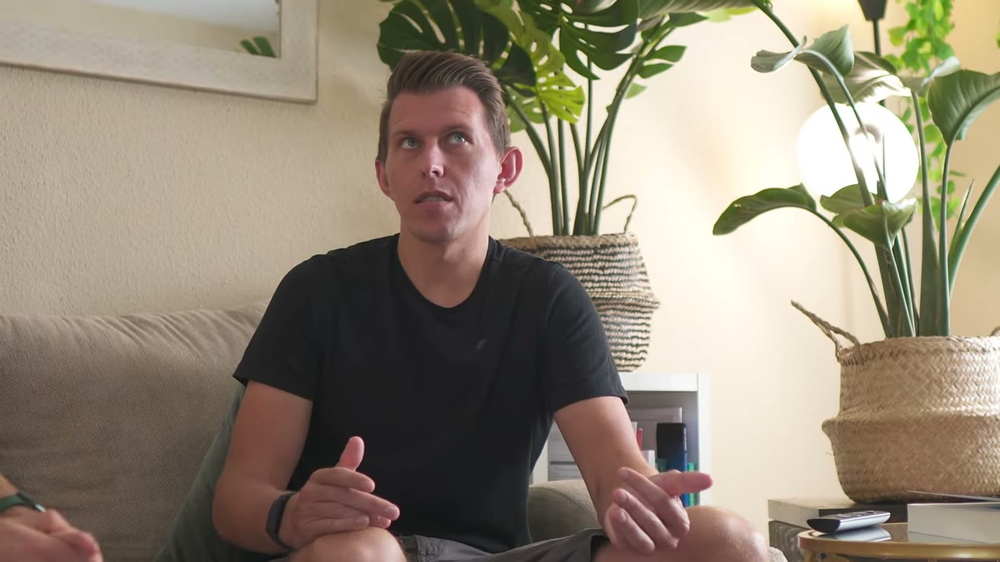
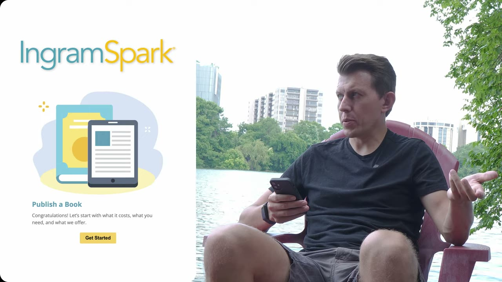
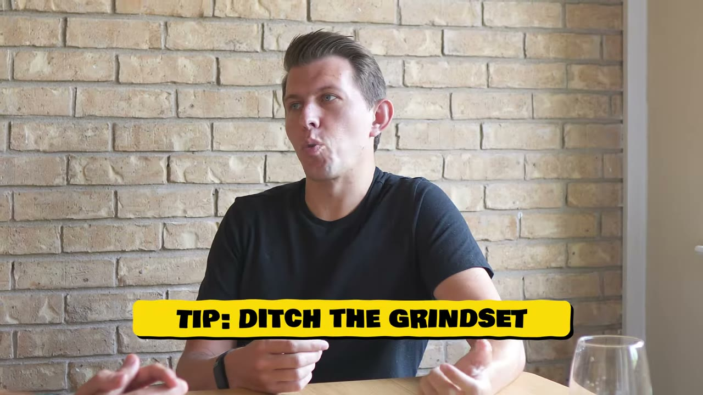

# The Pathless Path — phép tính khiến anh từ chối Penguin Random House

> **Tóm tắt 30 giây.** Paul Millerd bỏ công việc tư vấn **250.000 USD** năm 32 tuổi, không có kế hoạch gì. Công ty đòi anh trả lại **24.000 USD tiền thưởng ký hợp đồng** vì chưa làm đủ ba năm — anh gọi đó là *"mua lại tự do của mình"*. Anh viết một cuốn sách và **Penguin Random House chủ động liên hệ**. Anh từ chối, vì phép tính rất rõ: họ trả **10% giá bìa, khoảng 2 USD một cuốn**; tự xuất bản anh nhận **7–8 USD**. Đến nay: **125.000–130.000 USD tiền bản quyền, và gần như toàn bộ là lợi nhuận** — vì tổng chi phí làm sách chỉ khoảng **6.200 USD**.

## 1. Con số

| Chỉ số | Giá trị |
|---|---|
| **Tiền bản quyền tích luỹ** | **125.000–130.000 USD** — *"về cơ bản là lợi nhuận"* |
| Năm 1 | ~10.000 bản, ~50.000 USD |
| Năm 2 (5 tháng đầu) | **~15.000 bản, ~75.000 USD** |
| Tổng doanh thu năm ngoái | 249.000 USD (tổng, chưa trừ chi phí và thuế), tăng từ ~100.000 |
| **Tổng chi phí làm sách** | **~6.200 USD** |

**Tiền bản quyền trên mỗi cuốn — con số hiếm được công bố:**

| Định dạng | Anh nhận |
|---|---|
| Bìa cứng (Amazon) | **8,24 USD** |
| Bìa mềm (Amazon) | **7,45 USD** |
| Kindle | 4,28 USD |
| Sách nói | 3,98 USD |
| **Nếu qua Penguin Random House** | **~2 USD** (10% giá bìa) |

**Cơ cấu bán:** ~50% ebook, 29% bản in, 21% audio.

**Chi phí sản xuất, từng khoản:**

| Khoản | USD |
|---|---|
| Biên tập và coaching | 3.900 |
| Thiết kế bìa (99designs) | **742** |
| Phí xuất bản (IngramSpark) | 250 — *anh nói giờ đã miễn phí* |
| Sản xuất sách nói | 1.280 |
| **Tổng** | **~6.172** |

## 2. Phép tính từ chối Penguin ⭐⭐⭐⭐⭐

Đây là phần đáng học nhất và nó áp dụng được cho mọi quyết định "có nên bắt tay với người lớn hơn mình".

Penguin Random House **chủ động liên hệ**. Anh thừa nhận họ có quan hệ giúp đưa sách tới lượng độc giả rộng hơn. Nhưng anh từ chối vì hai lý do:

**Lý do 1 — Kiểm soát sáng tạo.** Nguyên văn: *"Với tôi cái giá đó quá cao. Tôi không sẵn sàng nhường bất kỳ quyền kiểm soát sáng tạo nào, **kể cả khi điều đó nghĩa là tôi bán được ít sách hơn.**"*

**Lý do 2 — Toán học.** Họ trả **10% giá bìa cho bản bìa cứng, tức khoảng 2 USD**. Tự xuất bản anh nhận **7–8 USD**. Nghĩa là **anh cần bán ít hơn khoảng 4 lần số sách để có cùng thu nhập.**

**Câu hỏi thật đằng sau:** *Penguin có giúp tôi bán được gấp hơn 4 lần không?* Nếu không, hợp tác với họ là lỗ.

Đây là dạng phân tích chuyển giao được sang mọi quyết định phân phối: **khi ai đó đề nghị mang bạn tới nhiều khách hàng hơn nhưng lấy phần lớn doanh thu, hãy tính ra hệ số họ phải nhân lên để bạn hoà vốn — rồi hỏi thẳng liệu họ có làm nổi không.**

Đối chiếu trong kho: [Deven của SuperGrow trả 40% cho RocketHub vì anh chỉ có 600 follower](../2025-09-10_how-i-made-65k-in-3-days/case.md) — cùng bài toán, kết luận ngược lại vì điều kiện khác. **Có sẵn khán giả thì tự làm; không có gì thì mua phân phối bằng phần trăm.** Paul đã có podcast và độc giả nhiều năm, nên anh ở phía tự làm.

## 3. Kinh tế của sách tự xuất bản ⭐⭐⭐⭐⭐

Con số đáng chú ý nhất không phải doanh thu, mà là **tỷ lệ chi phí trên doanh thu: 6.200 USD sản xuất, 125.000–130.000 USD thu về — tức chi phí bằng khoảng 5%.**

Và anh nói rõ **quy trình tự xuất bản đơn giản đến mức nào**: bạn xuất một file PDF, tải lên Amazon, và **có thể bắt đầu in và gửi sách trong khoảng ba ngày**.

Anh cũng chỉ ra chi tiết khiến người mới hay khựng lại:

> Điều điên rồ nhất là: nó hỏi **"nhà xuất bản của bạn là ai?"** Hoá ra **bạn có thể ghi luôn tên mình.** Tôi đã làm vậy.

**Bốn khoản nên đầu tư, theo thứ tự anh nêu:**

| Khoản | Vì sao |
|---|---|
| **Biên tập viên phát triển nội dung** (developmental editor) | *"có lẽ là khoản chi lớn nhất của bạn"* — người giúp ghép các mảnh lại và làm cho mọi thứ chảy trôi |
| **Thiết kế bìa** | anh dùng 99designs, chọn một designer mà anh thích các thiết kế khác của họ |
| **Định dạng** | công cụ của Amazon hoặc **Reedsy** — anh dùng Reedsy với tuỳ chọn mặc định |
| **Soát lỗi** | thuê người đọc soát ở khâu cuối |

Mục tiêu anh đặt ra rất rõ: **tạo ra thứ cảm giác như một cuốn sách thật, khớp với kỳ vọng của người đọc với một nhà xuất bản truyền thống.**

**Về marketing, cách chọn kênh của anh rất giống Colin của Sheets & Giggles:**

> Cách tiếp cận của tôi là: **tôi thực sự thích làm gì?** Rồi tôi dồn vào đó. Tôi thích nói chuyện trên podcast. Tôi thích bàn về các ý tưởng trong sách.

Cộng thêm một kênh cụ thể: **tặng sách**. Với tự xuất bản việc này rất dễ — trong nước Mỹ anh gửi đi bất cứ đâu với **4,50 USD bao gồm phí ship**.

## 4. Cách anh trở thành người viết — 100 ngày trên Quora ⭐⭐⭐⭐

Trình tự rất cụ thể và bắt đầu **khi anh vẫn đang đi làm**:

1. Một buổi sáng, **khoảng một năm trước khi nghỉ việc**, anh quyết định: **tôi sẽ viết trên Quora mỗi ngày trước khi bắt đầu làm việc**
2. Anh làm vậy **100 ngày liên tục**
3. Nguyên văn: *"Có gì đó đã khớp vào đúng lúc đó. **Tôi nghĩ tôi là một người viết kể từ khoảnh khắc ấy.**"*
4. Anh đang gặp vấn đề sức khoẻ (bệnh Lyme) nên lập một blog và **gửi nó cho mọi người**
5. Sau khi nghỉ việc, anh viết về con đường của mình — và **nhịp xuất bản tăng dần**: ba tháng một lần → hai tháng → một tháng → **một tuần** → *"giờ thì tôi viết suốt"*

**Điểm đáng học nhất:** anh không chờ có thời gian rảnh mới viết. Anh **cắm một khối viết vào trước giờ làm** — cùng chiến thuật với [Ben của Tech Lockdown build lúc 5h30 sáng](../2025-07-24_my-side-project-makes-15k-month-quit-my-9-5/case.md) và [Pat Walls đi Starbucks lúc 6h](../2024-10-30_the-day-i-hit-reset-on-my-life/case.md).

**Về cách viết, anh chỉ có một lời khuyên:** *"về cơ bản là dùng sức mạnh thô. Bạn cần lấy đủ số lần lặp để đối mặt được với nỗi sợ — nỗi sợ người ta sẽ nói gì. Rồi bạn nhanh chóng nhận ra, **nhất là khi mới bắt đầu, chẳng ai nói gì cả, vì bạn không có độc giả nào.**"*

Và một quan sát về quy trình sáng tạo mà tôi thấy đáng ghi:

> Tôi dành **rất nhiều ngày để lang thang** — chính khoảng thời gian tinh thần lang thang đó, khi tôi không thực sự làm gì cả, là lúc **ý tưởng lên men**. Tôi cũng đọc nhiều, nghe podcast. **Đó mới là lúc sáng tạo diễn ra. Còn viết chỉ là lúc tôi chuyển tải nó ra sau đó.**

## 5. Cách rời khỏi con đường mặc định — phần triết lý có giá trị hành động ⭐⭐⭐⭐

Điều anh nói khác hẳn giọng điệu thường thấy trong kho case này, và có vài điểm rất dùng được:

**1. Bạn không thoát khỏi công việc được.**

> Sau khi nghỉ việc, cảm giác rất lạ. Tôi không có kế hoạch. Và tôi nhận ra **bạn không thực sự thoát khỏi công việc**. Cuối cùng bạn cần tìm **loại công việc nuôi được tâm hồn mình**. Trong sách tôi gọi đó là *công việc thật sự của đời bạn*. Và "pathless path" về cơ bản là cam kết với điều đó — **mà không biết khi nào nó tới, có kiếm tiền được không, và có giải thích nổi cho bố mẹ hay người khác không.**

**2. Bỏ tiền ra khỏi phương trình càng lâu càng tốt.**

> Nếu bạn đang đi tìm công việc thật sự quan trọng, bạn nên **loại tiền bạc khỏi nó càng lâu càng tốt** — hãy chiến đấu cho điều đó.

**3. Chìa khoá chủ yếu là bỏ bớt.**

> Nếu thứ đó không làm bạn bừng sáng, bạn cần **loại nó khỏi cuộc đời mình**. Bạn cần giảm thiểu nó, tự động hoá nó, uỷ thác nó, hoặc bỏ nó.

**4. Lời khuyên cụ thể nhất: tìm một khối 1–3 tháng nghỉ hẳn.**

> Điều tôi khuyên hầu hết mọi người là **tìm một khoảng một tới ba tháng trong đời trưởng thành để nghỉ sabbatical**. Ngắt khỏi chế độ người lao động. Kết nối lại với những sở thích đã quên — vì **thứ duy nhất cho phép những điều sâu hơn nổi lên là tạo ra khoảng trống trong cuộc đời bạn.**

Đây là cùng đề xuất với [Sebastian của HabitKit: "hãy tiết kiệm tiền cho một kỳ sabbatical"](../2025-06-21_how-i-built-it-15k-month-mobile-app/case.md).

## 6. Nhiều nguồn thu — và trình tự của chúng ⭐⭐⭐⭐

Anh nêu rất rõ nguyên tắc nền:

> Với tôi luôn là: **kiếm đủ tiền để có không gian và thời gian tiếp tục viết.**

Trình tự các nguồn thu, theo đúng thứ tự anh xây:

1. **Freelance** (giai đoạn đầu)
2. **Khoá học** — lấy kinh nghiệm từ freelance biến thành khoá, anh gọi là Strategy U
3. **Workshop** — *"tôi sẽ dạy đúng nội dung này với giá này"*
4. **Coaching** khi cần
5. Và anh **giữ tất cả những thứ trên ở mức tối thiểu**, để dành chỗ cho viết, sáng tạo và podcast

Anh thành thật: *"cho tới gần đây, việc viết, podcast và tất cả những thứ đó **không kiếm được đồng nào**. Giờ nó mới bắt đầu cân bằng lại."*

Và khi được hỏi có muốn thành nhà sáng tạo toàn thời gian không: *"Tôi không biết. Tôi khá thích cái hỗn hợp kỳ lạ này."*

**Đây là mô hình quan trọng và ít được nói tới trong kho:** anh không tối ưu cho một nguồn thu lớn nhất, anh **dùng các nguồn thu dễ kiếm để mua thời gian cho thứ anh thật sự muốn làm** — và chấp nhận rằng thứ đó có thể mất nhiều năm mới sinh lời.

## 7. Cảnh báo thiên kiến nguồn

- **Một đoạn quảng cáo Starter Story dài khoảng 1 phút** (5:10–6:09) chèn giữa video, kèm câu chuyện *"Luke tham gia Starter Story rồi một tháng sau ra mắt newsletter thu 5.800 USD trong 30 ngày"* — một ví dụ đơn lẻ được dùng như bằng chứng.
- **Không có ảnh chụp báo cáo bản quyền nào.** Các con số là lời tự khai (dù chúng chi tiết và nhất quán một cách đáng tin).
- **Mâu thuẫn số liệu do cắt dựng:** ở phần mở đầu, câu của anh bị cắt thành *"tôi đi từ một nghìn đô doanh thu lên 2.000"*, trong khi ở phút 1:54 câu đầy đủ là **"từ 100 nghìn lên 249.000"**. Đây là lỗi dựng chứ không phải anh nói sai — nhưng nó cho thấy nên nghe hết video thay vì tin đoạn tóm tắt.
- **Bối cảnh làm nên toàn bộ câu chuyện:** anh là **tư vấn viên với mức lương 250.000 USD** và có **50–60 nghìn USD tiết kiệm** khi nghỉ việc. Anh gọi khoản tiết kiệm đó là *"giấy phép để lang thang và không làm gì cả"*. Đây là điều kiện tiên quyết mà tiêu đề không nhắc.
- **Anh cũng phải trả lại 24.000 USD** tiền thưởng ký hợp đồng và chi phí chuyển nhà — một chi tiết đáng nhớ với ai đang cân nhắc nghỉ việc sớm khỏi công ty lớn.
- **Đây là video có lượt xem thấp nhất trong toàn kho** (19.669) — đáng chú ý vì nó cũng là một trong những case **ít bán giấc mơ nhất**.

## 8. Áp dụng cho tôi (indie hacker VN)

**Sao chép được ngay:**

1. **Phép tính hệ số hoà vốn** khi ai đó đề nghị phân phối hộ bạn: họ lấy bao nhiêu phần trăm, và họ phải nhân doanh số lên bao nhiêu lần để bạn không lỗ?
2. **Cắm một khối viết vào trước giờ làm.** 100 ngày liên tục trên một nền tảng công khai — đây là bài tập rẻ nhất trong toàn kho để tìm ra mình có phải người viết hay không.
3. **Bảng chi phí tự xuất bản** ở mục 1 dùng được nguyên bản để lập ngân sách: khoảng 6.000 USD cho một cuốn sách chỉn chu, trong đó biên tập là khoản lớn nhất.
4. **Chọn kênh marketing theo thứ bạn thích làm.** Với anh là podcast; với bạn có thể là viết, quay video, hay nói chuyện trực tiếp.
5. **Dùng nguồn thu dễ để mua thời gian cho thứ bạn thật sự muốn làm**, thay vì ép thứ đó phải sinh lời ngay.

**Rào cản thật:**

- **Amazon KDP có hạn chế với người bán từ Việt Nam** về thuế và nhận thanh toán — giải được nhưng phải giải trước, gồm cả việc khai form thuế Mỹ.
- **In theo yêu cầu và giao hàng vật lý** chủ yếu phục vụ thị trường Mỹ và châu Âu. Với người Việt viết tiếng Anh, **ebook và audio (chiếm 71% doanh số của anh) là phần khả thi nhất.**
- **Sách bán được vì tác giả đã có độc giả.** Anh viết công khai nhiều năm trước khi ra sách. Cuốn sách là **kết quả** của việc viết, không phải điểm bắt đầu.
- **Anh có 50–60 nghìn USD tiết kiệm.** Toàn bộ chiến lược "bỏ tiền ra khỏi phương trình" đứng trên nền đó.

**Khi KHÔNG nên đi con đường này:**

- **Khi bạn cần thu nhập trong 12 tháng.** Anh nghỉ việc năm 2017 và sách ra nhiều năm sau đó.
- **Khi bạn chưa có độc giả nào.** Tự xuất bản giải quyết khâu in và phân phối; nó **không giải quyết khâu ai sẽ mua**.
- **Khi bạn muốn tối đa hoá số bản bán ra.** Chính anh chấp nhận bán ít hơn để giữ quyền kiểm soát — đó là một đánh đổi có ý thức, không phải một chiến thắng ở mọi mặt.

## Nguồn

- Video: [I Quit My $250K Job To Become an Author](https://www.youtube.com/watch?v=lWwZ-fsD8gM) — Starter Story, 20/12/2023, 19.669 view
- [Transcript đầy đủ](transcript.md) · [Ảnh chụp màn hình](screenshots/)
