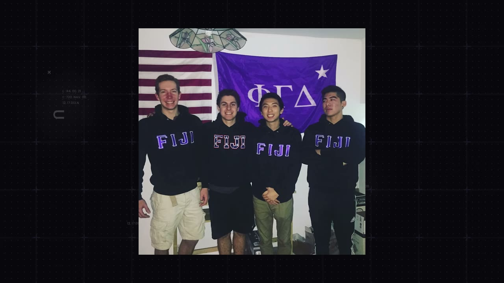
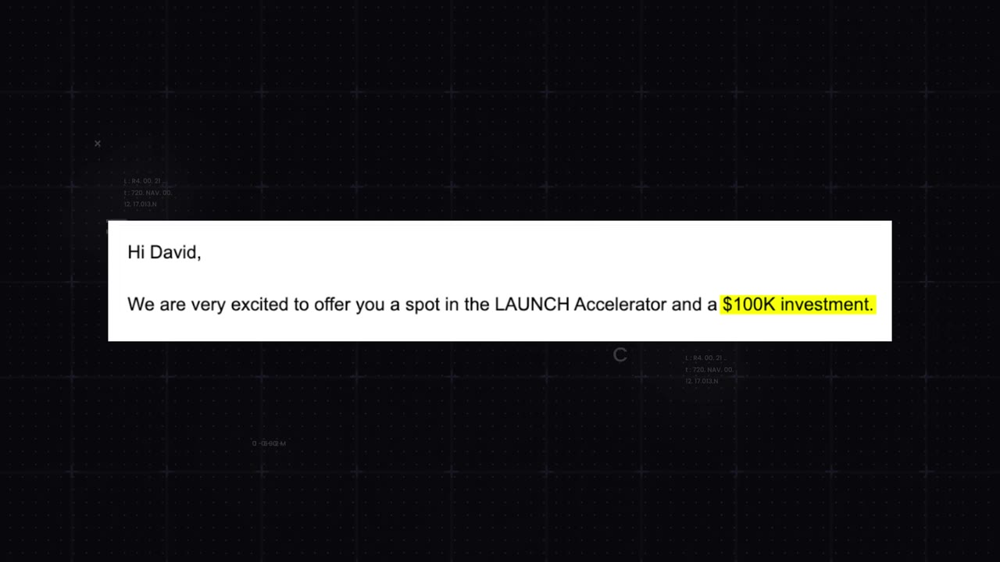

# The Underdog: From His Parent’s Basement to $25M

✅ **Đã phân tích sâu** → [`case.md`](case.md)

| | |
|---|---|
| **Video** | <https://www.youtube.com/watch?v=Gv2fzC96Z40> |
| **Đăng** | 28/01/2024 |
| **Thời lượng** | 14:08 |
| **Lượt xem** | 2,189,818 |
| **Lượt thích** | 63,817 |
| **Video ID** | `Gv2fzC96Z40` |

## Trong thư mục này

| File | Nội dung |
|---|---|
| [`case.md`](case.md) | **Phân tích đầy đủ** — ý tưởng, validate, GTM, áp dụng ở VN |
| [`meta.json`](meta.json) | Metadata gốc (chapters, heatmap, mô tả) |
| [`screenshots/`](screenshots/) | 7 ảnh 720p |

## Mô tả gốc

This is the story of how David Park went from a broke kid in his parent's basement to building a company now worth over $25M. 

## Số liệu bắt được từ transcript

> Các đoạn founder nhắc tới con số, kèm timestamp để tua thẳng tới đó trong video.

_(không bắt được con số nào)_

## Chương

_(không có chapter)_

## Ảnh

1. `01_00m53s_usd-25-m.jpg` — 
2. `02_01m41s_usd-20-000.jpg` — 
3. `03_04m18s_replay.jpg` — 
4. `04_05m11s_usd-2-000.jpg` — 
5. `05_06m26s_replay.jpg` — 
6. `06_07m50s_replay.jpg` — 
7. `07_13m28s_usd-3-m.jpg` — 

---

← [Quay lại index](../../index.md) · [Toàn bộ video](../README.md)
