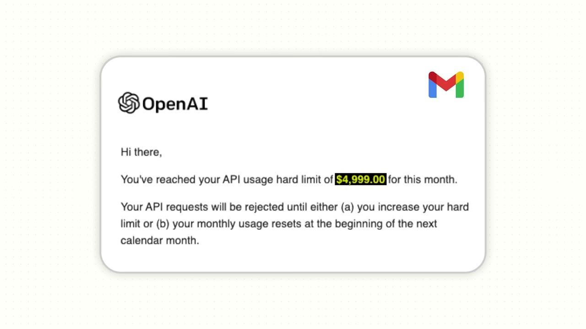
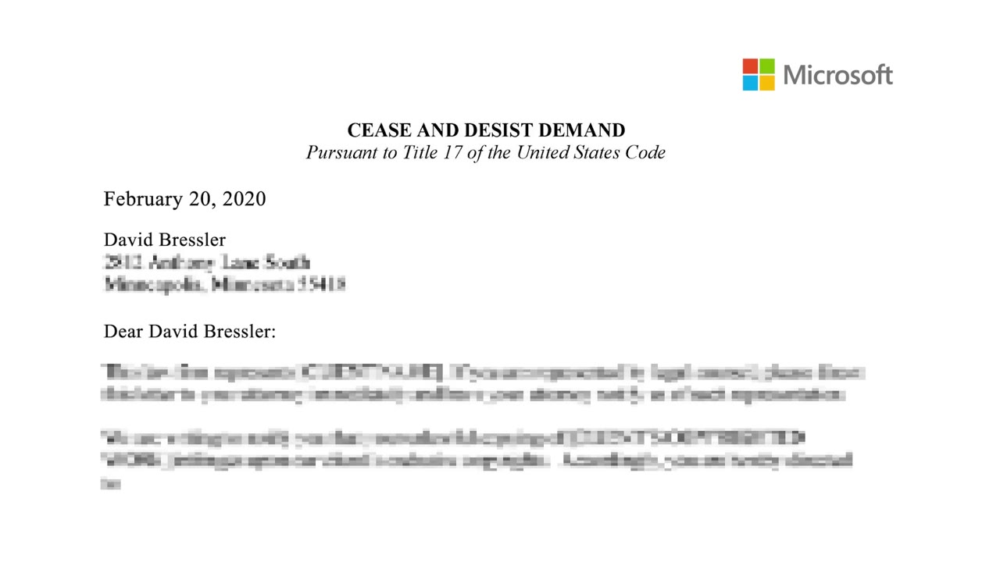
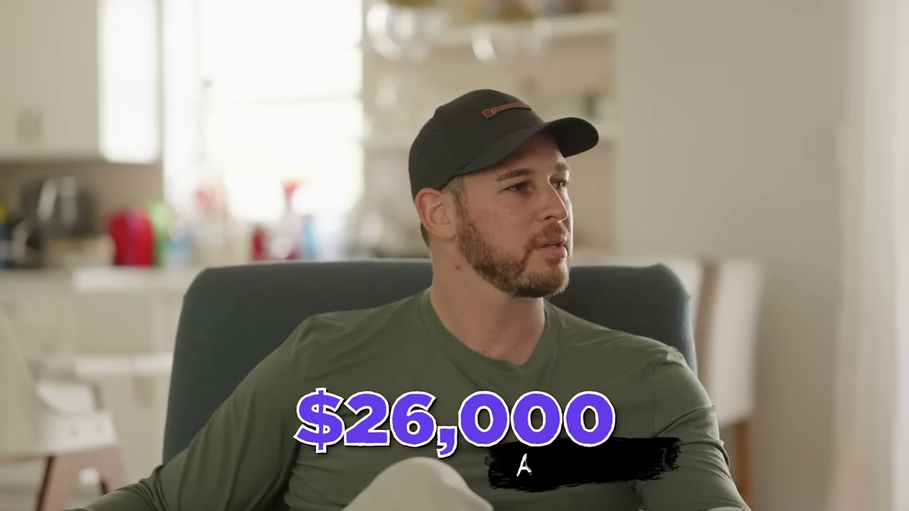
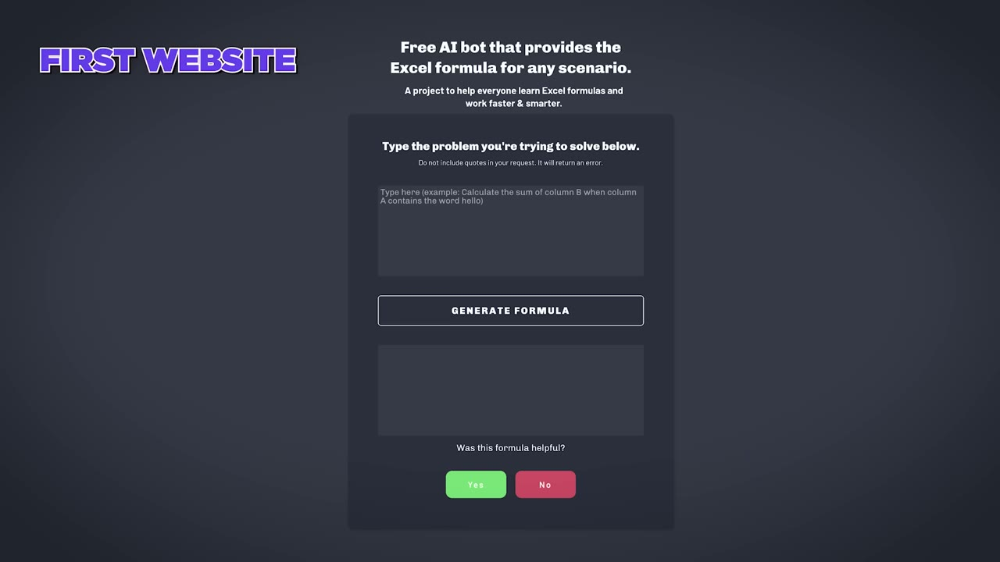
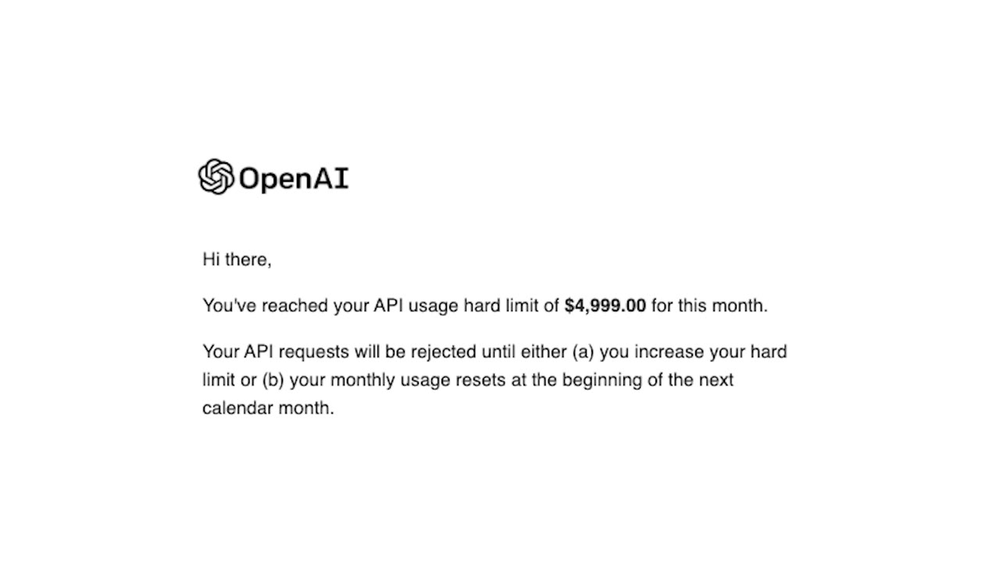
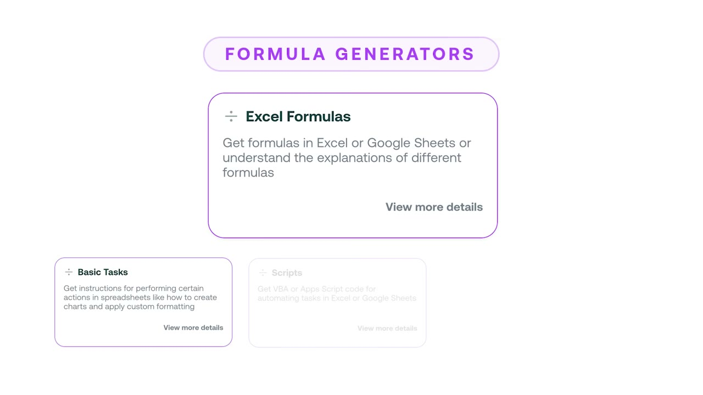
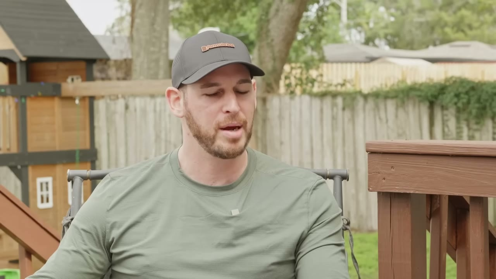
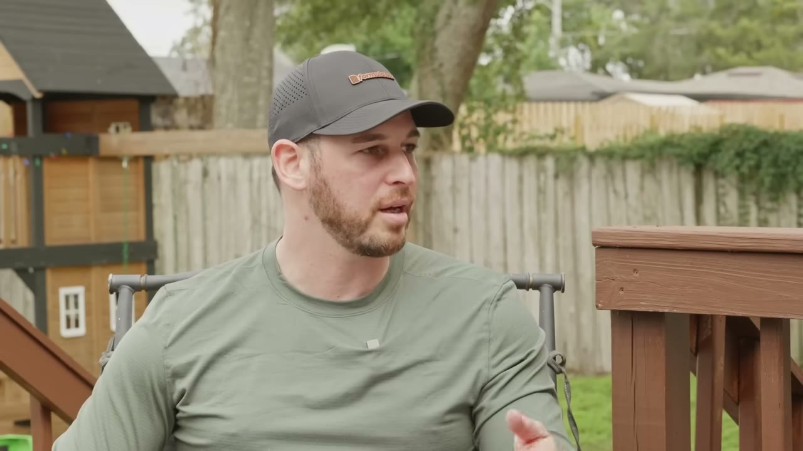

# I Built a $1M AI App [No Code]

✅ **Đã phân tích sâu** → [`case.md`](case.md)

| | |
|---|---|
| **Video** | <https://www.youtube.com/watch?v=IZsQqarWXtY> |
| **Đăng** | 11/02/2024 |
| **Thời lượng** | 16:13 |
| **Lượt xem** | 744,144 |
| **Lượt thích** | 16,327 |
| **Video ID** | `IZsQqarWXtY` |

## Trong thư mục này

| File | Nội dung |
|---|---|
| [`case.md`](case.md) | **Phân tích đầy đủ** — ý tưởng, validate, GTM, áp dụng ở VN |
| [`meta.json`](meta.json) | Metadata gốc (chapters, heatmap, mô tả) |
| [`screenshots/`](screenshots/) | 10 ảnh 720p |

## Mô tả gốc

This is the breakdown of how David Bressler went from working a full-time job to building an AI app valued at over $1M in just over 1 year.

## Số liệu bắt được từ transcript

> Các đoạn founder nhắc tới con số, kèm timestamp để tua thẳng tới đó trong video.

_(không bắt được con số nào)_

## Chương

- `00:00` Intro
- `01:08` Who is David
- `02:15` How he started Formula Bot
- `04:13` How he launched Formula Bot
- `06:24` How he got his first customer
- `07:44` How he started making money
- `09:48` Product talking to customers
- `11:39` Competitors
- `15:33` Outro

## Ảnh

1. `01_00m35s_usd-5-000.jpg` — 
2. `02_01m21s_replay.jpg` — 
3. `03_02m13s_usd-226-000.jpg` — 
4. `04_03m38s_replay.jpg` — 
5. `05_04m25s_ch-how-he-launched-formula-bot.jpg` — 
6. `06_06m43s_replay.jpg` — 
7. `07_07m57s_usd-5-000.jpg` — 
8. `08_10m00s_ch-product-talking-to-customers.jpg` — 
9. `09_11m51s_ch-competitors.jpg` — 
10. `10_14m01s_usd-299.jpg` — 

---

← [Quay lại index](../../index.md) · [Toàn bộ video](../README.md)
