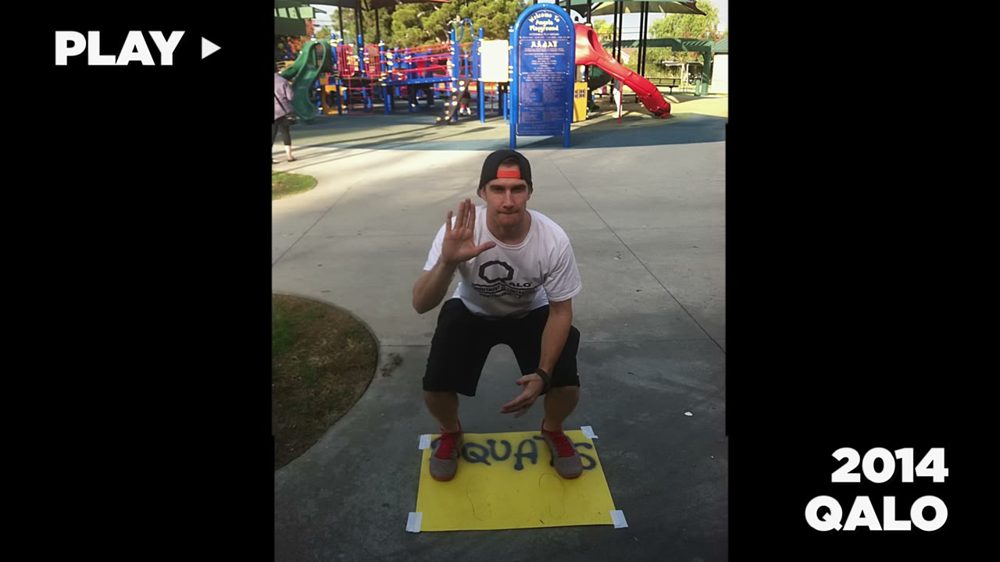
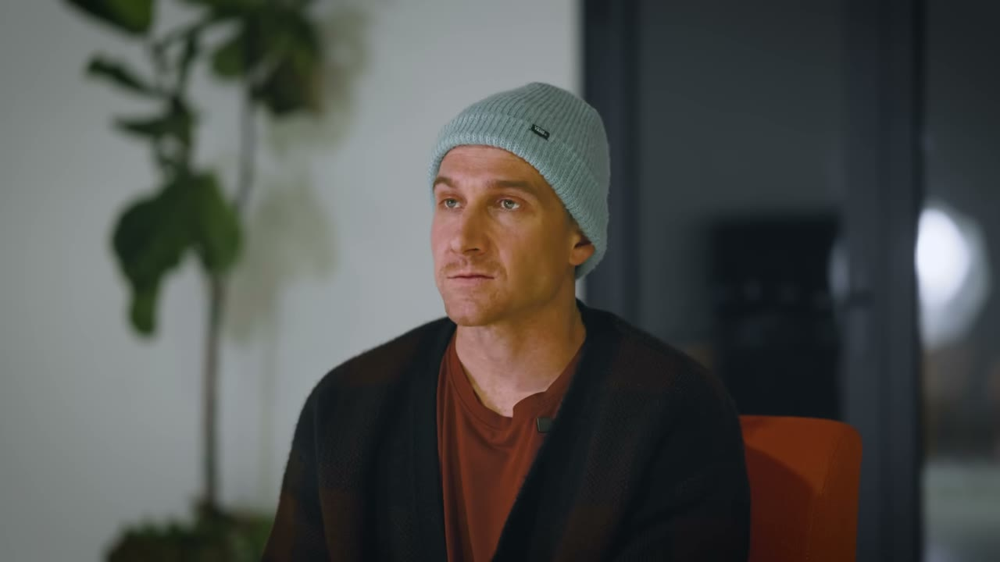
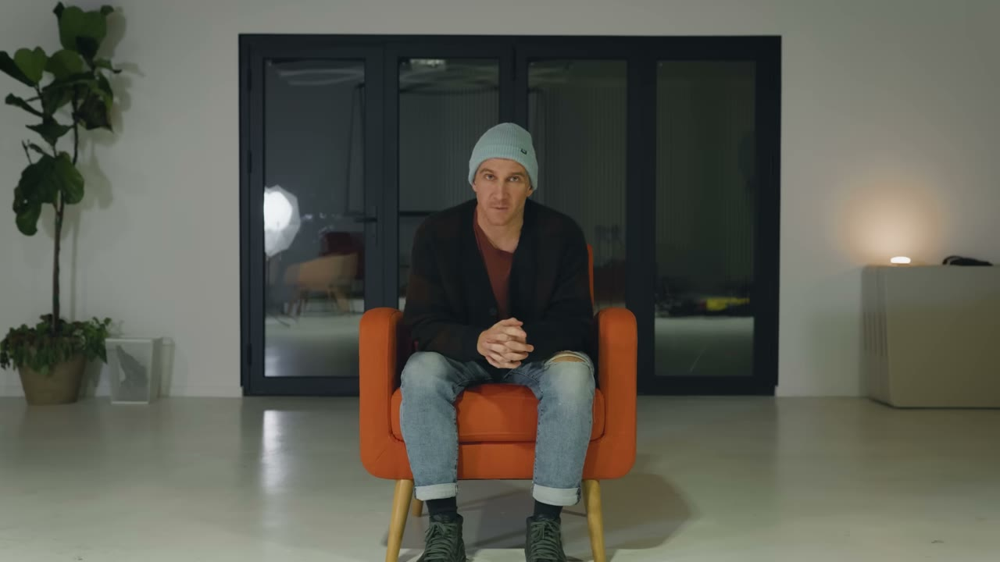
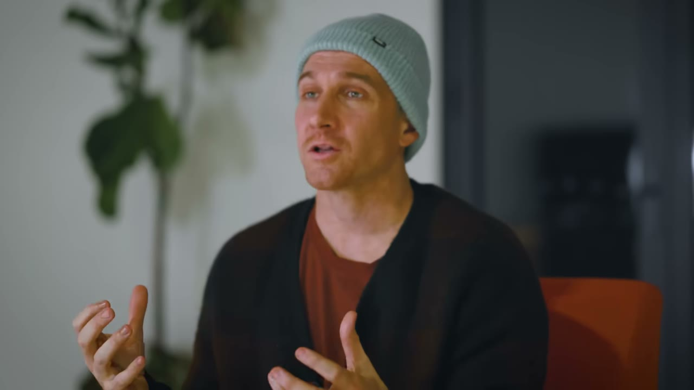
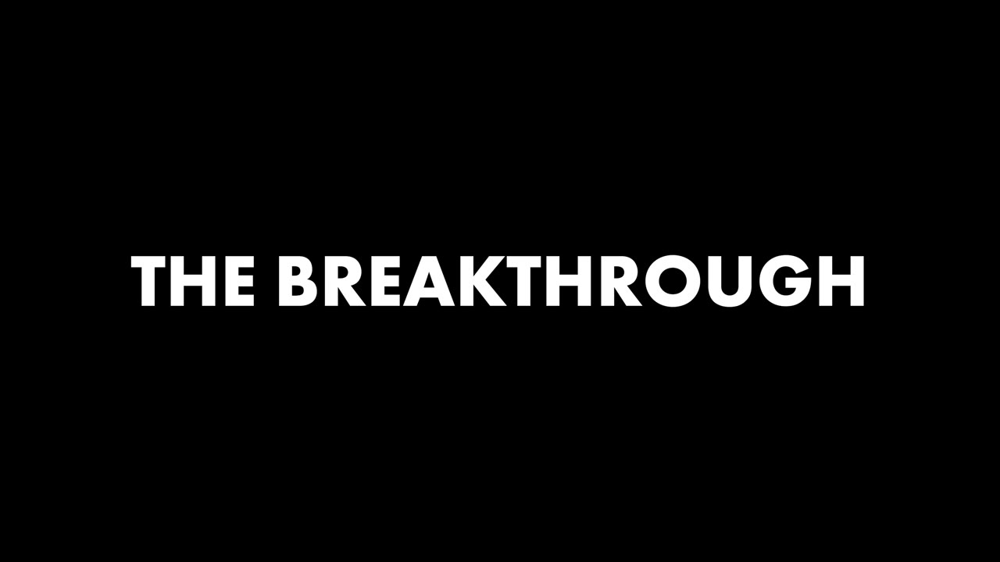
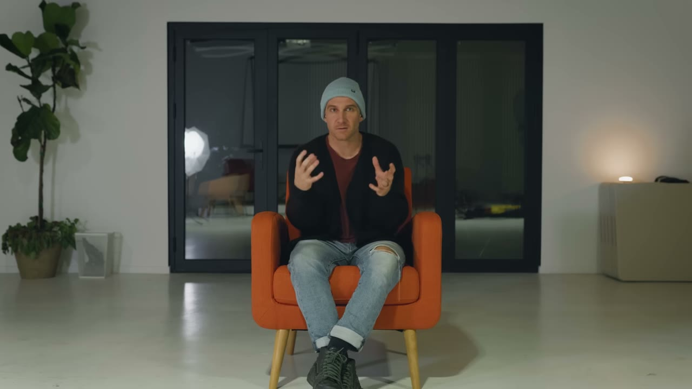
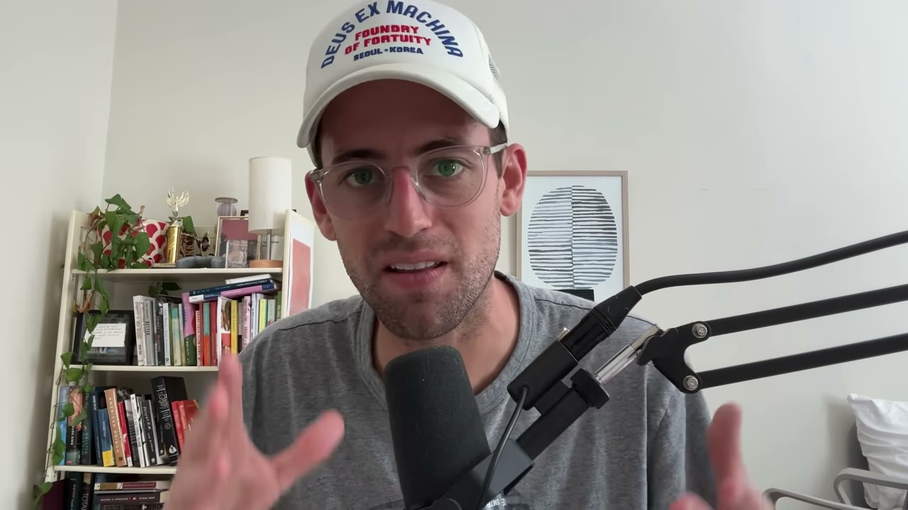

# QALO — từ dốc sạch tài khoản tiết kiệm tới 30 triệu USD/năm bán nhẫn cưới silicone

> **Tóm tắt 30 giây:** KC Holiday là bồi bàn ở Beverly Hills, mục tiêu ban đầu chỉ là **thay thế 2.000 USD/tháng** thu nhập nhà hàng. Anh và Ted góp toàn bộ tài khoản tiết kiệm để đặt lô nhẫn silicone đầu tiên — và lô hàng về **hỏng toàn bộ**, cạnh nhẫn nham nhở, không bán được. Hết sạch tiền, họ **cắt tay 50.000 chiếc nhẫn bằng kéo tỉa lông mày** trong khi xem hết sáu mùa phim Lost trên giường. Rồi họ launch website và nhận về **đúng 0 đơn hàng**. Cú xoay chuyển đến từ một tin nhắn Facebook gửi cho vợ của một quarterback NFL — vài tháng sau anh này xuất hiện trên HBO nói về chiếc nhẫn, và **doanh số gấp 3-4 lần ngay hôm sau**. Đỉnh điểm: **30 triệu USD/năm**, gần 100 nhân viên, biên lợi nhuận **20%**, luỹ kế hơn 100 triệu USD.

## 1. Con số

| Chỉ số | Giá trị |
|---|---|
| Doanh thu năm ở giai đoạn được nhắc | **30.000.000 USD** |
| Biên lợi nhuận | **20%** (tức khoảng 6 triệu USD lợi nhuận) |
| Nhân sự | Gần 100 người |
| Tốc độ tuyển | 2-3 người mỗi tháng |
| Doanh số luỹ kế | Hơn 100.000.000 USD nhẫn silicone |
| Mục tiêu ban đầu | Thay thế **2.000 USD/tháng** thu nhập nhà hàng |
| Vốn khởi điểm | Toàn bộ tài khoản tiết kiệm của hai người (số cụ thể không nêu, chỉ nói *tens of thousands*) |
| Nhẫn cắt tay | **50.000 chiếc** bằng kéo tỉa lông mày |
| Chi phí gây tranh cãi nhất | Theme Shopify **99 USD** |
| Đơn hàng ngày launch | **0** |
| Hiệu ứng Hard Knocks | Doanh số **gấp 3-4 lần** ngày hôm sau |
| Văn phòng đầu tiên | 13 người trong **200 sq ft** (~18,6 m²) |

⚠️ **Hai con số dễ bị trộn lẫn.** Tiêu đề nói *30.000.000*; narration cuối nói *"đã bán hơn 100 triệu USD nhẫn silicone"*. Đây là **hai kỳ khác nhau**: 30 triệu là doanh thu một năm ở thời điểm KC mô tả, 100 triệu là **luỹ kế toàn bộ lịch sử**. Kênh đặt hai con số cạnh nhau mà không phân biệt, dễ khiến người xem nghĩ công ty đang làm 100 triệu USD/năm. Tôi lấy 30 triệu chia 12 làm con số tháng vì đó là con số duy nhất KC tự nói có kèm ngữ cảnh (nhân sự và biên lợi nhuận).

⚠️ **Thì quá khứ đáng chú ý.** KC nói *"at that point, we're doing 30 million"* và *"looking back on QALO"* — anh đang kể ở thì quá khứ, tự giới thiệu là **president hiện tại** chứ không phải CEO. Video **không hề nói** hiện nay công ty ra sao, có bán không, có còn tăng trưởng không. Đây là khoảng trống thông tin có chủ đích.

## 2. Ý tưởng — bước xác thực tốn 15 phút ⭐⭐⭐

Ý tưởng đến từ một cuộc nói chuyện lúc dọn bàn ở nhà hàng. Cả KC và Ted đều vừa cưới, và cả hai đều gặp cùng một vấn đề:

> *"Tôi đeo nhẫn, nhưng nó phiền lắm. Mỗi lần tôi đi tập, đi đánh golf, làm gì đó, tôi lại tháo ra — mà tôi thì cực kỳ hay quên. Tôi rất háo hức được đeo nhẫn, nhưng tôi cứ làm mất nó suốt."*

Rồi câu định vị mà sau này trở thành toàn bộ marketing của công ty:

> *"**Bạn không đeo Rolex vào phòng gym. Bạn không đi giày tây chạy triathlon.** Người ta có phụ kiện rất cụ thể cho những việc rất cụ thể mà họ làm."*

Và đây là **bước xác thực rẻ nhất trong toàn bộ kho case này** — nó tốn đúng một buổi chiều:

> *"Cả hai đứa nói: thôi thử xem có cái gì tồn tại chưa. Kiểu chắc chắn phải có rồi. Tôi nhớ Ted nói **tôi sẽ đi mua một cái**. Rồi anh ấy quay lại và nói: **nó không tồn tại. Nó không có ngoài kia. Tôi không tìm được cái nào cả.**"*

**Cơ chế:** hai người **không khảo sát thị trường, không phỏng vấn khách hàng, không làm landing page**. Họ chỉ đóng vai khách hàng và cố mua sản phẩm đó. Nếu mua được — ý tưởng chết, và họ tiết kiệm được hai năm. Nếu không mua được — có khoảng trống.

Đây là bài kiểm tra nên chạy **trước mọi thứ khác**: *tôi có thể tự đi mua giải pháp cho vấn đề này ngay bây giờ không?* Nó tốn vài chục phút và loại bỏ được phần lớn ý tưởng tồi. Với sản phẩm số, phiên bản tương đương là dành một giờ thật sự cố tìm mua công cụ đó trên Google, G2, Product Hunt và App Store.

⚠️ **Nhưng đây cũng là điểm cần cẩn thận:** *"nó không tồn tại"* có hai lời giải thích — hoặc bạn tìm ra khoảng trống, hoặc **thị trường đó không có tiền và người khác đã thử rồi bỏ**. QALO rơi vào trường hợp đầu, nhưng đa số ý tưởng *"chưa ai làm"* rơi vào trường hợp sau. Bước xác thực thật sự không kết thúc ở đây — nó kết thúc khi có người trả tiền.

## 3. Thoả thuận đồng sáng lập — đổi thời gian lấy tiền ⭐⭐

Đây là một trong những mô tả sòng phẳng nhất về việc chia vai trò giữa hai co-founder có hoàn cảnh khác nhau:

> *"Đó là một thoả thuận rất hay giữa hai gã: **tôi chưa có con, tôi không có nhiều chi phí cuộc sống như anh. Tôi có thời gian, năng lượng và công sức — còn anh có tiền tiết kiệm.** Chúng ta có thể bắt tay rằng cả hai sẽ bỏ vào đây thứ mình có, ở mức mà cuộc sống mỗi người cho phép không? Ừ, làm đi."*

**Vì sao điều này quan trọng:** hầu hết các cặp co-founder đổ vỡ vì **giả định rằng đóng góp phải ngang nhau**. KC và Ted làm ngược lại — họ **nói thẳng ra sự bất đối xứng** ngay từ đầu và biến nó thành thoả thuận. Ted lớn tuổi hơn, có con, có tiền, chấp nhận rủi ro tài chính lớn hơn. KC không có tiền nhưng bỏ toàn bộ thời gian và là người **quit trước**.

**Bài học hành động:** nếu bạn tìm co-founder, đừng tìm bản sao của mình. Hãy viết ra bằng giấy trắng mực đen ai bỏ tiền, ai bỏ thời gian, và điều đó có ý nghĩa gì về mặt cổ phần và quyền quyết định — **trước** khi có đồng doanh thu đầu tiên.

Mục tiêu ban đầu của KC, và đây là chi tiết đáng nhớ nhất về mặt tâm lý:

> *"Mục tiêu của tôi là **thay thế thu nhập 2.000 USD một tháng ở nhà hàng**."*

Một công ty 30 triệu USD/năm bắt đầu bằng mục tiêu 2.000 USD/tháng. Không có tầm nhìn lớn lao nào cả:

> *"Chúng tôi không gọi nó là tìm product market fit. Chúng tôi không gọi nó là bootstrapping. **Trong đầu chúng tôi, đó là hai thằng nghèo đang cố tìm cách khiến người ta đeo và mua sản phẩm của mình.**"*

## 4. Thảm hoạ lô hàng đầu và 50.000 nhát kéo ⭐⭐⭐

Họ tìm nhà sản xuất bằng cách **crash một cuộc họp**: Ted có người bạn quen một nhà sản xuất trong thành phố, hai người đi thẳng tới khách sạn sang trọng ở LA, mang theo mấy chiếc nhẫn kim loại mua ở cửa hàng và hỏi *"anh làm được cái này bằng silicone không?"*. Câu trả lời: *"Ừ, sao lại không."*

Rồi họ dốc sạch tiền:

> *"Ted có rất ít trong tài khoản tiết kiệm và tôi còn ít hơn. Chúng tôi gộp lại và nói: bỏ hết những gì mình có vào lô hàng đầu tiên."*

> *"**Tôi từng không dám nhìn tài khoản ngân hàng vì tôi không muốn biết trong đó còn bao nhiêu.** Tôi chỉ muốn tin rằng séc tiền thuê nhà của mình sẽ không bị bounce. Đó là vị trí tôi đang đứng lúc ấy."*

Ba tháng sau khi cưới, KC dọn về ở với mẹ. Vợ anh vẫn làm ở nhà hàng, **ngủ trong chiếc Fiat đỏ nhỏ ở bãi sau nhà hàng** buổi sáng để chờ tới ca 11 giờ.

Rồi lô hàng về, xếp chồng lên tận trần garage nhà Ted:

> *"Khi tôi mở một trong những cái thùng đó ra, háo hức được thấy chiếc nhẫn QALO đầu tiên được sản xuất — thì nhận ra **chất lượng sản phẩm tệ hại. Từng chiếc nhẫn đều không bán được.**"*

Không còn tiền để đặt lô mới. Chỉ có hai lựa chọn: đóng cửa, hoặc sửa.

> *"Tôi nhớ mình lục lọi trong phòng tắm nhà mẹ và tìm thấy **một cái kéo tí xíu mà tôi còn không biết là nó tồn tại trên đời**. Hoá ra đó là kéo tỉa lông mày."*

Và rồi:

> *"Vợ tôi và tôi **xem hết cả sáu mùa Lost trong lúc nằm trên giường cắt nhẫn**. Tôi nhớ mình thức dậy giữa đêm đi uống nước và phải **bước qua những đống nhẫn** vì chúng tôi không còn chỗ nào để chúng. Vụn nhẫn silicone dính khắp nhà, **dính lên con mèo**, trên bàn, trong đệm ghế, trên giường. Sáng dậy là có vụn dính sau lưng vì bạn đã ngồi cắt nhẫn ngay trên giường. Đó là cuộc sống của chúng tôi."*

**Con số: 50.000 chiếc nhẫn silicone nửa inch, cắt bằng tay.**

**Bài học cơ chế, không phải bài học cảm hứng:** phần đáng học ở đây không phải sự chăm chỉ, mà là **quyết định kinh tế**. Khi vốn bằng 0 nhưng tồn kho đã nằm sẵn trong garage, **lao động của chính bạn là nguồn vốn duy nhất còn lại** — và chi phí cơ hội của nó gần bằng 0 vì bạn chưa có gì tốt hơn để làm. Đây chính là **lợi thế duy nhất mà người nghèo có so với công ty được rót vốn**: một công ty có vốn sẽ bỏ lô hàng đó và đặt lại. QALO không có lựa chọn đó, nên họ tìm ra cách rẻ hơn.

**Nhưng đọc kỹ mặt trái:** cách này chỉ đúng vì **lỗi sản phẩm là lỗi cơ học sửa được**. Nếu lỗi nằm ở công thức vật liệu hay ở chỗ không ai muốn mua, 50.000 nhát kéo là 50.000 nhát kéo lãng phí. Đừng rút ra bài học *"cứ cày là được"* — hãy rút ra *"trước khi cày, kiểm tra xem thứ đang hỏng có sửa được bằng công sức không"*.

## 5. Launch và nhận về con số 0 ⭐⭐⭐

Đoạn này nên được chiếu cho mọi indie hacker sắp launch:

> *"Suy nghĩ lúc đó là: **thứ duy nhất ngăn chúng tôi bán được cả đống nhẫn này là một cái website.**"*

> *"Tôi nhớ mình đã dằn vặt mãi về chuyện có nên mua **một cái theme 99 USD** không. Tôi nhớ mình căng thẳng kinh khủng về việc có đủ tiền mua cái theme 99 USD đó không, hay là cứ dùng bản mặc định Shopify cho không."*

Rồi:

> *"Ted và tôi đã bỏ ra nhiều tháng. Cuối cùng cũng dựng xong. Đã bỏ công, bỏ thời gian, bỏ tiền. Tôi nhớ khoảnh khắc bấm publish. Website live. Ted và tôi nhắn tin cho nhau đầy phấn khích."*

> *"Rồi khoảng trưa hôm sau, giọng điệu tin nhắn đổi từ **chúng ta đã launch** thành **có ai ghé không?** Kiểu, có ai vào cái này không? **Anh đã nói với ai chưa? Ê, anh đã nói với ai chưa?**"*

Narration chốt lại bằng một câu nên đóng khung treo tường:

> *"Hoá ra **người ta sẽ không tự nhiên tìm ra cái website bạn đã dựng**."*

**Cơ chế và vì sao ai cũng mắc lỗi này:** cả KC và Ted đều là người vận hành nhà hàng — trong nhà hàng, **địa điểm chính là phân phối**. Bạn mở cửa ở Beverly Hills thì người ta đi ngang qua và bước vào. Họ mang mô hình tinh thần đó lên internet, nơi **không có ai đi ngang qua cả**. Đây là lỗi mặc định của mọi người lần đầu bán hàng online, và nó lặp lại y hệt trong hàng chục case khác của kho này.

**Bài kiểm tra thực tế trước khi bạn launch bất cứ thứ gì:** viết ra tên cụ thể của **10 nơi** mà người mua tiềm năng đang tụ tập ngay lúc này, và bạn sẽ xuất hiện ở đó bằng cách nào. Nếu bạn không viết nổi 10 cái tên, bạn chưa có phân phối — bạn chỉ có sản phẩm.

## 6. Product seeding — cú Facebook message đổi đời ⭐⭐⭐

Với gần 0 USD trong túi và 50.000 chiếc nhẫn trong garage, KC không có tiền chạy quảng cáo. Anh làm cái duy nhất còn lại:

> *"Tôi nghĩ: **ai là người có ảnh hưởng?** Đây là trước thời có influencer. Ai là người có ảnh hưởng mà tôi có thể gửi sản phẩm cho họ, biết đâu tăng tốc được tăng trưởng hoặc giúp chúng tôi được biết tới nhiều hơn?"*

> *"Một trong số đó là Andy Dalton, quarterback của Cincinnati Bengals lúc bấy giờ. Tôi học TCU và tôi khá thân với vợ anh ấy hồi đó. Tôi nghĩ, **thôi tôi sẽ nhắn Facebook cho Jordan, vợ anh ấy**. Chúc mừng hai bạn mới cưới. Bọn mình vừa mở công ty này. Mình nghĩ Andy có thể thích một cái — mình gửi tặng như quà cưới được không?"*

> *"Đúng là vài tháng sau cô ấy trả lời: **Andy sẵn sàng thử một cái.** Và tôi nhớ mình nhảy múa trong phòng khách. Kiểu, đây rồi. Đây là khoảnh khắc."*

Rồi thực tế:

> *"Tôi gửi cho anh ấy và nhận lại một lời cảm ơn. Và **chỉ có thế. Chẳng có gì khác xảy ra cả.**"*

**Vài tháng sau**, HBO chiếu chương trình *Hard Knocks*. Tập đầu tiên dành **10 phút** cho việc Andy Dalton đeo một chiếc nhẫn cưới bằng cao su, có cả phỏng vấn:

> *"Anh ấy nói: tôi thấy nó rất hay, tôi có thể đeo nó dù đang làm gì đi nữa, tôi có thể đeo nó ra sân, và **nó đại diện cho cam kết tôi đã hứa với vợ tôi — điều rất quan trọng với tôi — nhưng đồng thời cũng đại diện cho công việc tôi làm**."*

> *"**Chúng tôi có viết kịch bản gửi cho anh ấy cũng không thể ra được cách diễn đạt tốt hơn về đúng định vị của công ty mình.**"*

> *"Hôm sau, tôi nghĩ doanh số **gấp ba hoặc bốn lần**."*

**Cơ chế thật sự — vì sao đây không phải may mắn thuần tuý:**

1. **Anh chọn người có mối quan hệ thật, không chọn người có nhiều follower nhất.** Anh học cùng trường với vợ Andy. Đây là điểm mấu chốt — anh không cold-outreach mà dùng **liên kết yếu có sẵn**. Ai cũng có vài chục liên kết yếu như vậy và hầu như không ai khai thác.
2. **Anh chọn người mà sản phẩm khớp hoàn hảo với danh tính công khai của họ.** Quarterback NFL đã cưới **là chính xác ICP của QALO** ở dạng cực đoan nhất: đeo nhẫn cưới rất quan trọng với hình ảnh của anh ta, và nghề của anh ta khiến đeo nhẫn kim loại là bất khả. Vì thế khi anh ta được phỏng vấn, anh ta **tự nói ra đúng thông điệp bán hàng** mà không cần ai dặn.
3. **Anh chấp nhận độ trễ nhiều tháng và không có tín hiệu gì ở giữa.** Từ lúc nhắn tin tới lúc lên sóng là nhiều tháng, và trong suốt thời gian đó phản hồi duy nhất anh nhận được là một lời cảm ơn.

**Phiên bản áp dụng được:** đừng gửi sản phẩm cho người có nhiều follower nhất. Gửi cho người mà **việc dùng sản phẩm của bạn củng cố danh tính công khai của họ** — vì họ sẽ tự nói về nó, miễn phí, đúng cách, ở nơi bạn không mua được chỗ.

## 7. Bài học sắc nhất — hai ngày sau, ai cũng quay lại sống đời họ ⭐⭐⭐

Đây là đoạn có giá trị nhất trong cả video và là thứ hiếm khi được nói ra ở các case study khác:

> *"Nhưng **hai ngày sau, ai cũng quay lại sống cuộc đời của họ**. Và điều quan trọng nhất, cuối cùng, là **bạn làm gì với sự chú ý đó trong khoảng thời gian trước cú tiếp theo** mà bạn cố tạo ra để có thêm chú ý, hoặc có thêm một khoảnh khắc nữa."*

> *"Khoảnh khắc với Andy giống như một lời khẳng định, rất tuyệt. Nhưng nó cũng **đáng sợ**, vì bạn nhận ra: ồ, thứ này có thể trở thành cái gì đó. **Và bây giờ tôi thật sự phải xây nó.**"*

**Cơ chế:** một cú viral, một lần lên báo, một lần Product Hunt số 1 — tất cả đều là **xung lực, không phải động cơ**. Chúng cho bạn một cửa sổ vài ngày. Giá trị của cửa sổ đó không nằm ở doanh số ngày hôm đó mà nằm ở **những gì bạn kịp giữ lại**: email, khách hàng quay lại, bằng chứng xã hội, và bài học về việc thông điệp nào chuyển đổi.

Chú ý một chi tiết trong video: sau cú Hard Knocks, kênh marketing tiếp theo của họ là **email**. Trong intro có câu: *"Chúng tôi không có tiền cho marketing. Và tôi nói: à, gửi email thì miễn phí."*

**Đây chính là câu trả lời cho câu hỏi làm gì với sự chú ý** — bạn chuyển nó thành một kênh bạn sở hữu. So sánh chéo: [Floga làm 120.000 USD trong 24 giờ](../2026-03-29_my-app-made-120k-in-24-hours/case.md) là cùng dạng cửa sổ chú ý; câu hỏi ở cả hai case đều là *ngày thứ ba thì sao*.

## 8. Sau khi all-in — tốc độ vì lợi thế first-mover ⭐⭐

KC quyết định nghỉ nhà hàng dù Ted phản đối:

> *"Tôi đến gặp Ted: này, tôi nghĩ tôi nên nghỉ nhà hàng và làm QALO toàn thời gian. Anh ấy nói: **chúng ta không đủ tiền để anh làm toàn thời gian.** Anh ấy đúng. Và tôi nói: nhưng tôi nghĩ chúng ta cần thế. Có cái gì đó ở đây. Tôi sẽ làm. Tôi sẽ chấp nhận rủi ro."*

Rồi logic chiến lược sau đó:

> *"Một phần lớn chiến lược ban đầu ở QALO là nhận ra rằng **chúng tôi là người đầu tiên trong category**. Và nếu chúng tôi không đi nhanh, ai đó có nhiều tiền hơn, thương hiệu tốt hơn, người vận hành giỏi hơn sẽ nhảy vào và nghiền nát chúng tôi."*

Kết quả của việc đi nhanh:

- **6-8 tháng:** 13 người trong văn phòng 200 sq ft. *"Khi có ai gọi vào đường dây chăm sóc khách hàng, không ai trong văn phòng được nói chuyện, vì họ nghe thấy hết tiếng mọi người ở phía sau."*
- Tuyển trung bình **2-3 người mỗi tháng**.
- Đạt **30 triệu USD** với gần 100 nhân viên, biên lợi nhuận **20%**.

⚠️ **Đây là chỗ mô hình này rẽ khỏi con đường indie hacker.** QALO không phải micro-business. Từ điểm này trở đi nó là bài toán vận hành: tuyển người, xây hệ thống, xây văn hoá, quản lý dòng tiền tồn kho. KC nói rõ: *"Bạn học được rằng sai lầm ở giai đoạn đó tốn kém hơn nhiều."* Nếu mục tiêu của bạn là 10.000 USD/tháng một mình, đây **không** phải playbook của bạn — hãy đọc các case micro-SaaS trong kho.

## 9. Lời khuyên cuối ⭐⭐

> *"Là một entrepreneur, bạn phải nói được cho bất kỳ ai: **đây là vấn đề tôi đang giải quyết**. Bắt đầu từ đó, rồi mới xác định sản phẩm là gì để giải vấn đề đó."*

> *"Và giống như mấy chiếc nhẫn — **kể cả khi chúng tệ hại, hãy tập trung vào việc đưa nó tới tay khách hàng thay vì làm cho nó hoàn hảo**, rồi nói chuyện với càng nhiều khách hàng đó càng tốt về cách làm nó tốt hơn."*

> *"Chúng ta quá bận tâm về việc người khác nghĩ gì về mình, về sản phẩm của mình, về việc mình đang làm — tới mức nó làm chúng ta tê liệt. **Sẽ rất giải phóng khi nhận ra rằng thật ra người ta chẳng nghĩ về bạn chút nào.**"*

Và câu lật ngược góc nhìn hay nhất:

> *"**Bạn thật ra đang ích kỷ khi KHÔNG giải quyết vấn đề mà bạn biết là người ta đang gặp.**"*

**Mâu thuẫn với chính câu chuyện của anh — cần chỉ ra:** KC khuyên *"đưa sản phẩm tệ tới tay khách hàng thay vì làm cho hoàn hảo"*. Nhưng lô nhẫn đầu tiên của anh **không bán được, và anh KHÔNG bán nó**. Anh bỏ hàng tháng trời cắt tay 50.000 chiếc để làm cho nó đủ tốt trước khi bán. Anh cũng bỏ **nhiều tháng** dựng website trước khi launch.

**Phân định điều kiện — khi nào ship hàng chưa hoàn hảo, khi nào không:**
- **Ship ngay khi** lỗi nằm ở tính năng thiếu, giao diện xấu, hoặc trải nghiệm thô. Khách vẫn dùng được và sẽ nói cho bạn biết cần gì. Đây là logic của [Marc Lou ship kèm nút mua](../2024-08-05_the-underdog-from-10-hr-to-1-5m-year/case.md).
- **Đừng ship khi** lỗi nằm ở chỗ sản phẩm **không dùng được cho mục đích chính** — như chiếc nhẫn cạnh nham nhở không ai chịu đeo. Với hàng vật lý, một lô hàng lỗi tới tay khách tạo ra review 1 sao vĩnh viễn, hoàn tiền, và phí ship hai chiều. **Chi phí sửa sai của hàng vật lý cao hơn phần mềm nhiều bậc** — đó chính là lý do phân định.
- Nói cách khác: lời khuyên *"ship sớm"* là lời khuyên của thế giới phần mềm, và chính hành động của KC cho thấy nó **không áp dụng nguyên xi cho hàng vật lý**.

## 10. So sánh chéo — biến số quyết định của cả lô ⭐⭐⭐

Ba video cùng đợt này đều là DTC hàng vật lý trên Shopify. Khác nhau đúng một biến số:

| Case | Audience trước khi launch | Kết quả ngày launch | Thời gian tới đơn hàng có ý nghĩa |
|---|---|---|---|
| [Van Man](../2024-03-23_i-built-this-5m-year-business-from-a-van/case.md) | Có — Twitter, cộng đồng animal-based | Gần hết hàng sau **20 phút** | Ngay lập tức |
| [Epic Gardening](../2024-03-10_i-made-30m-with-my-side-project/case.md) | Có — 3 năm blog và kênh nội dung | Một Instagram story, **hết hàng sau 2 tuần** | Ngay lập tức |
| **QALO** (case này) | **Không** | **0 đơn hàng** | **Nhiều tháng**, và phải nhờ một cú may truyền hình |

**Kết luận rút ra được:** QALO có sản phẩm tốt hơn về mặt độc đáo (họ là first-mover thật sự trong một category chưa tồn tại), nhưng mất nhiều tháng đau đớn hơn hẳn hai case kia — **chỉ vì họ không có ai để nói với**. Van Man có sản phẩm dễ nhái hơn nhiều nhưng bán hết trong 20 phút.

**Điều này không có nghĩa là QALO sai.** Nó có nghĩa là: nếu bạn không có audience, bạn phải **có kế hoạch phân phối cụ thể trước khi tiêu đồng nào vào tồn kho**, và kế hoạch đó phải cụ thể tới mức có tên người trong đó. KC cuối cùng cũng làm đúng điều này — nhưng anh làm nó **sau** khi đã có 50.000 chiếc nhẫn nằm trong garage, không phải trước.

## 11. Cảnh báo nguồn ⭐⭐

- **Đây là video có nhiều view nhất trong lô (537.736) và cũng là video được dựng như phim nhất.** Nó có narrator, nhạc nền kịch tính, cấu trúc ba hồi. Cấu trúc đó **được chọn vì nó bán được**, không phải vì nó phản ánh cách kinh doanh vận hành. Chú ý cách kênh xây dựng đỉnh điểm quanh khoảnh khắc Hard Knocks — trong thực tế đó chỉ là một trong nhiều năm làm việc.
- **Sinh tồn bias ở mức cao nhất trong kho.** Đây là series *The Underdog*, được thiết kế để chọn ra đúng những câu chuyện *"dốc sạch tiền rồi thắng"*. Với mỗi QALO, có một số lượng không đếm được các cặp co-founder đã dốc sạch tài khoản tiết kiệm vào một lô hàng lỗi và **mất tất cả**. Kênh không phỏng vấn họ. **Đừng đọc case này như bằng chứng rằng dốc hết tiền là chiến lược tốt** — hãy đọc nó như mô tả về một canh bạc đã thắng.
- **Không có bằng chứng số nào.** Không dashboard, không sao kê, không báo cáo tài chính. Con số 30 triệu USD, biên 20%, gần 100 nhân viên — tất cả là lời kể.
- **Video cố tình tránh hiện tại.** KC nói ở thì quá khứ (*"looking back on QALO"*, *"at that point"*), tự giới thiệu là president. Không có một câu nào về tình hình hiện tại của công ty, có bán chưa, doanh thu bây giờ ra sao, thị trường có bị đối thủ chia lại không — trong khi category nhẫn silicone hiện đã có rất nhiều người bán. **Khoảng trống đó tự nó là một dữ kiện.**
- **Ba lần chèn quảng cáo.** Đoạn quảng cáo Starter Story ở giữa được lồng khéo vào lời KC (*"khi tôi nghĩ về Starter Story và vì sao tôi yêu nó..."*) khiến nó nghe như lời chứng thực tự nhiên chứ không phải quảng cáo. Đây là dạng quảng cáo khó nhận ra nhất và đáng cảnh giác nhất.

## 12. Áp dụng cho tôi (indie hacker VN)

### Sao chép được gì

- **Bài kiểm tra 15 phút của Ted.** Trước khi làm gì, hãy **thật sự cố đi mua** giải pháp cho vấn đề bạn định giải. Nếu mua được dễ dàng, dừng lại và tiết kiệm hai năm. Chi phí bằng 0, và nó là bước đầu tiên hợp lý nhất trong cả kho case này.
- **Định vị bằng ngữ cảnh sử dụng, không bằng tính năng.** *"Bạn không đeo Rolex vào phòng gym"* — QALO không bán nhẫn rẻ hơn, họ bán **nhẫn cho một tình huống mà nhẫn hiện có không dùng được**. Đây là cách định vị mạnh nhất và áp dụng thẳng vào phần mềm: đừng làm bản rẻ hơn của Notion, hãy làm thứ dùng được trong tình huống mà Notion không dùng được.
- **Product seeding cho người mà sản phẩm củng cố danh tính của họ.** Áp dụng nguyên xi ở VN: tìm 20 người có ảnh hưởng vừa phải trong ngách của bạn mà việc dùng sản phẩm của bạn khiến hình ảnh họ **đẹp hơn**, và tặng miễn phí. Rẻ hơn quảng cáo rất nhiều, và với thị trường VN thì mối quan hệ có trọng lượng lớn hơn hẳn.
- **Thoả thuận co-founder bất đối xứng, viết ra rõ ràng.** Ai bỏ tiền, ai bỏ thời gian, và điều đó nghĩa là gì về cổ phần. Nói trước khi có tiền.
- **Chuyển cửa sổ chú ý thành kênh sở hữu.** Sau cú Hard Knocks họ đi làm email vì *"email thì miễn phí"*. Cú viral là xung lực; email list là động cơ.

### Rào cản thật

- **Rủi ro tồn kho ở VN còn nặng hơn ở Mỹ.** Bạn dốc tiền vào một lô hàng, lô hàng hỏng, và bạn **không có kéo tỉa lông mày nào cứu được** nếu lỗi nằm ở vật liệu. Vốn lưu động nằm chết trong kho là nguyên nhân giết doanh nghiệp vật lý phổ biến nhất. Đây là lý do lớn nhất khiến tôi chấm replicability chỉ 2/5.
- **First-mover trong category vật lý gần như không còn cửa cho người mới.** QALO thắng vì năm đó nhẫn silicone **không tồn tại**. Hôm nay, mọi ngách hàng tiêu dùng đơn giản đều đã có người bán trên Amazon, Shopee, TikTok Shop, thường là chính nhà máy Trung Quốc bán thẳng. Khoảng trống *"nó không tồn tại"* trong hàng vật lý đã hẹp lại rất nhiều so với năm 2013.
- **Đây là mô hình cần ĐỘI NGŨ, không phải solo.** 30 triệu USD đi kèm gần 100 nhân viên. Nếu bạn muốn làm một mình, mô hình này không mở rộng được — nó không giống micro-SaaS nơi một người phục vụ 1.000 khách.
- **Dòng tiền âm kéo dài.** Bạn trả tiền hàng trước, bán sau, thu tiền sau nữa (nếu qua sàn thì còn bị giữ tiền). Chu kỳ này giết doanh nghiệp đang tăng trưởng nhanh — càng bán chạy càng thiếu tiền. Với phần mềm, tăng trưởng không tiêu tiền theo cách đó.
- **Cú may Hard Knocks không lặp lại được.** Hãy trung thực: đóng góp lớn nhất vào bước ngoặt của QALO là một chương trình HBO mà họ không kiểm soát và không trả tiền. Bạn có thể sao chép *hành động* (seeding sản phẩm cho người phù hợp), nhưng bạn **không thể lên kế hoạch cho kết quả**. Hãy thiết kế doanh nghiệp sao cho nó vẫn sống được khi không có cú may nào.

### Khi nào KHÔNG dùng mô hình này

- **Khi bạn không thể mất số tiền bạn định bỏ vào.** KC và Ted dốc sạch tài khoản tiết kiệm, và lô hàng đầu tiên hỏng. Nếu kịch bản đó xảy ra với bạn và bạn không có nhà mẹ để dọn về, câu chuyện kết thúc ở đó. Đây là điều kiện tiên quyết, không phải lời khuyên.
- **Khi bạn muốn kinh doanh một mình và giữ nó nhỏ.** Mô hình DTC hàng vật lý gần như bắt buộc phải lớn để có biên lợi nhuận — 20% ở mốc 30 triệu USD là bình thường, nhưng 20% ở mốc 300.000 USD thì không đủ sống cho một đội. Nếu bạn muốn 10-20 nghìn USD/tháng một mình, hãy chọn [micro-SaaS](../2026-03-15_i-make-60k-month-from-the-most-boring-saas-on-the-in/case.md) hoặc app.
- **Khi bạn chưa có kế hoạch phân phối cụ thể có tên người trong đó.** Đây là bài học đắt nhất và cũng dễ bỏ qua nhất của case này. QALO có sản phẩm độc nhất vô nhị trên thị trường và vẫn nhận về 0 đơn ngày launch. Sản phẩm tốt không phải là phân phối.

**Case liên quan trong kho:** [Van Man](../2024-03-23_i-built-this-5m-year-business-from-a-van/case.md) (DTC có audience trước — cùng lô, đối chứng) · [Epic Gardening](../2024-03-10_i-made-30m-with-my-side-project/case.md) (DTC có audience trước — cùng lô) · [Hush Blankets](../2023-09-27_the-underdog-he-turned-his-last-4-000-into-48m/case.md) (cùng series Underdog, DTC dốc hết vốn) · [Neuro](../2025-02-07_the-underdog-from-life-changing-accident-to-100m-yea/case.md) (cùng series Underdog, DTC thực phẩm bổ sung) · [Greek House](../2023-04-09_he-turned-500-into-10m/case.md) (hàng vật lý, tăng trưởng cần đội ngũ) · [Tabs Chocolate](../2023-06-07_i-make-11m-year-selling-one-product/case.md) (một sản phẩm vật lý, marketing viral)

## Nguồn

- Video: <https://www.youtube.com/watch?v=GGxUH6EXF9I> (14:19, đăng 03/03/2024, 537.736 view)
- [Transcript đầy đủ](transcript.md) · [Ảnh chụp](screenshots/)

*Ghi chú về tên riêng: transcript nghe lại bằng Whisper sai tên thương hiệu ở gần như mọi lần nhắc — "Kalo", "K-Lo", "Kayla", "halo", "K-Lo ring". Tên đúng là **QALO**, xác nhận qua tags trong meta.json (qalo, qalo ring, qalo ring story). Tên founder cũng bị ghi thành "Casey" xuyên suốt; description trong meta.json ghi rõ là **KC Holiday** — KC đọc là Casey nên ASR nghe nhầm. Đồng sáng lập tên Ted, video không nêu họ.*
