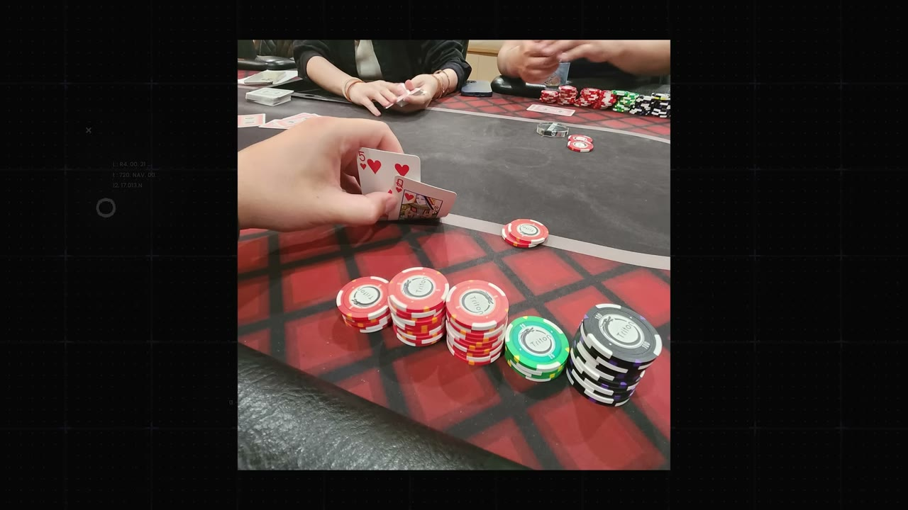
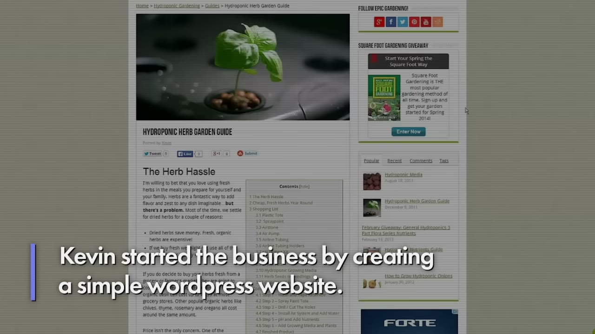
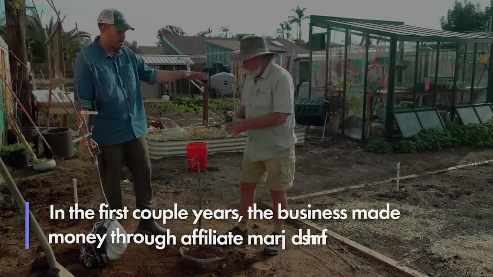
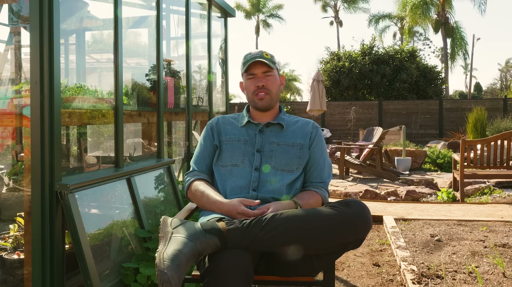
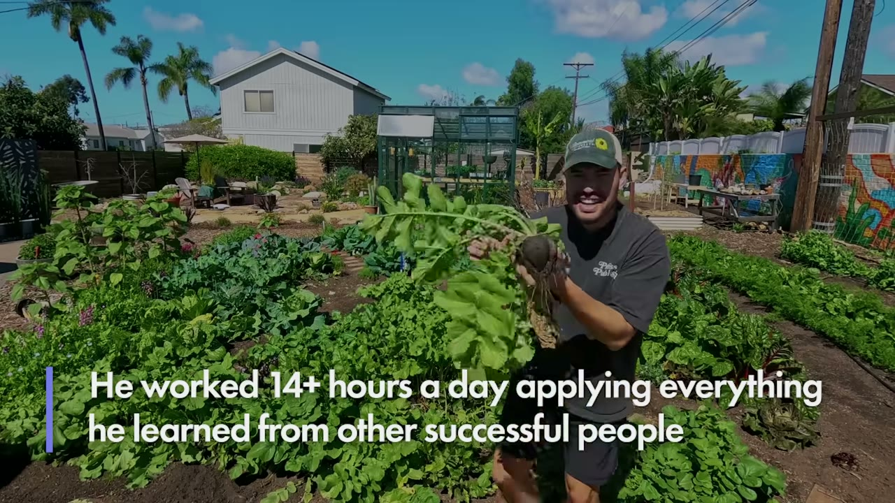

# I Made $30M With My Side Project

✅ **Đã phân tích sâu** → [`case.md`](case.md)

| | |
|---|---|
| **Video** | <https://www.youtube.com/watch?v=uBGbvKScavk> |
| **Đăng** | 10/03/2024 |
| **Thời lượng** | 10:18 |
| **Lượt xem** | 48,918 |
| **Lượt thích** | 1,223 |
| **Video ID** | `uBGbvKScavk` |

## Trong thư mục này

| File | Nội dung |
|---|---|
| [`case.md`](case.md) | **Phân tích đầy đủ** — ý tưởng, validate, GTM, áp dụng ở VN |
| [`meta.json`](meta.json) | Metadata gốc (chapters, heatmap, mô tả) |
| [`screenshots/`](screenshots/) | 6 ảnh 720p |

## Mô tả gốc

This is the story of how Kevin Espiritu went from trying 5+ hobbies and failing multiple businesses, to building a gardening brand making over $30M/year. Kevin talks about his childhood, how he grew the business, and what his days look like now running one of the biggest gardening brands in the world.

## Số liệu bắt được từ transcript

> Các đoạn founder nhắc tới con số, kèm timestamp để tua thẳng tới đó trong video.

_(không bắt được con số nào)_

## Chương

- `00:00` Intro
- `01:16` Childhood
- `02:23` Hobbies
- `03:10` Curiosity
- `03:47` Blogging
- `05:22` Revenue
- `07:32` Schedule
- `08:41` Consume Knowledge

## Ảnh

1. `01_01m28s_ch-childhood.jpg` — 
2. `02_02m35s_ch-hobbies.jpg` — 
3. `03_03m49s_usd-400.jpg` — 
4. `04_05m24s_usd-70-400.jpg` — 
5. `05_07m44s_ch-schedule.jpg` — 
6. `06_08m53s_ch-consume-knowledge.jpg` — 

---

← [Quay lại index](../../index.md) · [Toàn bộ video](../README.md)
