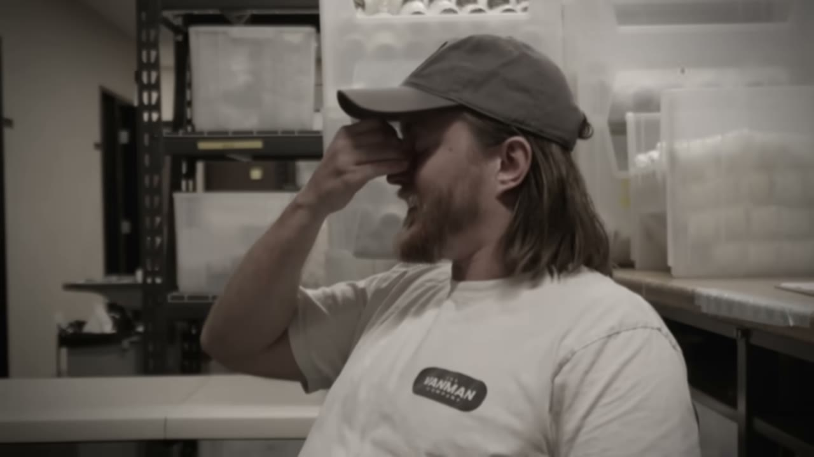
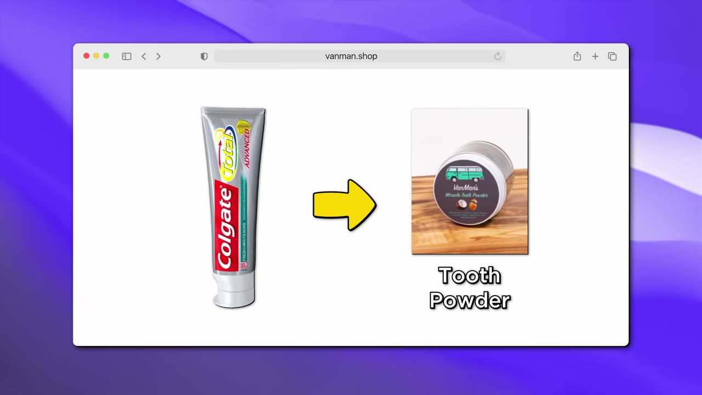
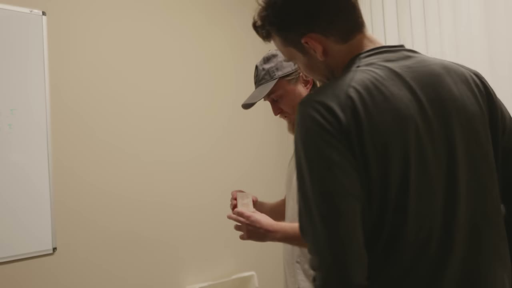
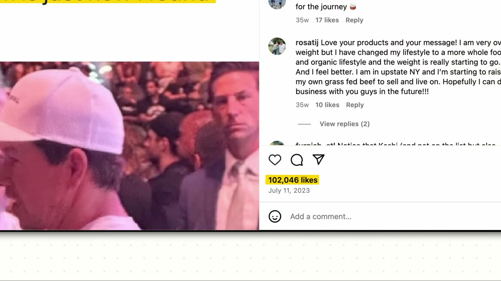
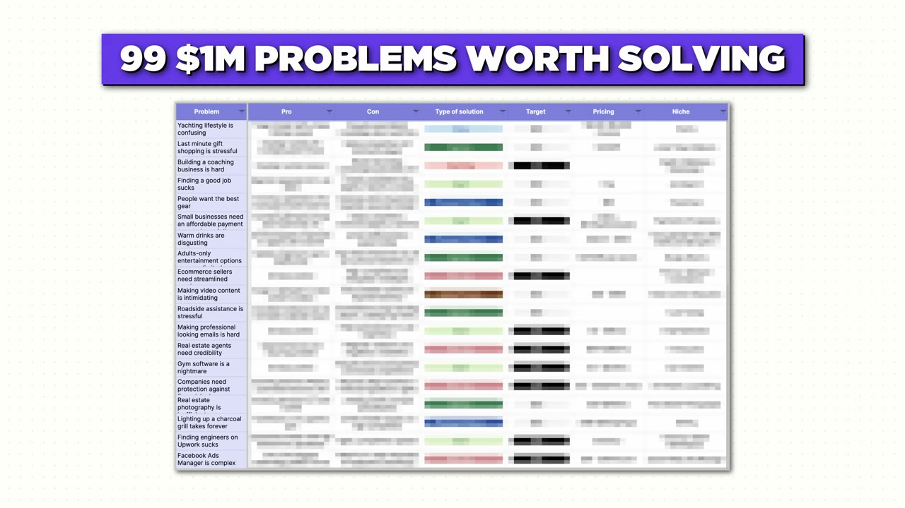

# Van Man — 5 triệu USD/năm bán kem đánh răng từ một chiếc van 2.000 USD

> **Tóm tắt 30 giây:** Jeremy phá sản sau nhiều startup thất bại, bán sạch đồ đạc, mua chiếc van **2.000 USD** trên Craigslist và sống trong đó. Anh không có sản phẩm — anh chỉ tweet về việc mình dừng dùng kem đánh răng có fluoride và tự nhúng bàn chải vào baking soda. Người theo dõi bảo *"tôi cũng sẽ thử"*. Anh đóng chai thứ mình đang tự dùng, đăng lên Shopify và **bán gần hết sau 20 phút**. Tháng đầu 5.000 USD; năm 2023 hơn **5 triệu USD**, ship **500-600 đơn/ngày**, **40% khách quay lại**. Toàn bộ marketing là meme trên Instagram.

## 1. Con số

| Chỉ số | Giá trị |
|---|---|
| Doanh thu 2023 | Hơn 5.000.000 USD |
| Tháng đầu tiên | Khoảng 5.000 USD |
| Đỉnh tháng | Đã có ít nhất một tháng đạt 1 triệu USD (lời Jeremy) |
| Bắt đầu | 2021 |
| Vốn khởi điểm | Chiếc van 2.000 USD mua trên Craigslist |
| Đơn hàng/ngày | 500-600 khi chạy tốt |
| Giá bán | Hầu hết dưới 20 USD/sản phẩm |
| Tỷ lệ khách quay lại | Khoảng 40% |
| Lần launch đầu | Bán gần hết sau 20 phút, dưới 100 hộp |
| Vốn ngoài | Không có — bootstrapped |

⚠️ **Ba con số không khớp nhau trong cùng một video.** Narration mở đầu nói Jeremy đi *"từ 5.000 USD/tháng lên 500.000 USD/tháng"*. Chính Jeremy lại nói *"chúng tôi đã có tháng triệu đô đầu tiên"*. Còn 5 triệu USD/năm chia 12 ra khoảng 417.000 USD/tháng. Ba con số này có thể cùng đúng (500k là mức nền, 1M là tháng đỉnh, 417k là trung bình cả năm) nhưng video không giải thích, và **không có một ảnh dashboard nào**. Tôi lấy 417.000 USD/tháng làm con số nền vì nó suy ra trực tiếp từ câu duy nhất Jeremy tự khẳng định về doanh thu.

## 2. Nguồn gốc ý tưởng — khách hàng viết công thức hộ anh ⭐⭐⭐

Chuỗi sự kiện đáng học nhất trong cả video, vì **không có bước nào là "nghĩ ra ý tưởng kinh doanh"**:

1. Jeremy phá sản, bán hết đồ, mua van, sống trong van. Mục tiêu duy nhất là **hồi phục năng lượng**, không phải khởi nghiệp.
2. Anh có tài khoản Twitter tên Van Man, đăng linh tinh về sức khoẻ. *"Tôi bị cuốn vào chuyện anti-fluoride."*
3. Anh bỏ kem đánh răng, mua một hộp baking soda và nhúng bàn chải vào. Baking soda quá mặn và gắt → anh **bắt đầu thêm thứ khác vào để tự dùng**.
4. Anh **vừa làm vừa tường thuật trên Twitter**. Phản hồi: *"Người ta nói tôi cũng sẽ thử cái đó, tôi cũng sẽ thử cái đó. Và rồi, ồ, hoá ra tôi có một sản phẩm ở đây."*
5. Ý tưởng vỏ bột vỏ trứng đến từ một video Arnold Schwarzenegger bỏ nguyên quả trứng vào shake protein. Anh tweet *"biết đâu vỏ trứng tốt cho răng"*, tìm được bột vỏ trứng, cho vào tooth powder.
6. Launch. Bán vài trăm USD trong **giờ đầu tiên**.

Câu quan trọng nhất của cả case:

> *"Người ta đã ở sẵn trong một cộng đồng mà tôi cũng là thành viên. Nên đây là bán cho cộng đồng cùng sống trong một paradigm — **tất nhiên vỏ trứng tốt cho bạn, vì chúng tôi đã ở trong cái paradigm animal-based rồi**. Nên gần như là khách hàng dạy tôi kiến thức này, rồi tôi đưa lại cho họ sản phẩm."*

**Cơ chế:** anh không phải thuyết phục ai rằng vấn đề tồn tại, cũng không phải thuyết phục ai rằng giải pháp hợp lý. Cả hai niềm tin đó đã có sẵn trong cộng đồng. Anh chỉ đóng gói lại. Đây là lý do chi phí thuyết phục của anh gần bằng 0 và cũng là lý do case này **không sao chép được bằng cách copy sản phẩm** — thứ tạo ra doanh thu là vị trí của anh bên trong một cộng đồng có hệ niềm tin riêng, không phải công thức tooth powder.

## 3. So sánh chéo đắt nhất của lô này ⭐⭐⭐

Ba video cùng đợt này đều là DTC bán hàng vật lý, nhưng khác nhau đúng **một biến số**: có audience trước hay không.

| Case | Có audience trước khi launch? | Ngày launch |
|---|---|---|
| **Van Man** (case này) | Có — Twitter, cộng đồng animal-based | Bán gần hết sau **20 phút** |
| [Epic Gardening](../2024-03-10_i-made-30m-with-my-side-project/case.md) | Có — 3 năm blog + kênh nội dung | Một Instagram story → **hết hàng sau 2 tuần** |
| [QALO](../2024-03-03_the-underdog-from-dead-broke-to-30-000-000/case.md) | Không — hai bồi bàn, zero audience | **0 đơn.** Phải mất nhiều tháng và một cú may truyền hình mới có đơn đầu tiên |

Đây là bằng chứng đối chứng gần như hoàn hảo: cùng loại sản phẩm, cùng nền tảng Shopify, cùng thời kỳ, khác nhau ở việc **có sẵn người nghe hay không** — và khác biệt kết quả ngày launch là 20 phút so với con số không. Nếu bạn chỉ rút ra một điều từ lô case này, hãy rút ra điều đó.

## 4. Meme marketing — cơ chế thật, không phải mẹo vặt ⭐⭐⭐

Toàn bộ marketing của một công ty 5 triệu USD/năm gói trong ba thứ: **bài viral gây tranh cãi trên Instagram, email, và meme**.

> *"Tôi thấy những bài **gây chia rẽ nhất** trên Instagram là những bài tạo ra comment và traction. Rồi nó được share, rồi nó được đẩy tới tất cả mọi người."*

> *"Tôi thử meme marketing, kiểu một tấm ảnh Mel Gibson nói chuyện với Mark Wahlberg. Rồi tôi viết lời thoại mà tôi muốn nói. Cái đó kéo được rất nhiều traction. **Nói điều tôi muốn nói, nhưng qua một khuôn mặt ai cũng nhận ra**, với một meme làm nó dễ đồng cảm và dễ share."*

Ba tầng cơ chế mà Jeremy mô tả, xếp theo mức khó:

**Tầng 1 — chia rẽ tạo comment, comment tạo phân phối.** Thuật toán Instagram đo engagement, không đo thiện cảm. Một bài khiến người ta cãi nhau sinh ra nhiều comment hơn một bài ai cũng gật đầu. Đây là lý do niche anti-fluoride / animal-based **là lợi thế chứ không phải trở ngại** — nó có sẵn phe đối lập.

**Tầng 2 — mượn khuôn mặt quen để giảm chi phí chú ý.** Người xem nhận ra Mel Gibson trong 0,2 giây, nên phần não dành cho việc "đây là quảng cáo à" chưa kịp bật lên.

**Tầng 3 — tốc độ trên tin thời sự.** Đây là phần Jeremy nhấn mạnh nhất, và cũng là phần khó copy nhất:

> *"Giỏi meme marketing không phải là ngồi nghĩ ra một meme trong 20 phút mỗi ngày. Nó là **luôn luôn ở trên mạng**. Tấm ảnh Mel Gibson với Mark Wahlberg là từ một trận UFC lớn. Bắt được nó **ngay hôm sau khi nó còn tươi trong đầu người ta** — cái đó mới là lớn."*

Và cái giá thật:

> *"Điên ở chỗ nó chỉ tốn năm phút làm. Nhưng có khi bạn phải lướt ba bốn ngày mới tìm được một thứ đáng đăng."*

**Khi nào chiến thuật này hết hiệu quả:** khi bạn không thật sự sống trong cộng đồng đó. Meme là bài kiểm tra thành viên — làm sai sắc thái thì cộng đồng phát hiện ngay và bạn trở thành thương hiệu đang cố gồng. Đây cũng là lý do Jeremy nói anh **không delegate phần bình luận**: *"Bạn không muốn giao phần đó cho ai. Đó là lúc bạn bắt được mạch của việc mọi người nghĩ gì về mọi thứ bạn đang làm."*

## 5. Kinh tế của việc mở rộng dòng sản phẩm ⭐⭐⭐

Đây là đoạn có giá trị vận hành cao nhất trong video, và hầu hết người xem sẽ lướt qua:

> *"Hầu hết người ta mua tooth powder, dưới 20 đô. Mouthwash cũng dưới 20 đô. Nhưng khi bạn có **năm sáu sản phẩm đều dưới 20 đô, thì bạn bắt đầu có những đơn to hơn**. Và đó mới là chỗ bạn bắt đầu kiếm được tiền trong e-com, vì average order cao lên. Chi phí ship giảm xuống. Chi phí xử lý mỗi đơn giảm xuống. **Đến được điểm đó mới là lúc chúng tôi thật sự có free cash flow.**"*

**Cơ chế:** trong DTC, chi phí ship và chi phí xử lý gần như **cố định theo đơn hàng**, không theo giá trị đơn. Một sản phẩm 18 USD đứng một mình gánh toàn bộ chi phí đó và gần như không còn gì sau COGS. Cũng chi phí đó chia cho một giỏ 70 USD thì biên lợi nhuận thay đổi hoàn toàn.

*(Ví dụ minh hoạ do tôi dựng để giải thích cơ chế, không phải số của Jeremy: nếu ship + xử lý là 8 USD/đơn và COGS 30%, thì đơn 18 USD còn lại 18 − 5,4 − 8 = 4,6 USD gộp — chưa đủ trả marketing. Đơn 72 USD với cùng 8 USD ship còn 72 − 21,6 − 8 = 42,4 USD. Cùng một khách, cùng một lần ship, biên gộp gấp 9 lần.)*

**Hệ quả chiến lược:** nếu bạn bán hàng vật lý giá thấp, **số lượng SKU trong cùng một dịp mua là biến số sống còn**, không phải giá. Van Man đi từ tooth powder sang deodorant, mouthwash, hair oil, soap — tất cả đều là **hàng tiêu hao trong phòng tắm**, mua cùng lúc, dùng hết rồi mua lại. Đó cũng là lời giải thích cho con số 40% khách quay lại: anh chọn danh mục có tính lặp lại tự nhiên. So sánh: [Tabs Chocolate](../2023-06-07_i-make-11m-year-selling-one-product/case.md) đi hướng ngược lại — một sản phẩm duy nhất, và phải bù bằng AOV cao cùng marketing viral cực mạnh.

## 6. Vận hành — làm thủ công là thương hiệu, không phải hạn chế ⭐⭐

Xưởng ở San Diego, mọi thứ làm và ship từ cùng một toà nhà.

> *"Mỡ bò được múc bằng tay, bằng thìa. Từ ngày đầu tiên đến giờ vẫn vậy và tôi **không thấy có gì thay đổi cả, vì chúng tôi cứ phải làm bằng tay. Tôi nghĩ chúng tôi sẽ làm bằng tay mãi mãi**."*

Giai đoạn van: dậy 6-7 giờ sáng, nấu chảy, khuấy rất lâu để hoà mật ong vào trước khi nguội. *"Có ngày 12 tiếng, ngày hôm sau không làm gì, rồi lại 12 tiếng. Tay tôi đau kinh khủng vì cầm thìa."*

**Vì sao giữ thủ công lại hợp lý về kinh tế:** với thương hiệu bán trên nền tảng niềm tin (tự nhiên, animal-based, chống công nghiệp hoá), **quy trình chính là điểm bán**. Tự động hoá dây chuyền sẽ tăng biên lợi nhuận nhưng phá huỷ đúng thứ khiến khách trả giá cao. Đây là một trong số ít trường hợp mà **không tối ưu hoá là quyết định đúng**.

## 7. Tầm nhìn — tích hợp ngược chuỗi cung ứng

Jeremy đang mua rất nhiều mỡ bò và mỡ bison, nên anh tính đi ngược lên: nuôi bò, nuôi bison của riêng mình, rồi bán thêm sữa và thịt từ chính đàn đó.

> *"Chúng tôi kiếm được nhiều tiền hơn trên mỗi con vật. Chúng tôi chăm sóc con vật tốt hơn nhiều. Và **miếng thịt cuối cùng thì gần như có thể bán không lấy lãi, vì chúng tôi đã kiếm đủ tiền rồi**."*

**Cơ chế đáng ghi nhớ:** đây là mô hình **trợ giá chéo bằng sản phẩm biên cao**. Balm và tooth powder có biên lợi nhuận cao, chúng gánh chi phí con vật; thịt trở thành sản phẩm gần như miễn phí về mặt kế toán, cho phép anh bán *"thịt, trứng, sữa chất lượng cao với giá Walmart"*. Đây là chiến lược cạnh tranh mà đối thủ chỉ bán thịt **không thể** đối phó bằng cách giảm giá.

## 8. Lời khuyên cuối — và mâu thuẫn với chính câu chuyện của anh ⭐⭐

Khi được hỏi sẽ khuyên gì cho chính mình lúc còn ở trong van:

> *"Tôi nghĩ **Etsy là nơi tốt nhất để bắt đầu**. Bạn có thể lướt Etsy để tìm ý tưởng sản phẩm, thêm chất riêng của mình vào, và bán ngược lại trên Etsy."*

> *"Nếu có vài đồng thì **test ads**. Tôi nghĩ bạn nên luôn luôn test ads trên các sản phẩm khác nhau, rồi bạn tìm được một quảng cáo thắng, cái đó có thể nuôi bạn cả tháng sau."*

⚠️ **Mâu thuẫn cần chỉ thẳng:** lời khuyên này **không phải là con đường Jeremy đã đi**. Anh không dùng Etsy, không chạy ads. Anh xây audience trên Twitter rồi bán cho họ. Đây là dạng lời khuyên "nếu làm lại tôi sẽ chọn con đường ít may mắn hơn" — nó thật lòng, nhưng **chiến lược thắng thật của anh là cái còn lại**. Khi đọc bất kỳ case study nào, hãy tách bạch *founder đã làm gì* và *founder khuyên gì*; hai thứ này thường khác nhau.

**Phân định điều kiện — khi nào Etsy đúng, khi nào audience-first đúng:**
- **Etsy/marketplace đúng khi** bạn chưa có ai nghe mình và cần vòng phản hồi trong vài tuần. Bạn mượn traffic tìm kiếm có sẵn, đổi lại bạn không sở hữu khách và cạnh tranh bằng giá.
- **Audience-first đúng khi** bạn đã ở sẵn trong một cộng đồng và sản phẩm dễ bị nhái. Chậm hơn nhiều lúc đầu, nhưng nó là thứ duy nhất khiến người khác không copy được bạn.

Câu cuối, và đây là câu thật nhất trong video:

> *"Đừng bao giờ dừng lại, vì tôi thấy có người thất bại vài lần rồi bỏ cuộc, hoặc là họ **có vợ rồi họ chấp nhận công việc của họ**. Với tôi thì đừng bao giờ chấp nhận cuộc đời đó."*

## 9. Cảnh báo nguồn ⭐⭐

- **Đây là kênh bán khoá học.** Starter Story (sau này được HubSpot mua lại — xem [case kênh tự kể](../2026-02-23_i-sold-my-company/case.md)) chèn quảng cáo lead magnet *99 vấn đề triệu đô* ngay giữa video, đúng lúc câu chuyện lên cao trào. Toàn bộ khung *"thành công của anh không liên quan gì tới may mắn, nó đến từ có đúng thông tin"* là **luận điểm bán hàng của kênh**, không phải kết luận từ dữ liệu. Trong chính câu chuyện này thì rõ ràng có yếu tố may: một video Arnold Schwarzenegger tình cờ lướt qua đã sinh ra sản phẩm chủ lực.
- **Không có bằng chứng số.** Không ảnh dashboard, không Shopify analytics, không sao kê. Toàn bộ 5 triệu USD là lời kể. Ba con số doanh thu trong cùng video còn không khớp nhau.
- **Survivorship bias tuyệt đối.** Jeremy nói thẳng anh đã thử *"cả đống ý tưởng kinh doanh khác nhau nhưng không cái nào ra tiền"* trước cái này. Kênh không phỏng vấn ai ở lại trong van.
- **Ngách này có rủi ro pháp lý.** Sản phẩm định vị quanh anti-fluoride và animal-based, đi kèm hàm ý về sức khoẻ. Ở Mỹ đây đã là vùng xám với FDA; ở VN, quảng cáo mỹ phẩm và thực phẩm có công bố tác dụng bị quản chặt hơn nhiều.

## 10. Áp dụng cho tôi (indie hacker VN)

### Sao chép được gì

- **Cơ chế lõi thì copy được, sản phẩm thì không.** Cơ chế là: *ở sẵn trong một cộng đồng có hệ niềm tin riêng → tường thuật công khai việc bạn tự giải quyết vấn đề của mình → để cộng đồng nói cho bạn biết họ muốn mua gì → đóng gói bán lại*. Cơ chế này hoạt động y hệt với sản phẩm số, và với sản phẩm số thì **bỏ được toàn bộ phần khó nhất của case này** (sản xuất, tồn kho, ship).
- **Tường thuật quá trình trước khi có sản phẩm.** Jeremy không hỏi *"mọi người có mua không?"* — anh chỉ đăng việc mình đang làm. Người dùng tự nhảy vào nói *"tôi cũng thử"*. Đây là cách xác thực rẻ nhất và ít gượng gạo nhất. Cùng logic với [Once xác thực trước khi viết code](../2026-05-10_i-built-a-20k-month-app-in-83-days/case.md), khác cách thực thi.
- **Chọn danh mục tiêu hao, không chọn danh mục mua một lần.** 40% khách quay lại của Van Man đến từ lựa chọn danh mục, không từ chiến thuật retention. Nếu bạn làm sản phẩm số, tương đương là chọn thứ **dùng hằng tuần** thay vì thứ dùng một lần rồi thôi.
- **Nội dung gây tranh cãi có kiểm soát.** Trên Facebook/TikTok VN cơ chế thuật toán giống hệt: comment kéo reach. Nhưng phải là tranh cãi **về chủ đề**, không phải về bạn.
- **Bó nhiều sản phẩm nhỏ để nâng AOV.** Áp dụng ngay được cho bất kỳ ai bán hàng vật lý ở VN qua Shopee/TikTok Shop — nơi phí ship và phí xử lý cũng cố định theo đơn.

### Rào cản thật

- **Bạn không có sẵn audience Mỹ, và đó chính là toàn bộ tài sản của case này.** Van Man thắng vì Jeremy là **thành viên bản địa** của cộng đồng animal-based nói tiếng Anh. Một người Việt xây audience đó từ 0 đang cạnh tranh về mặt văn hoá chứ không phải về sản phẩm. Nếu bạn định làm mô hình này, hãy làm với cộng đồng bạn **thật sự thuộc về** — kể cả đó là cộng đồng Việt.
- **Sản xuất mỹ phẩm và thực phẩm ở VN là ngành có giấy phép.** Kem đánh răng, deodorant, mouthwash đều là mỹ phẩm cần công bố sản phẩm với Bộ Y tế. Đây không phải rào cản kiểu SaaS mà bạn lách được bằng tốc độ.
- **Vốn tồn kho là thật.** DTC vật lý cần tiền nằm trong hàng trước khi có doanh thu. [QALO](../2024-03-03_the-underdog-from-dead-broke-to-30-000-000/case.md) trong lô này là ví dụ cực đoan: dốc sạch tài khoản tiết kiệm để rồi nhận về một lô hàng lỗi. Với sản phẩm số, thất bại tương đương chỉ tốn thời gian.
- **Không delegate được phần marketing.** Jeremy nói rõ anh tự ngồi trong comment nhiều giờ mỗi ngày. Mô hình này **không rảnh**, dù nghe có vẻ nhàn. Nó là công việc toàn thời gian của một người sáng tạo nội dung, cộng thêm một xưởng sản xuất.
- **Rào cản tiếng Anh ở đây nặng hơn mọi case SaaS.** Meme marketing đòi hỏi cảm nhận sắc thái, tin thời sự và văn hoá đại chúng Mỹ ở mức người bản xứ. Đây là kỹ năng khó thuê ngoài nhất trong toàn bộ kho case này.

### Khi nào KHÔNG dùng mô hình này

- **Khi bạn cần dòng tiền dự đoán được.** Doanh thu phụ thuộc vào việc meme có viral hay không — Jeremy tự mô tả là *"có đợt tăng vọt rồi có đợt tụt"*. Nếu bạn cần thay thế lương đều đặn, [SaaS B2B ngách chán](../2026-03-15_i-make-60k-month-from-the-most-boring-saas-on-the-in/case.md) là mô hình ngược lại và phù hợp hơn nhiều.
- **Khi bạn không muốn công khai mặt và quan điểm.** Mô hình này đòi hỏi bạn phải là một nhân vật có lập trường, thậm chí lập trường gây tranh cãi. Không có phiên bản ẩn danh của Van Man.
- **Khi bạn không sống trong ngách đó.** Đây là điểm chung với Packager: cả hai founder đều thắng vì họ **là** khách hàng. Bạn không thể nghiên cứu để có được vị trí đó.

**Case liên quan trong kho:** [Epic Gardening](../2024-03-10_i-made-30m-with-my-side-project/case.md) (audience trước, sản phẩm sau — cùng lô) · [QALO](../2024-03-03_the-underdog-from-dead-broke-to-30-000-000/case.md) (DTC không có audience — cùng lô, đối chứng) · [Tabs Chocolate](../2023-06-07_i-make-11m-year-selling-one-product/case.md) (một sản phẩm, marketing viral) · [Neuro](../2025-02-07_the-underdog-from-life-changing-accident-to-100m-yea/case.md) (DTC thực phẩm bổ sung) · [Sheets & Giggles](../2024-05-12_i-make-1m-month-from-bed/case.md) (DTC hàng gia dụng)

## Nguồn

- Video: <https://www.youtube.com/watch?v=6iqo7lNR_m0> (10:17, đăng 23/03/2024, 147.593 view)
- [Transcript đầy đủ](transcript.md) · [Ảnh chụp](screenshots/)

*Ghi chú về tên riêng: transcript là bản nghe lại bằng Whisper nên vẫn sai một số tên sản phẩm. "Talon honey balm" và "Tala" gần như chắc chắn là **Tallow** (mỡ bò) — sản phẩm chủ lực là tallow honey balm; "towel powder" cuối video cũng là tallow. "Mint Bone Toothpaste" là tên sản phẩm thứ hai theo lời Jeremy nhưng tôi không xác thực được chính tả từ meta.json, hãy kiểm tra lại trên trang chính thức nếu cần trích dẫn.*
