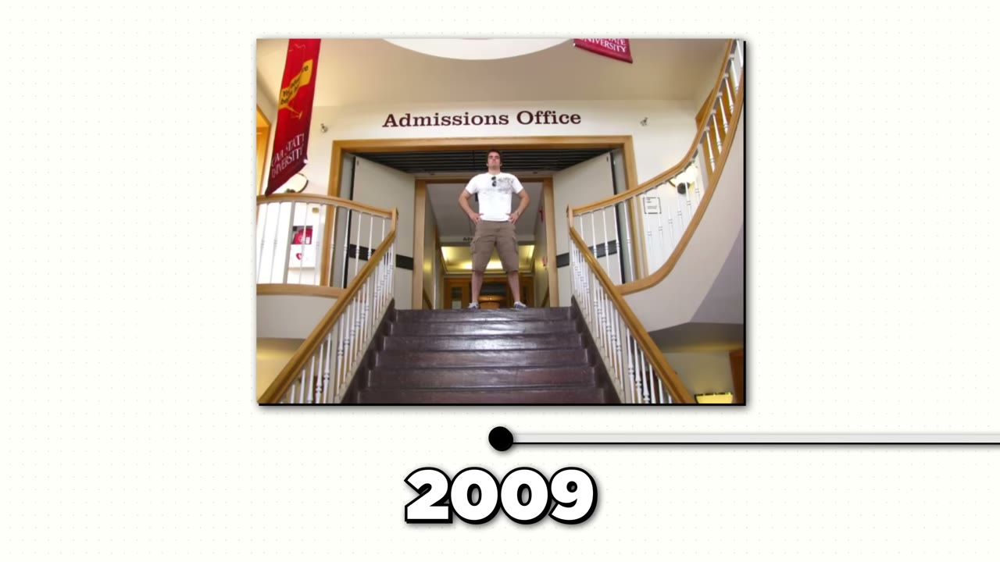
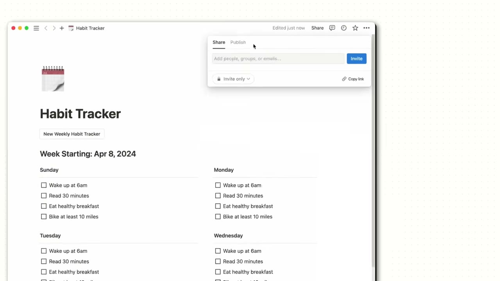
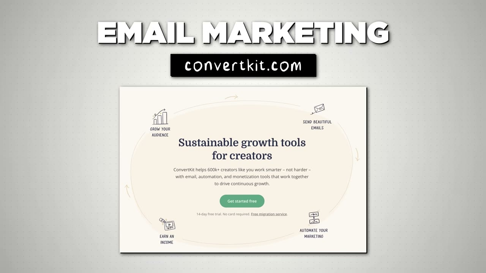

# I Made $2.5M Selling A Digital Product

✅ **Đã phân tích sâu** → [`case.md`](case.md)

| | |
|---|---|
| **Video** | <https://www.youtube.com/watch?v=OKl0C3zg0LU> |
| **Đăng** | 18/04/2024 |
| **Thời lượng** | 15:29 |
| **Lượt xem** | 127,963 |
| **Lượt thích** | 3,465 |
| **Video ID** | `OKl0C3zg0LU` |

## Trong thư mục này

| File | Nội dung |
|---|---|
| [`case.md`](case.md) | **Phân tích đầy đủ** — ý tưởng, validate, GTM, áp dụng ở VN |
| [`meta.json`](meta.json) | Metadata gốc (chapters, heatmap, mô tả) |
| [`screenshots/`](screenshots/) | 10 ảnh 720p |

## Mô tả gốc

This is the breakdown of how Thomas Frank makes over $100K/month selling digital products to a small audience.

## Số liệu bắt được từ transcript

> Các đoạn founder nhắc tới con số, kèm timestamp để tua thẳng tới đó trong video.

_(không bắt được con số nào)_

## Chương

- `00:00` Intro Summary
- `01:21` Thomas Frank
- `04:15` Backstory
- `06:48` Notion Templates
- `07:37` Customer Journey
- `08:43` Pricing
- `09:20` Tools
- `10:03` Cost
- `10:27` YouTube
- `11:17` Niche Channel
- `12:54` Day in the Life
- `13:19` Biggest Challenge
- `14:01` Advice

## Ảnh

1. `01_00m51s_usd-100-000.jpg` — 
2. `02_01m58s_usd-2-5-m.jpg` — 
3. `03_04m27s_ch-backstory.jpg` — 
4. `04_05m37s_usd-3-000.jpg` — 
5. `05_07m00s_ch-notion-templates.jpg` — 
6. `06_07m49s_ch-customer-journey.jpg` — 
7. `07_09m12s_usd-229.jpg` — 
8. `08_09m49s_replay.jpg` — 
9. `09_10m39s_ch-youtube.jpg` — 
10. `10_11m29s_ch-niche-channel.jpg` — 

---

← [Quay lại index](../../index.md) · [Toàn bộ video](../README.md)
