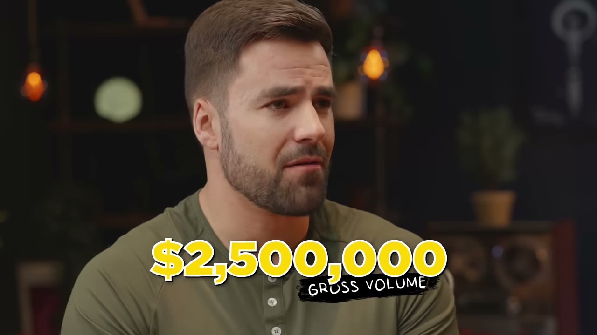
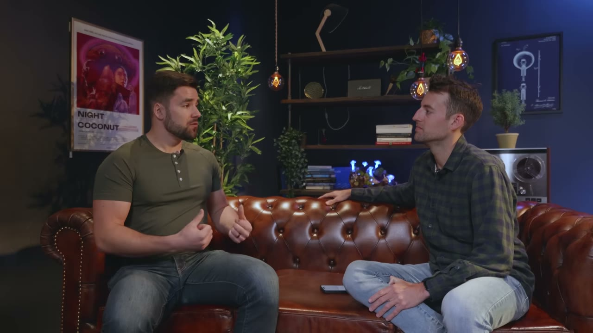
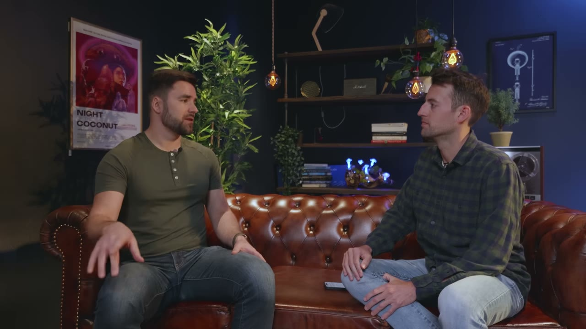

# Thomas Frank — kênh nhỏ kiếm nhiều hơn kênh lớn, và phép tính 28 USD mỗi email

> **Tóm tắt 30 giây.** Thomas Frank có kênh YouTube gần **3 triệu subscriber** với 180 triệu lượt xem. Anh bắt đầu kiệt sức: mọi video đều có tài trợ, và anh thấy áp lực phải đạt 100–200 nghìn view mỗi lần đăng. Nên anh mở **một kênh mới từ con số 0** chỉ dạy về Notion. Kênh đó giờ có **230.000 subscriber — chưa tới 1/10 kênh chính — nhưng kiếm 100.000–120.000 USD mỗi tháng.** Cú ra mắt quyết định: **90.000 USD trong 30 ngày từ một danh sách chờ chỉ 3.200 người**, tức khoảng **28 USD trên mỗi email**.

## 1. Con số

| Chỉ số | Giá trị |
|---|---|
| Doanh thu tích luỹ | **~2,5 triệu USD** |
| Doanh thu hiện tại | **100.000–120.000 USD/tháng** |
| Khách hàng | ~30.000 |
| **Kênh chính** | gần 3 triệu sub, ~180 triệu view |
| **Kênh ngách** | **~230.000 sub — kiếm nhiều tiền hơn** |
| Email list | 60–70K mảng Notion, 200K toàn bộ |
| Giá | 129 USD (Ultimate Brain), **229 USD** (bộ đầy đủ) |
| **Chi phí vận hành** | **dưới vài trăm USD/tháng** |

**Quỹ đạo doanh thu:**

| Mốc | Doanh thu |
|---|---|
| Creator's Companion, vài tháng đầu | ~3.000 USD/tháng |
| Sau 6 tháng | 15.000 USD/tháng |
| Ra mắt Ultimate Brain | **90.000 USD từ danh sách chờ 3.200 người** |
| Sau video hướng dẫn 45 phút | **100.000 USD/tháng** |
| Hiện tại | 100.000–120.000 USD/tháng |

## 2. Phép tính 28 USD mỗi email ⭐⭐⭐⭐⭐

Đây là con số đáng ghim nhất video.

**3.200 người trong danh sách chờ → 90.000 USD trong 30 ngày → khoảng 28 USD mỗi email.**

Đặt cạnh [phép toán crowdfunding của Sheets & Giggles](../2024-05-12_i-make-1m-month-from-bed/case.md): 11.000 email → 284.000 USD, tức **~26 USD mỗi email**. Hai doanh nghiệp hoàn toàn khác nhau — một bán ga trải giường vật lý, một bán file Notion — nhưng **giá trị trên mỗi email trong danh sách chờ gần như bằng nhau**.

**Vì sao điều này hữu ích:** nó cho bạn một con số để tính ngược. Nếu bạn thu được N email cho một danh sách chờ có lời hứa cụ thể, hãy dự tính khoảng **25–30 USD mỗi email** cho lần ra mắt — với điều kiện sản phẩm có giá trên 100 USD và danh sách đó thực sự chờ đúng thứ bạn bán.

Điều này cũng nói rằng **danh sách nhỏ nhưng đúng người đáng giá hơn nhiều so với lượng theo dõi lớn nhưng chung chung** — đúng như chính chênh lệch giữa hai kênh của anh.

## 3. Vì sao kênh 230.000 sub kiếm nhiều hơn kênh 3 triệu sub ⭐⭐⭐⭐⭐

Lập luận của anh rất sắc:

> Sức mạnh của một kênh ngách là **bạn không cố làm cho người ta quan tâm tới BẠN**. Bạn làm nội dung về thứ **họ đã quan tâm sẵn**. Notion đã có sẵn rất nhiều người đang cố làm gì đó, đang đi tìm câu trả lời. **Tôi chỉ đang đáp ứng một nhu cầu đã tồn tại.**

Đây là sự phân biệt giữa **kênh cá nhân** (bán sự chú ý dành cho bạn) và **kênh ngách** (bán giải pháp cho một nhu cầu có sẵn). Kênh thứ hai có ít người xem hơn nhưng **mỗi người xem đến với ý định rõ ràng**.

**Và anh nói rõ mô hình anh học theo là Zapier:**

> Zapier là phần mềm tự động hoá — ngách đó rất nhỏ. Nhưng có một nhóm rộng hơn quan tâm tới **các app lịch tốt nhất, phần mềm năng suất tốt nhất**. Nên khi nhìn vào marketing của Zapier, họ **thả lưới rộng hơn một chút nhưng vẫn tập trung vào quy trình làm việc và phần mềm năng suất**. Trong nhóm đó sẽ có một tỷ lệ nhỏ nghĩ *"à, tôi muốn nối hai app này lại — và công cụ của bạn làm được"*.

**Nguyên tắc rút ra:** đừng nhắm đúng ngách hẹp nhất của bạn khi làm nội dung. **Nhắm vòng tròn rộng hơn một bậc** — nơi có đủ người quan tâm để nội dung có lượt xem — rồi để một tỷ lệ nhỏ trong đó tự nhận ra họ cần sản phẩm của bạn.

Anh cũng đưa **câu hỏi kiểm tra** rất dùng được khi cân nhắc ngách nhỏ hơn:

> **Liệu 1/10 số lượt xem có mang lại cùng số doanh thu không?**

Nếu có — ngách nhỏ hơn nhưng người xem giá trị hơn — thì đi. Đây là cách định lượng đánh đổi giữa quy mô và ý định.

## 4. Video 45 phút vừa là quảng cáo vừa là giáo dục ⭐⭐⭐⭐⭐

Chi tiết này đưa doanh thu từ 15.000 lên 100.000 USD/tháng.

Anh làm một video **45 phút đi qua toàn bộ template**. Và anh mô tả nó rất thẳng:

> **Cả video là một quảng cáo**, nhưng tôi cho xem nhiều tới mức tôi thấy nó vẫn mang tính giáo dục — vì **người ta sẽ tự tái tạo lại được các phần của nó nếu muốn, mà không cần mua.**

**Vì sao nghịch lý này hoạt động:** khi bạn cho đi đủ nhiều để người ta **tự làm được**, bạn đã chứng minh hai thứ cùng lúc — sản phẩm thực sự có giá trị, và **việc tự làm sẽ tốn rất nhiều thời gian**. Người có thời gian sẽ tự làm (và trở thành người ủng hộ bạn); người có tiền sẽ mua.

Cùng cơ chế với [Ben của Tech Lockdown: "đưa toàn bộ phần hay ho vào chính bài Reddit"](../2025-07-24_my-side-project-makes-15k-month-quit-my-9-5/case.md) và [Papermark cho không phần lõi mã nguồn](../2025-08-16_how-we-built-it-900k-open-source-saas/case.md).

**Phễu đầy đủ của anh — đáng copy nguyên bản:**

| Loại nội dung | Mục đích |
|---|---|
| **Build guides** — "tôi sẽ dạy bạn tự xây bộ theo dõi thói quen" | luôn **kèm một template miễn phí** |
| **Tin tính năng mới của Notion** | bắt lưu lượng tìm kiếm khi có cập nhật |
| **Nội dung nền tảng** — cả một khoá học Notion miễn phí cho người mới | thu hút người mới vào hệ sinh thái |
| **Listicle vui** — "10 cách bạn đang dùng Notion sai" | nội dung dễ lan truyền |

Mỗi video làm **một trong ba việc**: chào template trả phí, chào template miễn phí (với build guide), hoặc mời vào email list qua trang tài nguyên.

Rồi **email tự động đầu tiên**: *"chúc bạn dùng vui các template miễn phí, đây là link tới tất cả template miễn phí khác của tôi — còn nếu bạn muốn nâng cấp lên năng suất trọn vẹn trong Notion, đây là Ultimate Brain, kèm mã giảm giá cho người đăng ký."*

## 5. Vấn đề sao chép lậu — và cách anh giải ⭐⭐⭐⭐

Đây là bài toán đặc thù nhưng cách giải thì chuyển giao được.

**Vấn đề:** một template Notion chỉ là **một trang công khai có tick ô cho phép nhân bản**. Nghĩa là **nó rất dễ bị sao chép lậu** — ai mua rồi cũng có thể chia sẻ link cho người khác.

**Cách anh giải:** anh **không cố bảo vệ file**. Anh chuyển thứ được trả tiền sang một thứ khác:

> Cái tôi quan tâm là **duy trì quyền truy cập trả phí vào phần hỗ trợ của chúng tôi.** Nên chúng tôi dùng Circle.so và có tài khoản đăng nhập thật cho khách hàng.

**Nguyên tắc rút ra:** khi sản phẩm số của bạn không thể chống sao chép, **đừng chống sao chép — hãy bán thứ không sao chép được**. Với anh đó là quyền vào cộng đồng hỗ trợ. Với người khác có thể là cập nhật, tư vấn, hay quyền được hỏi.

Và anh làm phần hỗ trợ đó rất nghiêm túc ngay từ đầu:

> Tôi làm hỗ trợ **8 tiếng mỗi ngày trong ít nhất một tháng trọn vẹn.** Tôi thực sự nghĩ founder nên làm điều này, vì bạn **bắt được nhịp** cách người ta nhìn nhận sản phẩm, nó dễ dùng tới đâu, điểm đau và điểm mắc kẹt của họ là gì.

Đây là kết luận lặp lại lần thứ tư trong kho: [Colin tự trả lời mọi comment và email trong nhiều năm](../2024-05-12_i-make-1m-month-from-bed/case.md), [Julien làm hỗ trợ một mình suốt năm đầu](../2024-11-07_how-i-built-it-37k-month-notion-app/case.md), [Dmytro tự email từng khách huỷ](../2024-11-22_how-i-built-it-12k-month-micro-saas/case.md).

## 6. Giá: tăng giá, giảm số lượng, tổng vẫn lên ⭐⭐⭐⭐

**Cách anh đặt giá ban đầu** — một lập luận đơn giản và dùng được:

> Suy nghĩ của tôi là: nếu bạn có thể vận hành **toàn bộ hoạt động sáng tạo của mình** từ khâu ghi ý tưởng tới lúc xuất bản, có kho lưu trữ toàn bộ kịch bản, tất cả trong một công cụ — thì người ta **có lẽ sẵn sàng trả hàng chục, hàng trăm đô mỗi tháng** cho thứ đó. Vậy thì ít nhất hãy tính trên 100 USD.

Tức là: **định giá bằng cách so với chi phí thay thế hàng tháng**, rồi bán một lần với mức thấp hơn tổng đó.

Giá ra mắt: 99 USD và 149 USD cho bản cao hơn. Hiện tại: **129 USD cho Ultimate Brain, 229 USD cho bộ đầy đủ** — và **phần lớn người mua chọn bộ đầy đủ**.

**Kết quả tăng giá năm ngoái:** số lượng bán **giảm nhẹ**, nhưng **tổng doanh thu tăng**.

Đây là điểm dữ liệu thứ ba trong kho ủng hộ việc tăng giá, sau [Dmytro](../2024-11-22_how-i-built-it-12k-month-micro-saas/case.md) và [Julien](../2024-11-07_how-i-built-it-37k-month-notion-app/case.md). Và nó đối lập với [Matt của Swim University phải hạ từ 50 xuống 24 USD](../2024-05-04_i-turned-one-website-into-1m-year/case.md) — cách phân định vẫn là: **khách dùng để làm việc thì giá không đàn hồi; khách chi tiền túi cho việc vặt thì giá rất đàn hồi.**

## 7. Chi phí gần bằng 0 — và ý nghĩa của điều đó ⭐⭐⭐⭐

Khi được hỏi chi phí vận hành, câu trả lời của anh gần như là một bản kế hoạch khởi nghiệp:

- **Vài thiết bị quay phim**
- **Một website Framer khoảng 15–30 USD/tháng**, tuỳ lượng nội dung
- **Phân phối miễn phí trên YouTube, Twitter, LinkedIn** — bất cứ đâu bạn muốn
- Tổng chi phí phần mềm: **dưới vài trăm USD/tháng**

Trên doanh thu 100.000–120.000 USD/tháng, đây là **một trong những biên lợi nhuận cao nhất trong toàn bộ kho**, ngang [Cursor Directory 99,8%](../2025-11-16_my-website-makes-35k-month-built-in-3-hours/case.md).

**Lý do cấu trúc:** một template Notion có **chi phí biên bằng 0 tuyệt đối**. Bán thêm một bản không tốn gì. Khác hẳn [ScreenshotOne với biên 40–60% vì mỗi ảnh là một trình duyệt chạy trên server](../2024-11-22_how-i-built-it-12k-month-micro-saas/case.md).

Công cụ đáng chú ý: **Lemon Squeezy** làm merchant of record — **họ xử lý toàn bộ thuế cho bạn**. Đây là chi tiết rất quan trọng với người bán từ Việt Nam ra thị trường quốc tế.

## 8. Hai lời khuyên cuối ⭐⭐⭐⭐

**1. Về YouTube: lấy số lần lặp.**

> Khi mới bắt đầu, bạn cần **lấy số reps**. Bạn cần đi qua vòng lặp phản hồi: học, thử, đăng để nhận phản hồi.
>
> Thứ bạn thực sự thu được khi đăng đều đặn và **cố cải thiện một thứ nhỏ mỗi lần** là một **khối lượng công việc dần dần cộng dồn kỹ năng của bạn**. Rồi ba năm sau bạn tỉnh dậy và nhận ra: mình biết chỉnh màu, biết dựng âm thanh, biết dựng phim trường, biết làm animation, nói trước camera tốt hơn nhiều. Và **tôi học được tất cả những thứ đó trong lúc vẫn đang đăng nội dung giúp doanh nghiệp lớn lên**.

**2. Về mạng lưới: "fan first".**

> Hãy **trở thành fan của những người bạn quan tâm** — chia sẻ đồ của họ, bình luận. Vì dần dần việc bạn để ý tới họ sẽ dẫn tới **những cuộc trò chuyện**, dẫn tới **gặp gỡ ở hội nghị**, dẫn tới **tình bạn**.
>
> Kể cả khi bạn xây doanh nghiệp một mình, **nó không được làm một mình** — vì bất kỳ ai thành công cũng được bao quanh bởi những người liên tục cho họ lời khuyên và phản hồi.

Và anh nói về cách anh học: anh **chưa bao giờ là người học qua khoá học**. Khi muốn học gì, anh **đi quan sát thật sâu một người anh ngưỡng mộ** — và thường đó không phải quyết định chiến lược, mà là **quyết định có vẻ vui nhất**.

**Thử thách lớn nhất của anh** cũng đáng ghi: **tự nghi ngờ kết hợp với chủ nghĩa hoàn hảo**. Khi mới làm video, anh tin mình có thể làm ra một video hoàn hảo — anh bỏ **hàng tuần** làm nó rồi **không bao giờ đăng**.

## 9. Cảnh báo thiên kiến nguồn

- **Hai lần chào bán Starter Story**, kèm mồi "cơ sở dữ liệu 102 ý tưởng sản phẩm số đang kiếm hàng triệu". Đoạn chèn giữa (3:32–4:01) lấy chính lời Thomas về "học bằng cách quan sát người giỏi" rồi nối sang *"đó chính là sức mạnh của Starter Story"*.
- **Không có ảnh chụp dashboard doanh thu nào.** Các con số là lời tự khai.
- **Bối cảnh quyết định mà video làm mờ:** anh bước vào việc bán template với **một kênh gần 3 triệu subscriber và 200.000 email đã có sẵn**. Kênh ngách 230.000 sub không mọc từ số 0 trong chân không — nó được nuôi bằng lưu lượng và uy tín từ kênh chính. Danh sách chờ 3.200 người tạo ra 90.000 USD **vì họ đã theo dõi anh nhiều năm**.
- **Anh viết blog từ 2010 và làm YouTube từ 2014** — tức khoảng 10 năm xây dựng trước khi bán được template đầu tiên.
- **Video quay tại Denver cùng đợt** với [Sheets & Giggles](../2024-05-12_i-make-1m-month-from-bed/case.md), [Swim University](../2024-05-04_i-turned-one-website-into-1m-year/case.md) và [Tim Stoddart](../2024-04-27_i-make-5m-year-with-3-businesses/case.md) — bốn video trong cùng một chuyến đi.

## 10. Áp dụng cho tôi (indie hacker VN)

**Sao chép được ngay:**

1. **Câu hỏi "1/10 số lượt xem có mang lại cùng doanh thu không?"** — dùng để quyết định có nên thu hẹp ngách hay không.
2. **Mô hình Zapier: nhắm vòng tròn rộng hơn một bậc so với ngách của bạn.** Nội dung phải có đủ người quan tâm để tồn tại; sản phẩm mới cần hẹp.
3. **Video dài đi hết sản phẩm, cho đủ để người ta tự làm được.** Nghịch lý nhưng đã được chứng minh: nó đưa anh từ 15K lên 100K/tháng.
4. **Bốn loại nội dung của phễu**: build guide (kèm quà miễn phí), tin cập nhật nền tảng, nội dung nền tảng cho người mới, listicle vui.
5. **Bán thứ không sao chép được** khi sản phẩm số của bạn không chống được sao chép. Với anh là quyền vào cộng đồng hỗ trợ.
6. **Định giá bằng chi phí thay thế hàng tháng**, rồi bán một lần thấp hơn tổng đó.
7. **Dùng merchant of record** như Lemon Squeezy để khỏi lo thuế quốc tế — đây là gợi ý thực tế nhất cho người bán từ Việt Nam.
8. **"Fan first"** — cách xây mạng lưới không tốn tiền và không cần đi hội nghị.

**Rào cản thật:**

- **Anh có 3 triệu subscriber trước khi bắt đầu.** Đây là rào cản lớn nhất và video không nêu. Nếu bạn bắt đầu từ 0, con số 28 USD mỗi email vẫn đúng — nhưng bạn phải tự kiếm 3.200 email đó, và đó mới là công việc thật.
- **Nội dung dạy Notion bằng tiếng Anh** cạnh tranh với hàng nghìn kênh. Ngách Notion năm 2020 rất trống; năm nay thì không.
- **Cần thiết bị quay và khả năng nói trước camera bằng tiếng Anh** nếu nhắm thị trường quốc tế.

**Khi KHÔNG nên đi con đường này:**

- **Khi bạn chưa có bất kỳ khán giả nào và cần tiền trong 6 tháng.** Mô hình này là **kiếm tiền từ khán giả đã có**, không phải cách xây khán giả.
- **Khi nền tảng bạn dựa vào chưa đủ lớn.** Toàn bộ mô hình sống nhờ việc Notion đã có sẵn hàng triệu người đang loay hoay tìm câu trả lời.
- **Khi bạn không chịu được việc cho đi gần hết.** Video 45 phút cho xem hầu như mọi thứ — nếu bạn sợ bị "lấy mất ý tưởng", cách này sẽ khiến bạn khổ sở.

## Nguồn

- Video: [I Made $2.5M Selling A Digital Product](https://www.youtube.com/watch?v=OKl0C3zg0LU) — Starter Story, 18/04/2024, 127.963 view
- [Transcript đầy đủ](transcript.md) · [Ảnh chụp màn hình](screenshots/)
