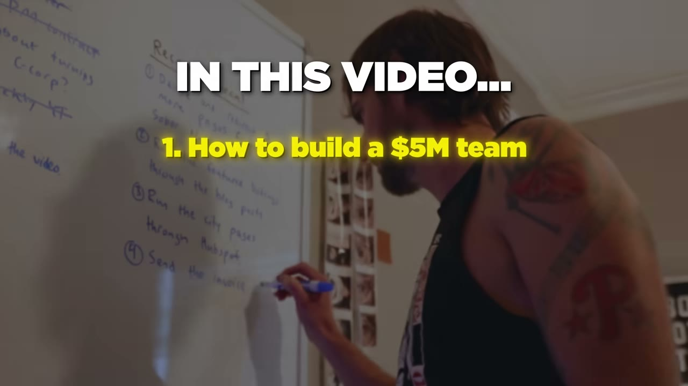

# I Make $5M/Year With 3 Businesses

✅ **Đã phân tích sâu** → [`case.md`](case.md)

| | |
|---|---|
| **Video** | <https://www.youtube.com/watch?v=zTKYJWAEl78> |
| **Đăng** | 27/04/2024 |
| **Thời lượng** | 15:51 |
| **Lượt xem** | 302,434 |
| **Lượt thích** | 6,939 |
| **Video ID** | `zTKYJWAEl78` |

## Trong thư mục này

| File | Nội dung |
|---|---|
| [`case.md`](case.md) | **Phân tích đầy đủ** — ý tưởng, validate, GTM, áp dụng ở VN |
| [`meta.json`](meta.json) | Metadata gốc (chapters, heatmap, mô tả) |
| [`screenshots/`](screenshots/) | 8 ảnh 720p |

## Mô tả gốc

This is the breakdown of how Tim Stoddart makes over $5M/year with 3 businesses. 

## Số liệu bắt được từ transcript

> Các đoạn founder nhắc tới con số, kèm timestamp để tua thẳng tới đó trong video.

_(không bắt được con số nào)_

## Chương

- `00:00` Intro
- `01:10` Interview
- `04:58` Blog
- `08:04` Investing
- `12:51` Life

## Ảnh

1. `01_00m53s_usd-5-m.jpg` — 
2. `02_05m10s_ch-blog.jpg` — 
3. `03_06m15s_replay.jpg` — 
4. `04_08m16s_ch-investing.jpg` — 
5. `05_10m13s_replay.jpg` — 
6. `06_11m38s_replay.jpg` — 
7. `07_13m03s_ch-life.jpg` — 
8. `08_14m55s_usd-5-m.jpg` — 

---

← [Quay lại index](../../index.md) · [Toàn bộ video](../README.md)
