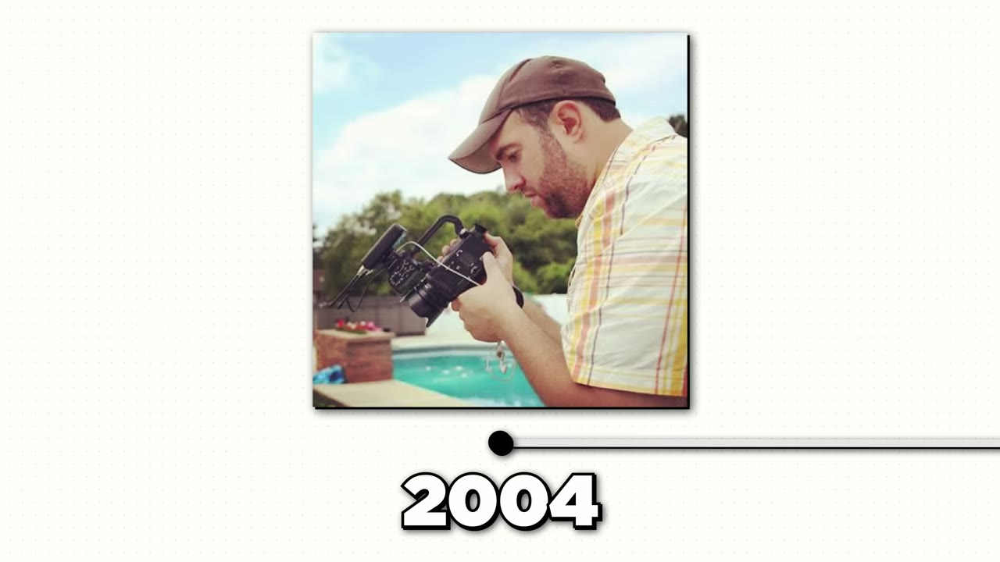
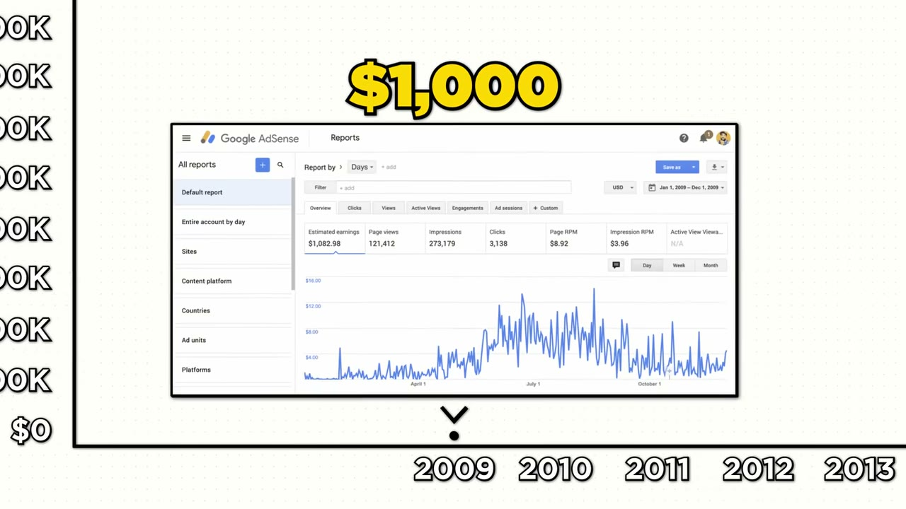
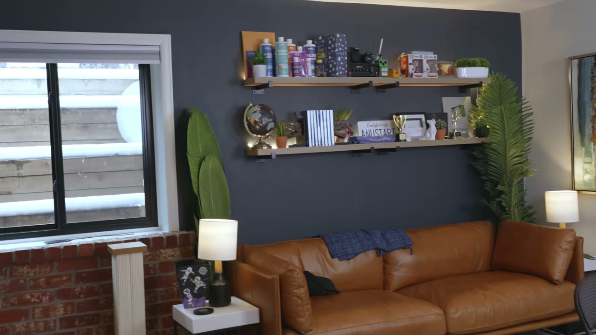

# I Turned One Website Into $1M/Year

✅ **Đã phân tích sâu** → [`case.md`](case.md)

| | |
|---|---|
| **Video** | <https://www.youtube.com/watch?v=7pCgbhUWW54> |
| **Đăng** | 04/05/2024 |
| **Thời lượng** | 15:18 |
| **Lượt xem** | 131,923 |
| **Lượt thích** | 3,553 |
| **Video ID** | `7pCgbhUWW54` |

## Trong thư mục này

| File | Nội dung |
|---|---|
| [`case.md`](case.md) | **Phân tích đầy đủ** — ý tưởng, validate, GTM, áp dụng ở VN |
| [`meta.json`](meta.json) | Metadata gốc (chapters, heatmap, mô tả) |
| [`screenshots/`](screenshots/) | 10 ảnh 720p |

## Mô tả gốc

This is the breakdown of how Matt Giovanisci makes over $1M/year with just one website (in one of the most boring niches). 

## Số liệu bắt được từ transcript

> Các đoạn founder nhắc tới con số, kèm timestamp để tua thẳng tới đó trong video.

_(không bắt được con số nào)_

## Chương

- `00:00` Intro Summary
- `01:05` Who is Matt
- `01:32` Business Breakdown
- `02:19` Backstory
- `04:12` Confidence
- `04:55` Monetization
- `06:07` Growth
- `07:14` Boring Niche
- `07:56` Picking the Right Niche
- `08:24` When the Going Gets Tough
- `08:41` Tools Software
- `09:27` Family Business
- `10:41` Shiny Object Syndrome
- `11:55` Day in the Life
- `12:37` Challenges
- `13:16` Advice to Founders
- `14:27` Outro

## Ảnh

1. `01_01m17s_replay.jpg` — 
2. `02_02m31s_ch-backstory.jpg` — 
3. `03_03m12s_usd-20-000.jpg` — 
4. `04_04m24s_ch-confidence.jpg` — 
5. `05_05m07s_ch-monetization.jpg` — 
6. `06_06m19s_ch-growth.jpg` — 
7. `07_07m26s_ch-boring-niche.jpg` — 
8. `08_08m08s_ch-picking-the-right-niche.jpg` — 
9. `09_09m14s_replay.jpg` — 
10. `10_10m53s_ch-shiny-object-syndrome.jpg` — 

---

← [Quay lại index](../../index.md) · [Toàn bộ video](../README.md)
