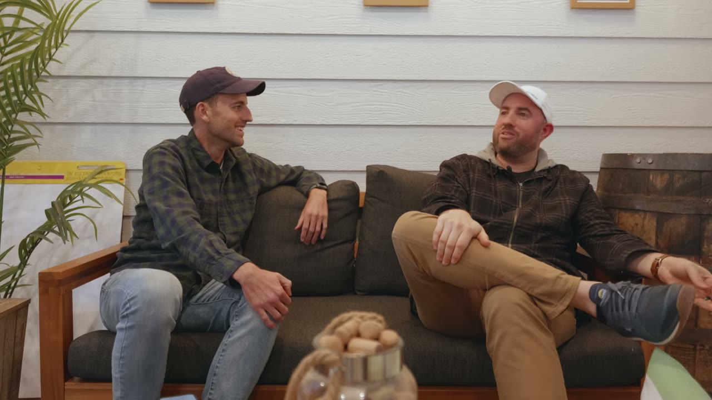
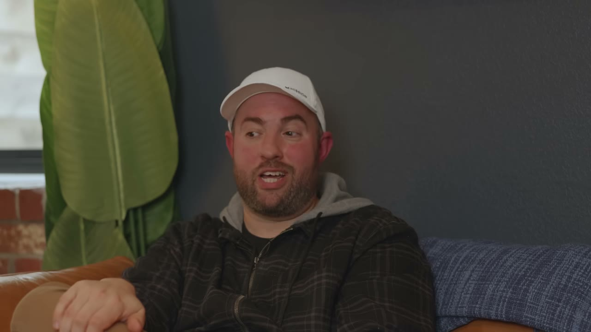
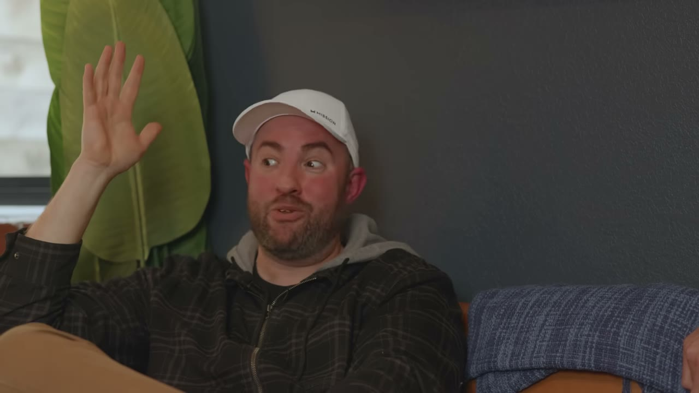
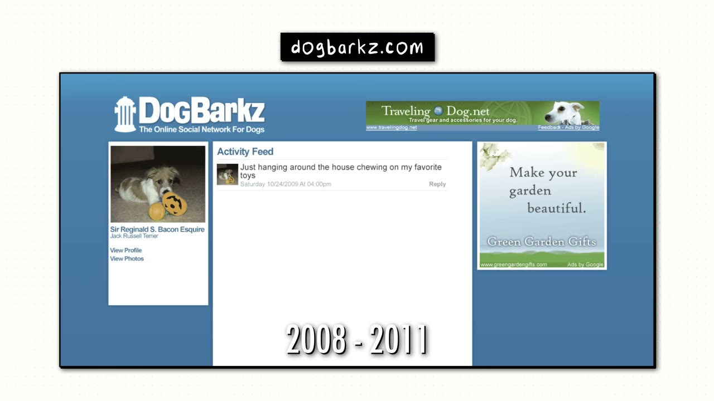

# Swim University — ngách chán, tảng đá 20 năm, và một cách tìm giá ngược đời

> **Tóm tắt 30 giây.** Matt Giovanisci làm giám đốc marketing cho một công ty hồ bơi và viết blog ở nhà. **Sếp phát hiện và sa thải anh.** Năm đó anh kiếm **20.000 USD** từ website, năm sau **40.000 USD**. Gần hai mươi năm sau, Swim University đạt **1 triệu USD một năm** với đội ngũ ba người: anh, vợ và em trai — **tất cả nhận lương ngang nhau**. Anh tự nhận viết rất tệ, không có dấu chấm dấu phẩy. Và sản phẩm đầu tiên của anh chỉ bán được sau khi **hạ giá từ 50 xuống 24 USD** — ngược hoàn toàn với mọi founder khác trong kho này.

## 1. Con số

| Chỉ số | Giá trị |
|---|---|
| Doanh thu | **1 triệu USD/năm** |
| Người đăng ký YouTube | ~225.000 |
| Newsletter | **100.000 chủ hồ bơi**, 2–3 email/tuần |
| Nhân sự | **3** (gia đình), lương ngang nhau |
| Năm đầu sau khi bị sa thải | 20.000 USD |
| Năm thứ hai | 40.000 USD |
| **Thời gian tới 1 triệu** | **gần 20 năm** |

**Cấu trúc doanh thu, theo thứ tự lịch sử:**

| Giai đoạn | Nguồn tiền |
|---|---|
| Đầu tiên | AdSense — *"thứ dễ nhất tôi làm được"* |
| Nhiều năm sau đó | **Chỉ affiliate** (chủ yếu Amazon) — anh bỏ AdSense vì quảng cáo xấu và không liên quan nội dung |
| Hiện tại | **Phần lớn từ khoá học và sách** — 3 khoá về hồ bơi, 1 khoá về bồn tắm nóng, và một cuốn sách in |

## 2. Cách tìm giá: hạ dần cho tới khi có người mua ⭐⭐⭐⭐⭐

Đây là dữ liệu đối lập quan trọng nhất trong kho về chuyện định giá.

**Sản phẩm đầu tiên của anh là một file PDF:**

| Giá | Kết quả |
|---|---|
| 50 USD | không ai mua |
| 40 USD | không ai mua |
| 30 USD | vài người mua |
| 29 USD | nhiều người hơn |
| **24 USD** | **rất nhiều người mua** |

Anh nói thẳng: **mất nhiều năm** mới tìm ra điểm giá.

**Vì sao điều này quan trọng:** trong kho này, [Dmytro của ScreenshotOne](../2024-11-22_how-i-built-it-12k-month-micro-saas/case.md) và [Julien của NotionForms](../2024-11-07_how-i-built-it-37k-month-notion-app/case.md) đều phát hiện **tăng giá không làm mất khách**. Matt phát hiện điều ngược lại.

**Cách phân định — và đây là điểm rút ra thật:**

| | Dmytro / Julien | Matt |
|---|---|---|
| Khách hàng | doanh nghiệp, dùng để **làm việc** | **chủ nhà**, chi tiền cá nhân |
| Sản phẩm | công cụ dùng liên tục | một PDF dùng một lần |
| Ngân sách | của công ty | của túi riêng |

**Giá không đàn hồi khi khách dùng sản phẩm để kiếm tiền; giá rất đàn hồi khi khách chi tiền túi cho một việc vặt trong nhà.** Đây là cùng bộ lọc mà [Will Cannon rút ra từ chênh lệch 8.000 lần giữa hai công ty của mình](../2025-10-01_my-two-apps-made-30m/case.md).

Điểm khác biệt lớn thứ hai: sản phẩm sau (**Pool Care Handbook**) làm tốt hơn nhiều vì anh đã học hết từ cái đầu — nó lớn hơn, và anh **thêm khoá video vào**, biến nó thành combo ebook + khoá học. Rồi in thành sách giấy.

## 3. Cỗ máy nội dung: một video đẻ ra bốn thứ ⭐⭐⭐⭐⭐

Khi được hỏi làm sao lên 1 triệu, câu trả lời của anh rất gọn: **vẫn đúng thứ tôi làm từ ngày đầu — nội dung.**

**Quy trình cụ thể:**

1. Bắt đầu bằng **một video dài, có kịch bản** — 1 video/tuần
2. **Quay lại vài đoạn nhỏ** để thành video ngắn — 3 video/tuần
3. Đăng lên **YouTube, Instagram, TikTok, Pinterest, Twitter, LinkedIn** — bất cứ nơi nào nhận video ngắn
4. **Lấy chính kịch bản đó, định dạng lại thành bài blog** xếp hạng trên Google
5. Người đến từ đó **đăng ký nhận email**
6. **Gửi 2–3 email/tuần** cho danh sách 100.000 người
7. Chạy quảng cáo bổ trợ cho toàn bộ

**Một quan sát đáng ghim từ anh:** video **thống trị doanh thu mỗi năm** là một **bản trình chiếu PowerPoint, không có kịch bản** — anh chỉ nói ra cách anh nghĩ về việc chăm sóc hồ bơi từ đầu tới cuối. Họ **không thể làm ra thứ nào hơn được nó**.

Kết luận của anh:

> **Không quan trọng video của bạn hay đến đâu — chỉ quan trọng nội dung có tốt hay không.**

Đây là liều thuốc giải cho ám ảnh sản xuất. Đối chiếu: [Jure dùng ma trận hook × thân × kết để sản xuất hàng loạt](../2025-04-12_i-make-60k-month-with-4-apps/case.md), [Steven Cravotta lưu video viral vào bảng tính để mổ format](../2024-09-24_how-i-built-it-40k-month-iphone-app/case.md). Ba cách tiếp cận khác nhau, cùng một kết luận: **format và nội dung thắng chất lượng sản xuất.**

## 4. Ngách chán — và vì sao đó là lợi thế ⭐⭐⭐⭐

Anh nói rất thẳng về bản chất ngách của mình:

> **Không ai muốn giỏi việc chăm sóc hồ bơi.** Không ai muốn thành chuyên gia vớt lá bể bơi. Họ chỉ muốn được bơi.
>
> Mục tiêu duy nhất của tôi: đưa họ từ *"hồ bơi nhà bạn kinh tởm"* sang *"hồ bơi trong và an toàn"* trong thời gian ngắn nhất.

Và anh rút ra hệ quả rất cụ thể cho cách làm nội dung: **đây không phải business sở thích.** Anh **không thể** làm podcast một tiếng ngồi tán gẫu về chăm hồ bơi cho vui — sẽ không ai nghe. Nên anh **phải ngắn, phải sắc, phải giải trí** để giữ được sự chú ý.

**Điểm rút ra chuyển giao được:** trong một ngách chán, **sự nhàm chán chính là hào bảo vệ** (ít người cạnh tranh), nhưng **nó cũng đặt ra ràng buộc cứng về định dạng** — bạn không được phép dài dòng. Nhiều người vào ngách chán rồi làm nội dung như thể đó là ngách đam mê, và thất bại vì lý do đó.

**Về cách chọn ngách,** anh có một bài tập rất cụ thể:

> **Đi vòng quanh nhà bạn và viết ra mọi thứ trong phòng.** Bạn sẽ tìm được ngách theo cách đó. Nhìn quanh căn phòng này thôi cũng có bao nhiêu thứ tôi có thể viết ra và nghĩ *"ừ, hoá ra mình cũng quan tâm cái đó — không biết có ai đang bàn về nó không"*.

Và lời khuyên kèm theo, nghe nghịch nhưng có lý: **chọn thứ bạn biết và bạn có ít nhất một chút hứng thú** — vì khi mọi thứ trở nên khó, khi việc làm nội dung trở nên nặng nề, ít ra bạn còn thích chủ đề đó **một chút**. Nếu không, bạn sẽ tự hỏi *"tôi làm cái này để làm gì?"*

## 5. Doanh nghiệp gia đình và quyết định trả lương ngang nhau ⭐⭐⭐⭐

Cấu trúc đội ngũ rất rõ:

| Người | Việc |
|---|---|
| **Vợ (Steph)** | viết kịch bản dài cho YouTube, viết toàn bộ nội dung ngắn, dựng và đăng video dài |
| **Em trai** | dựng video ngắn, làm **toàn bộ chăm sóc khách hàng** |
| **Matt** | đọc kịch bản trước máy quay, email marketing, podcast, bài viết, website, kỹ thuật, hành chính — *"lấp mọi khoảng trống của việc vận hành"* |

Và quyết định đáng chú ý nhất:

> **Tất cả chúng tôi nhận lương như nhau, để không ai cảm thấy mình ở trên ai.** Tôi không thấy mình là sếp. Không ai thấy mình là sếp. Tôi không cần kiếm nhiều hơn mọi người chỉ vì tôi sở hữu công ty.

Anh gọi đó là *"nước lên thì mọi thuyền cùng lên"*. Bối cảnh: anh cân nhắc tuyển thêm nhiều người, rồi quyết định **dùng chính doanh nghiệp này như một tài sản để lo cho gia đình**.

Đây là một trong số rất ít lần trong kho có người nói về **cấu trúc chia lợi ích** thay vì chỉ nói về doanh thu.

## 6. Hội chứng đồ chơi mới — và một ngoại lệ có chủ đích ⭐⭐⭐⭐

Danh mục dự án phụ của anh:

- **Mạng xã hội cho chó** (2008) — để học code. Thất bại
- **Roasty Coffee** — anh lấy chính playbook của Swim University và tự hỏi: *giờ tôi đã biết hết rồi, có làm lại trong nửa thời gian được không?* Kết quả: **100.000 khách truy cập/tháng sau 2 năm**, và anh **đã bán nó**
- **Money Lab** — nơi anh nói về chính những chuyện này, giờ chủ yếu là podcast, mang tính lưu trữ
- **Brew Cabin** — và đây là phần đáng suy nghĩ nhất

Về Brew Cabin, anh nói:

> Đó là thứ tôi hứng thú và đam mê tới mức **tôi không muốn biến nó thành một doanh nghiệp và làm hỏng tình yêu của mình với nó**. Tôi cần có một thứ cho riêng mình.
>
> Ngay khi bạn biến nó thành kinh doanh, ngay khi tiền bạc chen vào, **nó bắt đầu bị vấy bẩn một chút.**

**Điều này bổ sung một sắc thái quan trọng cho lời khuyên "hãy làm thứ bạn đam mê"** vốn xuất hiện khắp kho case này: Matt cố tình làm ngược — anh kiếm tiền từ ngách **chán** và **giữ đam mê thật ra ngoài** để bảo vệ nó.

Và Roasty Coffee cho một dữ liệu quý: **playbook có tái sử dụng được**, nhưng vẫn mất **2 năm** để đạt 100.000 khách/tháng, kể cả khi anh đã biết hết mọi thứ.

## 7. Điều anh nói về sự chậm — phần trung thực nhất ⭐⭐⭐⭐⭐

Khi được hỏi về khó khăn, câu trả lời của anh rất khác với giọng điệu chung của kênh:

> Chỉ là **sự chậm chạp** của nó. Nó không chịu vọt lên. Nó giống **một tảng đá khổng lồ tôi đẩy chậm chạp lên núi suốt gần 20 năm**.
>
> Lúc nào tôi cũng muốn đẩy thật mạnh, muốn quyết liệt hơn. Và **mỗi lần tôi làm vậy, tôi lại kiệt sức** rồi phải chấp nhận rằng doanh nghiệp này **cần đúng thứ nó cần và làm đúng thứ nó làm**.

Và lời khuyên cuối gồm hai phần:

**1. Cứ tiếp tục làm nội dung.** Anh nói mình cứ hay dừng lại, hay đổi hướng, hay nghĩ *"cái này sẽ giải quyết được vấn đề"* hay *"cái kia sẽ tốt hơn"*. Nhưng không — **mỗi khi anh làm nội dung, doanh nghiệp chuyển động; khi anh không làm, nó đi xuống.** Vì đó **chính là mô hình kinh doanh**. Anh thừa nhận có rất nhiều lúc anh **không muốn viết hay nói về hồ bơi** — nhưng đó là công việc.

**2. Nghĩ về lối sống trước, kinh doanh sau.** Anh không coi tiền là kết quả cần tối đa hoá:

> Có cả triệu thứ tôi đã có thể làm để kiếm nhiều tiền hơn bây giờ. Nhưng như thế tôi sẽ có một đội ngũ đông người, quản lý sẽ là ác mộng, và **tôi sẽ ghét cuộc sống của mình**.
>
> Nên tôi liên tục tự hỏi liệu quyết định sắp tới **có ảnh hưởng xấu tới cuộc sống mà tôi muốn hay không**.

Đặt cạnh [Ramsri chủ động không nghỉ việc vì gia đình](../2025-06-18_i-make-100k-year-from-2-ai-side-projects/case.md), [Thomas Sanlis không thể làm 10 tiếng/ngày](../2025-08-23_how-i-finally-built-a-10k-month-saas-30-failures/case.md), và [Dmytro coi sức khoẻ tinh thần là công cụ làm việc](../2024-11-22_how-i-built-it-12k-month-micro-saas/case.md) — bốn founder độc lập, cùng một kết luận về việc **định nghĩa thành công theo lối sống**.

## 8. Cảnh báo thiên kiến nguồn

- **Ba lần chào bán workshop miễn phí** của Starter Story, kèm *"số chỗ có hạn"*. Đoạn chèn giữa (3:33–4:00) nối thẳng câu chuyện bị sa thải của Matt sang lời mời *"xây doanh nghiệp triệu đô trên 2 tiếng mỗi ngày"*.
- **Mâu thuẫn trực tiếp nhất giữa quảng cáo và nội dung trong toàn bộ kho:** thông điệp bán là **"2 tiếng mỗi ngày"**, còn nhân vật thì mô tả **gần 20 năm đẩy tảng đá lên núi**, và nói rằng mỗi lần cố đẩy nhanh thì anh kiệt sức.
- **Không có ảnh chụp dashboard doanh thu nào.** Con số 1 triệu là lời tự khai.
- **Anh tự nói con số có thể dao động** vì *"chúng tôi có thể sẽ thay đổi vài thứ"* — tức 1 triệu không phải mức ổn định đã xác lập.
- **Bối cảnh làm nên toàn bộ câu chuyện:** anh đã làm nhiều năm trong ngành hồ bơi, lên tới **giám đốc marketing**, và **biết dựng website bằng HTML thuần cùng kỹ năng thiết kế đồ hoạ**. Anh tự nhận viết rất tệ — nhưng anh có đúng hai kỹ năng cần thiết là **chuyên môn ngành** và **khả năng làm ra một website trông chuyên nghiệp**.
- **Video quay tại nhà anh ở Denver**, cùng địa điểm và cùng đợt với [case Sheets & Giggles](../2024-05-12_i-make-1m-month-from-bed/case.md) và [case Tim Stoddart](../2024-04-27_i-make-5m-year-with-3-businesses/case.md) — ba video liên tiếp trong cùng một chuyến đi, nên cùng chung một khuôn kể chuyện.

## 9. Áp dụng cho tôi (indie hacker VN)

**Sao chép được ngay:**

1. **Quy trình một video đẻ ra bốn thứ:** video dài → cắt ngắn đăng mọi nền tảng → kịch bản thành bài blog xếp hạng Google → thu email → newsletter. Đây là cỗ máy nội dung **rẻ nhất và bền nhất** trong kho, và nó không cần vốn.
2. **Bài tập đi quanh nhà** để tìm ngách. Miễn phí, làm trong 20 phút.
3. **Thử giá theo cả hai hướng.** Nếu khách của bạn chi tiền túi cho việc vặt, hãy thử hạ giá; nếu họ dùng để kiếm tiền, hãy thử tăng. Đừng mặc định một chiều.
4. **Bán combo ebook + khoá video** thay vì chỉ một PDF — chính anh thấy sản phẩm thứ hai tốt hơn hẳn nhờ điều này.
5. **Đừng ám ảnh chất lượng sản xuất.** Video ăn khách nhất của anh là một bản PowerPoint không kịch bản.

**Rào cản thật:**

- **Gần 20 năm.** Đây là mô hình chậm nhất trong kho. Nếu bạn cần thu nhập trong 12 tháng, đây không phải con đường.
- **Cần chuyên môn ngành thật.** Anh làm trong ngành hồ bơi nhiều năm trước khi viết chữ nào. Nội dung giáo dục không giả được chuyên môn — người đọc phát hiện ngay.
- **Ngách hồ bơi là ngách Mỹ.** Nhưng nguyên lý thì chuyển được: hãy tìm **một việc vặt trong nhà mà chủ nhà Việt Nam phải làm định kỳ và làm sai hoài** — hoặc viết bằng tiếng Anh cho ngách toàn cầu nếu bạn đủ chuyên môn.
- **Affiliate Amazon và AdSense trả rất khác nhau theo quốc gia của người đọc.** Traffic từ Việt Nam có giá trị thấp hơn nhiều lần traffic từ Mỹ — điều này quyết định toàn bộ mô hình kiếm tiền.

**Khi KHÔNG nên đi con đường này:**

- **Khi bạn không chịu được việc phải làm nội dung mãi mãi.** Chính anh nói rõ: ngừng làm nội dung là doanh nghiệp đi xuống, vì **nội dung chính là mô hình kinh doanh**.
- **Khi bạn muốn đẩy nhanh.** Anh đã thử nhiều lần và lần nào cũng kiệt sức.
- **Khi bạn định biến đam mê lớn nhất của mình thành nguồn thu.** Anh cố tình không làm vậy, và giải thích lý do rất thuyết phục.

## Nguồn

- Video: [I Turned One Website Into $1M/Year](https://www.youtube.com/watch?v=7pCgbhUWW54) — Starter Story, 04/05/2024, 131.923 view
- [Transcript đầy đủ](transcript.md) · [Ảnh chụp màn hình](screenshots/)
