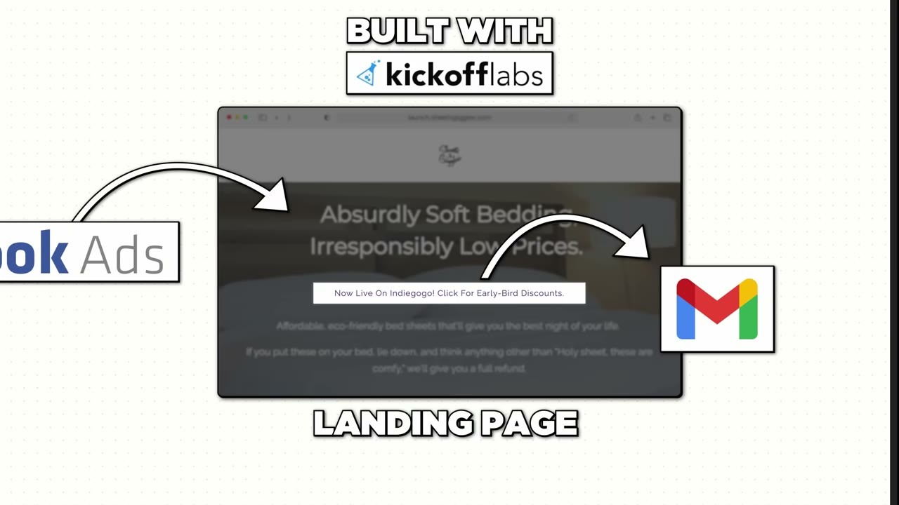
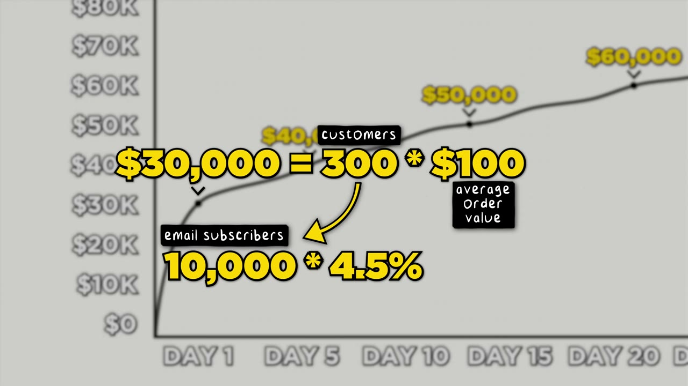

# I Make $1M/Month From Bed

✅ **Đã phân tích sâu** → [`case.md`](case.md)

| | |
|---|---|
| **Video** | <https://www.youtube.com/watch?v=dphK9rh2F5U> |
| **Đăng** | 12/05/2024 |
| **Thời lượng** | 15:17 |
| **Lượt xem** | 143,837 |
| **Lượt thích** | 3,929 |
| **Video ID** | `dphK9rh2F5U` |

## Trong thư mục này

| File | Nội dung |
|---|---|
| [`case.md`](case.md) | **Phân tích đầy đủ** — ý tưởng, validate, GTM, áp dụng ở VN |
| [`meta.json`](meta.json) | Metadata gốc (chapters, heatmap, mô tả) |
| [`screenshots/`](screenshots/) | 10 ảnh 720p |

## Mô tả gốc

This is the breakdown of how Colin McIntosh made $1M a month selling bedsheets online... From his bed.

## Số liệu bắt được từ transcript

> Các đoạn founder nhắc tới con số, kèm timestamp để tua thẳng tới đó trong video.

_(không bắt được con số nào)_

## Chương

- `00:00` Intro
- `01:12` Meet Colin
- `03:31` How did you find the idea
- `05:00` Validate the idea
- `06:38` Crowdfunding math
- `08:07` Special sauce of marketing
- `09:50` Brand name
- `10:44` Tools
- `12:07` Team
- `12:41` Day in the Life

## Ảnh

1. `01_00m38s_usd-284-000.jpg` — 
2. `02_01m26s_usd-1-2-m.jpg` — 
3. `03_03m43s_ch-how-did-you-find-the-idea.jpg` — 
4. `04_05m12s_ch-validate-the-idea.jpg` — 
5. `05_06m02s_replay.jpg` — 
6. `06_06m41s_usd-100-000.jpg` — 
7. `07_07m27s_usd-330-000.jpg` — 
8. `08_08m19s_ch-special-sauce-of-marketing.jpg` — 
9. `09_10m02s_ch-brand-name.jpg` — 
10. `10_11m14s_replay.jpg` — 

---

← [Quay lại index](../../index.md) · [Toàn bộ video](../README.md)
