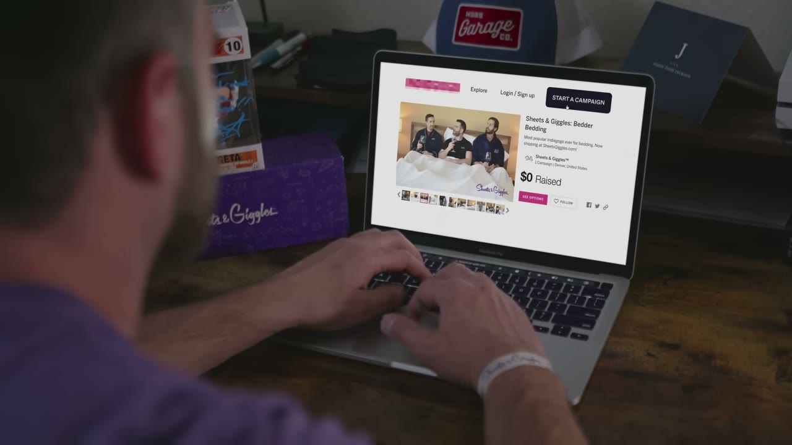
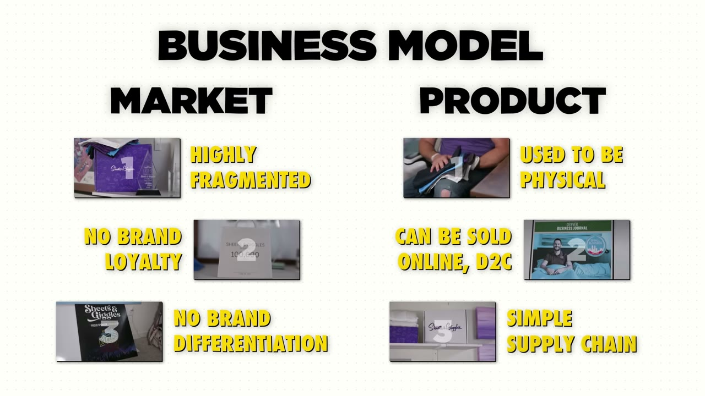
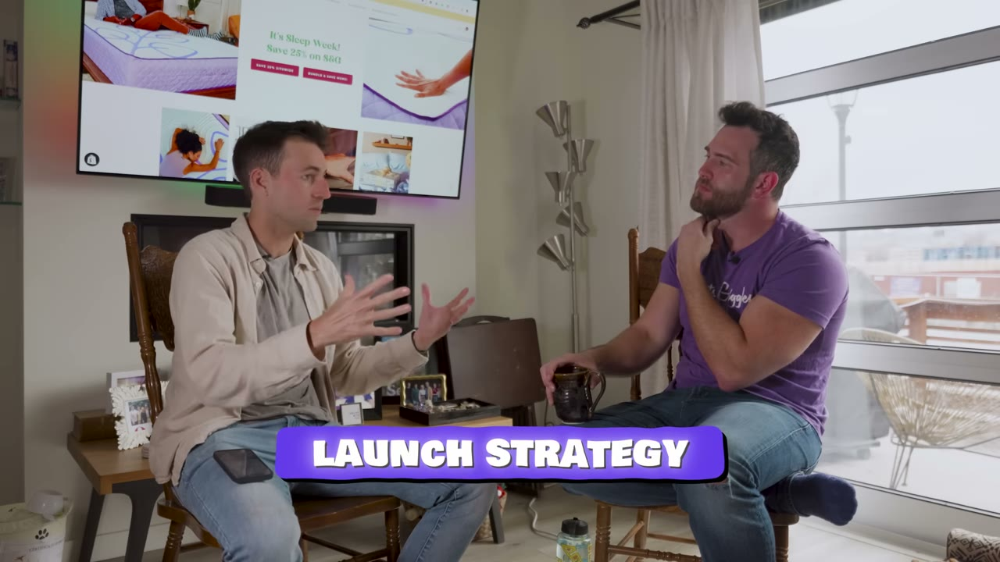
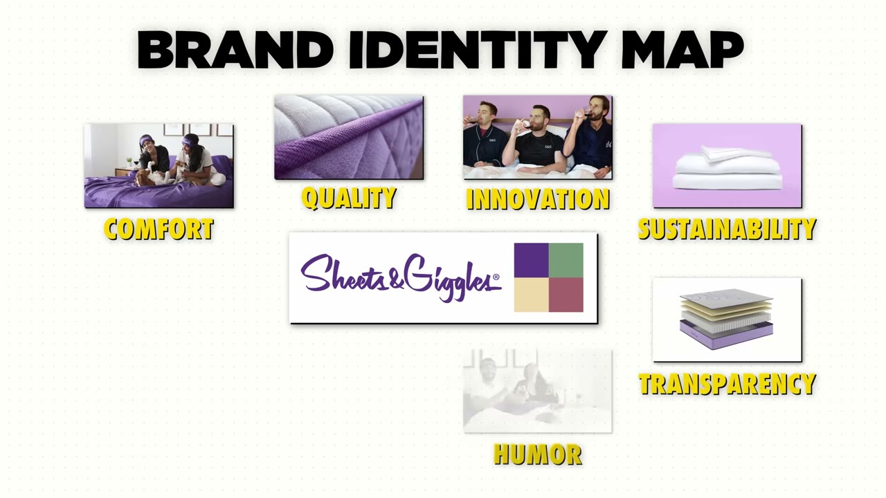
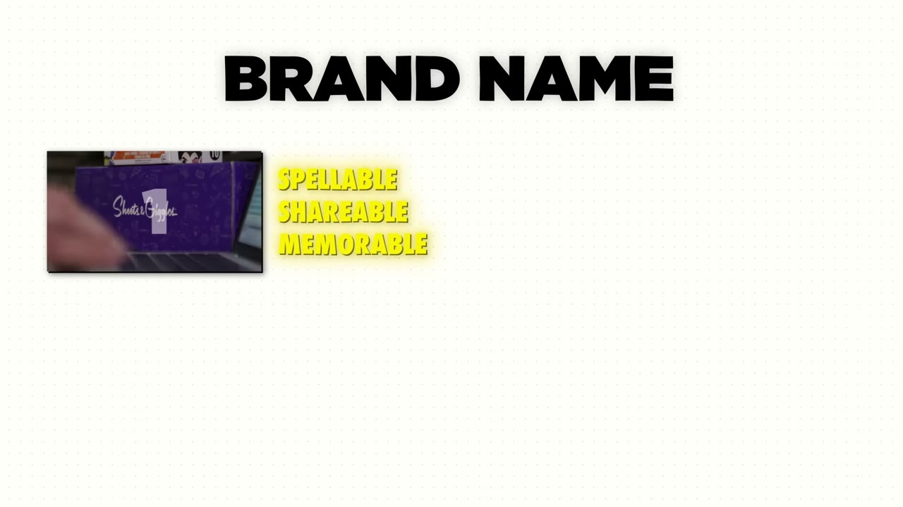
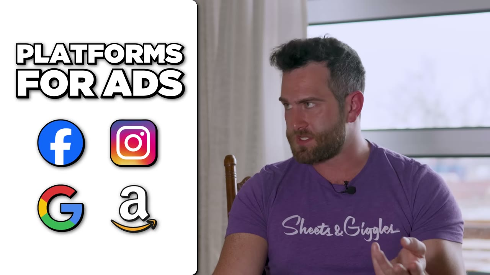

# Sheets & Giggles — công thức tính ngược một chiến dịch ra mắt, và nó chạy đúng như tính

> **Tóm tắt 30 giây.** Colin McIntosh bị **sa thải hai lần và cho nghỉ việc một lần** trước khi tự làm. Anh viết **mô hình kinh doanh trước khi biết mình sẽ bán sản phẩm gì**, rồi chọn ga trải giường. Trước khi có hàng, anh dựng trang thu email với lời hứa: giá bán 100 USD, ai đăng ký trước trả 69 USD — thu **11.000 email với tỷ lệ 46%**. Rồi anh **tính ngược toàn bộ chiến dịch bằng một phép toán**, và nó chạy đúng: **45.000 USD trong ngày đầu**, cuộn thành **284.000 USD**. Hai mươi lăm tháng sau lô hàng đầu tiên, tháng 11/2020 họ đạt **1,2 triệu USD một tháng**.

## ⚠️ Về con số trong tiêu đề

"$1M/Month" là **một tháng đỉnh vào tháng 11/2020** — mùa mua sắm cuối năm, và là mốc anh tự gọi là *"khá chóng mặt ở giai đoạn đầu"*. Video **không nêu doanh thu hiện tại**. Đây là dạng con số dễ đọc nhầm thành run-rate. Phần đáng học của case này không phải con số đó, mà là **phép toán ở mục 3**.

## 1. Con số

| Chỉ số | Giá trị |
|---|---|
| Chiến dịch đầu tiên | **284.000 USD** |
| Riêng ngày đầu | **45.000 USD** (450 khách × ~100 USD) |
| Email thu được trước khi bán | **11.000**, tỷ lệ chuyển đổi trang **46%** |
| Tỷ lệ email list ra đơn | **4,5%** (anh dự tính 3%) |
| Tháng đỉnh | 1,2 triệu USD — tháng 11/2020 |
| Thời gian tới tháng đỉnh | **25 tháng** sau lô hàng đầu |
| Kênh bán | ~80–90% website Shopify, phần còn lại Amazon |
| Nhân sự | ~40 người chạm vào việc mỗi ngày, gồm agency |

## 2. Mô hình kinh doanh trước, sản phẩm sau ⭐⭐⭐⭐⭐

Đây là sự đảo ngược đáng suy nghĩ nhất trong case này, và nó **đi ngược lời khuyên phổ biến nhất trong toàn bộ kho**.

Anh muốn một thương hiệu bán thẳng cho người tiêu dùng, muốn thứ mình tự hào, muốn một không gian lớn để tự khoét ngách riêng. Nên anh **bắt đầu viết mô hình kinh doanh trước khi biết sản phẩm là gì**.

Lập luận của anh về "hãy giải quyết vấn đề của chính bạn":

> Nếu bạn có một vấn đề, người khác cũng có vấn đề đó. Logic ấy ổn. **Câu hỏi là họ có sẵn sàng trả tiền cho giải pháp hay không.**

Nên anh khuyên: **dựng mô hình kinh doanh trước** — mô hình mà bạn thực sự tin, phù hợp với bạn và với thứ bạn giỏi nhất — **rồi mới chọn hoặc chỉnh sản phẩm cho khớp vào mô hình đó**.

Anh gọi đó là **founder market fit**: chọn doanh nghiệp khớp nhất với bộ kỹ năng sẵn có của bạn, thay vì đi tìm một vấn đề.

**Đối chiếu trong kho:** đây là phe đối lập với [Sebastian của HabitKit — "tôi luôn là khách hàng đầu tiên của chính mình"](../2025-06-21_how-i-built-it-15k-month-mobile-app/case.md), và cùng phe với [Dmytro thu hẹp ý tưởng theo siêu năng lực](../2024-11-22_how-i-built-it-12k-month-micro-saas/case.md). Cách phân định: **nếu bạn có một kỹ năng phân phối mạnh** (Colin: thương mại điện tử và xây thương hiệu), hãy bắt đầu từ đó; **nếu bạn có kỹ năng xây sản phẩm mạnh**, hãy bắt đầu từ vấn đề bạn hiểu.

## 3. Toán học của một chiến dịch ra mắt ⭐⭐⭐⭐⭐

Đây là phần đáng giá nhất video và là **công thức duy nhất kiểu này trong toàn bộ kho**.

**Quy luật anh nêu:** trong gọi vốn cộng đồng, doanh thu đi theo hình **cú vọt — bình nguyên — cú vọt nhỏ ở cuối**. Và **ngày đầu tiên chiếm khoảng 30% tổng mục tiêu**.

**Từ đó tính ngược:**

| Bước | Phép tính | Kết quả |
|---|---|---|
| Mục tiêu chiến dịch | — | 100.000 USD |
| Cần ngày đầu (30%) | 100.000 × 0,3 | **30.000 USD** |
| Giá trị đơn trung bình | 70 USD × 1,5 sản phẩm/đơn | ~100 USD |
| Số khách cần ngày đầu | 30.000 ÷ 100 | **300 khách** |
| Tỷ lệ email list ra đơn | 2% nếu làm sai, **3% chuẩn**, 4% nếu làm tốt | 3% |
| **Số email cần thu** | 300 ÷ 0,03 | **10.000 email** |

**Kết quả thật:** list của anh chuyển đổi **4,5%** thay vì 3% → **450 khách** → **45.000 USD ngày đầu** → cuộn thành **284.000 USD**.

**Vì sao phép toán này quan trọng hơn con số 284.000:** nó biến "ra mắt" từ một sự kiện may rủi thành **một bài toán có đầu vào kiểm soát được**. Bạn không cầu nguyện cho viral; bạn đếm xem cần bao nhiêu email và đi thu chúng.

Và nó cho bạn **một ngưỡng dừng**: nếu chỉ thu được 3.000 email, phép toán nói bạn sẽ đạt khoảng 30.000 USD chứ không phải 100.000 — bạn biết điều đó **trước khi** ra mắt, và bạn có thể lùi ngày hoặc hạ mục tiêu.

Anh cũng ghi công cho một yếu tố không nằm trong công thức: **nội dung email khác hẳn mọi email họ từng nhận**. Tỷ lệ 4,5% thay vì 3% đến từ đó.

## 4. Bán trước khi xây — và cách biến người mua thành người đồng sáng tạo ⭐⭐⭐⭐⭐

**Quy trình validate ba lớp của anh:**

**Lớp 1 — Ba tài liệu.** Anh nói thứ đầu tiên mọi người nên làm là **bản đồ nhận diện thương hiệu** (brand identity map), để hình dung được công ty mình đang xây. Rồi **mô hình tài chính** và **mô hình kinh doanh**.

**Lớp 2 — Đưa cho người bạn tôn trọng.** Gửi mô hình tài chính và hỏi: *cái này có hợp lý không? Tôi có quên khoản chi phí nào không? Tôi có tính giá quá cao không?* Đây là lớp kiểm tra rẻ nhất và hầu như không ai làm.

**Lớp 3 — Bán trước khi xây.** Nguyên tắc của anh: **bạn bán được một wireframe, một ý tưởng, một form đăng ký.**

Cách anh làm cụ thể:
- Lời hứa rất rõ và có mốc thời gian: **đăng ký ngay, và tới ngày 1/5 khi chúng tôi ra mắt, bạn có mức giá tốt nhất bạn sẽ từng có**
- Neo giá: **bộ ga bán 100 USD, ai đăng ký trước trả 69 USD**
- Kết quả: **11.000 email, tỷ lệ chuyển đổi trang 46%**

**Và bước tiếp theo mới là phần tinh tế nhất:** anh **gửi khảo sát cho danh sách đó** — *bạn muốn màu gì? bạn sẽ trả bao nhiêu?*

Lý do:

> Nếu bạn khiến người ta cảm thấy **họ đang cùng bạn xây sản phẩm**, họ trở nên **gắn bó về mặt cảm xúc** với nó. Và nếu họ không mua, họ có thể vẫn **chia sẻ nó cho người khác**.

Đây là cùng họ với [Setter AI thu 500 USD đặt cọc](../2025-09-27_how-we-built-a-10k-mo-saas/case.md) và [Nico thu tiền qua form Tally rồi làm tay](../2025-03-31_i-locked-myself-in-a-room-made-17-apps-sold-2-for-26/case.md) — nhưng Colin thêm một lớp: **biến danh sách chờ thành cộng đồng đồng sáng tạo**, tức là biến chi phí marketing thành tài sản quan hệ.

## 5. Bốn quy tắc đặt tên thương hiệu ⭐⭐⭐⭐

Anh nêu bốn quy tắc rõ ràng — hiếm có ai trong kho nói về đặt tên một cách có hệ thống như vậy:

1. **Đánh vần được, chia sẻ được, nhớ được** (ba thứ này tính là một quy tắc)
2. **Phải gợi hoặc nói rõ bạn làm gì.** "Sheets & Giggles" — chữ *sheets* nói thẳng ra là bán ga trải giường
3. **Phải có SEO tốt.** Tránh những từ hoặc tổ hợp từ mà khi tìm kiếm sẽ ra người khác — **hoặc tệ hơn, ra đối thủ**
4. **Phải có tên miền .com nếu bán cho người Mỹ**, vì theo anh người Mỹ không mua từ thứ gì không phải .com

**Thang chấm điểm của anh:** 4/4 là trúng đích. **3/4 thì cứ tiến.** 2/4 hoặc 2,5/4 thì **đổi tên khác**.

Đây là công cụ dùng được ngay trong một buổi chiều, và nó ngăn một sai lầm rất đắt: đổi tên thương hiệu sau khi đã có khách.

## 6. Kênh marketing bất ngờ: tài trợ thứ chính bạn yêu thích ⭐⭐⭐⭐⭐

Các kênh hiển nhiên vẫn chạy: Facebook, Instagram, Google, quảng cáo Amazon.

Kênh khiến anh bất ngờ: **podcast và kênh YouTube**. Nhưng cơ chế lựa chọn mới là phần đáng học:

> Anh **tài trợ những podcast anh thích** và **những kênh YouTube anh xem**.
>
> Lập luận: nếu bạn là founder và bạn yêu một đài phát thanh, một podcast, một YouTuber — thì **khả năng cao những người cũng thích họ giống bạn**. Họ sẽ cộng hưởng với cá tính của bạn, và **rất nhiều cá tính đó đã chảy vào thương hiệu của bạn**.

Hệ quả rất cụ thể: bạn **nói được đúng thứ ngôn ngữ của kênh đó**, viết được những câu đùa nội bộ, viết được nội dung thuyết phục, và **dựng cả một trang đích bằng đúng giọng thương hiệu đó**. Anh nói tỷ lệ chuyển đổi quanh những trang đó **cao điên rồ so với mọi trang khác trên website**.

**Vì sao điều này chuyển giao được:** nó biến câu hỏi "chọn kênh nào" — vốn cần dữ liệu và ngân sách để trả lời — thành một câu hỏi bạn **đã biết đáp án**: *tôi nghe gì, tôi xem gì?* Với người ít vốn, đây là cách chọn kênh rẻ nhất và có tỷ lệ trúng cao nhất.

## 7. Khác biệt hoá: chấp nhận làm 20% người khó chịu ⭐⭐⭐⭐

Ngách ga trải giường, theo chính anh, **đông và rất nhàm chán**. Cách anh tách khỏi đám đông:

- **Dùng bạn bè làm người mẫu**, không chỉ vì rẻ hơn mà vì **không thể giả vờ tình bạn và sự ăn ý**. Anh muốn thứ *"tràn ra khỏi màn hình, như thể bạn đang ở trong phòng cùng chúng tôi"*
- Nguyên tắc: **bạn không thể là mọi thứ cho mọi người, nên hãy chắc chắn bạn ít nhất là một thứ gì đó cho một ai đó**
- Và câu chốt: **nếu bạn không làm ít nhất 20% người khó chịu, có lẽ bạn đang làm sai**
- Một quy tắc cụ thể của họ: **không bao giờ là phẳng ga trải giường** trong ảnh chụp sản phẩm
- Và: **nếu điều đó đã có người làm rồi, tôi không muốn làm**

**Cộng với một chi tiết vận hành đáng nể:** trong nhiều năm anh **tự trả lời từng bình luận mạng xã hội, từng email chăm sóc khách hàng, tự viết từng email, và tự viết từng chữ trên website**. Lời khuyên của anh: founder hãy dành thời gian tương tác với người ta **cực kỳ cá nhân, ở mức chi tiết nhất**.

Đây là cùng nhận thức với [Dmytro tự gửi email cho từng khách huỷ](../2024-11-22_how-i-built-it-12k-month-micro-saas/case.md) và [Julien tự làm hỗ trợ suốt năm đầu](../2024-11-07_how-i-built-it-37k-month-notion-app/case.md).

## 8. Một chi tiết công cụ đáng lấy ⭐⭐⭐

Trong danh sách công cụ có một thứ đáng chú ý: **SiteGPT** — chatbot AI huấn luyện trên chính website, giá **khoảng 50 USD/tháng**.

Kết quả anh nêu:
- **Giảm khoảng 30% số ticket chăm sóc khách hàng**
- Và bất ngờ hơn: **nó là nhân viên bán hàng tốt nhất của họ**

Cơ chế: họ **dạy con bot rằng nếu nó có một cuộc trò chuyện tốt** — và nó tự đánh giá được cuộc trò chuyện có tốt không — thì **mời khách dùng mã `AI` giảm 10%**. Đó trở thành một trong những mã giảm giá hiệu quả nhất của họ.

Điểm đáng học: **họ biến kênh hỗ trợ thành kênh bán hàng, và dùng chính chất lượng cuộc trò chuyện làm điều kiện kích hoạt ưu đãi.** Đây là ý tưởng rẻ và sao chép được ngay với bất kỳ chatbot nào.

## 9. Cảnh báo thiên kiến nguồn

- **Ba lần chào bán "workshop miễn phí"** của Starter Story, một đoạn cài ngay giữa phần nói về tìm ý tưởng (khoảng 4:28) và một đoạn dài ở cuối, kèm chiêu khan hiếm *"số chỗ có hạn"*.
- **Đoạn chèn giữa đặc biệt khéo:** Pat lấy đúng khái niệm "founder market fit" mà Colin vừa nói và nối thẳng sang *"đó cũng là thứ chúng tôi dạy trong workshop"*.
- **Không có ảnh chụp dashboard doanh thu hiện tại.** Có ảnh con số 284.000 và 1,2 triệu, nhưng đó là các mốc lịch sử.
- **Con số 1,2 triệu USD/tháng là tháng 11/2020** — tức gần bốn năm trước thời điểm quay. Video không cập nhật tình hình hiện tại.
- **Không có bất kỳ số liệu chi phí, biên lợi nhuận, hay tồn kho nào.** Với một doanh nghiệp bán hàng vật lý có hàng trăm SKU và **vận chuyển nệm nặng 45 kg mỗi ngày**, đây là khoảng trống rất lớn — chi phí vốn hàng bán, kho vận, và tồn kho quyết định toàn bộ khả năng sống sót.
- **Bối cảnh không được nêu:** anh đã làm ở một công ty bán thẳng cho người tiêu dùng và một công ty công nghệ đeo được trước đó, và anh **học được cách chạy Kickstarter từ việc giúp bạn tổ chức tiệc ra mắt**. Anh cũng chủ động **mua bữa trưa hàng tuần cho ba người cố vấn** để hỏi họ. Đó là những tài sản có thật trước vạch xuất phát.

## 10. Áp dụng cho tôi (indie hacker VN)

**Sao chép được ngay — kể cả khi bạn không bán hàng vật lý:**

1. **Phép toán tính ngược chiến dịch.** Mục tiêu doanh thu → 30% cho ngày đầu → chia cho giá trị đơn trung bình → ra số khách → chia cho 3% → **ra số email cần thu**. Dùng được cho mọi lần ra mắt, kể cả ra mắt phần mềm.
2. **Bán trước khi xây, kèm neo giá và mốc thời gian.** "Đăng ký hôm nay, khi ra mắt bạn trả X thay vì Y."
3. **Gửi khảo sát cho danh sách chờ** để biến họ thành người đồng sáng tạo. Chi phí bằng 0, và nó tạo ra người chia sẻ chứ không chỉ người mua.
4. **Bốn quy tắc đặt tên**, chấm điểm trước khi mua tên miền.
5. **Chọn kênh tài trợ theo thứ chính bạn tiêu thụ.** Với người ít vốn ở Việt Nam, đây là cách chọn kênh chính xác nhất mà không cần ngân sách thử nghiệm.
6. **Gửi mô hình tài chính cho người bạn tôn trọng** trước khi bắt đầu. Miễn phí, và bắt được lỗi sớm.
7. **Dạy chatbot tặng mã giảm giá sau một cuộc trò chuyện tốt** — biến hỗ trợ thành bán hàng.

**Rào cản thật:**

- **Đây là mô hình hàng vật lý bán tại Mỹ**: cần vốn tồn kho, nhà sản xuất, kho vận, đổi trả, và một chuỗi cung ứng thật. Đây là một trong những case **khó chuyển giao nhất** trong kho về mặt vận hành.
- **Quy tắc ".com cho người Mỹ"** nghĩa là bạn cạnh tranh trong một thị trường tên miền đã cạn.
- **Chiến dịch gọi vốn cộng đồng cần một nền tảng như Kickstarter** và thường yêu cầu pháp nhân ở nước sở tại.
- **Anh có nền tảng thương mại điện tử và ba người cố vấn** trước khi bắt đầu.
- **Không biết biên lợi nhuận.** Một tháng 1,2 triệu USD doanh thu hàng vật lý có thể để lại rất ít hoặc rất nhiều — video không cho biết.

**Khi KHÔNG nên dùng cách này:**

- **Khi bạn không thu được danh sách email trước.** Toàn bộ phép toán sụp nếu bạn không có đầu vào. Nếu bạn không có cách thu 10.000 email, đừng lên kế hoạch cho một chiến dịch 100.000 USD.
- **Khi sản phẩm của bạn không cần một khoảnh khắc ra mắt.** Mô hình tích luỹ chậm như [SEO của Swim University](../2024-05-04_i-turned-one-website-into-1m-year/case.md) hay [ASO của HabitKit](../2025-06-21_how-i-built-it-15k-month-mobile-app/case.md) không hưởng lợi từ cú vọt một ngày.
- **Khi bạn không chịu được rủi ro tồn kho.** Bán trước khi xây giải quyết rủi ro nhu cầu, nhưng **không giải quyết rủi ro sản xuất** — bạn đã cầm tiền và phải giao hàng.

## Nguồn

- Video: [I Make $1M/Month From Bed](https://www.youtube.com/watch?v=dphK9rh2F5U) — Starter Story, 12/05/2024, 143.837 view
- [Transcript đầy đủ](transcript.md) · [Ảnh chụp màn hình](screenshots/)
