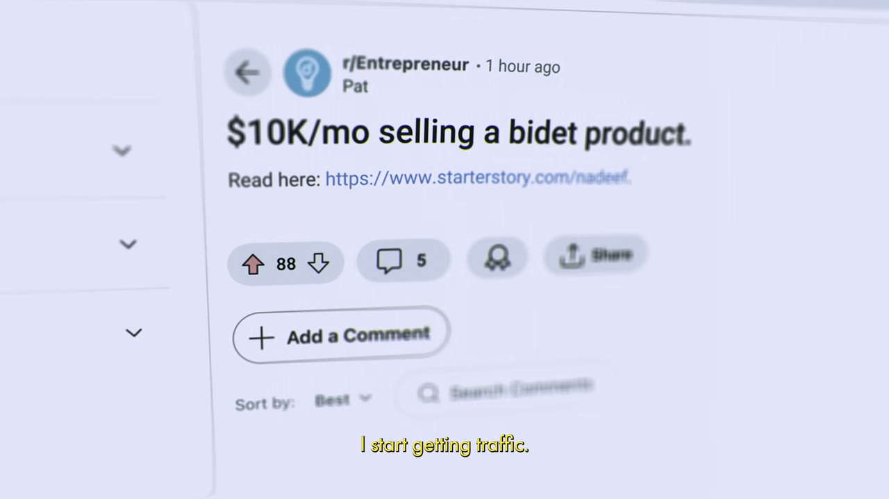

# Starter Story — cách Pat Walls lách luật Reddit để có những nghìn người dùng đầu tiên

> **Tóm tắt 30 giây:** Pat Walls ra mắt Starter Story sau nhiều tháng chăm chút hoàn hảo và nhận về **đúng 0 người dùng**. Anh đăng link lên r/Entrepreneur, được **88 upvote** rồi bị mod xoá vì vi phạm luật *không đăng link*. Thay vì bỏ cuộc, anh **bê toàn bộ nội dung vào thân bài self-post và chỉ để một link nhỏ ở cuối** — cùng một nội dung, khác đúng một chỗ đặt link. Bài lên top, hàng nghìn người vào web. Anh lặp lại tới khi cộng đồng lập **kiến nghị cấm hẳn tên miền của anh** — nhưng lúc đó anh đã kịp chuyển traffic đi mượn thành **email list hàng chục nghìn người** mà anh sở hữu. Bài học lõi không phải mẹo Reddit, mà là **mọi cái hack phân phối đều là bom hẹn giờ, việc của bạn là đổi nó lấy tài sản trước khi nó nổ**.

## ⚠️ Cảnh báo trước khi đọc — đây KHÔNG phải case breakdown

Đây là video **kể chuyện kiêm quảng cáo**, không phải một bản phân tích kinh doanh. Cần nói thẳng bốn điểm:

1. **Không có một con số kinh doanh nào.** Tiêu đề ghi *$1M business*. Trong 9 phút, không có doanh thu, không có MRR, không có dashboard, không có mốc năm nào. Con số duy nhất được nhìn thấy trên màn hình là **88 upvote**.
2. **Toàn bộ video là phễu bán hàng.** Đường dẫn trong mô tả là `starterstory.com/class?utm_source=youtube&utm_campaign=reddit` — một *free live workshop*, tức là buổi bán khoá học. Câu chốt ở phút 8:23 nói rất rõ: *"which is why I'm hosting a live workshop where I'll teach you my framework for hacking attention in 2024"*.
3. **Người kể chính là chủ kênh.** Đây là trường hợp duy nhất trong kho mà người kể chuyện và người dựng bộ tiêu chuẩn nội dung là một. Không có ai chất vấn con số.
4. **Sự kiện xảy ra khoảng 2017-2018 và được kể lại năm 2024.** Reddit của 2018 và Reddit của hôm nay là hai nền tảng khác nhau — xem mục 4.

Vì vậy case này viết ngắn, và giá trị của nó nằm ở **một cơ chế** chứ không ở con số.

## 1. Con số (những gì thật sự có trong video)

| Chỉ số | Giá trị |
|---|---|
| Doanh thu | **không nêu** — tiêu đề ghi $1M nhưng không có bằng chứng nào |
| Sau khi ra mắt lần đầu | 0 người dùng |
| Bài link đầu tiên | 88 upvote trên r/Entrepreneur, sau đó bị mod xoá |
| Bài self-post | hàng trăm upvote, hàng chục bình luận, hàng nghìn người đọc |
| Sau khi lặp lại nhiều lần | hàng trăm nghìn lượt truy cập web, hàng triệu lượt đọc nội dung |
| Email list | 100 → 200 → 500 → hàng chục nghìn |
| Kết cục trên Reddit | cộng đồng lập kiến nghị cấm toàn bộ link starterstory.com |

## 2. Cú ra mắt thất bại — và chẩn đoán đúng ⭐⭐

Phần này ngắn nhưng chính xác về mặt cơ chế.

Anh dành nhiều tháng làm mọi thứ hoàn hảo: landing page hoàn hảo, thiết kế hoàn hảo, font hoàn hảo, buổi ra mắt hoàn hảo. Rồi bấm publish.

> *"Then I sit there, refreshing my analytics. (...) And sure enough, nothing. Zilch, nada, **zero users**. I keep refreshing, just waiting for the word of mouth, the sharing, the millions of users to show up. But they never do."*

Và chẩn đoán:

> *"**Nobody gives a f*** about me or the thing that I launched.** Then I thought: how do I make them give a f***?"*

Anh đi nghiên cứu các công ty thành công và rút ra: tất cả đều bắt đầu bằng **sự chú ý**, lấy từ **kênh miễn phí** — YouTube, Instagram, TikTok, Reddit.

> *"They went to their customers, created content for them, and in return attracted millions of eyeballs."*

**Vì sao đây vẫn là bài học đúng:** phần lớn founder kỹ thuật dành 90% ngân sách thời gian cho sản phẩm và 10% cho phân phối, rồi ngạc nhiên khi không ai tới. Cách đặt câu hỏi đúng của Pat là *"where do my customers hang out?"* — câu hỏi về **địa điểm**, không phải về **thông điệp**. Bạn không tạo ra sự chú ý, bạn đi tới nơi nó đã có sẵn.

## 3. Cái hack thật sự — nội dung ở lại trên nền tảng ⭐⭐⭐

Đây là phần đáng giá duy nhất về mặt chiến thuật, và nó vẫn còn hiệu lực.

**Lần 1 — thất bại.** Anh đăng một bài dạng link lên r/Entrepreneur, tiêu đề *"$10K/mo selling a bidet product."* với dòng *"Read here: https://www.starterstory.com/nadeef"*. Bài đạt 88 upvote, traffic bắt đầu về — 10 user, 20 user, 100 user. Rồi:

> *"Your post has been removed. Sincerely, the mods. (...) Sorry, dude. Your post breaks the rules of this subreddit."*

Luật vi phạm: **no link posts, only self posts allowed**.

**Lần 2 — thành công.** Anh không đi tìm subreddit khác. Anh đọc lại luật và hỏi ngược:

> *"**Redditors hate the idea of you spamming your website. So what if I made it feel like this wasn't spam at all?** I won't post a direct link to my site. I'll just take all the content and put it in its own post. **I'll keep it on platform.** And then at the end of my post, I'll put a small link to my product if they want more stuff like this."*

Kết quả: hàng trăm upvote, hàng chục bình luận, hàng nghìn người đọc, hàng nghìn người vào web.

> *"**The engagement was like crack to me. This is product market fit.** Before, nobody gave a f*** about my website and now people are begging me for more."*

**Cơ chế — vì sao thay đổi nhỏ này lại đảo ngược kết quả:**

Mọi mạng xã hội đều **trừng phạt việc dẫn người dùng ra khỏi nền tảng**, vì thời gian ở lại là mô hình doanh thu của họ. Luật *no link posts* của subreddit chỉ là phiên bản do con người thi hành của cùng một logic mà thuật toán Facebook, LinkedIn, X đều áp dụng ngầm.

Nên nguyên tắc tổng quát là: **đưa toàn bộ giá trị lên chính nền tảng đó, không giữ lại gì; chỉ để một lối ra nhỏ ở cuối cho người đã được thuyết phục.** Bạn hy sinh tỉ lệ click để đổi lấy **phân phối lớn hơn hàng chục lần** — và người click qua là người đã đọc hết, nên chất lượng cao hơn hẳn.

Đây chính là cùng một chiến thuật mà các case Reddit khác trong kho tìm ra một cách độc lập: [AppAlchemy nhân bản một bài hay lên hàng chục subreddit](../2025-07-09_how-i-used-reddit-to-hit-17k-mrr-with-zero-audience/case.md), [Savewise nằm vùng 3,5 tháng rồi xin phép mod trước khi đăng](../2025-08-09_how-i-used-reddit-to-build-a-25k-month-business/case.md), và [Gojiberry AI đăng về việc mình đang làm chứ không đăng về sản phẩm](../2026-01-25_how-i-used-reddit-to-build-a-34k-month-saas/case.md).

**Chi tiết đáng học nhất trong ba case đó, so với case này:** Savewise **xin phép mod trước**. Pat thì đi vòng qua luật. Cách của Savewise chậm hơn nhưng không kết thúc bằng lệnh cấm.

## 4. Bom hẹn giờ — và cách anh gỡ ngòi ⭐⭐⭐

Đây mới là bài học lõi, và nó áp dụng cho mọi kênh chứ không riêng Reddit.

Ngay khi thấy nó hiệu quả, Pat nhận ra ba điều cùng lúc:

> *"**This hack was like a ticking time bomb.** The mods were going to catch on to me. **Others would come and copy my strategy.** I knew this wouldn't last forever. I needed to act and I needed to act fast."*

Kế hoạch hai bước:

- **Bước 1 — vắt kiệt kênh khi nó còn chạy.** *"I posted again and again and again. And to my amazement, it kept working."*
- **Bước 2 — đổi sự chú ý đi mượn lấy tài sản sở hữu.**

> *"An email list would allow me to **own my audience**. I could sell them whatever I wanted, whenever I wanted, **without Reddit**."*

Anh tối ưu một ô đăng ký email trên web. 100 → 200 → 500 subscriber.

Rồi bom nổ đúng như dự đoán: *"Petition to ban starterstory.com posts."*

> *"The Redditors formed a mob against me. I was donezo. **But actually, I was fine.** By that point, I built an email list to tens of thousands of subscribers."*

**Vì sao cơ chế này quan trọng hơn cái hack:**

Mọi kênh phân phối miễn phí đều có một cửa sổ. Nó đóng vì một trong ba lý do: nền tảng đổi luật, người khác sao chép tới bão hoà, hoặc cộng đồng phản ứng. **Câu hỏi đúng không phải "kênh này sống được bao lâu" mà là "trong cửa sổ này, tôi chuyển được bao nhiêu sự chú ý đi mượn thành tài sản mình sở hữu".**

Đây là bài học lặp lại xuyên suốt kho:
- [Jacky Chow mất gần hết doanh thu khi Google đổi thuật toán](../2026-03-22_i-make-250k-month-from-13-businesses-after-losing-ev/case.md) — người không kịp đổi.
- [Greg Isenberg xây cả holdco quanh nguyên tắc sở hữu email và SMS của cộng đồng](../2024-06-08_the-multipreneur-he-makes-10m-year-with-6-businesses/case.md) — chữ C trong ACP funnel chính là bước gỡ ngòi này, được thể chế hoá.
- [FollowBuddy sống hoàn toàn nhờ một tính năng của Instagram](../2026-03-19_i-make-17k-month-with-one-strategy/case.md) — bom chưa nổ, nhưng ngòi vẫn cháy.

**Reddit năm 2026 khác Reddit năm 2018 ở đâu:** cái hack self-post nay đã thành **kỹ thuật phổ thông** — mod nhận ra ngay, người dùng cũng nhận ra ngay, và nhiều subreddit lớn đã cấm hẳn liên kết thương mại kể cả ở cuối bài. Cửa sổ mà Pat khai thác đã đóng gần hết. Cái còn sống là **nguyên tắc**, không phải chiến thuật.

## 5. Áp dụng cho tôi (indie hacker VN)

**Sao chép được ngay:**

- **Luật đặt link.** Ở bất kỳ nền tảng nào — Reddit, nhóm Facebook, Voz, LinkedIn, TikTok — hãy đưa **toàn bộ** giá trị vào chính bài đăng và chỉ để một lối ra nhỏ ở cuối. Đừng bao giờ đăng một tiêu đề trần kèm link.
- **Bốn câu hỏi trước khi làm sản phẩm tiếp theo:** khách của tôi tụ ở đâu, luật ở đó là gì, tôi cho đi được gì miễn phí ở đó, và tôi chuyển họ sang thứ tôi sở hữu bằng cách nào. Pat trả lời bốn câu này *sau* khi thất bại. Bạn trả lời được *trước*.
- **Dựng ô thu email/Zalo trước khi bật kênh phân phối.** Đây là chi tiết dễ bỏ qua nhất và tốn kém nhất khi bỏ qua: nếu Pat dựng form email muộn ba tháng, anh đã mất trắng toàn bộ giai đoạn đỉnh. Đo lường của bạn không phải là *bao nhiêu view*, mà là **bao nhiêu địa chỉ liên lạc thu được trên mỗi 1.000 view**.
- **Đối xử với mọi kênh đang chạy tốt như tài nguyên đi thuê.** Đặt sẵn câu hỏi: nếu kênh này chết vào tháng sau, tôi còn lại gì.

**Rào cản thật, không tô hồng:**

- **Cửa sổ Reddit đã hẹp lại rất nhiều.** Nếu bạn nhắm khách phương Tây qua Reddit năm 2026, hãy dùng cách của [Savewise](../2025-08-09_how-i-used-reddit-to-build-a-25k-month-business/case.md) — nằm vùng nhiều tháng, đóng góp thật, xin phép mod — chứ đừng dùng cách lách luật của Pat. Chi phí sai lầm là bị cấm vĩnh viễn cả tên miền.
- **Reddit gần như không có người Việt.** Nếu sản phẩm của bạn phục vụ thị trường VN, kênh tương đương là **nhóm Facebook chuyên ngành, Voz, các cộng đồng Zalo/Discord ngách**. Cùng một cơ chế, khác hoàn toàn về văn hoá kiểm duyệt — admin nhóm Facebook VN thường xoá nhanh và cấm thẳng tay hơn mod Reddit.
- **Rào cản viết tiếng Anh dạng kể chuyện.** Bài self-post ăn upvote không phải bài viết đúng ngữ pháp — nó là bài viết **có giọng điệu**. Đây là mức tiếng Anh khó hơn nhiều so với việc viết landing page. Cân nhắc dùng người bản xứ đọc soát, hoặc bắt đầu từ thị trường VN.
- **Đây là kênh không dự đoán được.** Không có bảo đảm bài thứ 10 sẽ ăn như bài thứ 3. Khác hẳn quảng cáo trả tiền, bạn không thể mua thêm kết quả.
- **Toàn bộ câu chuyện là survivorship bias được kể lại bởi người bán khoá học về chính câu chuyện đó.** Hàng nghìn người đã đăng self-post lên r/Entrepreneur và chìm nghỉm; họ không có video 170 nghìn view.

**Khi nào KHÔNG dùng mô hình này:**

- **Khi sản phẩm của bạn không sinh ra nội dung tự nhiên.** Starter Story bán case study — nội dung của nó *chính là* sản phẩm, nên bê lên Reddit là chuyện tự nhiên. Nếu bạn bán một công cụ chuyển đổi file, bạn không có kho nội dung tương đương, và mọi bài đăng của bạn sẽ lộ ra là quảng cáo.
- **Khi bạn cần doanh thu ổn định hàng tháng.** Đây là kênh tạo **đợt sóng**, không tạo dòng chảy. Dùng nó để nạp email list ban đầu, rồi chuyển sang kênh có thể dự đoán được.
- **Khi bạn không sẵn sàng làm phần chuyển đổi.** Nếu bạn chỉ chạy phần *hack* mà bỏ phần *đổi lấy email*, bạn sẽ có một tuần vui vẻ và không có gì sau đó. Phần chán chính là phần tạo ra giá trị.

## Nguồn

- Video: <https://www.youtube.com/watch?v=ptT0tfzeu8I> (9:05, đăng 01/06/2024, 169.802 view)
- [Transcript đầy đủ](transcript.md) · [Ảnh chụp](screenshots/) (chỉ có 1 ảnh)
- **Thiên kiến nguồn — ở mức cao nhất trong kho.** Video này do chủ kênh tự kể về chính mình, không có con số nào được kiểm chứng, và toàn bộ kết cấu dẫn tới một lời mời tham gia workshop bán khoá học (`utm_campaign=reddit` trong link mô tả). Hãy dùng nó như một **bài học về cơ chế phân phối**, tuyệt đối không dùng như bằng chứng về quy mô kinh doanh. Xem thêm [case Pat Walls bán Starter Story cho HubSpot](../2026-02-23_i-sold-my-company/case.md) để hiểu vì sao toàn bộ kho này cần đọc với một lớp lọc.
