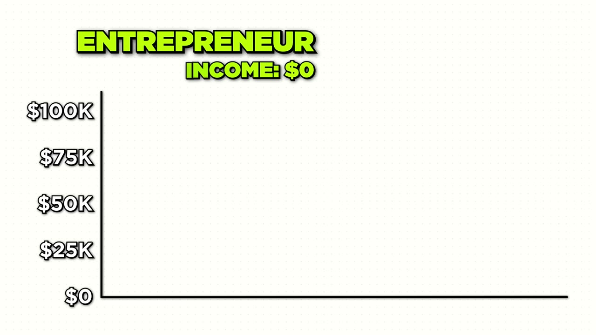
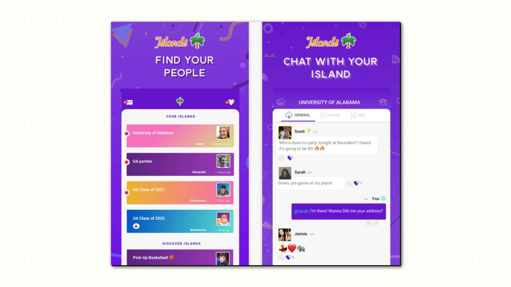
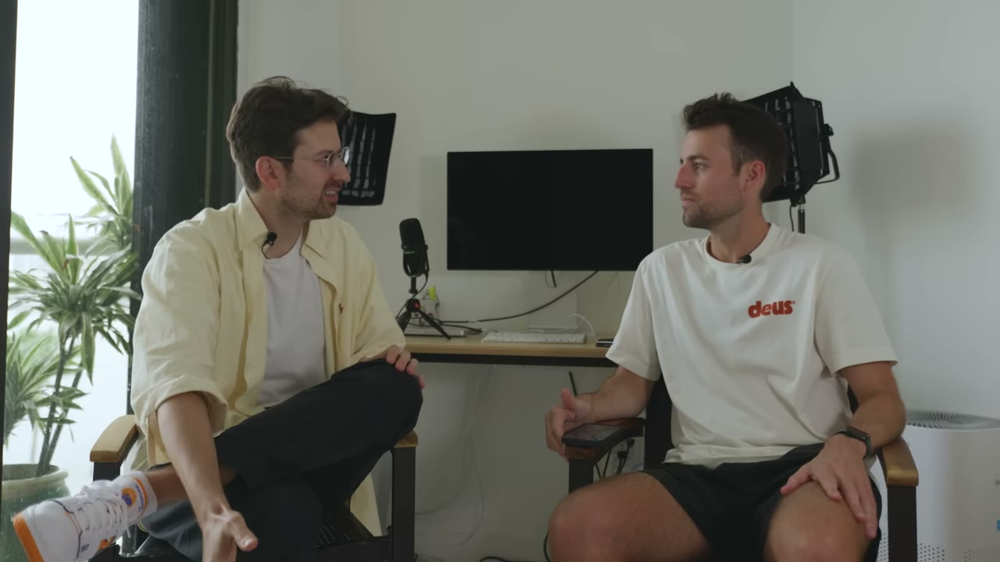
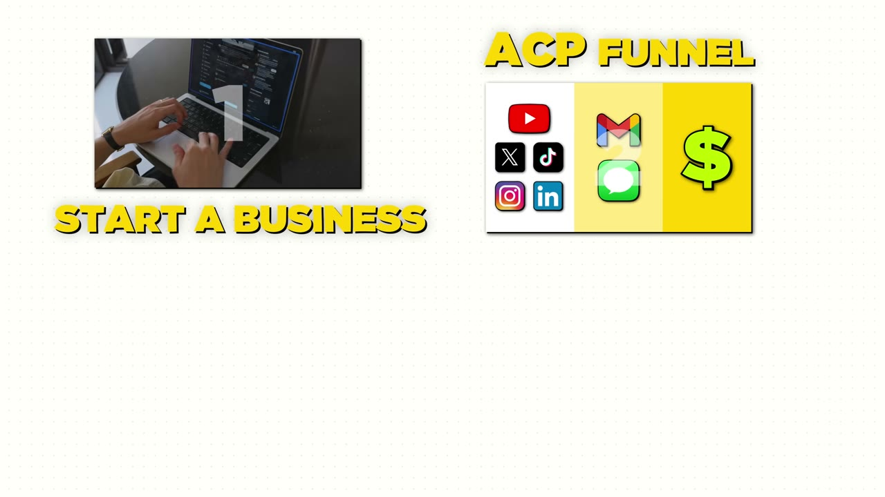

# Late Checkout — 6 doanh nghiệp, 8 chữ số doanh thu, và một cái phễu tên ACP

> **Tóm tắt 30 giây:** Greg Isenberg từng là head of product của WeWork lúc công ty được định giá **47 tỉ USD** — rồi chứng kiến nó bốc hơi vì không có lợi nhuận. Anh dựng holdco Late Checkout với đúng một nguyên tắc ngược lại: **có lãi từ ngày đầu**. Vũ khí là **ACP funnel — Audience → Community → Product**: xây khán giả trước, biến một phần thành cộng đồng mà anh **sở hữu email và biết chính xác họ đau gì**, rồi mới làm sản phẩm. Agency LCA của anh thu **trung bình 1,5 triệu USD/năm mỗi khách** trong khi agency thường thu 1.500 USD/tháng. Và quy tắc mở rộng cực kỳ cụ thể: **chỉ được mở business thứ hai sau khi business thứ nhất tạo ra ít nhất 100.000 USD lợi nhuận VÀ bạn đã đặt được một operator vào ghế điều hành.**

## ⚠️ Đọc con số ở case này với biên độ nghi ngờ rộng

Đây là case **không có một ảnh chụp dashboard nào**. Mọi con số đều là lời kể của một người mà nghề chính hiện tại là **bán quyền vào cộng đồng dạy làm multipreneur** (Multipreneurship.com). Ba điểm cần đánh dấu:

1. **Số công ty không khớp.** Anh nói *"we've got six companies"* rồi liệt kê 5 pháp nhân cấp một (LCA, You Probably Need A Robot, Design Scientist, Boring Holdings, Multipreneurship) — chỉ thành 6-7 nếu đếm cả hai thương hiệu con Boring Marketing và Boring Ads.
2. **Tên sản phẩm có vẻ đã đổi.** Anh kể dựng *Dispatch* bán design subscription, nhưng agency thiết kế trong danh mục lại tên **Design Scientist**. Nhiều khả năng đây là cùng một business đã đổi tên — video không giải thích.
3. **Lợi nhuận dự phóng bị kể như đã có.** *"In its second year, it'll **do** two to three million in profit"* là **thì tương lai** — nhưng khi lướt nhanh sẽ nghe như thành tích.

Thêm nữa, công cụ anh nêu là *"gummysurge.com"* — gần như chắc chắn là **GummySearch** (công cụ khai thác pain point từ Reddit), lỗi nghe của bản ghi âm.

## 1. Con số

| Chỉ số | Giá trị |
|---|---|
| Doanh thu holdco | 8 chữ số/năm (kênh ghi hơn 10 triệu USD) |
| Lợi nhuận holdco | mid 7 chữ số (kênh ghi hơn 5 triệu USD) |
| Giá mỗi khách của LCA | trung bình **1,5 triệu USD/năm** |
| LCA năm 1 | 1,5 triệu USD doanh thu — **1 khách lớn + 1 khách nhỏ** |
| LCA năm 2 | hơn 5 triệu USD |
| Dispatch năm 1 | 7 chữ số doanh thu, **450.000 USD lợi nhuận** |
| Boring Marketing năm 1 | 350.000 USD lợi nhuận |
| Boring Marketing năm 2 | dự kiến 2-3 triệu USD lợi nhuận (chưa xảy ra lúc quay) |
| Follower khi khởi động ACP | 10.000 trên Twitter |
| Ngưỡng để tách business mới | **100.000 USD lợi nhuận + có operator** |
| Vốn ban đầu | 0 USD |

## 2. ACP funnel — bộ khung trung tâm ⭐⭐⭐

Greg gọi đây là *"the secret sauce that I've used for the last 15 years"*.

**A — Audience.** Một kênh mạng xã hội bất kỳ: Twitter/X, Instagram, TikTok. Anh nhấn mạnh ngưỡng thấp đến bất ngờ:

> *"I had built a Twitter account of over 10,000 people. **That's not a lot, by the way. 10,000 people, anyone can get to 10,000 followers.**"*

**C — Community.** Đây là bước hầu hết mọi người bỏ qua, và là bước tạo ra toàn bộ giá trị:

> *"How do you convert some of those audience members into some place where **you own their emails, you have their SMS**, they have a place to talk, and **you really understand what are their pain points**."*

Cách anh làm cụ thể và hoàn toàn không giống marketing: anh đăng *"hey, come to these orange wine disco parties in these basements in Williamsburg"* — tiệc rượu vang cam trong tầng hầm Brooklyn.

> *"**I actually met some of my first clients at these parties.**"*

**P — Product.** Chỉ tới bước này mới có sản phẩm. Và vì bạn đã ở trong phòng với họ nhiều tháng:

> *"I told them, oh, I'm actually starting this thing called LCA. We sell innovation. And they were like, **come into my office first thing Monday**, because I had already built so much trust with them."*

**Vì sao cơ chế này hiệu quả — và khi nào nó không:**

Cái ACP thật sự làm không phải là "kiếm lead rẻ". Nó **đảo ngược thứ tự rủi ro**. Cách thông thường: bỏ tiền và tháng trời làm sản phẩm → rồi đi tìm xem có ai cần không. ACP: tích luỹ **quan hệ và thông tin** trước, khi ra sản phẩm thì bạn đã biết chính xác họ đau gì và họ đã tin bạn. Chi phí thu hút khách hàng gần như bằng 0 vì bán hàng đã xảy ra từ trước dưới dạng lòng tin.

Nhưng nó **chỉ hiệu quả với sản phẩm giá cao hoặc sản phẩm cần lòng tin**. Với sản phẩm 5 USD/tháng bán cho người lạ tìm qua Google, xây community là lãng phí — trường hợp đó thuộc về [playbook YouTube Search của FollowBuddy](../2026-03-19_i-make-17k-month-with-one-strategy/case.md), nơi founder tuyên bố thẳng *xây audience là lãng phí thời gian*.

**Bằng chứng ngược từ chính Greg:** anh mở business thứ hai tên **Nice Break** bằng cách làm sản phẩm trước.

> *"We started direct with the product. That's no, no, that's not the way to build a business nowadays. (...) **So we actually closed it down.**"*

Sau đó anh quay lại đúng công thức: mở tài khoản Twitter *Dispatch* về design inspiration → vài nghìn follower trong vài tuần → thấy cơ hội → **72 giờ** dựng landing page, thương hiệu và team → bán design subscription → năm đầu 7 chữ số doanh thu, 450.000 USD lợi nhuận. Lặp lại với tài khoản *Boring Marketer* → công cụ SEO có AI → năm đầu 350.000 USD lợi nhuận.

**Đây là điểm mạnh nhất của case: cùng một công thức chạy được 3 lần liên tiếp trong 3 ngành khác nhau, và lần duy nhất anh đi chệch công thức thì phải đóng cửa.**

## 3. Định giá 1,5 triệu USD/năm mỗi khách ⭐⭐⭐

> *"Instead of charging $1,500 a month, which most agency owners do, **we charge on average $1.5 million a year**. Why? Because if we come up with a whole new vision for where to take your company, **oftentimes those products generate nine to 10 figures of revenue**. If you're spending $1.5 million, it sounds like a pretty good trade to me."*

Con số đó gấp **83 lần** mức agency thông thường. Cơ chế:

1. **Định giá theo giá trị tạo ra, không theo giờ công.** Nếu đầu ra là một dòng sản phẩm mang về 100 triệu USD, thì 1,5 triệu là 1,5% — hoàn toàn hợp lý với người mua.
2. **Chọn khách có ngân sách ở tầng đó.** Nike, Dropbox, Shopify, TikTok. Một agency 1.500 USD/tháng không thể tăng giá 83 lần cho khách hiện tại; họ phải **đổi hẳn tệp khách**.
3. **Bán một thứ khách không tự làm được.** Không phải thi công, mà là *"come up with new ideas to future-proof your business"* — thứ vốn không có nhà cung cấp rõ ràng, nên không có mặt bằng giá để so.

Marcos Ruiz ở [case The Birdhouse](../2024-06-15_i-make-1m-year-as-an-introvert/case.md) dùng **đúng cơ chế này ở quy mô nhỏ hơn 500 lần**: anh bỏ lời chào *tăng follower* để chuyển sang *tăng doanh thu*, và lập luận với khách rằng một thread đã mang về cho họ 20-30K USD trong khi họ chỉ trả 3K/tháng. Cùng một logic, hai bậc thang khác nhau.

**Điều cần nói thẳng:** Greg bán được mức giá này **vì anh từng là head of product của WeWork và từng bán một startup**. Đó là tài sản danh tiếng tích luỹ 12-13 năm, không phải kỹ thuật định giá. Phần định giá bạn sao chép được; phần credential thì không.

## 4. Vì sao anh chọn mô hình này — bài học từ WeWork ⭐⭐

Đây là gốc rễ của toàn bộ triết lý:

- Ở tuổi 17, tuần đầu tiên vào trung học, anh có mặt trong **một vụ xả súng ở trường — 19 người trúng đạn**. Anh ngồi trong lớp hoá bị khoá cửa, nghe tiếng đạn. *"I realized as a 17-year-old that life is short and I wanted to do big things."*
- Anh dựng **Islands** (một dạng Discord cho sinh viên) → bán cho WeWork → trở thành head of product strategy rồi head of product.
- Rồi anh xem công ty rơi tự do: **47 tỉ → 25 → 20 → 15 → 10 tỉ**, hết tiền mặt.

> *"I vowed to myself that the next thing I start isn't going to be an unprofitable venture-backed business. **It's going to be a profitable machine.**"*

Và lời khuyên cuối video là hệ quả trực tiếp:

> *"I made the mistake of listening to the top entrepreneurs of my day who said, go build a venture-backed company and go scale it and be Mark Zuckerberg. **I was living someone else's life by doing that.** And I spent 12, 13 years of my life, 7 a.m. to 2 a.m. every single day, working seven days a week."*

**Đọc ngược lại:** chính vì 12-13 năm đó mà anh có mạng lưới, uy tín và khả năng thu 1,5 triệu USD một khách. Anh gọi đó là sai lầm, nhưng nó là **bệ phóng của mọi thứ đến sau**. Đây là kiểu tường thuật hồi cố rất hay gặp — hãy tách phần bài học tinh thần khỏi phần cơ chế kinh doanh.

## 5. Quy tắc đa dạng hoá — con số cụ thể nhất trong video ⭐⭐⭐

> *"**I'm not advocating for launch five products on day one.** Become a solopreneur, find a niche, build an audience, build a community, build a product for them. All I'm saying is at the end of that, **once that business is generating at least $100,000 of profit, find an operator.** Then that frees you up to find the next thing. Either buy another business using some of that cash flow or incubate something new."*

Ba điều kiện, theo đúng thứ tự:
1. Một business đã chạy được.
2. Nó tạo ra **ít nhất 100.000 USD lợi nhuận**.
3. **Đã có operator ngồi vào ghế** — không phải bạn.

Chỉ khi đủ cả ba mới sang việc tiếp theo.

Lập luận về vì sao đa dạng hoá đáng giá:

> *"Instead of having one company do $100,000 a month in revenue, you now have eight companies. Maybe they're only doing $25,000 a month. But if one struggles a little bit or **Google makes a change** that affects this business or **Instagram does this**, you now have that **built-in insurance**."*

**Đây chính xác là bài học mà [Jacky Chow đã trả giá để học](../2026-03-22_i-make-250k-month-from-13-businesses-after-losing-ev/case.md)** — anh mất gần hết doanh thu khi thuật toán Google và AI đổi luật chơi, rồi xây lại thành danh mục 13 business nhỏ. Greg nói lý thuyết; Jacky là bằng chứng thực nghiệm.

**Mâu thuẫn với case tuần kế tiếp:** đúng một tuần sau, cùng kênh, cùng thành phố Miami, [Marcos Ruiz nói ngược lại](../2024-06-15_i-make-1m-year-as-an-introvert/case.md) — rằng kẻ thù lớn nhất của anh là *shiny object syndrome* và bí quyết là **bám đúng một thứ**. Hai lời khuyên không thật sự đối nghịch, chúng chỉ **ở hai giai đoạn khác nhau của cùng một đường**: Marcos ở mức 70K/tháng và vẫn tự làm chief editor — theo tiêu chí của Greg, anh chưa có operator nên chưa đủ điều kiện tách. Ranh giới giữa *multipreneurship* và *shiny object syndrome* không nằm ở thái độ, nó nằm ở câu hỏi: **việc cũ có tự chạy khi bạn biến mất 30 ngày không?**

## 6. Cách tìm ý tưởng — hai công cụ, một câu ⭐⭐⭐

> *"I use two tools. One is called **redditlist.com**, which tells me **how fast a particular subreddit is growing**. (...) And I use a tool called **GummySearch**, which basically takes the subreddit and tells me **what are the biggest problems** that this subreddit is having. And it's your job as the entrepreneur to solve them."*

(Trong bản ghi âm tên công cụ thứ hai bị nghe thành *gummysurge.com*; công cụ có thật là **GummySearch**.)

**Cơ chế đằng sau, và đây là phần đắt nhất:** RedditList không cho bạn ý tưởng — nó cho bạn **tốc độ tăng trưởng của một cộng đồng**. Một subreddit đang phình nhanh nghĩa là **một nhóm người mới đang hình thành xung quanh một vấn đề mới**, và nhóm đó thường chưa có nhà cung cấp phần mềm nào phục vụ. Bạn đang săn **thị trường mới nổi**, không phải săn ý tưởng hay.

Đây là cùng một mỏ mà [Gold Mining Framework](../2025-06-04_how-to-use-ai-to-find-a-1m-idea-reddit-claude/case.md) khai thác bằng Claude, và cũng là nơi [Gojiberry AI](../2026-01-25_how-i-used-reddit-to-build-a-34k-month-saas/case.md) và [AppAlchemy](../2025-07-09_how-i-used-reddit-to-hit-17k-mrr-with-zero-audience/case.md) lấy khách đầu tiên. Reddit xuất hiện lặp đi lặp lại trong kho này tới mức nó gần như là **hạ tầng mặc định của indie hacker phương Tây** — và đó cũng chính là điểm yếu khi áp vào VN (xem mục 9).

## 7. Cách tuyển người ⭐⭐

Hai kênh, cả hai đều không phải đăng tin tuyển dụng:

1. **Nerds in residence.** Anh xây community trước, rồi **chủ động nhắn cho những người hoạt động tích cực nhất trong đó**. *"If it's the AI example, you need an AI nerd who's thinking about this all the time."* Community vừa là kênh bán hàng vừa là kênh tuyển dụng — đây là lợi ích kép ít người tính tới khi đánh giá chi phí xây community.
2. **Cold DM không ngại.** *"If I find someone interesting online, I won't be shy and I'll try to find their email address, I'll DM. And even if they have a job, I'll say, hey, let's hop on a quick call. **The best people to hire actually work a job.**"*

Câu cuối là một heuristic thật sự hữu ích: người giỏi nhất hiếm khi đang rải CV. Nếu bạn chỉ tuyển từ nhóm ứng viên chủ động nộp đơn, bạn đang lọc bỏ phần trên của thị trường lao động ngay từ đầu.

## 8. Tech stack cho một holdco 8 chữ số

| Hạng mục | Công cụ |
|---|---|
| Landing page và website | **Framer** — dựng nhanh, phù hợp nhịp 72 giờ |
| Email | ConvertKit (anh thích phần automation) |
| Nghiên cứu YouTube | **VidIQ** — anh dùng một tính năng ít người biết: **lọc ra các câu hỏi hàng đầu trong phần bình luận** của một kênh, để lấy ý tưởng sản phẩm |
| Tìm ý tưởng | RedditList + GummySearch |
| Giao tiếp team | Slack |
| Vận hành | Notion (toàn bộ công ty) |
| Thiết kế | Figma |
| Truyền đạt bất đồng bộ | **Loom** — anh dùng cực nhiều |

> *"That runs our eight figure business."*

**Đáng chú ý:** không có ERP, không có CRM đắt tiền, không có công cụ nội bộ tự viết. Toàn bộ là phần mềm SaaS phổ thông giá vài chục USD/tháng. Điều này lặp lại ở gần như mọi case trong kho — **độ phức tạp của công cụ không tương quan với quy mô doanh thu**.

Mẹo VidIQ ở trên đáng thử riêng: mở kênh YouTube của đối thủ hoặc của một kênh trong ngách bạn nhắm, lọc câu hỏi trong bình luận — đó là danh sách pain point đã được viết sẵn bằng chính ngôn ngữ khách hàng.

## 9. Áp dụng cho tôi (indie hacker VN)

**Sao chép được ngay — và đây là phần dùng được nhất:**

- **ACP theo đúng thứ tự, ở quy mô của bạn.** Không cần 10.000 follower. Một nhóm Facebook 300 người, một Discord 150 người, một newsletter 200 địa chỉ trong đúng ngách — đã đủ để chạy vòng C và P. Điều bắt buộc là **bạn phải sở hữu danh sách liên lạc**, không chỉ có follower trên nền tảng của người khác.
- **Quy tắc 100.000 USD lợi nhuận + operator.** Dùng nó làm bộ lọc chống phân tâm. Mỗi lần bạn muốn mở dự án mới, hỏi hai câu: việc cũ có lãi thật không, và nó có chạy khi tôi biến mất 30 ngày không. Nếu không, dự án mới là trốn tránh. (Có thể hạ ngưỡng theo VN, ví dụ 300-500 triệu VNĐ lợi nhuận/năm — nhưng **giữ nguyên điều kiện operator**, đó mới là phần quan trọng.)
- **Nhịp 72 giờ.** Từ khi thấy tín hiệu cộng đồng tới khi có landing page và có thứ để bán: ba ngày. Nếu bạn cần ba tháng, tín hiệu đã nguội.
- **RedditList + GummySearch để săn cộng đồng đang phình nhanh.** Miễn phí hoặc rẻ, làm được ngay tối nay.
- **Mẹo VidIQ lọc câu hỏi trong bình luận YouTube** — có thể áp thẳng cho YouTube tiếng Việt, nơi gần như không ai khai thác.
- **Cold DM người đang có việc làm ổn định** khi cần cộng sự, thay vì đợi ứng viên nộp đơn.

**Rào cản thật, không tô hồng:**

- **Phần kiếm ra 8 chữ số của case này KHÔNG sao chép được, và cần nói thẳng.** Mức 1,5 triệu USD/khách đến từ việc anh là cựu head of product của WeWork, đã bán một startup, và có mạng lưới ở New York. Một founder VN không có credential đó **không thể** vào phòng họp của Nike. Cái bạn lấy được từ case này là **bộ khung**, không phải kết quả.
- **Không có một con số nào được xác minh.** Không dashboard, không hợp đồng, không sao kê. Và người kể đang bán một cộng đồng dạy chính mô hình đó. Hãy đối xử với case này như **một khung tư duy**, không phải một bằng chứng.
- **Community là công việc toàn thời gian, không phải kênh marketing rẻ.** Greg tổ chức tiệc offline hàng tháng ở Brooklyn để nuôi lòng tin. Chi phí thật của C trong ACP là **thời gian con người**, và nó không tự động hoá được — đây là lý do đa số người bỏ ngang giữa A và C.
- **Rào cản văn hoá và tiếng Anh ở tầng community cao hơn tầng sản phẩm.** Bán phần mềm cho người Mỹ chỉ cần landing page tiếng Anh sạch. Dẫn dắt một cộng đồng người Mỹ đòi hỏi bạn hiểu cách họ đùa, họ tranh luận, họ tin nhau. Nếu chưa vững, hãy chạy ACP trên **cộng đồng người Việt** trước — thị trường nhỏ hơn nhưng bạn là người trong nhà.
- **Dòng tiền của mô hình agency rất gồ ghề.** LCA năm đầu làm 1,5 triệu USD với **một khách lớn rưỡi**. Nghĩa là mất một khách là mất phần lớn doanh thu. Đây không phải mô hình ổn định như MRR — nó là mô hình rủi ro tập trung cực cao được kể lại như một thành công.
- **Cần vốn thời gian, không cần vốn tiền.** Anh nói bắt đầu với 0 USD, đúng. Nhưng ACP tiêu **6-18 tháng** trước khi có đồng doanh thu đầu tiên. Nếu bạn cần tiền trong 90 ngày, đây không phải con đường — hãy xem [YouTube Search của FollowBuddy](../2026-03-19_i-make-17k-month-with-one-strategy/case.md) hoặc [Google Ads của Late](../2026-03-04_zero-to-40k-month-with-one-marketing-channel-no-soci/case.md).

**Khi nào KHÔNG dùng mô hình này:**

- **Khi sản phẩm của bạn giá thấp và bán cho người lạ có ý định tìm kiếm rõ ràng.** Ai đó gõ tìm *công cụ chuyển PDF sang Excel* không cần vào cộng đồng của bạn — họ cần trang đích và nút mua. Xây community trong trường hợp đó là đốt 12 tháng vô ích.
- **Khi bạn chưa có một business nào có lãi.** Đây là sai lầm phổ biến nhất khi xem video kiểu này: người mới nghe từ *multipreneur* rồi mở 4 dự án cùng lúc và chết đói ở cả 4. Chính Greg nói *"I'm not advocating for launch five products on day one."* Câu đó nằm ở phút 10:39 — sau khi 90% người xem đã bỏ đi với ấn tượng ngược lại.
- **Khi bạn không chịu được việc làm một người của công chúng.** Toàn bộ chữ A trong ACP đòi hỏi bạn đăng bài công khai, có quan điểm, và bị phản đối. Nếu bạn là kiểu người hướng nội thuần, [mô hình của Marcos Ruiz](../2024-06-15_i-make-1m-year-as-an-introvert/case.md) — cold DM riêng tư thay vì phát sóng công khai — phù hợp hơn nhiều.

## Nguồn

- Video: <https://www.youtube.com/watch?v=akM6P97_0B8> (14:08, đăng 08/06/2024, 247.357 view)
- [Transcript đầy đủ](transcript.md) · [Ảnh chụp](screenshots/)
- **Thiên kiến nguồn:** video chèn **hai lần quảng cáo** cho sản phẩm Starter Story (bộ *160+ solopreneur business ideas* ở phút 4:13 và lời mời vào cộng đồng trả phí ở phút 13:23), trong đó có câu bán hàng khá mạnh về thư viện *hơn 4.000 case study*. Bản thân người được phỏng vấn cũng đang bán một cộng đồng dạy mô hình mà anh trình bày. Kênh chỉ phỏng vấn người thành công và đã được HubSpot mua lại — xem [case về chính Starter Story](../2026-02-23_i-sold-my-company/case.md).
