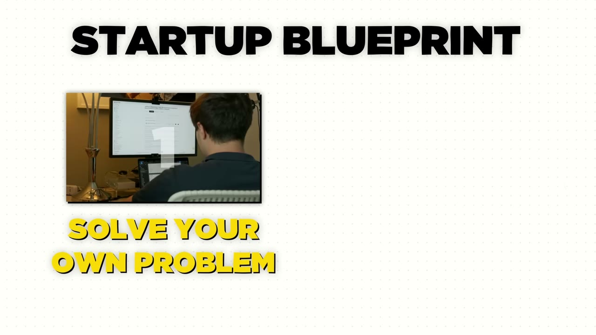
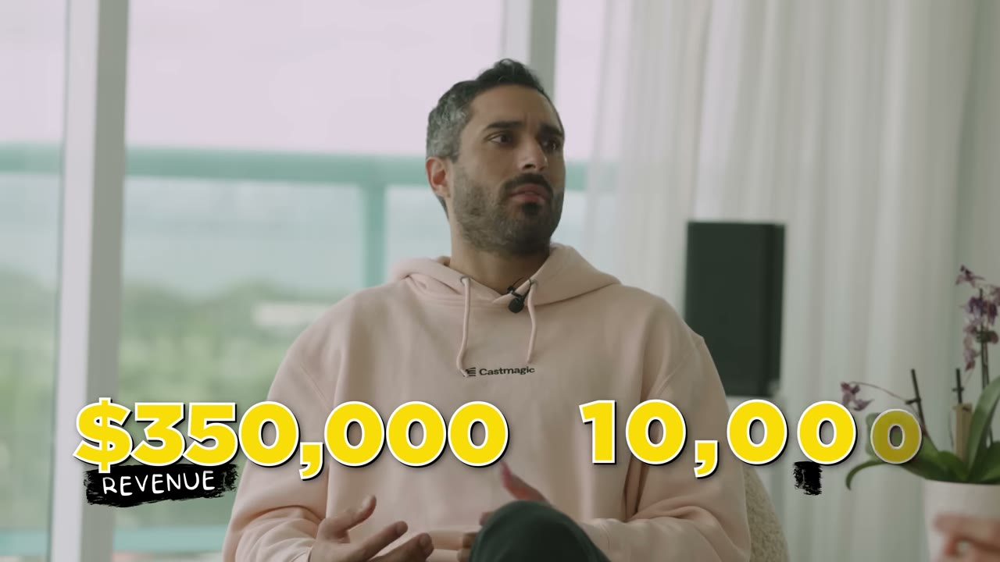
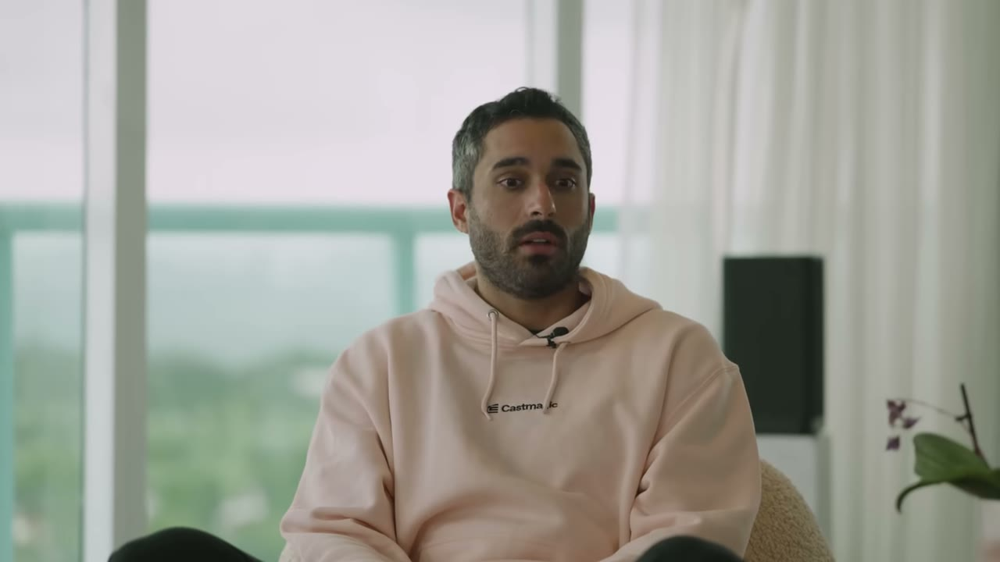
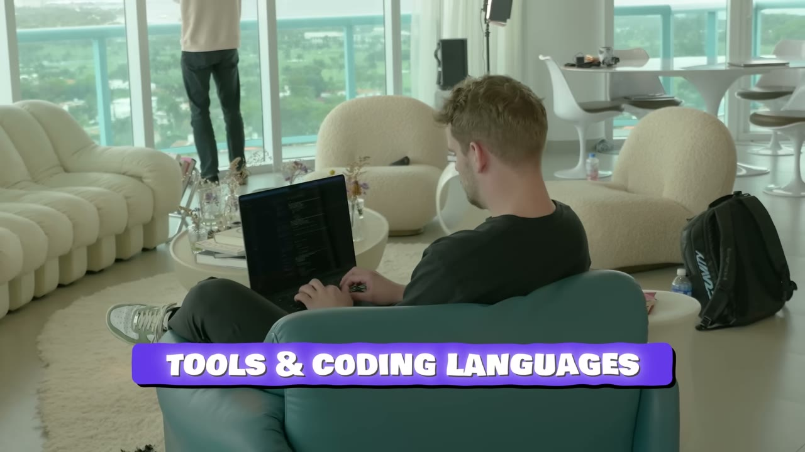
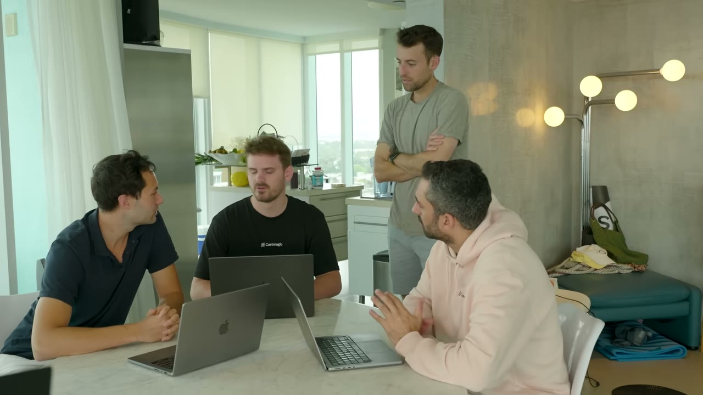
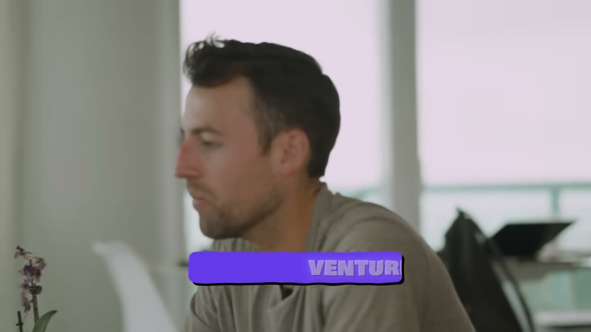

# They Make $1.4M/Year With AI

✅ **Đã phân tích sâu** → [`case.md`](case.md)

| | |
|---|---|
| **Video** | <https://www.youtube.com/watch?v=b5JhfGHafZA> |
| **Đăng** | 22/06/2024 |
| **Thời lượng** | 13:40 |
| **Lượt xem** | 134,078 |
| **Lượt thích** | 3,049 |
| **Video ID** | `b5JhfGHafZA` |

## Trong thư mục này

| File | Nội dung |
|---|---|
| [`case.md`](case.md) | **Phân tích đầy đủ** — ý tưởng, validate, GTM, áp dụng ở VN |
| [`meta.json`](meta.json) | Metadata gốc (chapters, heatmap, mô tả) |
| [`screenshots/`](screenshots/) | 10 ảnh 720p |

## Mô tả gốc

This is the breakdown of how the boys at Castmagic built an AI app from $0 to $120,000 a month in just 9 months.
0:00 - Intro
1:04 - The AI app
1:36 - Building with AI
1:59 - Finding the idea
2:42 - Launching an AI app
3:23 - Marketing & growth strategies
4:43 - Solo marketing hacks
6:10 - Tools for building 
6:48 - Pricing strategy
7:19 - Competition with AI apps
8:08 - Will you get replaced by ChatGPT?
8:40 - Financials & Numbers
9:42 -  Marketing Strategy
9:13 - Building with 3 founders
10:29 - VC Funding vs Bootstrapping
12:26 - Staying consistent
11:44 - Schedule & Day in the life buildin

## Số liệu bắt được từ transcript

> Các đoạn founder nhắc tới con số, kèm timestamp để tua thẳng tới đó trong video.

_(không bắt được con số nào)_

## Chương

- `00:00` Intro
- `01:04` The AI app
- `01:36` Building with AI
- `01:59` Finding the idea
- `02:42` Launching an AI app
- `03:23` Marketing & growth strategies
- `04:43` Solo marketing hacks
- `06:10` Tools for building
- `06:48` Pricing strategy
- `07:19` Competition with AI apps
- `08:08` Will you get replaced by ChatGPT?
- `08:40` Financials & Numbers
- `09:42` Marketing Strategy
- `10:29` VC Funding vs Bootstrapping
- `12:26` Staying consistent

## Ảnh

1. `01_01m16s_ch-the-ai-app.jpg` — 
2. `02_02m11s_ch-finding-the-idea.jpg` — 
3. `03_02m54s_ch-launching-an-ai-app.jpg` — 
4. `04_03m49s_metric.jpg` — 
5. `05_04m55s_ch-solo-marketing-hacks.jpg` — 
6. `06_06m13s_replay.jpg` — 
7. `07_07m00s_ch-pricing-strategy.jpg` — 
8. `08_08m20s_ch-will-you-get-replaced-by-chatgpt.jpg` — 
9. `09_10m37s_usd-80-m.jpg` — 
10. `10_12m44s_usd-120-000-m.jpg` — 

---

← [Quay lại index](../../index.md) · [Toàn bộ video](../README.md)
