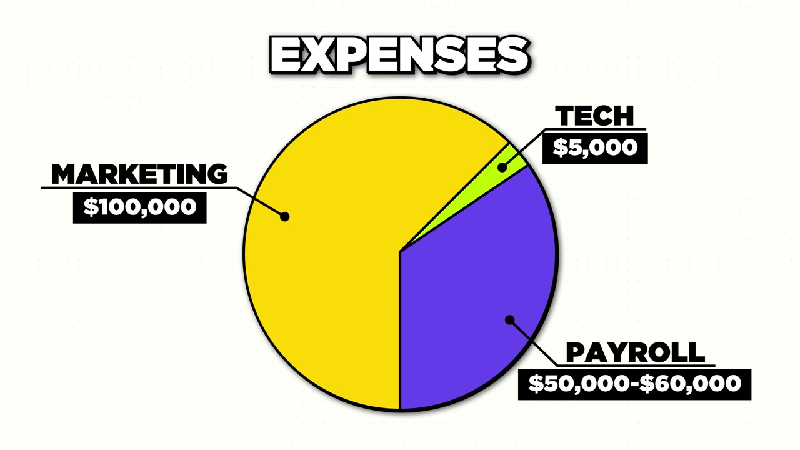
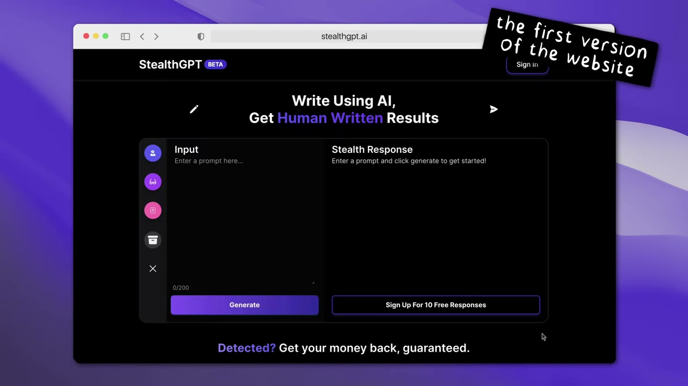
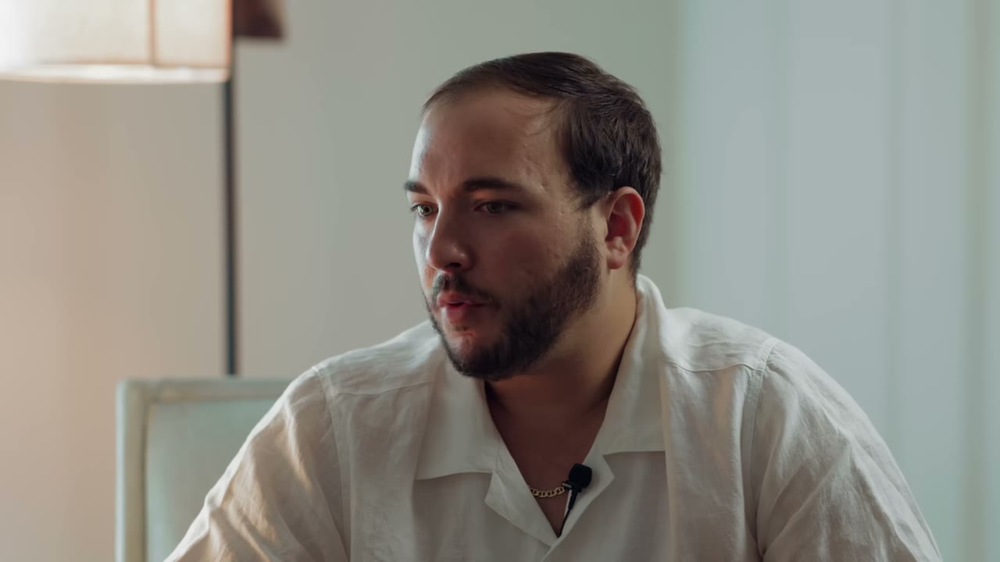

# I Turned $150 into $2M/Year

✅ **Đã phân tích sâu** → [`case.md`](case.md)

| | |
|---|---|
| **Video** | <https://www.youtube.com/watch?v=8yCXyCN_NR0> |
| **Đăng** | 28/07/2024 |
| **Thời lượng** | 16:13 |
| **Lượt xem** | 220,014 |
| **Lượt thích** | 4,723 |
| **Video ID** | `8yCXyCN_NR0` |

## Trong thư mục này

| File | Nội dung |
|---|---|
| [`case.md`](case.md) | **Phân tích đầy đủ** — ý tưởng, validate, GTM, áp dụng ở VN |
| [`meta.json`](meta.json) | Metadata gốc (chapters, heatmap, mô tả) |
| [`screenshots/`](screenshots/) | 10 ảnh 720p |

## Mô tả gốc

This is the breakdown of how Jozef Gherman went from an inexperienced coder, to turning $150 into $2M/year with ONE app.

## Số liệu bắt được từ transcript

> Các đoạn founder nhắc tới con số, kèm timestamp để tua thẳng tới đó trong video.

_(không bắt được con số nào)_

## Chương

- `00:00` Intro
- `01:13` What is Stealth
- `02:48` How I got into coding
- `03:37` Failure
- `05:44` Finding the Idea
- `07:44` First Customer
- `08:40` Scaling
- `09:38` Customer Feedback
- `10:52` Tools Languages
- `11:41` Solopreneur
- `12:25` Ideas
- `13:15` Day in the Life

## Ảnh

1. `01_00m37s_usd-150-000.jpg` — 
2. `02_01m41s_usd-190-000-m.jpg` — 
3. `03_02m30s_usd-5-000.jpg` — 
4. `04_03m49s_ch-failure.jpg` — 
5. `05_05m56s_ch-finding-the-idea.jpg` — 
6. `06_07m56s_ch-first-customer.jpg` — 
7. `07_09m22s_usd-10.jpg` — 
8. `08_11m25s_replay.jpg` — 
9. `09_12m37s_ch-ideas.jpg` — 
10. `10_13m27s_ch-day-in-the-life.jpg` — 

---

← [Quay lại index](../../index.md) · [Toàn bộ video](../README.md)
