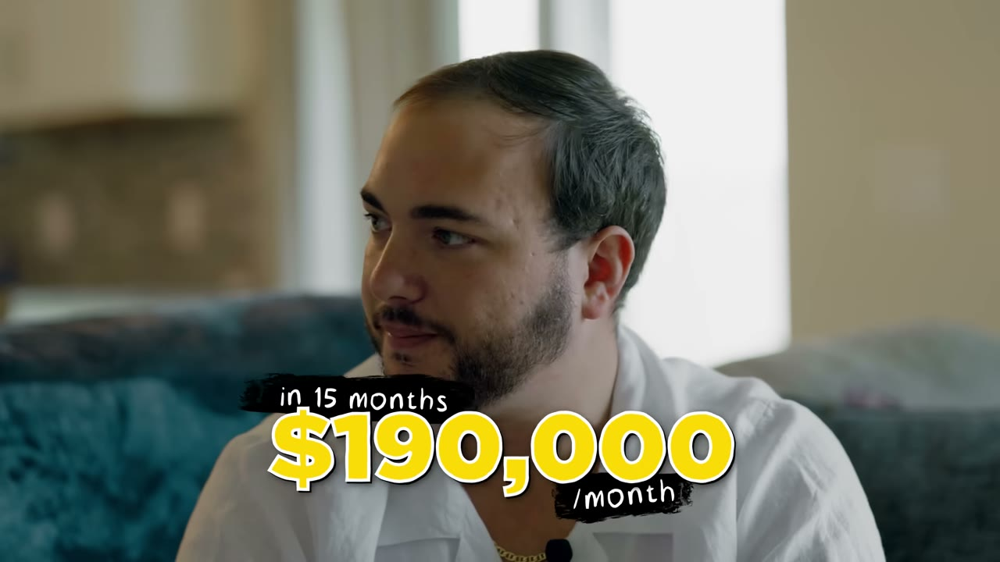
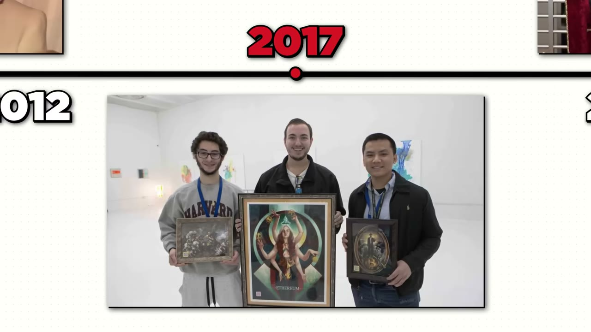
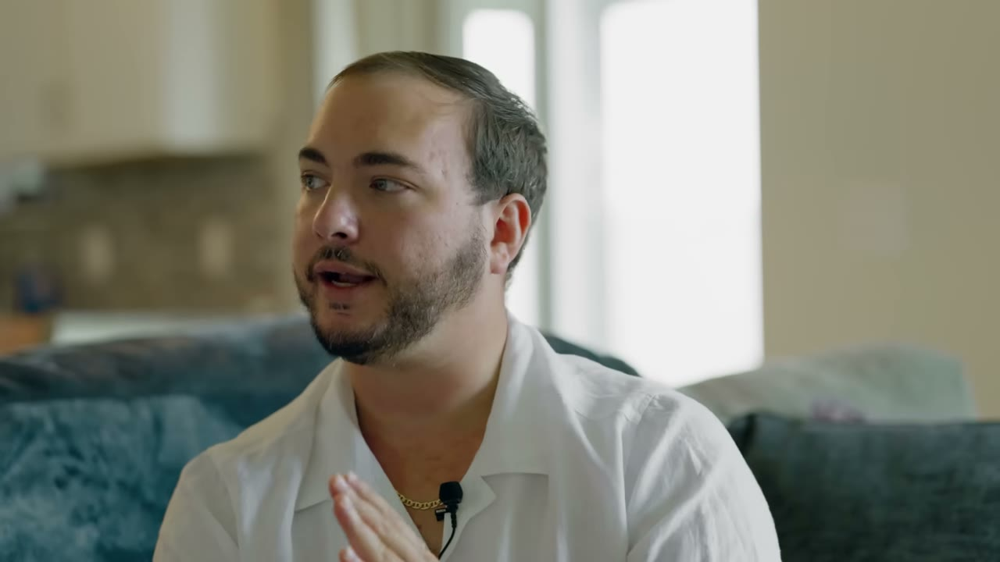
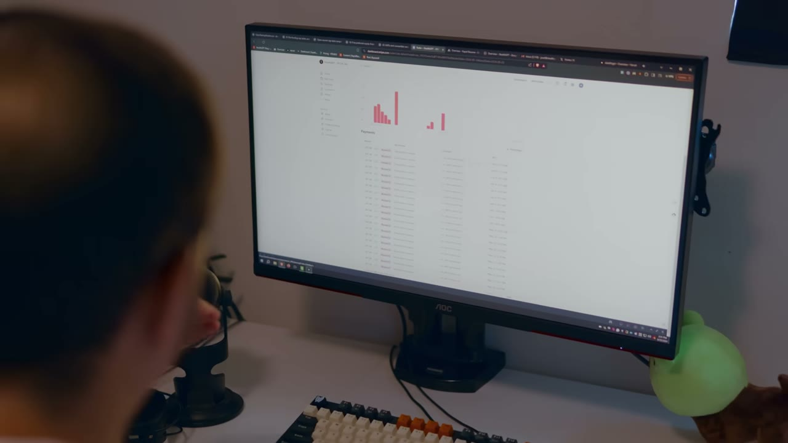
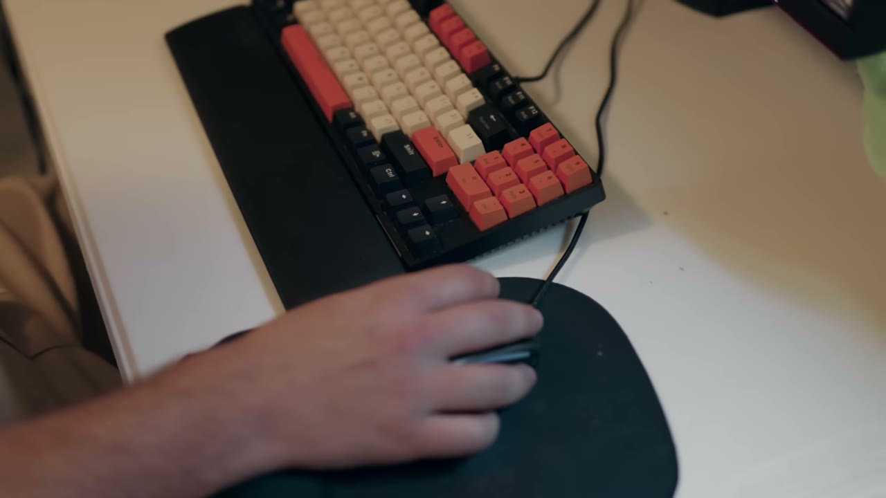

# StealthGPT — $190K MRR trong 15 tháng, nhưng chỉ giữ lại $10-30K

> **Tóm tắt 30 giây:** Jozef Gherman từng mất sạch tiền trong crypto và bị chính phủ Mỹ (CFTC) truy đến mức phải dàn xếp **$400.000** — vẫn đang trả nợ tới ngày quay video. Anh mua domain `.ai` giá **$150**, xem YouTube tutorial để tự code, và sau **15 tháng** đạt **$190.000 MRR** với StealthGPT, công cụ làm cho văn bản AI qua mặt được máy dò AI. Nhưng đây là con số đắt nhất của case: doanh thu $190K/tháng mà **lợi nhuận chỉ $10-30K/tháng** — vì anh đốt **~$100.000/tháng cho Google Ads**. Đây không phải micro-SaaS biên lợi nhuận cao; đây là một cỗ máy mua quảng cáo.

## 1. Con số

| Chỉ số | Giá trị |
|---|---|
| MRR | ~$190.000 (đạt trong 15 tháng) |
| **Lợi nhuận ròng** | **$10.000-30.000/tháng** |
| Chi Google Ads + acquisition | ~$100.000/tháng |
| Lương nhân sự | $50.000-60.000/tháng (6-7 người) |
| Hạ tầng (database, hosting, AI stack) | ~$5.000/tháng |
| Tổng chi phí | ~$160.000/tháng |
| Signup trọn đời | 400.000 |
| Đã từng trả tiền | 15.000-20.000 |
| **Subscriber đang hoạt động** | **8.500** |
| ARPU suy ra | ~$22/tháng (tôi tự tính, video không nêu) |
| Giá lúc ra mắt | 3 gói, $4,99 đến $15/tháng |
| CPA giai đoạn đầu | $10-20/chuyển đổi |
| Vốn khởi điểm | $150 (domain `.ai`, 2 năm) |

### Vài con số cần đọc kỹ

- **Tỉ lệ chuyển đổi phễu:** 400.000 signup → 15-20K từng trả tiền = **3,75-5%**. Còn 8.500 active / 400.000 signup = **2,1%**. Đây là mô hình freemium rất loãng, chỉ chạy được vì đầu phễu được bơm bằng tiền quảng cáo.
- **Biên lợi nhuận thực chỉ 5-16%.** Với $190K doanh thu mà giữ lại $10-30K, đây gần với biên của một agency hoặc một cửa hàng dropship hơn là của SaaS. So sánh: [Charlie Chang](../2024-02-18_i-make-2-4m-year-with-6-youtube-channels/case.md) làm $200-250K/tháng với chi phí đội ngũ chỉ $20-25K/tháng — biên trên 85%.

> **⚠️ Mâu thuẫn trong chính video.** Phần intro do Starter Story dựng nói anh bị *"$150,000 penalty from the federal government"* (có đồ hoạ $150.000 ở phút 00:37). Nhưng chính Jozef nói: *"it was like a $400,000 total settlement"* và *"the whole process cost us $50,000 before we even got to a trial"*. **Tôi lấy $400.000** vì đó là lời founder nói trực tiếp, chi tiết hơn, và có bối cảnh (dàn xếp sau 2-3 năm). Con số $150.000 trong intro nhiều khả năng là lỗi dựng hoặc chỉ là một phần khoản phạt. Đây là ví dụ điển hình cho việc **đồ hoạ trên màn hình của kênh này không phải lúc nào cũng khớp với lời founder**.

## 2. Câu chuyện thất bại — và vì sao nó đáng đọc ⭐⭐

Năm 23 tuổi Jozef lập công ty đầu tiên, J Squared Invest, môi giới giúp người thường mua Bitcoin/Ethereum khi chưa ai biết Coinbase là gì. Vay tiền bố để thuê luật sư và lập công ty. 2017 thị trường bull, mọi thứ lên mặt trăng. 2018 sập:

> *"I lost all my money... the company got rinsed and then a few months later I get hit with this email out of nowhere from the CFTC."*

Rồi 2-3 năm sống trong sợ hãi:

> *"Every time I got an email from these people it was devastating. But it was also devastating every day thinking: are they going to do something today? Are they going to email me today? **You're at the full mercy of the government** and you got really nothing."*

Kết cục: dàn xếp ~**$400.000**, riêng chi phí pháp lý trước khi ra toà đã **$50.000**, và anh **phải vay bố mẹ toàn bộ** vì đã trắng tay.

> *"As a child you want to make your parents proud... and then here I am having to beg for their help or else I'm going to **get crushed like a bug** by the government."*

**Cơ chế đáng học ở đây, không phải cảm xúc:** Jozef thất bại vì làm một business **có quy định pháp lý** (nhận tiền khách để đầu tư = hoạt động môi giới/tư vấn tài chính) mà không có giấy phép. Anh thắng ở lần sau vì chuyển sang một sản phẩm **không cầm tiền của ai, không giữ tài sản của ai** — chỉ bán subscription phần mềm. Bài học không phải "hãy kiên trì", mà là **hãy chọn mô hình kinh doanh không đặt bạn dưới quyền sinh sát của cơ quan quản lý**.

## 3. Nguồn gốc ý tưởng — bắt sóng bằng cách suy ra hệ quả bậc hai ⭐⭐⭐

Đây là phần giá trị nhất của video, và cách suy nghĩ này lặp lại được:

1. **Quan sát làn sóng chính (2022):** ChatGPT xuất hiện. Ai cũng thấy.
2. **Suy ra hệ quả bậc một:** *"This is going to dominate online content. People are going to produce all this content with AI and put it online."* Ai cũng thấy.
3. **Suy ra hệ quả bậc hai — chỗ ít người đi:** *"Naturally there's going to be some kind of pushback. There's going to be people who care: is the content that I'm reading right now human or is it AI?"*
4. **Bán cuốc xẻng cho phe bị hệ quả bậc hai đánh trúng.** Người tạo nội dung AI sẽ bị máy dò AI chặn → họ cần công cụ vượt máy dò.
5. **Xác thực bằng tay trong vài ngày.** TikTok đẩy cho anh video về máy dò GPTZero *"scan with like a 99% accuracy"*. Anh reverse engineer nó: *"After a few days of like trialing it, **I cracked it** — every single response I was throwing through the AI detector was coming up human. And I was like, okay, we got something here."*

> **Đây là mẫu tư duy có thể sao chép:** với mỗi làn sóng công nghệ, đừng bán chính làn sóng đó (quá đông). Hỏi **"làn sóng này tạo ra vấn đề mới cho ai?"** rồi bán thuốc giải cho nhóm đó. AI sinh nội dung → sinh ra máy dò AI → sinh ra nhu cầu vượt máy dò. Ba tầng, và tầng ba là chỗ trống.

**Điểm then chốt về validation:** anh **không xây sản phẩm trước**. Anh dành vài ngày thử tay bằng prompt cho tới khi qua được máy dò. Đến khi biết chắc kỹ thuật khả thi mới mua domain. Đây là cách validate của những case như [Once](../2026-05-10_i-built-a-20k-month-app-in-83-days/case.md) — validate trước khi viết code — chứ không phải kiểu ship-trước-rồi-tính.

**Timeline thật:**

| Mốc | Việc |
|---|---|
| ~1/2023 | Thấy video TikTok về GPTZero, bắt tay reverse engineer |
| 2/2023 | Mua domain `.ai` giá $75/năm, bắt buộc 2 năm → **$150** |
| 3/2023 | Website Next.js + React lên sóng, **có khách đầu tiên** |
| ~6/2024 | $190.000 MRR (15 tháng) |

## 4. Khách hàng đầu tiên — từ một directory và một người lạ trên TikTok ⭐⭐

Cách anh có 2 khách đầu tiên đơn giản đến mức khó tin:

1. Đăng sản phẩm lên **Futurepedia** (directory công cụ AI) *"which I saw some people talking about"*.
2. Cho **10 lượt dùng miễn phí** rồi mới bắt trả tiền.
3. 3 gói giá từ **$4,99 đến $15**.

Rồi:

> *"We got these two customers and I remember thinking: **how the heck did these guys find us** in the wide ocean of the internet? And they're like: oh, we actually heard about you mentioned on the show from this TikTok guy."*

Một creator (transcript ASR đọc lúc là *Phil* lúc là *Bill* — **tên không chắc chắn**) theo dõi Futurepedia và làm video mỗi ngày về sản phẩm mới. Anh ta lướt qua StealthGPT và làm một video ngắn.

> **Bài học của Jozef:** *"That's the power of just posting your stuff. You never know what's going to happen."*

**Cơ chế thật sự phía sau, quan trọng hơn câu quote:** các directory (Futurepedia, Product Hunt, Uneed, There's An AI For That...) không tự chúng tạo ra khách hàng. Chúng là **nguồn thức ăn cho các creator chuyên săn công cụ mới**. Đăng directory = đặt sản phẩm vào tầm ngắm của những người **có sẵn khán giả và có nhu cầu ra nội dung mỗi ngày**. Chi phí bằng 0, kỳ vọng nên bằng 0, nhưng đuôi phân phối rất dài. Đây cùng cơ chế với [Uneed](../2025-08-23_how-i-finally-built-a-10k-month-saas-30-failures/case.md).

## 5. Cách scale — hai giai đoạn rất khác nhau ⭐⭐⭐

### Giai đoạn 1 — UGC để **giáo dục thị trường** (không phải để bán)

> *"We kind of went at it with like a UGC type strategy on TikTok and Instagram... at that point it was like **market education** because something like this has never existed before. We need to tell people: hey, what is StealthGPT, what does it do? Just kind of intrigue them into it."*

**Vì sao phải làm bước này trước:** không ai gõ Google tìm thứ họ chưa biết là tồn tại. Với sản phẩm hạng mục mới, quảng cáo search **không có gì để bắt** vì chưa có truy vấn. Phải tạo nhận thức trước, rồi mới có người đi tìm.

### Giai đoạn 2 — Google Ads, khi đã có người đi tìm

> *"When we got past the summer we started leaning a lot into Google Ads... they were converting like **insanely low cost per conversion — $10, $15, $20** in the early days and that allowed us to scale a ton. We would get a lot of money in and then we just pour more into Google Ads and it was just like **putting gasoline on a fire**."*

**Cơ chế:** với ARPU ~$22/tháng và CPA $10-20, payback period gần bằng **1 tháng**. Đó là lý do duy nhất mô hình này chạy được — tiền quay vòng nhanh đến mức có thể tái đầu tư liên tục mà không cần vốn ngoài.

**Nhưng đây cũng là cái bẫy, và video không nói thẳng:** CPA $10-20 là *"in the early days"*. Tới lúc quay video, anh đang chi ~$100K/tháng để giữ $190K doanh thu. Nếu CPA đã tăng gấp 3-5 lần (điều luôn xảy ra khi bạn mở rộng khỏi tệp dễ nhất), thì phần lớn $190K MRR đang **đi thẳng ra ngoài để mua khách mới thay cho khách đã churn**. Con số lợi nhuận $10-30K chính là bằng chứng.

> **Cách đọc case này cho đúng:** đây không phải câu chuyện "$150 thành $2M". Đây là câu chuyện **một cỗ máy mua media có biên 5-16%**, cần 6-7 người vận hành và không thể dừng chi quảng cáo dù chỉ một tháng. Ngược hoàn toàn với [FollowBuddy](../2026-03-19_i-make-17k-month-with-one-strategy/case.md) — $17K/tháng nhưng **$0 quảng cáo**, tức là bỏ túi gần hết.

## 6. Triết lý sản phẩm — một cú click, và biết nói KHÔNG với khách ⭐⭐

Phần này ngắn nhưng sắc:

> *"When you're trying to build a business you need to make a solution to **as broad of a problem as possible**."*

Về feedback khách hàng, anh phân loại rõ ràng — và đây là chỗ nhiều indie hacker làm sai:

| Dùng khách hàng để hỏi | KHÔNG dùng khách hàng để hỏi |
|---|---|
| Chất lượng đầu ra tốt không | Nên xây tính năng gì tiếp theo |
| Dùng app có dễ không | Roadmap sản phẩm |
| Có hiểu công cụ này làm gì không | Yêu cầu tính năng riêng lẻ |

> *"Sometimes I'm just like: nah, that's something that maybe **you** would like... no, I'm not going to spend hundreds of hours building this whole complex method that you want."*

Và câu đắt nhất, đánh thẳng vào bản năng của dân kỹ thuật:

> *"Engineers and coders really want to build the most complex, high-powered application out there and give the user so much freedom. **That's horrible.** People want to use the internet like this: I want to be able to give you my problem and **in one click** get that problem solved. Don't make it complicated."*

**Mâu thuẫn với các founder khác trong kho — và cách hoà giải:**

| Quan điểm | Ai nói | Đúng khi nào |
|---|---|---|
| Giải vấn đề **càng rộng càng tốt** | Jozef (case này) | Bạn có ngân sách quảng cáo và bán B2C giá thấp — cần TAM lớn để CPA rẻ |
| Đi vào **ngách chán, càng hẹp càng tốt** | [Packager](../2026-03-15_i-make-60k-month-from-the-most-boring-saas-on-the-in/case.md), [Hero Analytics](../2026-06-10_i-built-a-1m-saas-in-a-hidden-niche/case.md) | Bạn bán B2B giá cao và phân phối bằng SEO/word-of-mouth — cần ARPU cao chứ không cần đông |

Phân định bằng **ARPU**: dưới ~$30/tháng thì bắt buộc phải rộng (như Jozef), trên ~$100/tháng thì hẹp lại và tính tiền nhiều hơn.

## 7. Tech stack và cách tuyển người

| Hạng mục | Công cụ |
|---|---|
| Framework | **Next.js + React** — *"the best stack that you can work with these days"* |
| Deploy | **Vercel** — nhấn mạnh khả năng **rollback trong vài phút** khi user báo lỗi |
| Database | **Supabase** |
| Giao tiếp nội bộ | Discord |
| Quản lý social | Buffer (Instagram, TikTok, Facebook) |
| Support | Zendesk (ASR đọc thành *zenes*) |
| Tài liệu | Google Sheets, Google Docs |
| Code | GitHub |

Về tuyển dụng — chi tiết này bị bỏ qua nhưng rất đáng chú ý:

> *"All of our developer hires have come through **Twitter posts**. **No one has a pedigree**, no one has really done anything before, and we're kind of just building an amazing piece of software over here."*

Anh cũng nói thẳng về thời điểm thuê người: *"After the first 2 months, once I actually started to see real traction, I knew it in my gut we got something good."* — tức là **chỉ thuê sau khi có traction**, không thuê để tạo traction.

## 8. Một ngày làm việc — nó nói lên bản chất business

Thứ tự việc trong ngày của Jozef tiết lộ chính xác business này là gì:

1. Kiểm tra hệ thống, mọi thứ xanh chưa.
2. **Xem hiệu suất quảng cáo hôm nay. Rồi xem lại hiệu suất quảng cáo hôm qua.**
3. Còn lại là ideation và cập nhật đội nhóm — quản lý rất hands-off.
4. **Dành lượng thời gian đáng kể lướt Twitter** để nhặt ý tưởng.

> *"Even some accounts with an anime profile picture get no traction, they get maybe one or two likes. I'm like: you know what, that's a good idea, I might give that a shot."*

Việc thứ hai trong ngày là mở dashboard quảng cáo — với một business SaaS thật sự (SEO hoặc word-of-mouth) thì đó không bao giờ là việc thứ hai trong ngày.

## 9. Lời khuyên cuối của founder

> *"**Marketing really is just as important if not more important than the product itself.** At the end of the day if you cannot get distribution, if you cannot get eyeballs on what you're building, **you're toast**."*

> *"There's never been a better time to build. If you have a laptop and Wi-Fi — even if you don't have Wi-Fi, there's a Starbucks down the street — you have the power with AI, with things like Vercel and Supabase and the free tier out there, you have the power to put something online today. **Don't waste this opportunity.**"*

Về cách tìm ý tưởng, anh thêm một bộ lọc trung thực mà ít người nói:

> *"You need to honestly be able to **critique your idea** and be honest with yourself to say: is this actually good, will people actually buy this, **or am I just kind of hyping myself up** and thinking I just came up with the next big thing?"*

## 10. ⚠️ Cảnh báo thiên kiến nguồn và rủi ro đạo đức/pháp lý

**Về nguồn (Starter Story):**
- Video có **hai đoạn quảng cáo** cho Starter Story chèn giữa (phút 07:12 và phần outro), bán báo cáo *"52 micro SaaS ideas"* và khoá học. Kênh này chỉ phỏng vấn người thành công.
- Tiêu đề *"I Turned $150 into $2M/Year"* là **cách kể chuyện chọn lọc**. $150 là tiền domain; nhưng anh đã có nhiều năm học code, và quan trọng hơn: con số $2M/năm là **doanh thu**, không phải lợi nhuận. Lợi nhuận thật là $120K-$360K/năm. Chênh lệch **6-17 lần**.
- Đồ hoạ trên màn hình mâu thuẫn với lời founder ở đoạn khoản phạt CFTC (mục 1).

**Về sản phẩm — đây là rủi ro lớn nhất và video không hề đề cập:**
- StealthGPT bán khả năng **qua mặt máy dò AI**. Tệp khách chủ lực gần như chắc chắn là **sinh viên nộp bài**. Đây là mảng xám về đạo đức và **rủi ro cao về nền tảng**.
- **Rủi ro Google Ads:** toàn bộ business sống nhờ Google Ads, trong khi Google có chính sách hạn chế quảng cáo cho dịch vụ hỗ trợ gian lận học thuật. Một lần đổi chính sách là mất kênh phân phối duy nhất — cùng loại rủi ro đã xoá sổ mảng của [Jacky Chow](../2026-03-22_i-make-250k-month-from-13-businesses-after-losing-ev/case.md).
- **Rủi ro payment processor:** Stripe/PayPal có thể ngừng phục vụ hạng mục này.
- **Rủi ro cuộc đua vũ trang:** sản phẩm phụ thuộc vào việc luôn đi trước máy dò AI. Máy dò cập nhật thì sản phẩm hỏng cho tới khi anh cập nhật lại. Đây là **chi phí R&D vĩnh viễn**, không phải moat.
- **Rủi ro reputational cá nhân** nếu bạn định làm cùng loại: khó gọi vốn, khó tuyển, khó bán lại công ty.

## 11. Áp dụng cho tôi (indie hacker VN)

**Sao chép được gì (những phần sạch của case này):**

1. **Khung tư duy hệ quả bậc hai.** Với mọi làn sóng công nghệ, viết ra ba tầng: (a) làn sóng, (b) vấn đề mới do làn sóng tạo ra, (c) ai đau vì vấn đề đó và sẵn sàng trả tiền. Bán ở tầng (c). Đây là bài tập 30 phút, làm được ngay tối nay.
2. **Validate bằng tay trước khi code.** Jozef mất *vài ngày* thử prompt bằng tay để chứng minh kỹ thuật khả thi, trước khi tiêu $150. Bạn cũng có thể làm phiên bản "concierge" bằng tay cho 5 người trước khi mở editor.
3. **Đăng directory là việc miễn phí có đuôi dài.** Futurepedia, There's An AI For That, Product Hunt, Uneed. Kỳ vọng bằng 0, chi phí bằng 0, nhưng nó đưa bạn vào tầm ngắm của creator đang săn nội dung mỗi ngày.
4. **Chỉ thuê sau khi có traction, và tuyển qua kênh public.** Toàn bộ dev của anh đến từ post Twitter, không ai có CV đẹp. Với VN, tương đương là các nhóm dev trên Facebook/Discord.
5. **Nguyên tắc một cú click.** Nếu người dùng phải cấu hình trước khi thấy giá trị, bạn đã thua ở B2C.

**Rào cản thật — case này khó sao chép hơn vẻ ngoài rất nhiều:**

- **Bạn cần vốn quay vòng lớn.** Mô hình này chỉ chạy khi bạn dám nạp $100K/tháng vào Google Ads. Ngay cả ở quy mô nhỏ, bạn cần đủ tiền để chịu lỗ vài tháng đầu trong lúc học đấu giá quảng cáo. Đây **không phải mô hình cho người có $500 vốn**.
- **Google Ads yêu cầu thẻ thanh toán quốc tế và tài khoản chịu được review.** Tài khoản mới từ VN dễ bị suspend, đặc biệt ở hạng mục nhạy cảm như AI humanizer. Chi phí học lại từ đầu sau mỗi lần bị khoá là rất lớn.
- **Biên lợi nhuận 5-16% không tha thứ cho sai sót.** Bạn lệch CPA 20% là lỗ. Đây là kỹ năng media buying chuyên nghiệp, không phải kỹ năng làm sản phẩm.
- **Rào cản tiếng Anh ở mức cao.** Toàn bộ tệp khách là người nói tiếng Anh, ad copy và landing page phải chuẩn native mới có Quality Score tốt (Quality Score kém = CPC đắt gấp đôi).
- **Rủi ro pháp lý và nền tảng đã nêu ở mục 10.** Nếu bạn ở VN và không có pháp nhân nước ngoài, việc bị Stripe khoá tài khoản đồng nghĩa mất luôn tiền đang treo.
- **Câu chuyện CFTC là cảnh báo nghiêm túc**, không phải màu sắc drama: đừng xây business đứng trên đường ray của cơ quan quản lý.

**Khi nào KHÔNG dùng mô hình này:**

- Khi bạn **chưa có tiền để lỗ ít nhất 3 tháng ad spend**. Không có ngân sách quảng cáo thì mô hình này bằng 0 — vì sản phẩm không có kênh nào khác.
- Khi ARPU của bạn dưới ~$10/tháng. Payback period sẽ dài hơn thời gian khách ở lại, và bạn càng chạy càng lỗ.
- Khi bạn muốn một business **để bán lại**. Business phụ thuộc 100% một kênh quảng cáo và nằm trong vùng xám đạo đức thì định giá rất thấp.
- Khi bạn muốn một business **chạy được với 5 giờ/tuần**. Case này cần 6-7 nhân sự toàn thời gian và một người ngồi canh dashboard quảng cáo mỗi sáng. Nếu bạn muốn kiểu vận hành nhẹ, hãy đọc [Chart Detector AI](../2026-07-23_i-make-50k-per-month-working-5-hours-a-week/case.md) hoặc [FollowBuddy](../2026-03-19_i-make-17k-month-with-one-strategy/case.md).

## Nguồn

- Video: <https://www.youtube.com/watch?v=8yCXyCN_NR0> (16:13, đăng 28/07/2024, 220.014 view)
- [Transcript đầy đủ](transcript.md) · [Ảnh chụp](screenshots/)
