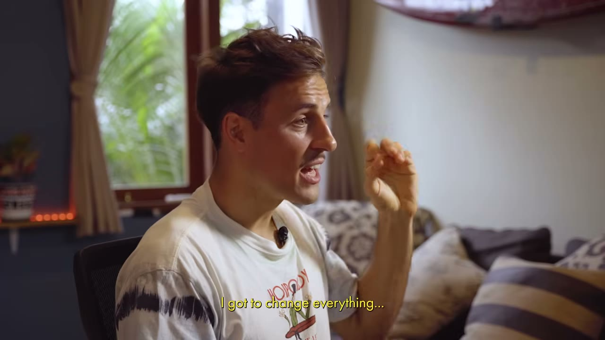
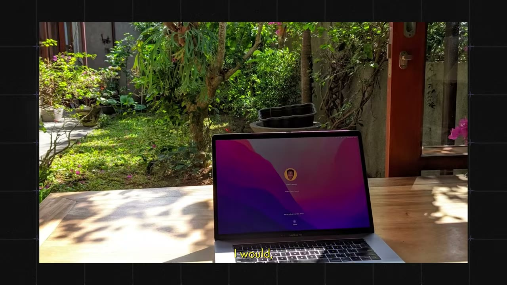
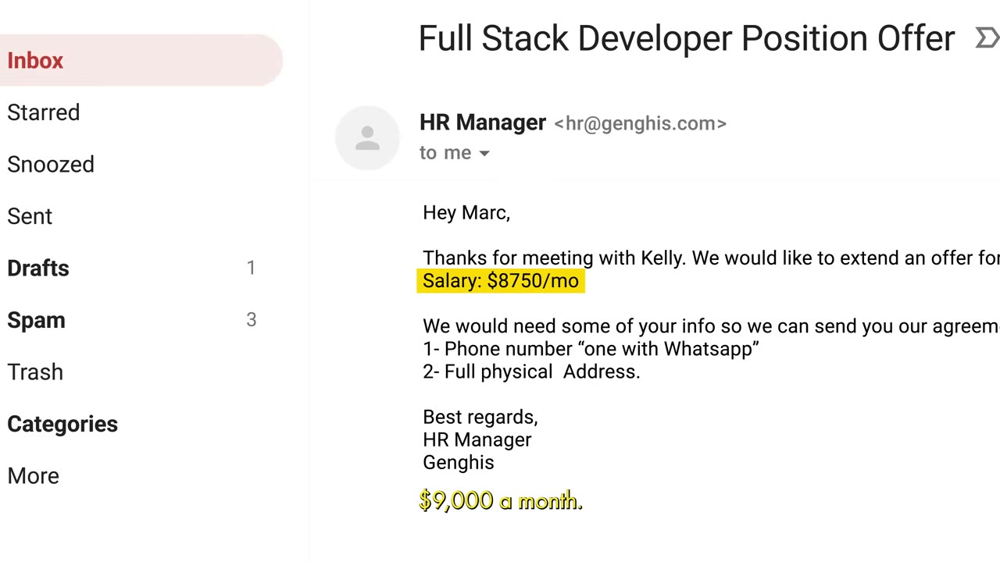
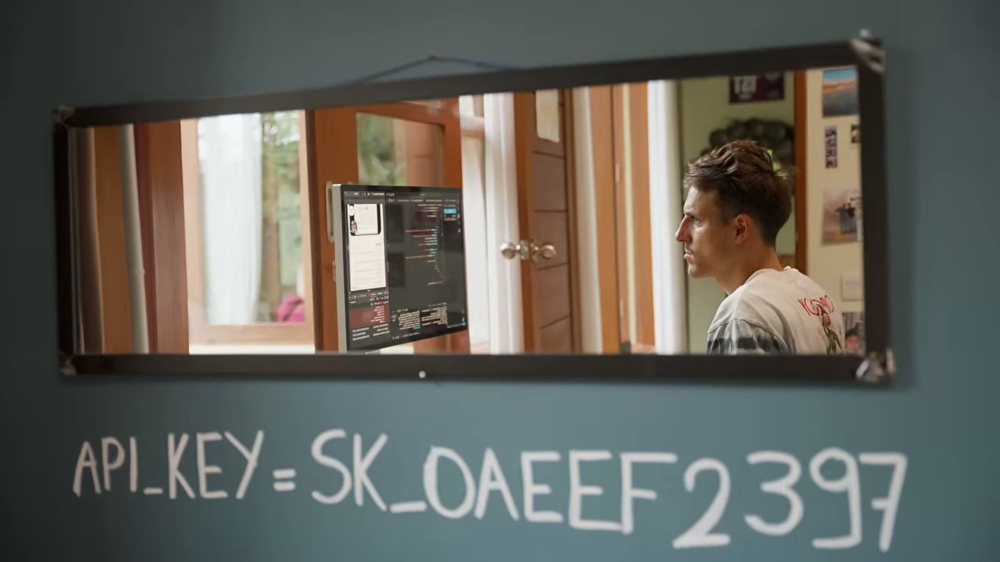
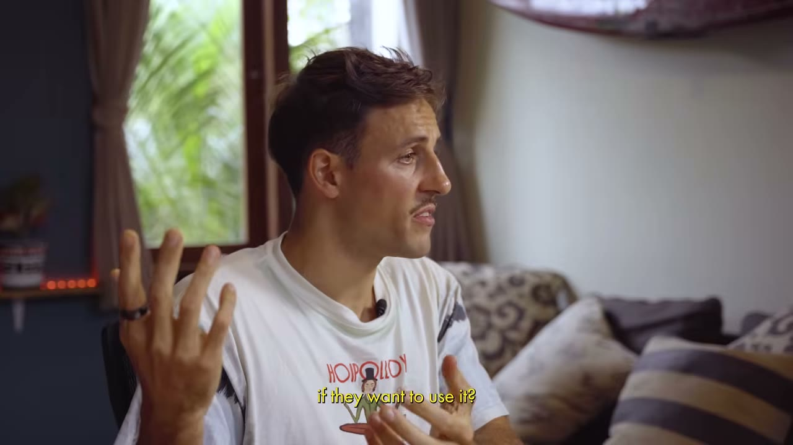
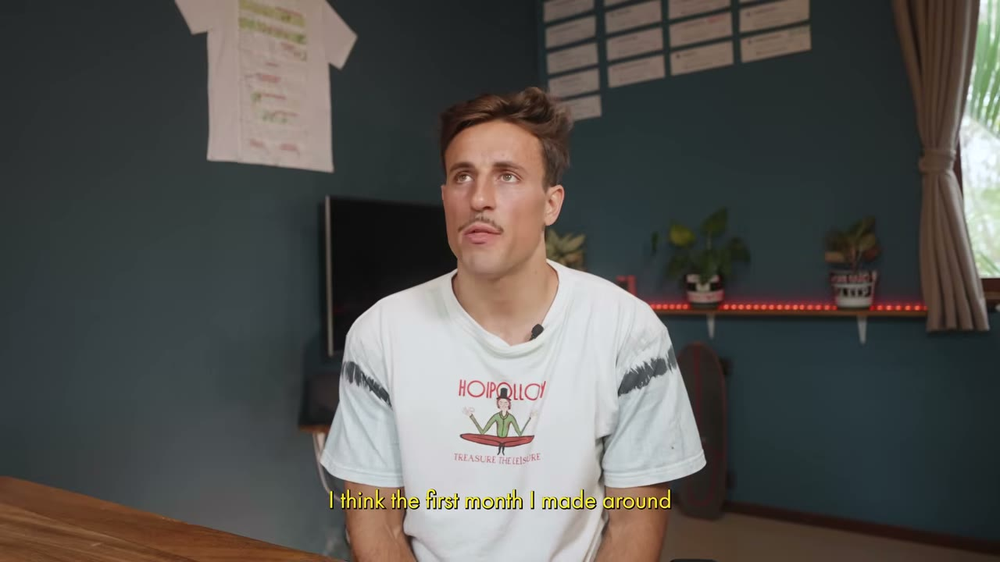
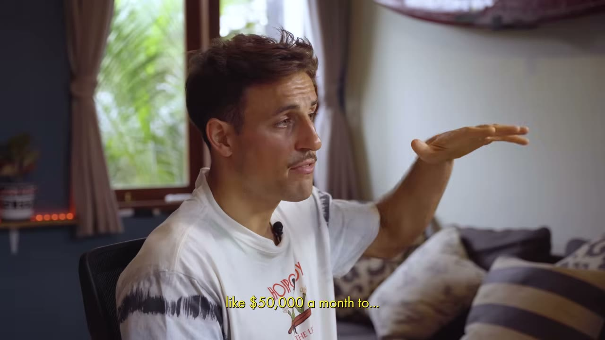

# Marc Lou — từ bồi bàn 10 USD/giờ tới 1,5 triệu USD/năm, sau 30 startup thất bại

> **Tóm tắt 30 giây:** Marc Lou mất 5 năm, 30 startup thất bại, sống trong phòng 12m² có gián, mất toàn bộ 4.000 USD/tháng trong 24 giờ vì Covid, rồi một sáng khóc không lý do và đấm thủng tường. Anh đi xin việc, nhận 9.000 USD/tháng — và **thừa nhận công việc làm thuê đã chữa lành anh**. Sau khi bị sa thải, anh ship 15 sản phẩm nhỏ và nhận ra thứ đáng bán nhất không phải sản phẩm nào trong số đó, mà là **đoạn code lặp đi lặp lại giữa chúng**. Anh đóng gói nó trong **dưới 1 tuần**, bán được **500 USD trong 2 tiếng đầu**, và đạt đỉnh **135.000 USD/tháng**.

## 1. Con số

| Mốc | Giá trị |
|---|---|
| Lương bồi bàn khởi điểm | 10 USD/giờ |
| Số startup thất bại | **30** |
| Đỉnh trước Covid | 4.000 USD MRR → **0 trong 24 giờ** |
| Lời mời việc làm | 9.000 USD/tháng (sau 5 năm kiếm 1.000 USD/tháng) |
| Sau khi bị sa thải | 6 dự án trong 7 tháng, vẫn 1.000 USD/tháng |
| Sau khi đổi sang painkiller + launch viral | ~4.000 USD/tháng |
| Thời gian build ShipFast | **dưới 1 tuần** |
| ShipFast — 2 tiếng đầu | 500 USD |
| ShipFast — ngày 2 | ~3.000-4.000 USD |
| ShipFast — tháng 1 | ~40.000 USD |
| Black Friday | ~8.000 USD **trong một ngày** |
| Ổn định trước tập YouTube | ~50.000 USD/tháng (đỉnh 65.000 tháng 11) |
| Sau tập YouTube | 85.000 → **135.000** → 135.000 USD/tháng |
| Tại thời điểm quay | ~80.000 USD/tháng |

**Mâu thuẫn số liệu cần nêu rõ:** tiêu đề nói **1,5 triệu USD/năm** ≈ 125.000 USD/tháng, nhưng con số cuối cùng anh nói trong video là **~80.000 USD/tháng** cho ShipFast. 125K/tháng chỉ khớp với **2 tháng đỉnh** (135K). Nhiều khả năng "1,5M/năm" là **run-rate tại đỉnh** hoặc **gộp toàn bộ sản phẩm** của anh (anh có nhiều sản phẩm khác nhưng không nêu số trong video này). Tôi chọn 80.000 cho frontmatter vì đó là con số mới nhất, cụ thể nhất, và có ngữ cảnh rõ.

## 2. Bốn thất bại — và bài học CƠ CHẾ rút ra từ mỗi cái ⭐⭐⭐

Đây là phần đáng học nhất, vì mỗi thất bại sửa đúng một lỗi và lỗi đó có tên.

**Thất bại 1 — "Tinder cho người mê thể thao" (1 năm):**

> *"There was no business plan in mind, there was not even an idea of how to monetize that thing. I was just — I have to build that thing."*

> *"I was so arrogant that I spent a year working on this app. I build this identity for one year of this guy who is going to build the next brilliant idea, and **you cannot even know what I'm working on because it's a brilliant idea, right**."*

Sau 365 ngày anh nhận ra mình không đủ năng lực build nó và nó sẽ không bao giờ ra tiền. Anh **xoá toàn bộ code trong 24 giờ**, chia tay bạn gái, bay sang Hàn Quốc.

→ **Lỗi: xây danh tính quanh một bí mật.** Việc giữ bí mật ý tưởng không bảo vệ được gì, nhưng nó chặn đứng mọi phản hồi có thể cứu bạn sớm hơn 11 tháng.

**Thất bại 2 — startup AI có VC ở Hàn Quốc (2017):**

> *"We were both engineers. None of us was good at marketing, none of us was good at product. It took 6 months to make an app but we didn't get any customers."*

→ **Lỗi: hai kỹ sư, không ai lo phân phối.** Sản phẩm xong là hết chuyện.

**Thất bại 3 — bán găng tay đôi (dropshipping):** anh thấy quảng cáo Facebook về đôi găng cho hai người nắm tay chung, nghĩ *"nếu nó chạy cho họ thì nó chạy cho tôi"*. Anh quá dở quảng cáo Facebook nên **ra đường bán tay** — bán được ~30 đôi, lãi bằng 0.

→ **Lỗi: sao chép sản phẩm mà không sao chép được KÊNH.** Toàn bộ mô hình đó nằm ở kỹ năng chạy Facebook ads, không nằm ở đôi găng.

**Thất bại 4 — Covid xoá sạch (2020):** công cụ giúp doanh nghiệp vật lý kiếm khách, lên 4.000 USD MRR ở Bali. *"Covid hits, everything closed down. Revenue went from $4,000 a month to zero in like 24 hours. Everything that I built for the last 2 years just suddenly disappeared."*

→ **Lỗi: rủi ro tập trung ngành.** 100% khách hàng cùng một loại hình, cùng chịu một cú sốc.

## 3. Đồng tiền đầu tiên — bán TRƯỚC khi build ⭐⭐⭐

Sau ba thất bại, anh đổi điểm xuất phát: bắt đầu từ **vấn đề**, không từ ý tưởng.

> *"What is a universal problem that everybody has that I can solve? Every business wants more customers."*

Ý tưởng: một công cụ nhỏ giúp các **escape room** kiếm thêm khách. Rồi anh gặp một người làm marketing thuần tuý:

> *"He's like — **why don't you just try to sell it before you make it?** I listened to him, I did exactly what he told me. I sent some cold emails..."*

Cuộc gọi đầu tiên với một doanh nghiệp ở Úc:

> *"I'm thinking like an engineer and I'm like I'm scamming her just talking to her, but she's so friendly. After 42 minutes she's like — all right yeah, **send me the invoice, I'll pay**. I'm sweating, my armpits are sweating so much, and I make her confirm. I was like — are you sure? And then she said yes."*

**Cơ chế vì sao pre-sell hiệu quả:** một lời hứa mua trả lời **cả hai** câu hỏi cùng lúc — có ai cần không, và có ai trả tiền không. Còn một sản phẩm đã build xong chỉ trả lời được câu hỏi thứ nhất, sau khi bạn đã tiêu hết vốn quý nhất là thời gian.

**Điều kiện để pre-sell chạy được:** khách là **doanh nghiệp** (họ quen mua thứ chưa tồn tại), vấn đề là **đau về tiền** (thiếu khách), và bạn tiếp cận được họ **1-1** (cold email). Không pre-sell được cho khách B2C — không ai đặt cọc cho một app tracker.

## 4. Chương ít ai dám kể — đi làm thuê đã CỨU anh ⭐⭐⭐

Sau Covid, 28 tuổi, mới cưới, không doanh thu, quay về đúng ngôi nhà anh từng rời đi để chứng minh có con đường khác:

> *"One morning I have no clue what is happening, I start to cry for no reason... I look at my wall and I start to punch my wall four times without even thinking. My wall is pretty thin so it goes through the wall and I'm shouting... so much anger that just comes out."*

Anh đi xin việc kỹ sư phần mềm và được nhận với 9.000 USD/tháng — sau 5 năm kiếm 1.000 USD/tháng.

Và đây là đoạn quan trọng nhất, đoạn mà 99% nội dung indie hacker cắt bỏ:

> *"When you have a job, your boss is telling you today I want you to do that. So at the end of the day once you've done that, you've created the value for the person and **it makes you feel like you're worthy**. I didn't get any of this in the past."*

> *"Those years of entrepreneurship, you aim to create something people want, and when nothing is actually working **you're basically creating void**. Nobody cares about what you do, nobody needs anything that you're doing, so it feels like you're just useless."*

> *"I had 100% freedom but **0% worthiness**."*

Công việc trả lại cho anh: cuối tuần, giấc ngủ, sách, tập luyện, và sức khoẻ tinh thần. Chỉ **sau khi** hồi phục, khát khao tự do mới quay lại — và anh bị sa thải đúng lúc đó, một cách nhẹ nhõm.

**Vì sao đoạn này đáng giá với bạn:** nó cho bạn một **khung chẩn đoán**, không phải một câu chuyện truyền cảm hứng. Nếu bạn đang kiệt sức và không thấy mình có giá trị, vấn đề của bạn có thể **không phải** là chưa tìm đúng ý tưởng. Đi làm thuê một thời gian không phải là bỏ cuộc — với Marc, đó là điều kiện tiên quyết để lần sau thành công. Đây cũng là một cột mốc chống lại toàn bộ tông giọng "bỏ việc ngay" của thể loại nội dung này.

## 5. Bộ luật anh tự viết sau khi bị sa thải ⭐⭐

> *"The moment I get fired I build my new identity. I'm going to be an entrepreneur again, but **this time I'll do things differently**. I will never spend months on a product. I will never raise money. I'll never have employees. I'll never do all the things that frustrated me in the past."*

Cộng thêm một quy tắc thứ tư:

> *"I also decided that at the same time I build stuff, I'm going to try to **share this publicly**, so that if my app goes wrong, in the worst case maybe I'll have created a little following for the next project — and not start again from zero."*

**Cơ chế của luật thứ tư (build in public):** nó biến thất bại từ số 0 thành số dương. Mỗi sản phẩm chết vẫn để lại một tài sản chuyển tiếp được — khán giả. Đây là cách duy nhất để 30 lần thất bại **cộng dồn** thay vì trừ dần. Nếu Marc không làm điều này, ShipFast sẽ chỉ là startup thất bại thứ 31.

## 6. Sáu sản phẩm, 7 tháng, vẫn 1.000 USD/tháng — và hai thứ đã sửa nó ⭐⭐⭐

Danh sách anh ship: **Mood to Movie** (gợi ý phim theo tâm trạng), **Habits Garden** (habit tracker, ~10.000 người dùng), công cụ xếp hạng mẹo năng suất, công cụ tạo landing page từ text, công cụ link-in-bio kiểu "CV cho người khởi nghiệp".

Sáu sản phẩm trong 7 tháng. Doanh thu: vẫn 1.000 USD/tháng.

**Sửa 1 — painkiller thay vì vitamin:**

> *"I start to make **painkiller apps** where it's actually solving a problem... The fact that I was shipping painkillers means **people know their struggle, they know their pain**, so I come up with a solution — it's much easier to sell than a vitamin, where like the habit tracker for instance, it's fun but you don't necessarily need it."*

Chú ý con số: habit tracker có **10.000 người dùng** và vẫn không ra tiền. Đây là bằng chứng cứng rằng **user không phải doanh thu**. Anh cũng thêm quy tắc: chỉ làm app **có paywall**, không làm app miễn phí.

**Sửa 2 — launch viral, không phải build viral:**

> *"I try to get a new approach of launching viral. **I would focus on the launch part**, try to get as many eyeballs as I can. I started to make those skits where I would go on a podcast with Joe Rogan, or I would be in a movie with Leonardo DiCaprio. This did really well — **people felt that I was having fun**."*

Doanh thu: 1.000 → ~4.000 USD/tháng.

**Cơ chế:** anh không làm sản phẩm viral, anh làm **màn ra mắt** viral. Đó là hai kỹ năng khác nhau, và cái thứ hai học được. Điểm mấu chốt trong câu của anh là *"people felt that I was having fun"* — thứ lan truyền không phải sản phẩm mà là **cảm xúc kèm theo người làm ra nó**. Đây là lý do build in public chỉ chạy khi bạn thật sự thích thú; làm gượng thì không ai chia sẻ.

## 7. ShipFast — bán chính phần việc lặp lại của mình ⭐⭐⭐

Giữa 2023, sau 10-15 sản phẩm:

> *"I realized **I was doing the same thing over** — set up a landing page, deploy it, add a button for people to pay, send them an email, create an account. I was like — what if I just create a little code base that I can reuse for every new project? I built it in like **less than a week**, and I was like — this is super cool, why not just putting a price tag on it?"*

Kỳ vọng của anh trước khi launch:

> *"I told my wife — hey, you know, maybe we'll make 100 bucks, that would be nice. I shipped the product, went skating, and I came back home, opened my Stripe dashboard after 2 hours of skate — I was like, **I made 500 bucks**, which is what I would make in a week in entrepreneurship before. In 2 hours."*

Ngày hôm sau: ~3.000-4.000 USD. Tháng đầu: ~40.000 USD.

> *"It was steady around like $50,000 a month, except in November where there was like a burst at 65. And I realized one thing — **product market fit, when it hits, it's there, you can feel it**. I would receive messages from people that say hey I cannot pay using your credit cards, do you accept crypto? You would have people ask me **to give me money**. It's the first time ever — usually I'm trying to convince people to give me money for my product."*

**Đây là insight trung tâm của cả case, và nó ít ai nói ra:**

ShipFast **không thể là sản phẩm đầu tiên của anh**. Nó là **sản phẩm phụ của việc đã ship 15 sản phẩm**. Marc không nghĩ ra nó — anh **phát hiện** ra nó, bằng cách làm cùng một việc chán ngắt 15 lần cho đến khi việc đó trở nên hiển nhiên.

Suy ra một chiến lược sạch sẽ: **thứ bạn lặp lại nhiều lần chính là sản phẩm tiếp theo của bạn.** Không phải ý tưởng lớn nào cả — là cái template bạn copy đi copy lại, cái checklist bạn tự viết, cái script bạn dùng ở mọi dự án. Nếu bạn đã làm một việc 5 lần và vẫn thấy chán, có người khác cũng đang chán y hệt và sẵn sàng trả tiền.

Hệ quả thực dụng: **giữ lại mọi thứ bạn lặp lại**, ngay cả khi các dự án đều chết. Đó mới là tài sản.

Cùng thị trường boilerplate này sau đó có [LaunchFast của Hassam — 25K/tháng](../2026-01-04_how-i-built-my-first-saas-without-an-audience-25k-mo/case.md), và Hassam đi bằng con đường **hoàn toàn khác** (đổi 50% cổ phần lấy tệp khách có sẵn, vì anh không có audience). Hai case cạnh nhau là ví dụ tốt nhất trong kho về việc **cùng một sản phẩm cần hai chiến lược phân phối khác nhau tuỳ vào bạn có audience hay không**.

## 8. Kênh phân phối thật của ShipFast — và một sự thật khó chịu ⭐⭐⭐

Anh liệt kê ba nguồn:

1. **Cú launch** tạo cú hích ban đầu.
2. **Free tools marketing** — anh build công cụ miễn phí (ví dụ trình tạo logo), bên phải đặt banner *"are you building a startup? ship it fast with ShipFast"*.
3. **Tập YouTube của Starter Story.**

Và đây là con số:

> *"There's obviously the YouTube episode that came a little bit later — added lots of revenue to the product ShipFast. So it went from like $50,000 a month to somewhere around **$85,000** on the first month, then **135** in the second month, 135 in the third month, and now it's slowing down a little bit to somewhere like around $80,000 a month."*

**Hãy đọc con số này thật kỹ.** Một tập YouTube của Starter Story đã **gần như nhân ba** doanh thu tháng của anh (50K → 135K), và khi hiệu ứng nguội, doanh thu rơi về 80K — tức **vẫn cao hơn 60% so với trước**.

Điều này có ba hàm ý:

- **Với founder:** một lần xuất hiện trên đúng kênh có thể đáng giá hơn cả năm làm SEO. Nhưng bạn không kiểm soát được nó, và nó chỉ đến khi bạn **đã** có con số đẹp để kể.
- **Với bạn, người xem:** phần lớn doanh thu ShipFast **không** đến từ chiến thuật nào bạn sao chép được. Nó đến từ việc được truyền thông ngành khuếch đại.
- **Với độ tin cậy của nguồn:** xem mục dưới.

## 9. Cảnh báo thiên kiến nguồn — case này là ví dụ rõ nhất trong kho ⭐⭐

- **Starter Story vừa là người kể chuyện vừa là kênh phân phối của chính câu chuyện.** Founder nói thẳng rằng tập YouTube trước của Starter Story đưa anh từ 50K lên 135K/tháng. Nghĩa là kênh này **có lợi ích trực tiếp** trong việc câu chuyện nghe hay — video hay hơn thì founder tiếp theo càng muốn lên, và Starter Story càng có nội dung. Không phải bịa, nhưng là một vòng lặp lợi ích cần được nói ra.
- **Sai lệch sống sót ở mức cực đoan.** 30 startup thất bại. Video khung nó thành *"nếu không bỏ cuộc thì cuối cùng sẽ thắng"*. Nhưng mẫu số thật là: có bao nhiêu người cũng thất bại 30 lần và **không** bao giờ có ShipFast? Kênh này theo định nghĩa không bao giờ phỏng vấn họ.
- **Video là phễu bán hàng.** Có ba lần chèn quảng cáo cho báo cáo *50+ Solo Developer Ideas* và cho cộng đồng trả phí Starter Story.
- **Không có ảnh chụp dashboard nào.** Toàn bộ chuỗi 40K → 50K → 85K → 135K → 80K là lời kể. ShipFast là sản phẩm bán một lần (lifetime), nên "doanh thu tháng" ở đây **không phải MRR** — nó phụ thuộc hoàn toàn vào lượng khách mới mỗi tháng, và vì thế dễ sụt mạnh hơn nhiều so với một SaaS thuê bao cùng con số.
- **Ngược lại, phần đáng tin nhất của video là phần thất bại** — khóc, đấm tường, đi xin việc, thừa nhận công việc làm thuê chữa lành anh. Không ai bịa những chi tiết làm mình yếu đi. Hãy đặt trọng số cao vào các mục 2, 3, 4 và thấp vào các con số doanh thu.

## 10. Mâu thuẫn giữa các founder — và điều kiện phân định ⭐⭐

**Mâu thuẫn 1 — Marc mâu thuẫn với chính Marc.**

Ở phút 6, đồng tiền đầu tiên của anh đến từ **bán trước khi build**. Ở phút 18, lời khuyên cuối của anh là **"start, make the smallest version of your app as fast as you can"** — tức build trước.

Đây không phải anh nói dối; đây là **hai bối cảnh khác nhau**, và phân định được bằng hai biến số:

| Bán trước (pre-sell) | Ship trước |
|---|---|
| Khách là **doanh nghiệp**, mua được thứ chưa tồn tại | Khách là **cá nhân**, không ai đặt cọc cho app |
| Chi phí build **trên 1 tháng** | Chi phí build **dưới 1 tuần** |
| Bạn tiếp cận được khách 1-1 (cold email, gọi điện) | Bạn chỉ tiếp cận được đám đông (mạng xã hội, chợ ứng dụng) |
| Ví dụ: công cụ cho escape room; [Once](../2026-05-10_i-built-a-20k-month-app-in-83-days/case.md) | Ví dụ: ShipFast, build dưới 1 tuần |

**Quy tắc gọn:** dưới 1 tuần thì ship rồi đo; trên 1 tháng thì bán trước rồi mới viết dòng code đầu tiên. Vùng ở giữa thì làm landing page có nút mua.

**Mâu thuẫn 2 — audience có đáng xây không?**

Marc coi build in public là **luật số 4** của mình, và nó chính là thứ biến 30 thất bại thành vốn tích luỹ. Ngược lại, Ben của [FollowBuddy](../2026-03-19_i-make-17k-month-with-one-strategy/case.md) nói thẳng *"xây audience là lãng phí thời gian"* và chỉ bám ý định tìm kiếm.

**Phân định bằng việc BẠN BÁN CHO AI:**
- Marc bán **cho chính cộng đồng anh thuộc về** (indie hacker bán công cụ cho indie hacker). Ở đây audience vừa là khách hàng vừa là kênh — xây nó là bắt buộc.
- Ben bán cho **người lạ đang có vấn đề cụ thể** (người dùng Instagram bị unfollow). Ở đây audience vô dụng; ý định tìm kiếm là tất cả.

Câu hỏi tự kiểm tra: *khách hàng của tôi có đọc cùng thứ nội dung với tôi không?* Có thì xây audience. Không thì đi tìm nơi họ đang tìm kiếm.

## 11. Lời khuyên cuối của anh

> *"There are multiple people living up there and there is one that's very strong and that always thinking — **it's overthinking**. It's blocking you from making the first step. It's going to find a good excuse for this idea to not work. It's going to tell you that the idea you're working on is not perfect enough to be launched."*

Hai việc cụ thể:
1. **Bắt đầu bất cứ thứ gì.** Làm bản nhỏ nhất, nhanh nhất có thể.
2. **Tìm định dạng bạn thấy thoải mái khi chia sẻ.** Thích viết → Twitter/X. Thích quay video → TikTok. Kể chuyện bằng hình → Instagram. Rồi học cách **trộn** việc build và việc chia sẻ vào làm một.

> *"I failed 30 startups. But if you don't quit, then at some point you'll win. It's just a matter of not quitting before you win."*

## 12. Áp dụng cho tôi (indie hacker VN)

**Sao chép được gì — cụ thể và hành động được:**

1. **Lập "sổ việc lặp lại" ngay hôm nay.** Mỗi lần bạn làm một việc lần thứ hai (dựng auth, dựng thanh toán, viết script scrape, dựng dashboard báo cáo), ghi vào một file. Sau 5 dự án, đọc lại file đó — sản phẩm tiếp theo của bạn nằm trong đó. Đây là cách ShipFast ra đời và nó **không cần** ý tưởng gì mới.
2. **Áp dụng bộ lọc painkiller.** Trước khi build, hỏi: *người dùng có biết mình đang đau không, và họ có gọi tên được cái đau đó không?* Nếu không, bạn đang làm vitamin — 10.000 người dùng cũng bằng 0 doanh thu, đúng như Habits Garden.
3. **Pre-sell nếu khách là doanh nghiệp.** Gửi 50 cold email, xin 20 phút gọi, mô tả sản phẩm, hỏi thẳng *"nếu tôi làm cái này, anh có trả X không?"*. Một chữ "có" thật đáng giá hơn 3 tháng code.
4. **Đặt luật cho chính mình như Marc.** Viết ra 4 câu bắt đầu bằng "tôi sẽ không bao giờ...". Chúng lọc bỏ 90% quyết định tồi trước khi bạn kịp cân nhắc.
5. **Ghi lại quá trình dù chưa ai xem.** Chi phí bằng 0, giá trị chỉ hiện ra ở sản phẩm thứ 10.

**Rào cản thật — không tô hồng:**

- **ShipFast bán được vì Marc đã có tên tuổi trong cộng đồng indie hacker tiếng Anh.** Đây là rào cản lớn nhất và nó không thể vượt bằng cách code giỏi hơn. Bạn không thể sao chép "500 USD trong 2 tiếng" nếu không có ai theo dõi bạn. Hassam của LaunchFast gặp đúng vấn đề này và phải **đổi 50% cổ phần** để mua tệp khách — đó mới là con đường thực tế cho người không có audience.
- **Thị trường boilerplate đã bão hoà nặng.** Marc launch giữa 2023 khi gần như chưa có ai. Đến nay có hàng chục boilerplate Next.js, và AI coding đã làm giảm mạnh giá trị của một bộ code khởi tạo. **Đừng sao chép sản phẩm này. Hãy sao chép cách anh tìm ra nó.**
- **Sản phẩm bán một lần không phải MRR.** 80.000 USD/tháng của ShipFast phải kiếm lại **từ đầu mỗi tháng**. Không có doanh thu định kỳ, không có nền doanh thu. Đây là rủi ro dòng tiền mà con số "1,5 triệu USD/năm" che giấu hoàn toàn.
- **Chi phí tinh thần là thật và video kể rất rõ.** 5 năm, phòng 12m² có gián, trầm cảm, đấm thủng tường. Ở VN, thêm áp lực gia đình và thiếu lưới an toàn xã hội, chi phí này còn cao hơn. Marc có ba thứ bạn có thể không có: bằng kỹ sư ở châu Âu cho phép anh **quay lại thị trường lao động lương cao bất cứ lúc nào**, cha mẹ cho ở nhờ, và chi phí sống rẻ ở Bali.
- **Thanh toán quốc tế.** Bán cho lập trình viên toàn cầu cần Stripe hoặc merchant of record. Với pháp nhân VN, Stripe không hỗ trợ trực tiếp — cần Paddle/LemonSqueezy hoặc lập pháp nhân nước ngoài. Cộng thêm rủi ro tỉ giá và thuế TNCN với thu nhập nước ngoài.
- **Ảo tưởng "30 lần rồi sẽ thắng".** Câu *"nếu không bỏ cuộc thì sẽ thắng"* nghe hay nhưng sai về mặt thống kê. Marc thắng không phải vì thử 30 lần, mà vì mỗi lần anh **sửa đúng một lỗi có tên** và **giữ lại tài sản chuyển tiếp** (audience, code lặp lại). 30 lần lặp lại cùng một sai lầm thì vẫn là 30 lần thua.

**Khi nào KHÔNG dùng mô hình này:**

- Khi bạn **không thuộc về cộng đồng khách hàng của mình**. Toàn bộ mô hình build in public sụp đổ nếu người mua không đọc cùng thứ nội dung với bạn. Trường hợp đó, hãy làm theo [FollowBuddy](../2026-03-19_i-make-17k-month-with-one-strategy/case.md) (SEO theo ý định tìm kiếm) hoặc [LaunchFast](../2026-01-04_how-i-built-my-first-saas-without-an-audience-25k-mo/case.md) (mượn tệp khách của người khác).
- Khi bạn **cần thu nhập ổn định trong 12 tháng tới**. Mô hình "small bets" của Marc cần 5 năm và một tấm đệm. Nếu bạn đang nuôi gia đình, hãy đọc lại mục 4 — anh đi làm thuê không phải vì thua, mà vì đó là điều kiện để lần sau thắng.
- Khi sản phẩm bạn định làm cần **hơn một tháng** để có bản chạy được. Toàn bộ bộ luật của Marc được thiết kế quanh chu kỳ ngắn; áp nó vào sản phẩm phức tạp sẽ cho ra đúng thất bại số 1 và số 2 của anh.

## Nguồn

- Video: <https://www.youtube.com/watch?v=WGVxAmmJUmY> (20:09, đăng 05/08/2024, 653.180 view)
- [Transcript đầy đủ](transcript.md) · [Ảnh chụp](screenshots/)
