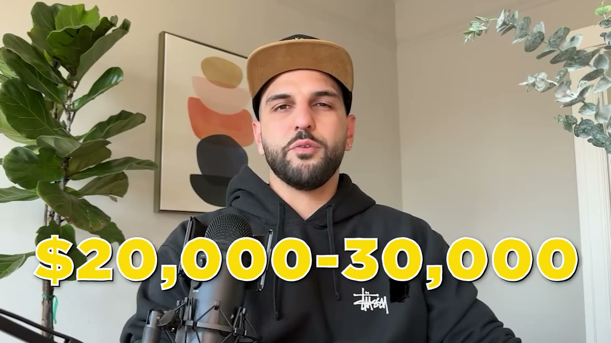
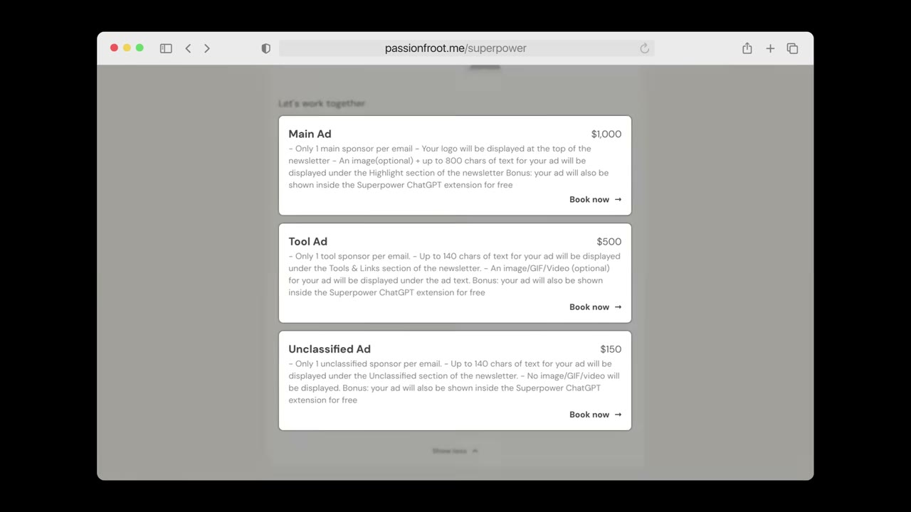
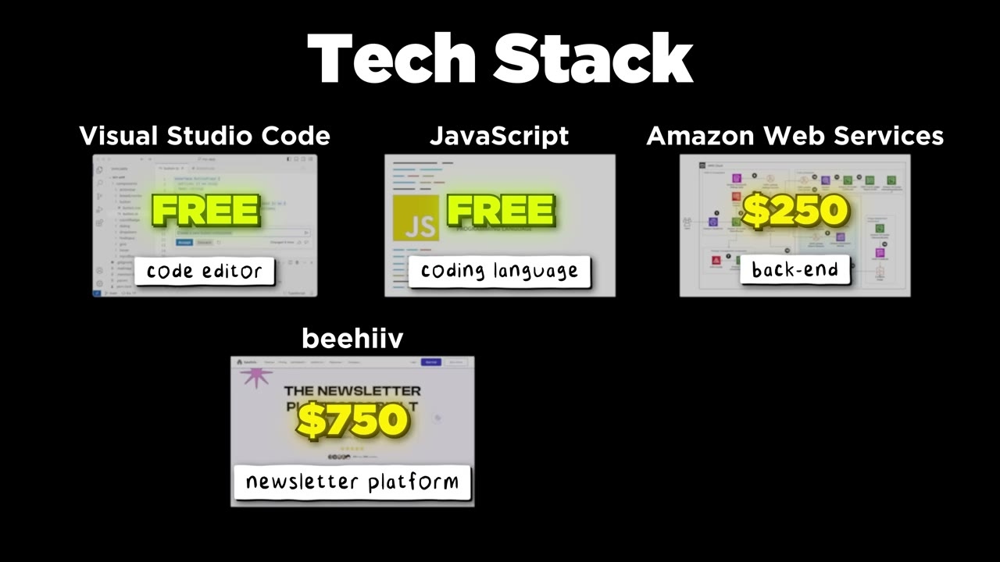

# How I Built It: $20K/Month Chrome Extension

✅ **Đã phân tích sâu** → [`case.md`](case.md)

| | |
|---|---|
| **Video** | <https://www.youtube.com/watch?v=ty9ZcimL6VE> |
| **Đăng** | 18/08/2024 |
| **Thời lượng** | 13:13 |
| **Lượt xem** | 303,135 |
| **Lượt thích** | 9,016 |
| **Video ID** | `ty9ZcimL6VE` |

## Trong thư mục này

| File | Nội dung |
|---|---|
| [`case.md`](case.md) | **Phân tích đầy đủ** — ý tưởng, validate, GTM, áp dụng ở VN |
| [`meta.json`](meta.json) | Metadata gốc (chapters, heatmap, mô tả) |
| [`screenshots/`](screenshots/) | 8 ảnh 720p |

## Mô tả gốc

This is how Saeed Ezzati built an AI Chome Extension to over $20,000/month.

## Số liệu bắt được từ transcript

> Các đoạn founder nhắc tới con số, kèm timestamp để tua thẳng tới đó trong video.

_(không bắt được con số nào)_

## Chương

- `00:00` Intro
- `01:14` Who is S
- `02:00` Best Strategy
- `03:48` Ideas
- `05:50` How to build
- `07:45` Early Opportunities
- `08:39` Making Money First
- `09:41` Monetization
- `10:15` Coding Tools
- `11:15` Downsides
- `11:43` Final Thoughts

## Ảnh

1. `01_00m35s_usd-20-000.jpg` — 
2. `02_01m39s_usd-30-000-m.jpg` — 
3. `03_04m00s_ch-ideas.jpg` — 
4. `04_06m02s_ch-how-to-build.jpg` — 
5. `05_07m57s_ch-early-opportunities.jpg` — 
6. `06_09m19s_replay.jpg` — 
7. `07_10m46s_replay.jpg` — 
8. `08_11m27s_ch-downsides.jpg` — 

---

← [Quay lại index](../../index.md) · [Toàn bộ video](../README.md)
