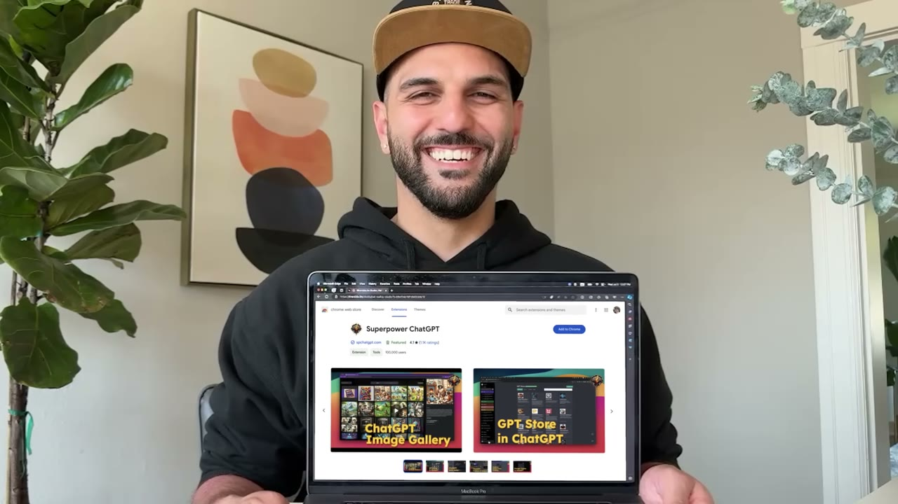
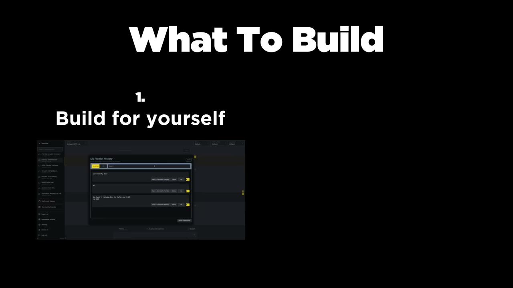
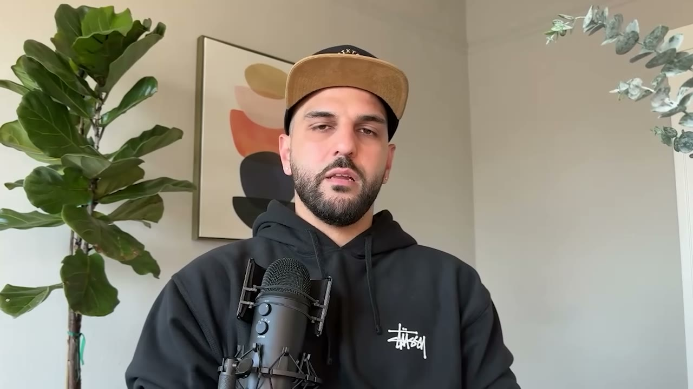
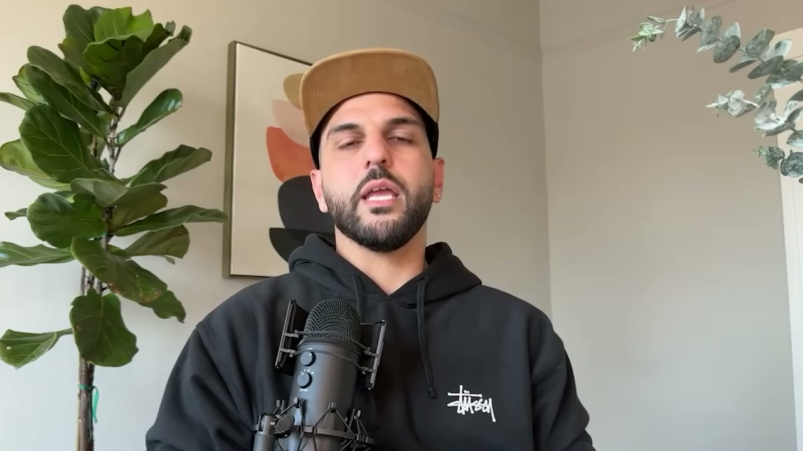
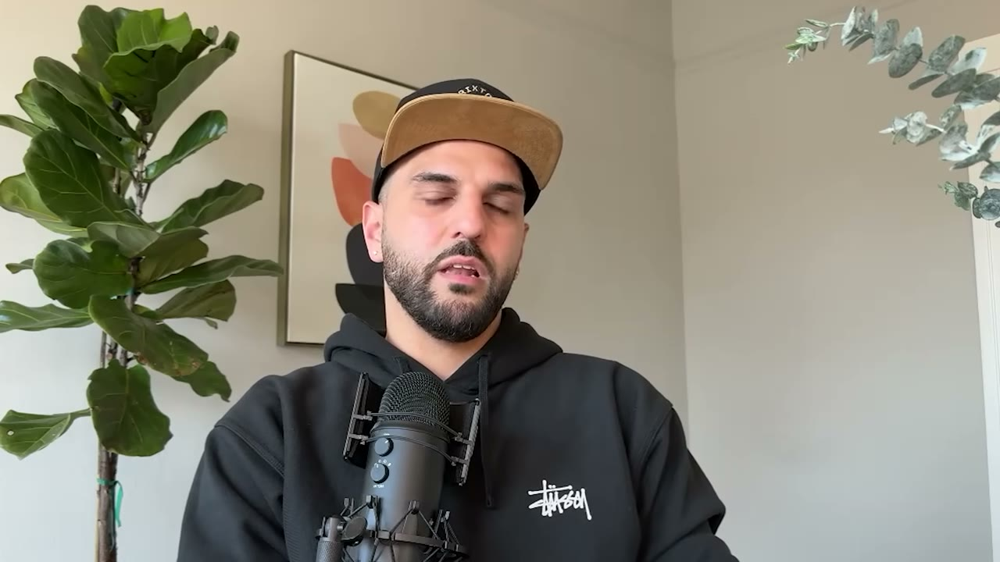

# Superpower ChatGPT — 20-30K USD/tháng từ một extension trình duyệt, một mình, 0 đồng quảng cáo

> **Tóm tắt 30 giây:** Saeed Ezzati là kỹ sư phần mềm làm thuê gần 10 năm. Khi ChatGPT ra mắt, anh học viết extension và **launch bản đầu tiên trong 2-3 ngày** dù chưa từng viết extension bao giờ. Sản phẩm đạt ~150.000 người dùng hàng tuần và 20-30K USD MRR. Điều bất ngờ nhất không phải sản phẩm mà là **thứ tự kiếm tiền**: 9 tháng đầu extension miễn phí hoàn toàn, đồng tiền đầu tiên của anh đến từ một **newsletter** viết cho chính tệp người dùng đó — rồi mới quay lại tính phí cho các tính năng MỚI, giữ nguyên miễn phí mọi tính năng cũ.

## 1. Con số

| Chỉ số | Giá trị |
|---|---|
| Doanh thu | 20-30K USD MRR (tiêu đề lấy 20K) |
| Lượt cài | ~260.000-270.000 |
| Người dùng hoạt động/tuần | ~150.000 |
| Chi quảng cáo | **0 USD** |
| Đội ngũ | **1 người** |
| Thời gian build v1 | **2-3 ngày** |
| Thời gian miễn phí | **9 tháng đầu** |
| Thời gian lên 20K+ | ~18 tháng |

**Lưu ý về số liệu:** phụ đề tự động đọc sai vài chỗ — `$330,000 Mr` thực ra là *20 to 30,000 MRR*, `$220,000 a month` là *20,000 a month*, `260 70,000` là *260-270,000*. Tên riêng cũng bị đọc sai: ASR ghi `s aadi` / `sayah` (đúng là **Saeed Ezzati**, xác nhận qua phần mô tả video), `super power chat GPT` (đúng là **Superpower ChatGPT**), `beehive` (đúng là **beehiiv**), `passion fruit` (đúng là **Passionfruit**), `SL groups` (đúng là **Slack groups**).

## 2. Chiến lược cốt lõi — đừng xây chợ, hãy bán trong chợ người khác đã gom sẵn người mua ⭐⭐⭐

Đây là phần đắt nhất của video và là thứ áp dụng được ngay.

Saeed chia cơ hội làm **hai loại**, và đây là toàn bộ logic:

**Loại 1 — nền tảng khổng lồ, đã có sẵn hàng trăm triệu user:** Gmail, Roblox, Facebook, YouTube, Twitter.

> *"Twitter had like hundreds of millions of users and if only like 2,000 people want that feature, that's like a good amount of revenue for you to just live off of."*

Phép tính này là cả bài học. Bạn **không cần** 1% thị phần. Bạn cần **2.000 người** trong một biển 300 triệu người — tức 0,00067%. Ở quy mô đó, bạn không cạnh tranh với ai cả; bạn chỉ cần tồn tại đúng chỗ để 2.000 người đó tìm ra.

**Loại 2 — nền tảng có marketplace nhưng user ít hơn:** Zoom, Salesforce.

> *"It's a lot easier to compete in a Marketplace like that. They have less number of users but at the same time they have less number of people building for those platforms."*

**Cơ chế vì sao mô hình này thắng một SaaS đứng riêng:**

| Yếu tố | SaaS có website riêng | Extension/plugin trong marketplace |
|---|---|---|
| Đối thủ | Cả internet | Số người build cho nền tảng đó — hữu hạn, đếm được |
| Kéo traffic | Bạn phải tự kéo 100% | Nền tảng đã kéo hộ, bạn chỉ cần được tìm thấy |
| Chi phí validate | Cần backend, frontend, auth, billing | Một script chạy trong trình duyệt user |
| Niềm tin | Phải tự xây | Vay uy tín của nền tảng chủ |

> *"Competing with everyone on the Internet is a lot harder than competing with a limited number of players in a smaller Marketplace. And it also helps a lot with validating the product."*

**Khi nào cơ chế này hết hiệu quả:** khi marketplace bão hoà (số người build tăng lên bằng số user chia cho một con số nhỏ), hoặc khi **nền tảng chủ tự làm luôn tính năng của bạn**. Xem mục 7.

Cùng cơ chế "sống trong chợ người khác" đã tạo ra [Kaching Bundles — 4,5 triệu USD ARR trên Shopify App Store](../2025-04-19_my-apps-make-4-5m-year-with-0-marketing/case.md) và [Barn 2 Plugins — 150K USD/tháng từ 20 plugin WordPress](../2026-02-08_i-make-150k-month-from-20-tiny-apps/case.md). Ba case, ba chợ khác nhau, cùng một logic.

## 3. Cách tìm ý tưởng tính năng — growth hack lớn nhất của anh ⭐⭐⭐

Quy trình 4 bước, Saeed gọi thẳng đây là *"probably one of the biggest growth hack that I apply to this extension"*:

1. **Bản đầu tiên xây cho chính mình.** Anh là user nặng của ChatGPT, biết thiếu gì.
2. **Đi tới nơi người dùng tiềm năng đang tụ tập** — subreddit, kênh Discord, group Slack, group Facebook. Vào hết, và **chỉ ngồi nghe**.
3. **Build đúng tính năng họ đang xin.**
4. **Quay lại chính chỗ đó và nói với họ**: tôi đã thêm tính năng này rồi, cài extension là dùng được.

Bước 4 là bước hầu hết mọi người bỏ qua, và nó chính là bước tạo tiền.

> *"Just go where your potential customers hang out and see what they are asking for and just try to build that."*

**Vì sao cơ chế này mạnh:** bước 4 biến một request thành **ba** thứ cùng lúc — một tính năng, một khách hàng đã cam kết, và **một bài đăng hợp pháp trong cộng đồng** (bạn không spam, bạn đang trả lời chính câu hỏi của người ta). Chi phí marketing bằng 0 vì marketing chính là sản phẩm.

**Điều kiện để nó hoạt động:** tệp người dùng của bạn phải **đồng nhất** — ai xin tính năng cũng đại diện cho phần lớn số còn lại. Nếu tệp của bạn quá rộng và tạp, bước này sẽ giết bạn (xem mâu thuẫn ở mục 8).

**Cách tìm ý tưởng SẢN PHẨM MỚI** (không phải tính năng), phần này ít người nói:

> *"Learning about how a lawyer is using ChatGPT to make their job easier, or a doctor is using ChatGPT to make their job easier, is one of the best ways to come up with new ideas and build new products for people who don't directly use AI."*

Tức là: bạn có sẵn 150.000 người dùng thuộc mọi nghề. Mỗi lần nói chuyện với một người, bạn hỏi họ **làm nghề gì** và **dùng ChatGPT để làm gì trong nghề đó**. Mỗi câu trả lời là một ngách sản phẩm dọc chưa ai làm. Đây là mỏ ý tưởng mà chỉ người đã có user mới đào được — và là lý do nên xây một sản phẩm ngang rẻ tiền trước, để lấy quyền đào mỏ.

## 4. Thứ tự kiếm tiền ngược đời — newsletter trước, sản phẩm sau ⭐⭐⭐

Đây là phần độc nhất của case này so với phần còn lại của kho.

**Mốc thời gian:**
- Tháng 0-9: extension **miễn phí 100%**, mọi tính năng.
- Tháng 3-4: bắt đầu viết **newsletter** cho tệp user đã có.
- Đăng newsletter lên vài website chợ tài trợ. **Trong 1-2 tuần** có nhà tài trợ đầu tiên trả *"a few hundred dollars"* để đặt quảng cáo.
- Tháng 9-10: mới bắt đầu tính phí extension.

Cách tính phí cũng khác thường và rất đáng chép:

> *"I started to think about NEW features that I can add to the extension and ask people to pay for those extra features. **I didn't ask anyone to pay for any existing features** that the extension had, and all of those features stayed free."*

**Cơ chế:** khi bạn dựng paywall lên thứ người ta đang dùng miễn phí, bạn phá huỷ đúng thứ đã tạo ra tăng trưởng — thiện chí và truyền miệng. Cộng đồng Reddit từng đẩy bạn lên top sẽ quay ra đấu tố bạn. Khi bạn chỉ tính phí tính năng **mới**, không ai mất gì, không ai có cớ tức giận, và bạn vẫn giữ nguyên cỗ máy truyền miệng đang chạy.

Anh cũng thử nhiều mức giá — cao, thấp — rồi chốt ở khoảng giữa. Video không nêu con số giá cụ thể.

**Nhưng anh tự phản biện chính mình:**

> *"If you ask me today, I think I should have monetized the extension earlier. But at the same time I do feel like it helped a lot with growing my user base."*

Đây là một mâu thuẫn thật, không phải lỗi kể chuyện. Nó nói với bạn rằng **9 tháng là quá dài** — nhưng cũng rằng anh không dám khẳng định vì không có bản đối chứng.

**Chi phí ẩn của newsletter:** ban đầu mất **6-7 tiếng mỗi ngày** để viết, giờ còn ~2 tiếng. Đó là một công việc toàn thời gian mà nhiều người bỏ qua khi nghe câu chuyện "kiếm tiền từ newsletter".

## 5. Phân phối — 0 đồng, và vì sao nó chạy được

- Nơi đăng đầu tiên: **Reddit**. Bài lên top subreddit đó trong ngày.
- Sau đó người khác **tự viết** các bài kiểu *"top 10 ChatGPT extensions"*, và extension của anh có đúng các tính năng đó nên luôn được nhắc.

> *"I didn't write them, I didn't pay for them to be written. I've never actually paid anyone to write any article. It was all organic."*

**Cơ chế thật sự đứng sau:** khi một danh mục mới bùng nổ (ChatGPT, cuối 2022), có một cửa sổ ngắn mà **nhu cầu nội dung vượt xa nguồn cung sản phẩm**. Hàng nghìn blogger và YouTuber cần viết bài "top 10 công cụ X" nhưng chỉ có 5 công cụ tồn tại. Nếu bạn là 1 trong 5 đó, bạn được nhắc miễn phí ở mọi bài. Saeed thừa nhận:

> *"Clearly being early helped a lot... I'm not saying every simple project could work — **timing is really important here. I built really really early.**"*

**Đây là lời cảnh báo quan trọng nhất của case này.** Chiến thuật "đăng Reddit rồi chờ listicle" **không** tái lập được ở một danh mục đã chín. Thứ tái lập được là **hành vi**: nhận diện một nền tảng vừa mở, và có mặt trong 2-3 ngày đầu.

## 6. Tech stack — cố tình đơn giản

| Hạng mục | Công cụ |
|---|---|
| Extension | **JavaScript thuần, không framework** |
| Frontend | HTML, CSS |
| Backend | AWS (toàn bộ project của anh) |
| Editor | VS Code |
| Newsletter | beehiiv (dùng tính năng **Boost** để kiếm tiền từ link trong newsletter) |
| Tìm nhà tài trợ | Passionfruit |

> *"If you know how to build a simple website, you'll know how to build an extension. JavaScript, HTML, CSS — that's how I built the very first version. It was very very simple, only had like two features basically."*

Hai chi tiết đáng chú ý: (1) anh **quay lại JavaScript thuần** dù là kỹ sư có nghề — vì extension chạy trong trang của người khác, framework chỉ thêm khối lượng và xung đột; (2) bản v1 chỉ có **hai tính năng**.

## 7. Rủi ro chết người — đây là một wrapper của OpenAI ⭐⭐⭐

Pat hỏi thẳng, và câu trả lời trung thực đến bất thường:

> *"**OpenAI can kill this product any day.** I was scared of that for a very long time, and at this point I kind of feel numb to it. I don't want to worry about it. Literally if my extension stopped working at some point, I'm probably going to try and build other extensions for one of these other major platforms — that's going to make my life a lot harder."*

**Đọc kỹ câu này.** Anh không có kế hoạch B thật. Kế hoạch B là "làm lại từ đầu ở một nền tảng khác, và sẽ khó hơn nhiều". Đây là bản chất của mô hình: bạn không sở hữu kênh phân phối, bạn **thuê** nó.

**Ghi chú của tôi (không có trong video, hãy tự kiểm chứng):** video quay tháng 8/2024. Kể từ đó OpenAI đã tự ship nhiều thứ mà lớp extension này từng cung cấp — thư mục/Projects, tìm kiếm trong lịch sử chat, custom instructions, thư viện prompt. Trước khi sao chép mô hình này, hãy **tự kiểm tra Superpower ChatGPT còn sống và còn MRR đó không**. Đừng coi con số 2024 là con số hôm nay.

Rủi ro nền tảng này là loại rủi ro đã xoá sổ cả mảng kinh doanh của [Jacky Chow](../2026-03-22_i-make-250k-month-from-13-businesses-after-losing-ev/case.md) và là điều [FollowBuddy](../2026-03-19_i-make-17k-month-with-one-strategy/case.md) đang sống chung. Nguyên tắc rút ra giống nhau: **coi doanh thu loại này là tiền thuê, không phải tài sản — và tái đầu tư sang thứ bạn sở hữu.**

## 8. Mâu thuẫn với các founder khác — và điều kiện phân định ⭐⭐

**Mâu thuẫn 1 — có nên làm theo yêu cầu tính năng của user không?**

| Quan điểm | Ai nói | Đúng khi nào |
|---|---|---|
| Nghe user, build đúng cái họ xin, rồi quay lại báo — đây là growth hack lớn nhất | Saeed (case này) | Tệp user **đồng nhất**, một người xin đại diện cho số đông; chi phí build một tính năng tính bằng giờ |
| Phần lớn yêu cầu tính năng phải bị từ chối; chỉ dùng user để hỏi về chất lượng và trải nghiệm | Jozef Gherman (StealthGPT, cùng lô này) | Tệp user **rộng và tạp** (400.000 lượt đăng ký đủ loại người); một tính năng chuyên sâu chỉ phục vụ một người |

**Cách phân định:** hỏi hai câu — *người xin này có đại diện cho phần lớn tệp của tôi không?* và *build cái này mất mấy giờ hay mấy tuần?* Đại diện + rẻ thì làm ngay. Không đại diện, hoặc đắt, thì từ chối. Saeed có cả hai điều kiện, Jozef không có điều kiện nào.

**Mâu thuẫn 2 — miễn phí bao lâu trước khi tính phí?**

Saeed để miễn phí **9 tháng** rồi tự nhận là quá lâu. Ngược lại [Marc Lou](../2026-04-26_how-i-work-77k-month-solopreneur/case.md) chủ trương gắn nút thanh toán ngay từ ngày đầu.

**Cách phân định bằng cơ chế phân phối, không phải bằng nguyên tắc:**
- Nếu tăng trưởng của bạn **do người dùng tạo ra** (truyền miệng, Reddit, listicle), miễn phí là nhiên liệu — nhưng hãy đặt hạn chót cứng, ví dụ 90 ngày, và tính phí phần MỚI.
- Nếu tăng trưởng của bạn **do bạn mua** (quảng cáo, cold outreach), miễn phí là lỗ ròng — phải có paywall từ ngày đầu.

## 9. Cảnh báo thiên kiến nguồn

- Kênh Starter Story chỉ phỏng vấn **người thành công**. Có bao nhiêu extension ChatGPT ra đời cùng tuần đó và chết? Video không nói, và đó chính là mẫu số bạn cần để đánh giá tỉ lệ thắng.
- Video này là **phễu bán hàng**. Có **ba** lần chèn quảng cáo cho báo cáo *50+ Solo Dev Ideas* của Starter Story (phút 5, phút 12, và cuối). Câu *"turns out it's actually pretty simple and it's not as saturated as you might think"* ở phần mở đầu là lời của Pat Walls, **không phải** của founder — và nó phục vụ mục tiêu bán hàng, không phải mục tiêu chính xác.
- Founder thì ngược lại, khá trung thực: anh tự nhận đáng lẽ phải kiếm tiền sớm hơn, nhấn mạnh timing là yếu tố quyết định, và thừa nhận OpenAI có thể giết sản phẩm bất kỳ ngày nào. Những chỗ đó đáng tin hơn phần dẫn chuyện.
- Không có ảnh chụp dashboard Stripe hay bảng điều khiển doanh thu nào trong video. Con số 20-30K MRR là **lời kể**, không có bằng chứng.

## 10. Áp dụng cho tôi (indie hacker VN)

**Sao chép được gì — cụ thể:**

1. **Chọn một marketplace loại 2, không phải loại 1.** Chrome Web Store giờ đã đông. Nhưng Zoom Marketplace, Salesforce AppExchange, Figma Community, Notion integrations, Slack App Directory, Shopify App Store, WordPress Plugin Directory, Raycast Store — mỗi cái là một chợ với số người build hữu hạn, đếm được. Vào chợ, sắp xếp theo số lượt cài, và tìm khoảng trống.
2. **Làm bài toán 2.000 người.** Trước khi build, viết ra: nền tảng này có bao nhiêu user, tôi cần bao nhiêu người trả tiền để sống, tỉ lệ đó là bao nhiêu phần trăm. Nếu phải hơn 0,1% thì đổi nền tảng.
3. **Vào 5 cộng đồng của nền tảng đó ngay tuần này**, chỉ nghe trong 2 tuần, ghi lại mọi câu bắt đầu bằng *"tôi ước gì X có thể..."*. Cái nào lặp lại 3 lần trở lên là ứng viên.
4. **v1 chỉ 2 tính năng, JavaScript thuần, ship trong dưới 1 tuần.**
5. **Bước 4 của Saeed là bắt buộc:** quay lại đúng thread đó và báo. Đây là 90% giá trị marketing và nó miễn phí.
6. **Thứ tự tiền:** nếu tăng trưởng đến từ cộng đồng, cho miễn phí nhưng đặt hạn chót 90 ngày, rồi tính phí **chỉ tính năng mới**.

**Rào cản thật — không tô hồng:**

- **Rào cản tiếng Anh là rào cản chính ở đây, không phải kỹ thuật.** Toàn bộ mô hình sống bằng việc bạn viết bài trong subreddit và Discord tiếng Anh, và **được cộng đồng chấp nhận như người trong nhà**. Đây không phải việc dịch máy được. Nếu tiếng Anh viết của bạn nghe như người ngoài, bước 4 phản tác dụng — bạn bị đọc là spam.
- **Timing của Saeed không tái lập được.** Anh vào 2-3 ngày sau khi ChatGPT ra mắt. Thứ tái lập được là hành vi canh nền tảng mới, không phải kết quả.
- **Rủi ro nền tảng ở mức cao nhất trong kho này.** Không phải rủi ro bị đổi thuật toán — mà là rủi ro nền tảng chủ tự ship tính năng của bạn, và điều đó **gần như chắc chắn xảy ra** nếu tính năng của bạn tốt. Bạn đang làm phòng R&D miễn phí cho OpenAI.
- **Thanh toán quốc tế.** Bán cho user toàn cầu nghĩa là bạn cần Stripe hoặc Paddle/LemonSqueezy — với pháp nhân VN, Stripe không hỗ trợ trực tiếp; phải qua merchant of record hoặc lập pháp nhân nước ngoài (Singapore, US LLC). Chi phí và thời gian này không xuất hiện trong bất kỳ video Starter Story nào.
- **Newsletter không miễn phí.** 6-7 tiếng/ngày lúc đầu. Đó là một công việc toàn thời gian thứ hai, và nó ngốn đúng số giờ bạn cần để build sản phẩm.
- **Vốn cần có: gần như bằng 0.** Đây là ưu điểm lớn nhất và là lý do case này đáng làm dù có mọi rào cản trên. Chi phí là thời gian, không phải tiền.

**Khi nào KHÔNG dùng mô hình này:**

- Khi bạn cần **doanh thu ổn định để sống** trong 12-24 tháng tới. Rủi ro bị nền tảng chủ xoá sổ là rủi ro thật, và nó đến không báo trước. Đây là mô hình cho tiền thặng dư, không phải cho tiền cơm.
- Khi giá trị sản phẩm của bạn nằm ở **dữ liệu tích luỹ hoặc mạng lưới người dùng**. Extension không giữ được hai thứ đó — user rời đi là mất sạch, và bạn không có cách nào liên hệ lại họ (trừ khi có newsletter, đó chính là lý do sâu xa vì sao Saeed xây newsletter).
- Khi bạn **không thể hoạt động bằng tiếng Anh trong cộng đồng**. Không có cách vòng tránh cho mô hình này.
- Khi nền tảng chủ có lịch sử thù địch với bên thứ ba, hoặc khi tính năng của bạn nằm đúng trên lộ trình công khai của họ.

## Nguồn

- Video: <https://www.youtube.com/watch?v=ty9ZcimL6VE> (13:13, đăng 18/08/2024, 303.135 view)
- [Transcript đầy đủ](transcript.md) · [Ảnh chụp](screenshots/)
