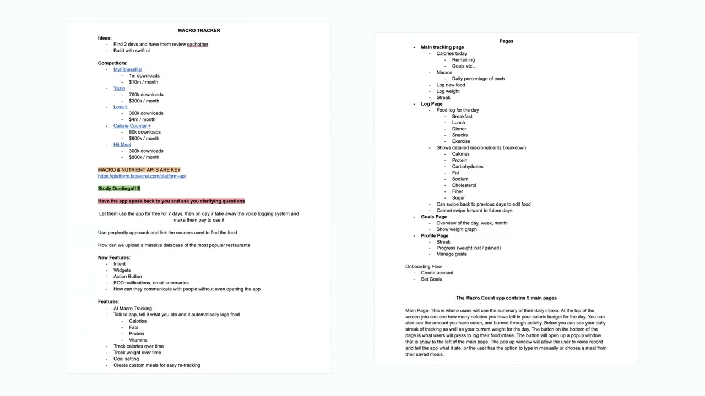

# How I Built It: $40K/Month iPhone App

✅ **Đã phân tích sâu** → [`case.md`](case.md)

| | |
|---|---|
| **Video** | <https://www.youtube.com/watch?v=loXc0Tyi4R4> |
| **Đăng** | 24/09/2024 |
| **Thời lượng** | 17:01 |
| **Lượt xem** | 1,329,106 |
| **Lượt thích** | 42,241 |
| **Video ID** | `loXc0Tyi4R4` |

## Trong thư mục này

| File | Nội dung |
|---|---|
| [`case.md`](case.md) | **Phân tích đầy đủ** — ý tưởng, validate, GTM, áp dụng ở VN |
| [`meta.json`](meta.json) | Metadata gốc (chapters, heatmap, mô tả) |
| [`screenshots/`](screenshots/) | 10 ảnh 720p |

## Mô tả gốc

This is how Steven Cravotta built a viral iPhone app to over $40,000/month.

## Số liệu bắt được từ transcript

> Các đoạn founder nhắc tới con số, kèm timestamp để tua thẳng tới đó trong video.

_(không bắt được con số nào)_

## Chương

- `00:00` Intro
- `01:12` Who is Steven Kada
- `01:46` What do you like about this business model
- `02:31` How to build something like this
- `04:04` How to validate an idea
- `04:50` Building the app
- `05:43` Hiring a developer
- `07:10` Marketing
- `08:16` Organic Marketing
- `09:06` Monetization
- `10:15` Pricing
- `10:47` Onboarding
- `11:25` Tools
- `12:45` Most Profitable Niche
- `13:32` Advice for New Entrepreneurs
- `14:15` How does a day in the life look like
- `15:08` Advice for aspiring entrepreneurs

## Ảnh

1. `01_01m39s_usd-43-000.jpg` — 
2. `02_02m43s_ch-how-to-build-something-like-this.jpg` — 
3. `03_04m16s_ch-how-to-validate-an-idea.jpg` — 
4. `04_05m02s_ch-building-the-app.jpg` — 
5. `05_05m41s_replay.jpg` — 
6. `06_06m22s_usd-1-000.jpg` — 
7. `07_07m22s_ch-marketing.jpg` — 
8. `08_08m28s_ch-organic-marketing.jpg` — 
9. `09_09m18s_ch-monetization.jpg` — 
10. `10_10m15s_usd-4.jpg` — 

---

← [Quay lại index](../../index.md) · [Toàn bộ video](../README.md)
