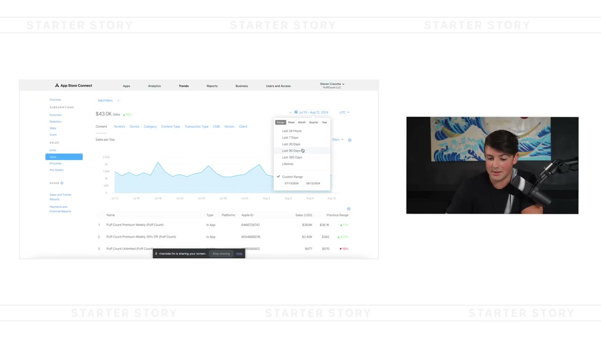
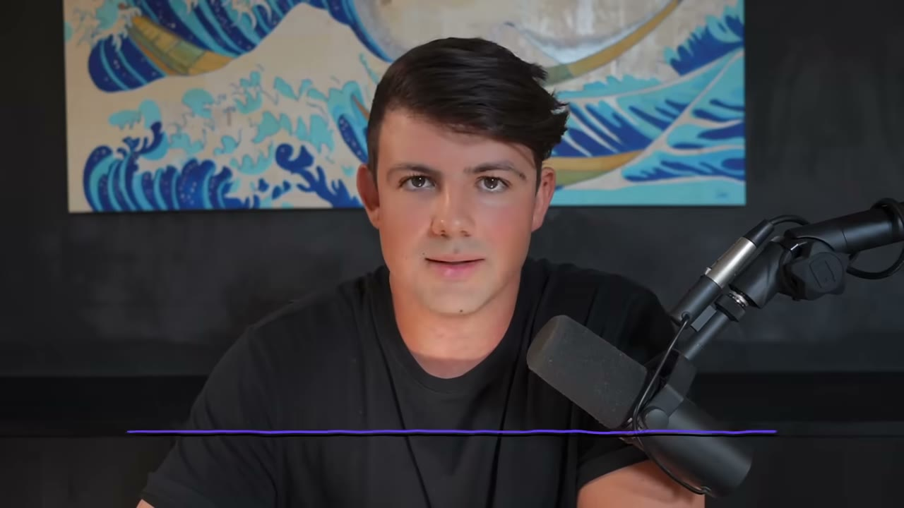
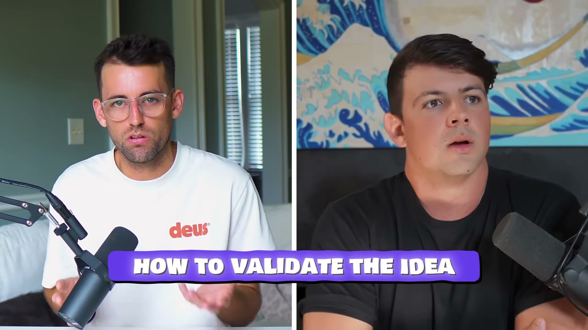
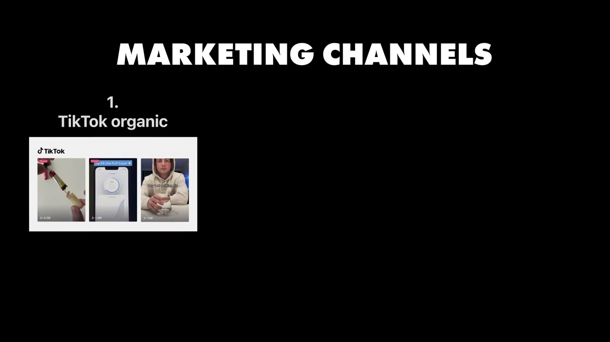
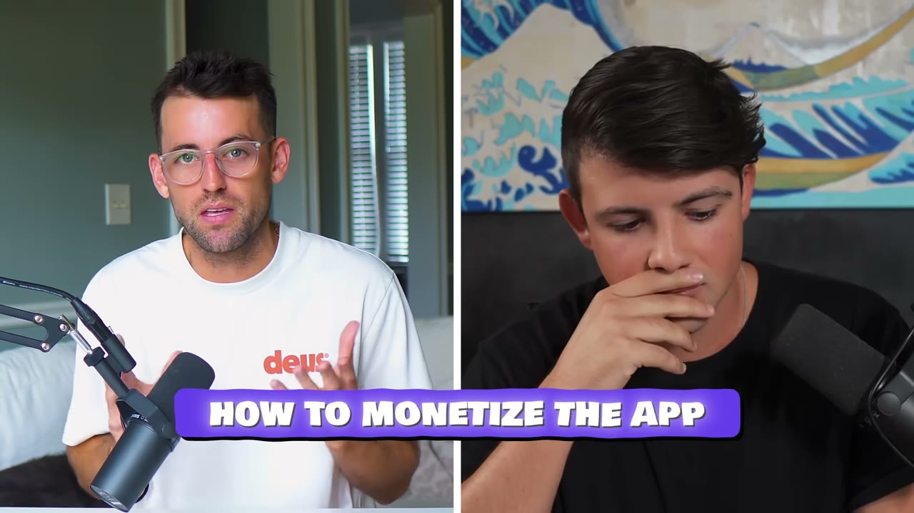

# PuffCount 2024 — quy trình làm app cho người không biết code, và cái paywall đổi tất cả

> **Tóm tắt 30 giây.** Steven Cravotta **không viết code và không thiết kế gì cả**. Anh chỉ có ý tưởng và biết cách lắp một đội. Quy trình của anh: vẽ tay bằng bút chì → đưa lên **99designs** để 50–70 designer nộp bản thiết kế → thuê dev trên **Upwork** trả theo dự án, dưới 5.000 USD. Rồi anh nghiên cứu TikTok bằng cách **lưu mọi video viral về vape vào một bảng tính** và phân tích chúng. **Bốn tới sáu tháng đầu anh không kiếm được đồng nào.** Cú đổi đời là một thay đổi kỹ thuật: chuyển sang **hard paywall bắt buộc dùng thử** — tỷ lệ chuyển đổi vọt lên **20–25%**.

## ⚠️ Đọc cùng với case PuffCount một năm sau

Kho này có **hai video về cùng một sản phẩm, cách nhau đúng một năm**:

| | Video này (9/2024) | [The $1M Mobile App Playbook (9/2025)](../2025-09-20_the-1m-mobile-app-playbook/case.md) |
|---|---|---|
| Doanh thu công bố | 43.000 USD / 30 ngày | — |
| Thông điệp | TikTok organic là chìa khoá | Một video **11,6 triệu view, ~1 triệu like** mang về **gần 0 lượt cài** |

Đặt cạnh nhau, hai video kể một câu chuyện đầy đủ hơn hẳn từng video riêng lẻ: **TikTok organic tạo ra kết quả rất thật, nhưng không ổn định và không dự đoán được.** Đây là lý do nên đọc cả hai.

## 1. Con số

| Chỉ số | Giá trị |
|---|---|
| Doanh số 30 ngày | **43.000 USD** |
| Doanh số 90 ngày | **hơn 112.000 USD** |
| Tổng lượt tải mọi app | hơn 12 triệu |
| **Chuyển đổi sau hard paywall** | **20–25%** |
| Chi phí xây app | **dưới 5.000 USD** |
| Thời gian trên chợ | **4 năm** |
| **Thời gian có doanh thu tốt** | **chỉ 6–7 tháng cuối** |

**Con số quan trọng nhất bị chôn ở phút 14:** PuffCount đã sống trên App Store **bốn năm**, nhưng anh nói rõ **chỉ sáu bảy tháng gần nhất mới thật sự có doanh thu tử tế**. Tiêu đề nói "$40K/tháng"; sự thật là ba năm rưỡi gần như không có gì. Đây là dữ liệu quan trọng hơn con số doanh thu.

## 2. Quy trình sản xuất app cho người không biết code ⭐⭐⭐⭐⭐

Đây là phần đáng copy nhất, và nó là **quy trình vận hành hoàn chỉnh**, không phải lời khuyên chung.

**Bước 1 — Brain dump.** Mở Google Docs, đổ ra hết: mọi ý tưởng, mọi tính năng muốn có, **danh sách đối thủ**, và anh nghĩ app nên làm gì.

**Bước 2 — Học từ đối thủ đang kiếm tiền.** Khi xem những ai đang kiếm được tiền trong ngách của bạn trên App Store, **ghi lại mọi thứ**: tính năng, quy trình onboarding, giao diện. Đó là bản đồ cho biết một app tốt trông như thế nào.

**Bước 3 — Vẽ tay.** Anh lấy **giấy và bút chì** phác thảo app.

**Bước 4 — 99designs.** Upload bản vẽ tay, mô tả app và các tính năng, rồi **50, 60, đôi khi hơn 70 designer chuyên nghiệp** cùng nộp phương án. Anh nói đây là cách anh làm giao diện cho **tất cả** app của mình.

**Bước 5 — Upwork.** Tìm developer. Ba nguyên tắc anh nêu:
- **Định giá theo độ phức tạp của app**, không theo giờ
- App đơn giản như PuffCount: **dưới 5.000 USD**
- **Trả theo dự án hoàn thành**, không trả theo giờ — nghiệm thu là: app lên chợ, không lỗi

Anh cũng nói thêm: có thể làm app **dưới 1.000 USD** nếu tải template khá tốt từ **ThemeForest**. Và ngân sách càng chặt thì **app càng nên đơn giản**.

**Bước 6 — Phỏng vấn 15 phút** với các ứng viên anh thích trên Upwork. Anh xem: họ có mang thêm ý tưởng cho app không, họ có hào hứng không, họ trình bày thế nào.

**Về nỗi sợ bị ăn cắp ý tưởng,** anh trả lời rất thẳng: chuyện đó chưa bao giờ là vấn đề với anh, và **ý tưởng của bạn không đáng giá gì cả** — nhiều khả năng ý tưởng bạn đang có đã tồn tại rồi. Bạn phải vượt qua nỗi sợ thuê một người lạ trên mạng, vì **tìm người giỏi và tin họ chính là công việc của một founder**.

**Vì sao quy trình này quan trọng:** nó cho thấy rào cản kỹ thuật để làm app di động thấp hơn nhiều so với hình dung — nhưng cũng cho thấy rào cản thật nằm ở chỗ khác (xem mục 4).

## 3. Validate bằng ba nguồn — và nguồn thứ ba mới quan trọng ⭐⭐⭐⭐⭐

| Nguồn | Câu hỏi trả lời |
|---|---|
| **Sensor Tower** | các app cai rượu, cai thuốc lá có đang kiếm tiền không? → có |
| **Google Trends** | vaping có đang tăng không? → có |
| **TikTok** | **video về vape có đang viral không?** → có |

Anh nói rõ **nguồn thứ ba là quan trọng nhất**. Lý do — và đây là điểm tinh tế mà nhiều người bỏ qua:

Sensor Tower và Google Trends đo **nhu cầu**. TikTok đo một thứ khác hẳn: **liệu có sẵn một kênh phân phối miễn phí cho chủ đề này hay không.** Với một app di động mà marketing chiếm 95% thành công, biết trước rằng chủ đề của bạn có đất viral quan trọng hơn biết rằng có người cần nó.

Cùng cơ chế với [Stoppr dùng Google Trends cộng hashtag TikTok trong 30 phút](../2025-10-30_i-vibe-coded-a-12k-month-mobile-app-stoppr-breakdown/case.md) và [Natural Write đòi hai bằng chứng: có đối thủ trên TikTok VÀ đối thủ đó đang có video viral](../2025-09-06_our-simple-app-made-100k-in-90-days/case.md).

Và anh cảnh báo ngay sau đó: chỗ nhiều người trẻ hỏng là **bỏ ý tưởng quá sớm**. Với chính anh, **4–6 tháng đầu không có đồng nào** — chỉ sau khi khoá được phần marketing thì mọi thứ mới chạy.

## 4. Nghiên cứu TikTok bằng bảng tính ⭐⭐⭐⭐⭐

Câu mở đầu của anh: **marketing là 95% thành công của một app di động.** (Anh nói 90% ở một chỗ khác trong video — ghi lại cả hai, nhưng thông điệp thì thống nhất.)

**Quy trình cụ thể:**

1. Lên TikTok, gõ từ khoá ngách (với anh: `vaping`)
2. **Lưu toàn bộ video viral nhất vào một bảng tính**
3. Phân tích từng cái: **hook là gì**, **giá trị nằm ở đâu**, **họ quay như thế nào**

**Kết quả cụ thể:** anh thấy một video hơn **20 triệu view** quay cảnh **tháo rời một cái vape**. Anh làm lại đúng concept đó — cho người xem thấy **bên trong một cái vape có gì** — và cuối video là **một CTA hai giây**. Một video của anh đạt **8,3 triệu view** và mang về **hàng chục nghìn lượt tải**.

**Nguyên tắc anh rút ra, và nó là phần đáng ghim nhất:**

> Chỗ nhiều người sai là họ **làm cả video về sản phẩm** — nói về tính năng, nói về đủ thứ — và nó trở thành **một video bán hàng rõ rệt**. Không ai muốn xem video bán hàng trên TikTok.
>
> Video của anh: **giải trí trước, CTA hai giây ở cuối.**

Đây là kết luận trùng khớp với [Nico về quảng cáo Facebook: tập trung vào vấn đề, giấu tên sản phẩm tới cuối](../2025-03-31_i-locked-myself-in-a-room-made-17-apps-sold-2-for-26/case.md) và [Jure: sản phẩm phải kể được thành chuyện trong 10 giây](../2025-04-12_i-make-60k-month-with-4-apps/case.md). Ba founder, ba nền tảng, cùng một kết luận: **thứ trông giống quảng cáo là thứ đắt nhất bạn có thể chạy.**

**Cầu nối organic sang paid:** nếu một video chạy tốt organic, đó là **chỉ báo rằng creative đó tốt nói chung**. Đưa nó lên quảng cáo trả phí và bấm nút tiêu tiền — thuật toán Facebook hay TikTok sẽ tự tối ưu quanh một creative tốt và tự tìm khách cho bạn.

Đây chính là cơ chế mà [Connor gọi là "organic là phòng thí nghiệm creative cho paid ads"](../2025-10-26_i-vibe-coded-a-20k-month-mobile-app-in-14-days/case.md) và [Lotts gọi là "TikTok để TÌM hook, Meta Ads để NHÂN hook"](../2025-11-09_i-flipped-4-apps-and-made-500-000/case.md).

**Về influencer, anh thẳng thắn:** khó làm việc cùng, họ luôn đòi rất nhiều tiền và **không thật sự quan tâm video chạy ra sao cho bạn**. Cách khả thi là tìm **những viên ngọc thô** — creator nhỏ, liên hệ trực tiếp, nội dung khá rẻ, rồi nhân rộng. Cùng chiến thuật với [Kelechi thuê streamer nhỏ 120 USD một video](../2025-10-28_my-2-apps-made-1-5m/case.md).

## 5. Hard paywall — thay đổi doanh nghiệp qua một đêm ⭐⭐⭐⭐⭐

**Vì sao quảng cáo không hợp:** với các game trước, anh kiếm tiền bằng quảng cáo vì người ta ở trong app rất lâu. Nhưng với **app công cụ** như PuffCount, bạn **không mong người dùng ở lại lâu**, nên quảng cáo không hoạt động. Phải dùng mua hàng trong ứng dụng.

**Cấu trúc chuẩn hiện nay theo anh:** app miễn phí → đi qua onboarding → **đâm thẳng vào hard paywall**. Đây là màn hình yêu cầu trả tiền, **không thể bỏ qua**, và không trả thì không dùng được tính năng nào.

**Kết quả khi anh chuyển sang hard paywall và bắt buộc dùng thử miễn phí trước khi vào app: tỷ lệ chuyển đổi vọt lên 20–25%.** Anh mô tả là *"thay đổi doanh nghiệp của tôi qua một đêm"*.

**Và onboarding dài là có chủ đích — đây là phần thông minh nhất:**

Onboarding của PuffCount rất dài, hỏi người dùng rất nhiều câu. Anh biết có người thấy phiền. Nhưng dữ liệu cho anh thấy: khi người dùng đi qua onboarding, **họ đầu tư thời gian** và **họ được dẫn đi qua chính vấn đề của mình**. Nên khi chạm paywall, **họ đã suy nghĩ rất nhiều về vấn đề đó** và tự nghĩ *"mình đúng là cần bỏ thật"* — nên khả năng trả tiền cao hơn hẳn.

**Nói cách khác: onboarding không phải là hướng dẫn sử dụng. Nó là bài bán hàng.** Cùng kết luận với [Connor: "onboarding LÀ sản phẩm đối với 90% người dùng"](../2025-10-26_i-vibe-coded-a-20k-month-mobile-app-in-14-days/case.md).

## 6. Giá: tối ưu theo LTV, không theo tỷ lệ chuyển đổi ⭐⭐⭐⭐⭐

Anh A/B test giá **từ 4 USD lên 12 USD**.

Công cụ: **Superwall** — cho phép cấu hình paywall từ xa và **đổi giá mà không cần gửi bản cập nhật lên App Store**. Đây là chi tiết kỹ thuật rất giá trị: nó biến việc thử giá từ chu kỳ hàng tuần (chờ Apple duyệt) thành chu kỳ hàng ngày.

**Và điều anh tối ưu không phải tỷ lệ chuyển đổi — mà là LTV.** Superwall cho anh biết mức giá nào mang lại **giá trị vòng đời cao nhất**, và anh chọn theo đó.

Đây là sự phân biệt mà rất nhiều người làm sai: giá thấp cho tỷ lệ chuyển đổi cao hơn nhưng **doanh thu mỗi khách thấp hơn**. Con số cần tối đa hoá là tích của hai thứ, không phải một trong hai.

**Và LTV là chỉ số trung tâm của cả mô hình:** anh nói LTV là **chỉ số quan trọng nhất trong app của bạn**, vì nó quyết định bạn được phép chi bao nhiêu cho quảng cáo, influencer, hay mua lượt cài. Công thức duy nhất: **CAC thấp hơn LTV thì bạn có lãi.**

**Bộ công cụ đầy đủ của anh:**

| Công cụ | Việc |
|---|---|
| Upwork | thuê dev |
| 99designs | làm giao diện |
| **Superwall** | A/B test paywall và giá — anh nói **mọi app di động đều nên dùng** |
| RevenueCat | phân tích doanh thu và LTV |
| AppsFlyer | MMP, nối app với quảng cáo Facebook/TikTok |
| Mixpanel / Amplitude | phân tích hành vi — **anh khuyên ở lại gói miễn phí, đừng nâng cấp** |

## 7. Ngách và lời khuyên ⭐⭐⭐

**Ngách lợi nhuận nhất theo anh: sức khoẻ** — giảm cân, cai thuốc lá điện tử, cai rượu. Bất cứ thứ gì trong không gian sức khoẻ. Anh thừa nhận đã có những app rất lớn ở đó, nhưng nói rằng **tất cả quy về marketing**: bạn có tiếp cận được người dùng với chi phí rẻ hơn họ không?

Và lập luận về lợi thế của người nhỏ: các công ty lớn trong ngành **chậm chạp và không bao giờ lặp lại ý tưởng của mình**; một người làm một mình, nhanh nhẹn, có thể hạ họ — **chỉ cần một video TikTok viral**.

Lưu ý điều này đúng nhưng cũng là chỗ rủi ro nhất: **"chỉ cần một video viral" cũng có nghĩa là bạn phụ thuộc vào một sự kiện bạn không kiểm soát.** Đó chính xác là điều video 2025 của anh phơi bày.

**Lời khuyên cuối:**
- Không khó như bạn nghĩ — chỉ cần quyết tâm và **sẵn sàng làm việc với người có kỹ năng bạn không có**
- **Thuê ngoài thứ bạn dở**, xây một đội bạn tin và đối xử tốt với họ
- **Đừng bỏ ý tưởng quá sớm** — có khi mất nhiều tháng, thậm chí nhiều năm
- Nói chuyện với người dùng không ngừng, lặp lại dựa trên dữ liệu
- **Sai lầm lớn của người mới làm app:** nghĩ ra một tính năng ngẫu nhiên rồi bỏ **hai tháng** phát triển nó **trước khi ra mắt MVP**. Đừng làm vậy — ra thị trường với thứ đơn giản mà bạn kham được, lấy phản hồi, rồi xây tiếp

## 8. Cảnh báo thiên kiến nguồn

- **Hai đoạn bán Starter Story**, một chèn giữa (3:22–3:55) và một ở cuối, kèm ưu đãi "52 ý tưởng micro SaaS miễn phí".
- **Có chiếu màn hình doanh số** (43.000 USD trong 30 ngày, 112.000 USD trong 90 ngày) — đây là một trong số ít case trong kho **có bằng chứng hình ảnh**, đáng ghi nhận.
- **Không có số liệu chi phí nào.** Không biết anh chi bao nhiêu cho quảng cáo, nên **không tính được lợi nhuận**. Với một mô hình mà anh nói rõ là đẩy creative organic sang paid ads, đây là khoảng trống lớn.
- **Con số 95% và 90% cho tầm quan trọng của marketing** được nói ở hai chỗ khác nhau trong cùng video.
- **Khung "không cần kinh nghiệm"** là đúng về mặt code, nhưng anh đã **làm nhiều app trước đó với hơn 12 triệu lượt tải tích luỹ** — tức là anh bước vào PuffCount với kinh nghiệm vận hành và phân phối rất dày.
- **Bốn năm trên chợ, sáu bảy tháng có doanh thu** — sự thật này nằm ở phút 14, sau khi hầu hết người xem đã rời đi.

## 9. Áp dụng cho tôi (indie hacker VN)

**Sao chép được ngay — đây là case có quy trình cụ thể nhất trong kho:**

1. **Toàn bộ chuỗi 99designs → Upwork → ThemeForest** dùng được ngay với ngân sách 1.000–5.000 USD. Và điều đáng chú ý cho người Việt: **bạn có thể ở phía cung của chuỗi này**, không chỉ phía cầu.
2. **Trả dev theo dự án hoàn thành, không theo giờ.** Nghiệm thu rõ ràng: lên chợ, không lỗi.
3. **Bảng tính nghiên cứu TikTok:** lưu video viral trong ngách, mổ hook / giá trị / cách quay. Miễn phí, làm được trong một buổi tối.
4. **Ba nguồn validate**, trong đó TikTok trả lời câu hỏi khác hai nguồn kia: *có kênh phân phối miễn phí cho chủ đề này không?*
5. **Hard paywall + onboarding dài có chủ đích.** Onboarding là bài bán hàng, không phải hướng dẫn.
6. **Dùng Superwall để đổi giá không cần cập nhật app**, và **tối ưu theo LTV chứ không theo tỷ lệ chuyển đổi**.
7. **Giữ Mixpanel/Amplitude ở gói miễn phí** — lời khuyên tiết kiệm cụ thể từ người đã làm.

**Rào cản thật:**

- **Không có số chi phí quảng cáo nghĩa là không thể tính unit economics từ case này.** Đừng dựng kế hoạch tài chính dựa trên nó.
- **TikTok organic không dự đoán được.** Chính founder này, một năm sau, có video 11,6 triệu view mang về gần 0 lượt cài. Đây là kênh có phương sai cực lớn.
- **Cần tài khoản Apple Developer, pháp nhân, và tài khoản nhận tiền quốc tế.**
- **Cần người xuất hiện trước camera nói tiếng Anh tự nhiên**, hoặc chọn định dạng không cần mặt người — như chính video "tháo rời cái vape" của anh, vốn không cần nói.
- **Ngách sức khoẻ có rủi ro kiểm duyệt.** App liên quan tới cai nghiện, giảm cân bị App Store và Google Play soi kỹ hơn.

**Khi KHÔNG nên đi con đường này:**

- **Khi bạn cần dòng tiền trong 6 tháng.** Bốn tới sáu tháng đầu không có gì, và bốn năm mới thật sự chạy.
- **Khi sản phẩm của bạn không có đất viral.** Nếu bước validate thứ ba (TikTok) không cho tín hiệu, toàn bộ playbook này vô dụng — vì marketing là 95%.
- **Khi bạn muốn doanh thu ổn định.** Đây là mô hình phụ thuộc vào những cú viral riêng lẻ.
- **Khi bạn không thoải mái với hard paywall.** Nó hiệu quả về mặt tiền, nhưng nó cũng nghĩa là **không ai được thử sản phẩm trước khi trả tiền** — một đánh đổi thật về trải nghiệm và về đánh giá trên chợ.

## Nguồn

- Video: [How I Built It: $40K/Month iPhone App](https://www.youtube.com/watch?v=loXc0Tyi4R4) — Starter Story, 24/09/2024, 1.329.106 view
- [Transcript đầy đủ](transcript.md) · [Ảnh chụp màn hình](screenshots/)
