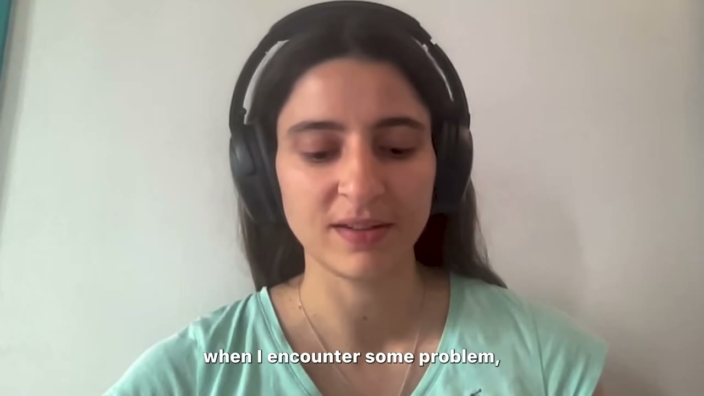
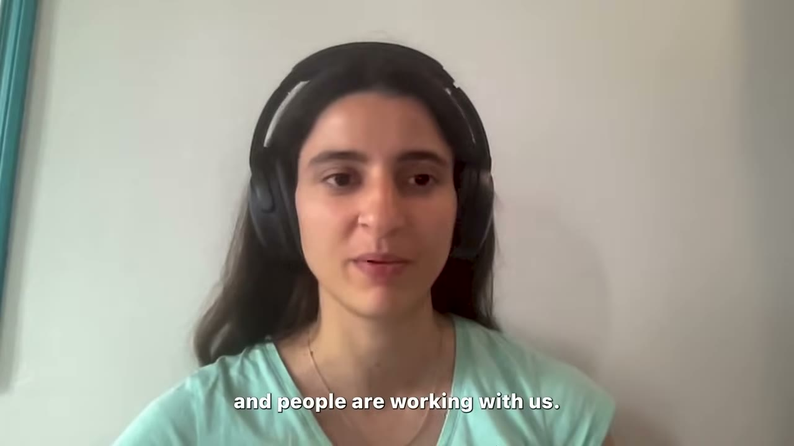

# How I Built It: $10K/Month AI Image Generator

✅ **Đã phân tích sâu** → [`case.md`](case.md)

| | |
|---|---|
| **Video** | <https://www.youtube.com/watch?v=mjCa8IFjM2E> |
| **Đăng** | 15/10/2024 |
| **Thời lượng** | 14:21 |
| **Lượt xem** | 133,801 |
| **Lượt thích** | 4,097 |
| **Video ID** | `mjCa8IFjM2E` |

## Trong thư mục này

| File | Nội dung |
|---|---|
| [`case.md`](case.md) | **Phân tích đầy đủ** — ý tưởng, validate, GTM, áp dụng ở VN |
| [`meta.json`](meta.json) | Metadata gốc (chapters, heatmap, mô tả) |
| [`screenshots/`](screenshots/) | 10 ảnh 720p |

## Mô tả gốc

This is how Pauline built an AI home staging app to $100,000/year.

## Số liệu bắt được từ transcript

> Các đoạn founder nhắc tới con số, kèm timestamp để tua thẳng tới đó trong video.

_(không bắt được con số nào)_

## Chương

- `00:00` Intro
- `01:11` Who is AI Crea
- `02:42` How I come up with ideas
- `03:23` How I validate my ideas
- `04:03` What it looks like to create an MVP
- `05:47` How to find customers
- `06:44` Where to launch
- `07:16` Monetization
- `07:50` Business Models
- `09:00` Tech Stack
- `10:18` Biggest Opportunities
- `10:48` Girl Hacker
- `11:29` Advice
- `12:45` Outro

## Ảnh

1. `01_01m23s_ch-who-is-ai-crea.jpg` — 
2. `02_01m58s_usd-100-000.jpg` — 
3. `03_02m54s_ch-how-i-come-up-with-ideas.jpg` — 
4. `04_03m35s_ch-how-i-validate-my-ideas.jpg` — 
5. `05_04m15s_ch-what-it-looks-like-to-create-an-mvp.jpg` — 
6. `06_05m59s_ch-how-to-find-customers.jpg` — 
7. `07_06m56s_ch-where-to-launch.jpg` — 
8. `08_08m20s_metric.jpg` — 
9. `09_09m12s_ch-tech-stack.jpg` — 
10. `10_09m49s_replay.jpg` — 

---

← [Quay lại index](../../index.md) · [Toàn bộ video](../README.md)
