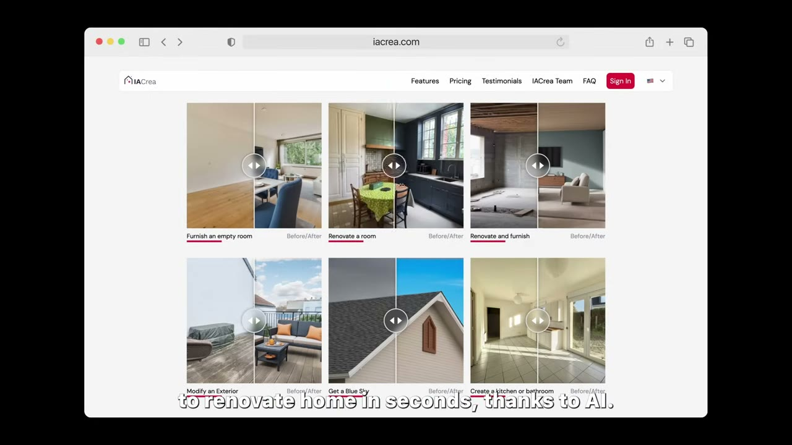
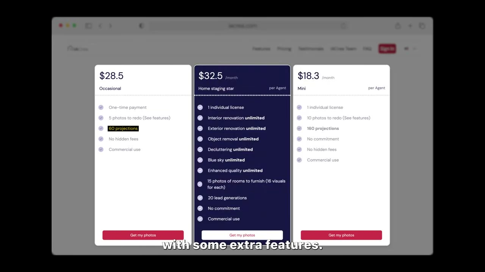
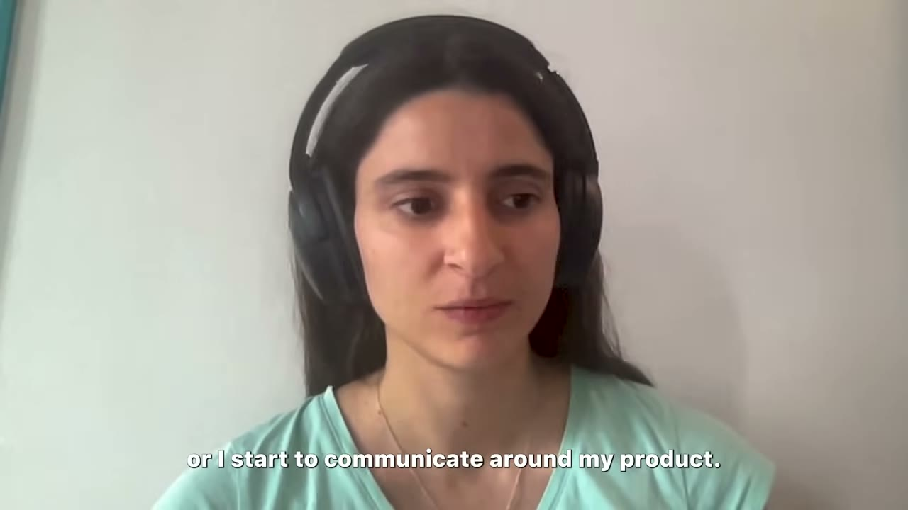
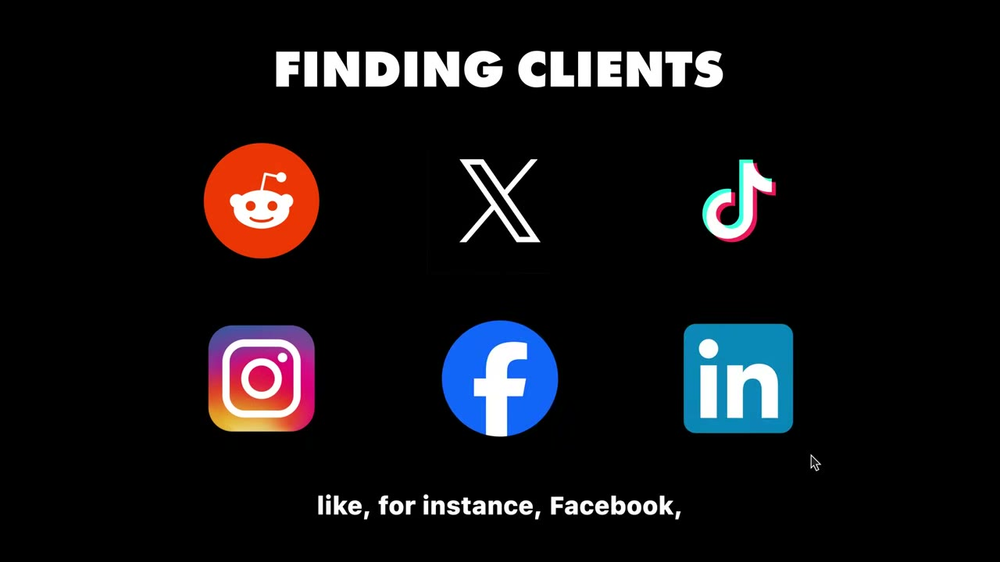
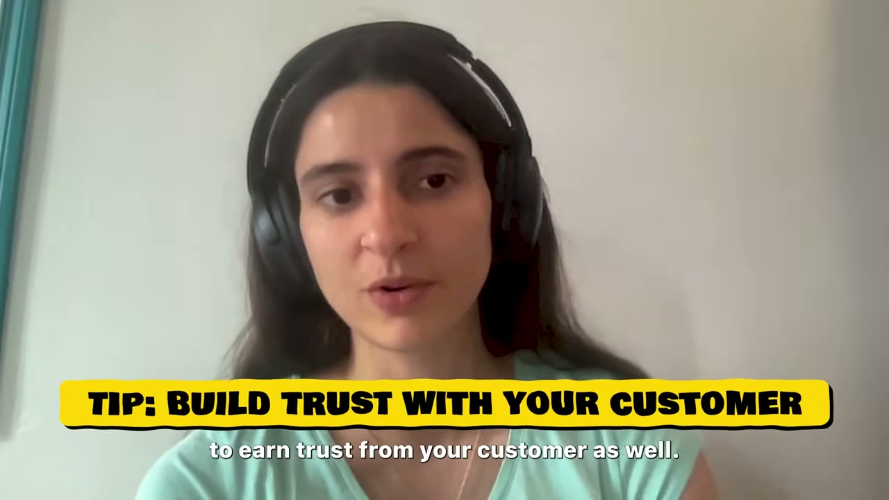
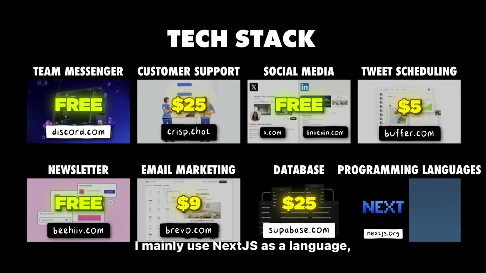

# AI Crea — $8K MRR từ ngành mà founder không biết gì, xây trong đêm và cuối tuần

> **Tóm tắt 30 giây:** Pauline là data scientist ở IBM, **không biết gì về bất động sản**. Cô xây AI Crea — công cụ dùng AI bày nội thất vào ảnh phòng trống (virtual home staging) — trong đêm và cuối tuần, MVP *"tính năng đơn giản, chất lượng tệ"* làm trong **1 tháng**, rồi mất **1 năm** cải thiện. Cô nghỉ IBM tháng 6/2024. Điểm đắt nhất của case không phải con số $8.000 MRR mà là **hai bài học ngược trực giác**: (1) kênh marketing tốt nhất của cô là **group Facebook và sự kiện offline** — không phải Twitter, dù cô có audience lớn trên Twitter, vì *"môi giới bất động sản là nghề của con người"*; (2) đòn **giảm churn mạnh nhất không phải tính năng mà là thêm gói năm** — vì nhu cầu của môi giới là episodic, tháng nào không có nhà bán thì họ huỷ.

## 1. Con số

| Chỉ số | Giá trị |
|---|---|
| MRR | **khoảng $8.000** (founder nói) |
| Người dùng | **hơn 8.000** |
| Tỉ lệ trả tiền (tôi ước tính) | khoảng 3-5% — xem cách tính ở mục 5 |
| Giá one-time | **$28,5** — gói Occasional, 5 ảnh làm lại, 60 projections |
| Giá tháng thấp | **$18,3/agent/tháng** — gói Mini, 10 ảnh, 160 projections |
| Giá tháng cao | **$32,5/agent/tháng** — gói Home staging star, gần như unlimited + 20 lead generations |
| Chi phí vận hành | **3.000-4.000 EUR/tháng** (server, ads, freelancer, sự kiện) |
| Chi phí SaaS tools | **khoảng $64/tháng** |
| Thời gian làm MVP | **1 tháng** (rồi 1 năm cải thiện) |
| Nghỉ việc IBM | tháng 6/2024 |

### Mâu thuẫn số liệu

Ba con số cho cùng một business:

- **Tiêu đề video:** `$10K/Month AI Image Generator`
- **Mô tả video:** *"how Pauline built an AI home staging app to **$100,000/year**"* (tức khoảng $8,3K/tháng)
- **Chính founder nói (hai lần):** *"AI Crea which is at **8,000 MRR** currently"* và *"AI Crea has more than 8,000 users right now, it makes around **8,000 every month**"*

**Tôi lấy $8.000/tháng.** Tiêu đề làm tròn lên $10K, mô tả làm tròn lên $100K/năm. Đây là kiểu thổi phồng nhẹ mà kênh Starter Story làm thường xuyên — luôn đối chiếu tiêu đề với lời founder.

**Lưu ý ASR:** phụ đề tự động đọc sai tên sản phẩm liên tục ("AI career", "AA", "air", "C"). Tên đúng là **AI Crea** — lấy từ chapter title do chính kênh viết và từ logo trong ảnh chụp bảng giá. Sản phẩm thứ hai của cô, ASR đọc là "nexts directory"/"nextory", nhiều khả năng là **nextDirectory** (một boilerplate làm site directory bằng Next.js) — chưa xác nhận chắc chắn, đừng trích tên này.

## 2. Bộ lọc ý tưởng — bốn câu hỏi, hỏi TRƯỚC khi build ⭐⭐⭐

> *"Tôi thường tìm ra ý tưởng khi gặp một vấn đề — của tôi hoặc của bạn bè. Khi là của bạn bè, như trường hợp AI Crea, **tôi hỏi rất nhiều câu hỏi**. Kiểu: bạn có vấn đề này thật à — nhưng **bạn gặp nó thường xuyên đến mức nào?** Rồi tôi tự hỏi: tôi có làm tốt hơn được không? Tôi có xây được cái gì quanh nó không? Tôi có **kiếm tiền** được từ nó và **tìm được khách** không? Đó là câu hỏi thật sự quan trọng. Và nếu câu trả lời là có cho tất cả, tôi mới bắt đầu làm."*

Bốn bộ lọc, theo đúng thứ tự:

| # | Câu hỏi | Nó lọc ra cái gì |
|---|---|---|
| 1 | **Bạn gặp vấn đề này thường xuyên đến mức nào?** | Phân biệt **vấn đề thật** với **sự khó chịu nhất thời**. Vấn đề gặp mỗi tuần thì trả tiền hằng tháng được. Vấn đề gặp mỗi năm thì không. |
| 2 | Tôi có làm tốt hơn được không? | Lợi thế thi công |
| 3 | Tôi có xây được cái gì quanh nó không? | Khả thi kỹ thuật |
| 4 | **Tôi có kiếm tiền và tìm được khách không?** | Kênh phân phối — hỏi TRƯỚC khi viết dòng code đầu tiên |

**Vì sao câu 1 và câu 4 là hai câu giá trị nhất:**

- **Câu 1 (tần suất)** là bộ lọc mà hầu hết indie hacker bỏ qua. Bạn nghe một người than phiền và tưởng đó là thị trường. Hỏi "bao lâu một lần?" biến một câu than thành một con số. Với môi giới bất động sản, việc chụp và đăng ảnh nhà là **việc lặp lại mỗi khi có listing mới** — đó là lý do mô hình subscription có cửa (dù vẫn khó, xem mục 6).
- **Câu 4 (tìm khách)** được hỏi **trước** khi build. Đa số hỏi sau — build xong rồi mới đi tìm khách, và đó là lúc phát hiện mình không biết khách ở đâu.

**Điểm đáng chú ý nhất:** Pauline **không biết gì về bất động sản**. Cô là data scientist. Rào cản của cô không phải kiến thức ngành — mà là **có tiếp cận được 5 môi giới thật hay không**. Cô có, qua mạng lưới cá nhân và tìm online. Đó mới là tài sản khởi đầu thật.

## 3. Validate = MVP xấu + môi giới trả tiền thật ⭐⭐⭐

> *"Với AI Crea, tôi xây một MVP rồi mang cho vài môi giới bất động sản mà tôi tìm được trên mạng hoặc trong mạng lưới cá nhân xem. Họ nói 'cái này tuyệt vời, tôi muốn mua ngay bây giờ' — và **họ trả tiền thật**. Đó là bước xác thực."*

Về MVP:

> *"Theo tôi, **ship càng sớm càng tốt**, vì đôi khi bạn tưởng tượng khách muốn cái này nhưng thứ họ thật sự muốn lại là cái kia. **Rất khó tưởng tượng khách hàng muốn gì nếu bạn không có khách hàng.** Đừng mong mọi thứ hoàn hảo lúc bắt đầu. MVP của AI Crea chỉ là một tính năng đơn giản, chất lượng tệ, làm mất khoảng **một tháng** — rồi sau đó là **một năm** để cải thiện nó."*

### Tỉ lệ 1:12 — con số đáng nhớ nhất của mục này

MVP mất **1 tháng**. Cải thiện tới mức bán được $8K/tháng mất **12 tháng**. Nghĩa là **MVP chỉ chiếm khoảng 8% khối lượng công việc**.

Hệ quả thực tế: nếu bạn đang cân nhắc bỏ 3 tháng để làm MVP "cho tử tế", bạn đang tính sai. 3 tháng MVP nghĩa là 36 tháng tới doanh thu. Cắt MVP xuống 2-4 tuần, kể cả khi nó xấu.

### Mâu thuẫn với các founder khác trong kho — và cách phân định ⭐⭐

Kho này có ba trường phái validate rõ rệt:

| Trường phái | Ai | Cách làm |
|---|---|---|
| **Ship kèm nút mua ngay** | Marc Lou ([case](../2026-04-26_how-i-work-77k-month-solopreneur/case.md)) | Đưa sản phẩm ra, gắn nút thanh toán, để thị trường trả lời |
| **Validate trước khi viết code** | [Once](../2026-05-10_i-built-a-20k-month-app-in-83-days/case.md) | Landing page, phỏng vấn, danh sách chờ — code sau cùng |
| **MVP xấu 1 tháng làm chính công cụ validate** | **Pauline (case này)** | Build cái tệ nhất chạy được, mang cho 5 người có tên, thu tiền |

**Cách hoà giải — phân định bằng chi phí build và bằng loại bằng chứng:**

- Cách của Pauline là **con lai** và có lẽ mạnh nhất cho sản phẩm AI: MVP 1 tháng đủ rẻ để không cần validate trước, nhưng đủ thật để **lấy được tiền thật** — bằng chứng mạnh hơn landing page rất nhiều.
- Ranh giới: **nếu MVP dưới 1 tháng thì build luôn rồi mang đi bán 1:1. Nếu trên 1 tháng thì phải validate trước.** Sản phẩm AI image generation rơi vào vế đầu vì API model đã có sẵn — bạn chỉ ghép.
- Điểm chung của cả ba: **tiêu chí thành công là tiền vào tài khoản, không phải lời khen.** Pauline nhấn mạnh *"và họ đã trả tiền thật"* — không phải *"và họ nói sẽ mua"*.

## 4. Kênh phân phối — bài học đắt nhất của cả video ⭐⭐⭐

> *"Để tìm khách online, bạn phải nghĩ xem **khách của bạn đang ở đâu**. Có nhiều mạng xã hội — Facebook, LinkedIn, Reddit. Đi qua từng cái và gõ vào thanh tìm kiếm như thể bạn đang đi tìm môi giới bất động sản. Gõ vào LinkedIn xem có cộng đồng nào không. Với AI Crea, kênh marketing tốt nhất của tôi có lẽ là **Facebook và sự kiện offline** — có lẽ vì môi giới bất động sản **là một nghề của con người**. Còn với nextDirectory thì kênh chính của tôi là **Twitter**, vì tôi có audience lớn ở đó và audience của tôi chủ yếu là developer hoặc người muốn làm indie hacking — sản phẩm đó hợp với họ."*

### Đây là thí nghiệm đối chứng gần như hoàn hảo

**Cùng một founder. Cùng kỹ năng. Cùng thời điểm. Hai sản phẩm. Hai kênh hoàn toàn khác nhau.**

Điều đó chứng minh một mệnh đề mà rất nhiều indie hacker không tin: **kênh phân phối được quyết định bởi khách hàng, không bởi founder.** Pauline có audience lớn trên Twitter — tài sản đó **vô dụng** với AI Crea, vì môi giới bất động sản không ở Twitter. Cô phải đi tới group Facebook và hội thảo offline, tức là làm việc cô không giỏi và không thích.

**Anti-pattern mà nó giết chết:** indie hacker mặc định chọn Twitter → Product Hunt → Reddit → Hacker News, vì đó là nơi **bản thân họ** sinh sống. Nếu khách của bạn là môi giới, kế toán, chủ tiệm, giáo viên, nha sĩ — họ **không có** ở những nơi đó. Bạn đang câu cá ở hồ không có cá.

**Quy trình 15 phút bạn làm được ngay hôm nay:** mở Facebook, LinkedIn, Zalo, Reddit. Gõ đúng chức danh khách hàng của bạn vào thanh tìm kiếm. Ghi lại: có bao nhiêu group, bao nhiêu thành viên, group nào đang sống. Nếu không tìm thấy gì ở đâu cả — đó là tín hiệu rất xấu về ý tưởng, không phải về kỹ năng tìm kiếm của bạn.

### Về Product Hunt — đánh giá trung thực hiếm thấy

> *"Giờ tôi thích launch trên Product Hunt **để lấy backlink cho SEO**, vì đó là backlink rất tốt. Nhưng **độ hiển thị thì kém hơn trước kia rồi**."*

Dịch sang ngôn ngữ thực dụng: **Product Hunt giờ là một chiến thuật SEO, không phải một kênh acquisition.** Đừng dồn hai tuần chuẩn bị cho một cú launch PH. Launch cho có backlink rồi đi làm việc khác.

## 5. Giá và mô hình — hai trục, không phải một ⭐⭐

Bảng giá thật lấy từ ảnh chụp trong video:

| Gói | Giá | Nội dung |
|---|---|---|
| **Occasional** | **$28,5 một lần** | 5 ảnh làm lại, 60 projections, no hidden fees, commercial use |
| **Mini** | **$18,3/tháng/agent** | 1 license, 10 ảnh làm lại, 160 projections, no commitment |
| **Home staging star** | **$32,5/tháng/agent** | Interior/exterior renovation unlimited, object removal, decluttering, blue sky, enhanced quality — tất cả unlimited; 15 ảnh phòng để bày nội thất (16 visual mỗi ảnh); **20 lead generations** |

**Triết lý định giá của Pauline — nó có hai trục, không phải một:**

> *"Nếu bạn bán giá thấp, bạn mang hình ảnh của một hàng giá rẻ, và **bạn không có cùng loại khách hàng**. Bán giá cao thì có thể ít khách hơn, **nhưng cũng ít việc hỗ trợ hơn**. Nên bạn phải nghĩ cả về việc bạn muốn được nhìn nhận thế nào, và bạn **đủ sức phục vụ bao nhiêu support**."*

Hai trục đó là:
1. **Giá chọn khách hàng** (định vị thương hiệu)
2. **Giá chọn tải trọng support** (chi phí vận hành của chính bạn)

Trục thứ hai gần như không ai nói tới. Với solo founder, **support là nút thắt cổ chai thật sự** — không phải server, không phải code. Bán $5/tháng cho 1.600 khách sẽ giết bạn; bán $32,5 cho 250 khách thì sống được. Cùng doanh thu, khác hẳn cuộc đời.

**Phép tính ngược (đây là ước tính của tôi, video không nói):** $8.000/tháng với ARPU gói tháng $18-32 → khoảng **250-450 khách trả tiền**. Trên nền 8.000 user → tỉ lệ chuyển đổi khoảng **3-5%**. Con số này hợp lý cho một freemium/trial B2B nhỏ. Có gói one-time nên con số thật lệch xuống một chút.

**Vì sao cô giữ cả gói one-time bên cạnh subscription:**

> *"Tôi thích cung cấp cả subscription và one-time payment, vì **có những người thật sự ghét subscription**. Tôi từng đăng ký vài dịch vụ và việc huỷ là ác mộng. Tôi không thích kiểu giữ chân đó. **Nút huỷ của tôi rất rõ ràng** — đăng ký xong là huỷ được, và rất dễ. Tôi nghĩ **giành được lòng tin của khách** là điều rất quan trọng."*

## 6. Ba đòn giảm churn — và cơ chế thật của đòn số 1 ⭐⭐⭐

> *"Năm ngoái churn của tôi rất cao và tôi đã **giảm nó rất mạnh bằng cách thêm gói năm**. Nghe có vẻ ngớ ngẩn, nhưng giờ họ cam kết một năm nên **họ sẽ dùng dịch vụ tốt hơn**. Thứ hai là tôi làm **free trial**, để người ta thử trước khi đăng ký, họ tự thấy dịch vụ có hợp nhu cầu không. Thứ ba là tôi **cải thiện chất lượng** — giờ tốt hơn năm ngoái rất nhiều, nó thật sự trông giống một tấm ảnh."*

### Cơ chế thật của gói năm — quan trọng hơn nhiều so với "khoá tiền lại"

Ai cũng biết gói năm khoá doanh thu. Nhưng câu Pauline nói mới là chìa khoá: **"họ sẽ dùng dịch vụ tốt hơn"**.

Vấn đề gốc của AI Crea là **nhu cầu episodic**. Môi giới cần bày ảnh khi **có listing mới**. Tháng nào không có nhà bán, họ mở hoá đơn $32,5 ra và nghĩ *"tháng này mình có dùng đâu"* → huỷ. Gói tháng biến **mỗi tháng thành một quyết định mua lại**, và mỗi quyết định đó là một cơ hội churn.

Gói năm chuyển quyết định đó từ **12 lần/năm xuống 1 lần/năm**. Đồng thời tạo hiệu ứng tâm lý ngược: *"mình đã trả cả năm rồi, phải dùng cho đáng"* → dùng nhiều hơn → thấy giá trị hơn → gia hạn. Vòng lặp tự củng cố.

> **Quy tắc rút ra, áp dụng rộng:** **subscription theo tháng thất bại khi nhu cầu là episodic.** Nếu sản phẩm của bạn thuộc loại "dùng khi có việc" (công cụ AI tạo ảnh, công cụ làm CV, công cụ soạn hợp đồng, công cụ báo cáo thuế), thì gói tháng sẽ churn nặng bất kể sản phẩm tốt đến đâu. Ba lựa chọn: (a) gói năm, (b) bán credit one-time, (c) tìm cách tạo lý do đăng nhập hằng tuần. Pauline làm cả (a) và (b).

**Chú ý một điểm tưởng là mâu thuẫn:** cô vừa khoe **nút huỷ dễ** vừa dùng **khoá năm**. Hai thứ này không mâu thuẫn — vì gói năm là lựa chọn **khách tự chọn để lấy giá tốt hơn**, không phải cái bẫy. Giữ chân bằng giá trị, không giữ chân bằng ma sát.

## 7. Tech stack và cấu trúc chi phí — công cụ rẻ, GPU đắt ⭐⭐

Video hiện nguyên bảng giá từng công cụ:

| Hạng mục | Công cụ | Giá/tháng |
|---|---|---|
| Team messenger | Discord | **Free** |
| Customer support | Crisp | $25 |
| Social media | X + LinkedIn | **Free** |
| Lên lịch tweet | Buffer | $5 |
| Newsletter | beehiiv | **Free** (cô nói vẫn đang ở bản dùng thử) |
| Email marketing automation | Brevo | $9 |
| Database + auth | Supabase | $25 |
| Ngôn ngữ chính | **Next.js** | — |
| Model AI | **Python** | — |
| **Tổng công cụ** | | **khoảng $64/tháng** |

**Nhưng chi phí vận hành thật là 3.000-4.000 EUR/tháng:**

> *"Tôi nghĩ business của tôi tốn khoảng ba hoặc bốn nghìn EUR mỗi tháng để vận hành. Nhưng nó bao gồm **server**, bao gồm **marketing — thỉnh thoảng tụi tôi chạy ads**, cũng có thể là **chi phí freelancer** và **đi sự kiện**. Tôi có thể cắt bớt chi phí, nhưng lúc này tôi không cố tiết kiệm tối đa — tôi đang cố **đầu tư để tăng trưởng**."*

### Con số quan trọng nhất mà không ai nhắc tới

**$64 công cụ vs 3.000-4.000 EUR vận hành.** Tức là **bill SaaS tools là nhiễu, chiếm dưới 2% chi phí**. Tiền thật đi vào **GPU/server, người, và sự kiện**.

Và đây là điều phải nói thẳng: với doanh thu khoảng **$8.000/tháng** và chi phí **3.000-4.000 EUR/tháng** (tương đương khoảng $3.300-4.400), lợi nhuận còn khoảng **$3.600-4.700/tháng**. **Biên lợi nhuận khoảng 45-55%** — thấp hơn rất nhiều so với SaaS kinh điển 80-90%.

> **Đây là đặc trưng của mọi sản phẩm AI image/video generation: nó không phải SaaS, nó là business tính toán.** Mỗi ảnh sinh ra là tiền GPU thật. Doanh thu tăng thì chi phí tăng gần tuyến tính. So sánh: [ScreenshotOne](../2024-11-22_how-i-built-it-12k-month-micro-saas/case.md) hay [Bank Statement Converter](../2025-07-20_i-make-40k-month-with-this-one-website/case.md) có biên cao hơn hẳn vì chi phí xử lý gần bằng 0. [Neural Frames](../2025-07-30_my-ai-app-makes-100k-month/case.md) là case cùng loại chi phí GPU đáng đọc kèm.

**Hệ quả bắt buộc:** trước khi định giá sản phẩm AI, tính **giá vốn mỗi lần sinh ảnh** và nhân với hạn mức bạn cho trong gói. Gói "unlimited" $32,5 của Pauline chỉ an toàn vì cô biết môi giới thực tế dùng bao nhiêu.

## 8. Cơ hội lớn nhất theo Pauline

> *"Tôi nghĩ **cơ hội lớn nhất có thể là cắm AI vào sản phẩm đã có sẵn**. Bạn nhận email mỗi ngày — nếu có một AI giúp bạn trả lời email thì sao? Đó là một dịch vụ cắm vào một dịch vụ khác. Tôi nghĩ **cơ hội lớn nhất là service**."*

Cơ chế: khi bạn cắm AI vào một quy trình đã tồn tại, bạn **không phải thay đổi hành vi người dùng** — phần khó nhất của mọi sản phẩm mới. AI Crea chính là ví dụ của chính nguyên tắc đó: môi giới **đã** phải chụp ảnh và **đã** phải làm nhà đẹp lên trước khi đăng tin. Cô chỉ thay công đoạn thuê stylist bằng một cú upload.

## 9. Về việc là nữ trong giới indie hacker

> *"Tôi không biết vì sao nhưng con gái không được nhìn thấy, họ không làm indie hacking nhiều. Nên xin đừng tự ngăn mình lại nếu bạn là con gái và nghĩ 'ở đây toàn đàn ông, chỗ này không dành cho mình' — **không, nó dành cho bạn nữa**. Nếu bạn thích code, thích SaaS, hãy làm. Và nếu bạn là con gái thì việc **hiện diện công khai** cũng rất quan trọng, vì bạn sẽ truyền cảm hứng cho người khác làm theo. Đừng giấu mình."*

## 10. Lời khuyên cuối của Pauline

> *"Nếu bạn muốn bắt đầu indie hacking, **đừng chờ sản phẩm hoàn hảo**. Cứ bắt đầu làm gì đó, vì **rất có khả năng sản phẩm đầu tiên của bạn sẽ thất bại** — tôi không biết doanh nhân nào thành công ngay lần đầu. Bạn sẽ học được rất nhiều trên đường đi. Nên hãy ship thật nhanh, launch khi có MVP, xin thật nhiều phản hồi, và **kiên trì**. Cũng nên kết nối với những người đang làm cùng thứ — tụi tôi trao đổi best practice, trao đổi mẹo, trao đổi cả những thứ **không** hiệu quả."*

Và câu đắt nhất:

> *"Bài học lớn nhất của tôi là **đầu tư vào chính mình — bạn là điểm chung của mọi dự án bạn xây**. Và hãy nghĩ về cách bạn tiếp cận khách hàng. Đừng nghĩ kiểu 'ừ mình có thể nhắn tin Reddit, nhắn Discord, DM người ta' — hãy nghĩ **làm sao xây được kết nối thật sự với khách hàng của bạn**."*

## 11. Cảnh báo thiên kiến nguồn

- **Khoảng 2,5 phút trên 14 phút video là quảng cáo Starter Story Academy** — một đoạn chèn giữa (`04:33-05:35`) và một đoạn outro dài (`13:00-14:17`). Cấu trúc video được thiết kế để dẫn tới việc bán khoá học 5 tuần.
- **Tiêu đề thổi $8K lên $10K**, mô tả thổi lên "$100,000/year".
- Video **không hề nói về** churn rate cụ thể, CAC, tỉ lệ chuyển đổi, hay chi phí GPU trên mỗi ảnh — tức là những con số quyết định sống chết của mô hình này. Chỉ có doanh thu gộp và chi phí gộp.
- Kênh chỉ phỏng vấn người đã thành công. Pauline tự nói *"tôi đã có vài năm làm side project mà không thấy thành công gì mấy"* — nhưng video không kể những dự án thất bại đó là gì và tốn bao nhiêu.

## 12. Áp dụng cho tôi (indie hacker VN)

### Sao chép được gì — đây là một trong những case dễ áp dụng nhất cho thị trường VN

1. **Virtual home staging cho bất động sản Việt Nam là ngách còn trống.** Môi giới VN đăng tin trên Batdongsan.com.vn, Chợ Tốt Nhà, Nhà Tốt và **hàng nghìn group Facebook**. Ảnh nhà trống, nhà cũ, nhà chưa hoàn thiện là vấn đề mỗi ngày. Phong cách nội thất Việt (nhà ống, chung cư 2PN, nhà phố) là lợi thế bản địa mà tool quốc tế không có.
2. **Kênh Facebook mạnh hơn ở VN so với ở Pháp.** Group Facebook là **nơi sống thật sự** của môi giới VN — mạnh hơn LinkedIn rất nhiều. Bài học "đi tới nơi khách ở" ở đây gần như miễn phí để thực hiện.
3. **Bộ lọc bốn câu hỏi** dùng được cho mọi ý tưởng, không riêng gì AI. Đặc biệt câu **"bạn gặp vấn đề này bao lâu một lần?"**
4. **MVP 1 tháng rồi mang cho 5 người có tên thật, thu tiền thật.** Không landing page, không khảo sát. Với công cụ AI hiện nay, MVP loại này làm được trong 1-2 tuần.
5. **Ra gói năm ngay từ đầu**, đừng chờ churn cao rồi mới sửa.
6. **Zalo thay cho Crisp.** Ở VN, hỗ trợ qua Zalo OA là lợi thế cạnh tranh thật so với tool nước ngoài.

### Rào cản thật — nói thẳng

- **Biên lợi nhuận mỏng vì GPU.** Đây là rào cản số một. Pauline bán $32,5/tháng mà biên chỉ 45-55%. Ở VN, môi giới khó trả quá **200.000-500.000 VNĐ/tháng** (khoảng $8-20). Với ARPU đó, **chi phí GPU có thể nuốt hết lãi**. Bắt buộc phải: (a) tính giá vốn mỗi ảnh trước khi định giá, (b) đặt hạn mức rõ ràng, không bán unlimited, (c) cân nhắc model rẻ hoặc self-host.
- **Chia sẻ tài khoản.** Pauline bán **per Agent**. Ở VN, một tài khoản sẽ được cả phòng môi giới dùng chung. Bạn gần như không ép được mô hình per-seat. Phải chuyển sang tính theo **credit/ảnh** thay vì theo ghế.
- **Cạnh tranh quốc tế đã đông.** Virtual staging là ngách nhiều tool. Lợi thế duy nhất của bạn là **tiếng Việt + phong cách nội thất Việt + hỗ trợ Zalo + giá VNĐ**. Nếu bạn định đánh thị trường quốc tế bằng tiếng Anh, bạn đang đấu với hàng chục đối thủ đã có SEO.
- **Kênh của case này đòi kỹ năng bán hàng trực tiếp.** Group Facebook và **hội thảo offline** — Pauline đi sự kiện thật. Đây không phải kênh cho người hướng nội chỉ muốn ngồi code. Ở VN chi phí đi hội thảo BĐS rẻ hơn, nhưng vẫn tốn thời gian và cần khả năng nói chuyện với môi giới.
- **Thanh toán.** Bán trong nước thì cần VNPay/MoMo/chuyển khoản và xuất hoá đơn. Bán quốc tế cần Stripe/Paddle qua pháp nhân nước ngoài. Đừng bỏ qua bước này khi lập kế hoạch.

### Khi nào KHÔNG dùng mô hình này

- **Khi bạn không tiếp cận được 5 khách hàng thật để đưa MVP cho họ trả tiền.** Toàn bộ phương pháp của Pauline đứng trên bước đó. Nếu bạn không quen ai trong ngành và không tìm được ai online, đây không phải mô hình của bạn — hãy chọn ngách mà **bạn chính là khách hàng**.
- **Khi nhu cầu quá episodic mà bạn không tạo được lý do giữ subscription.** Nếu khách chỉ dùng 2-3 lần một năm, đừng ép subscription — bán credit one-time và chấp nhận đó là business giao dịch, không phải business recurring.
- **Khi chi phí AI trên mỗi lần dùng vượt quá 30% giá bán.** Lúc đó bạn không có SaaS, bạn có một tiệm gia công chạy bằng GPU. Tính trước, đừng phát hiện sau.

## Nguồn

- Video: <https://www.youtube.com/watch?v=mjCa8IFjM2E> (14:21, đăng 15/10/2024, 133.801 view)
- [Transcript đầy đủ](transcript.md) · [Ảnh chụp](screenshots/)
